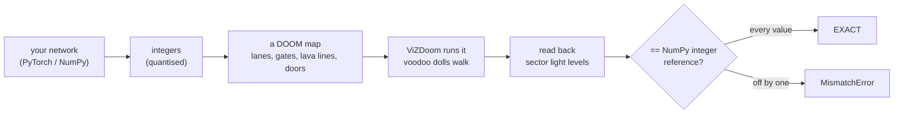

<p align="center">
  
</p>

<p align="center"><b>Neural networks that run on DOOM's game mechanics: voodoo dolls, conveyor belts, lava and doors.</b><br>
<a href="https://mottopanikeiku.github.io/doomformer/">Watch the films</a></p>

<p align="center">
  <a href="https://github.com/mottopanikeiku/doomformer/actions/workflows/tests.yml"></a>
  
  
  
  
</p>

A number is a crowd of voodoo dolls on a conveyor belt. An activation function is a staircase they have to climb. A matrix
multiply is dolls running across lava lines, each line raising a room's light level. Attention is dolls squeezing under
ceilings that another number has lowered. When the dolls stop, the light levels are read back out of the running game
and compared bit for bit with an independent integer reference. One value off by one and the run fails.


<p align="center"><sub>The marine's brain is compiled into the level he is fighting in. The dots on the right are 1,345
voodoo dolls of him. They run his transformer and choose his next move; the level senses the demons and pulls the
trigger. <a href="https://github.com/mottopanikeiku/doomformer/releases/download/v0.1.0/brain_is_the_level_raw.mp4">Watch the film</a>.</sub></p>

## Walk a digit, DOOM reads it


The input is a 28×28 floor in the level. Every tile the marine walks on while holding FIRE inks itself, and the level
writes that pixel into the brain. He presses READ. 1,355 voodoo dolls run an MNIST network, compare all 45 pairs of
digit scores and count the wins. Only the winner's doll gets through, and it lights that digit on the wall. Python
advances the clock, then reads back the 784 pixels, the hidden layer, every comparison and the answer, and checks all
248 values against NumPy.

```sh
doomformer draw               # opens a window: arrow keys to walk, hold Ctrl to draw, Space on the READ switch
doomformer draw --digit 7     # headless: the marine walks a 7 (Python presses his keys in place of a player)
```

```text
          ▄▄▄▄▄▄▄▄▄▄▄▄▄▄
       ▄████████████████
       ████▀▀     ▀████▀
       ▀▀▀        ▄███▀
                  ████
                  ███
                  ███
                  ███
                 ████
                 ███▀
                 ████
                 ▀███

DOOM reads: 7  (right)   -- the winner's doll lit it on the 7-segment display
EXACT: all 248 values DOOM computed (hidden layer, 45 score comparisons and 10 win counts, each with its twin, and the one-hot answer) equal the NumPy integer reference computed from the 784 pixel ports DOOM holds (tolerance 0); one display firing
pixels: the 784 ports equal the level's canvas (the tiles the pen inked)
READ pass: 5,705 game tics = 163 s of real-time DOOM at 35 tics/s, 79 s wall | Python sent 58 commands, 29 readout scripts each followed by the ack script it waits for (0 waited more than one advance), and nothing else (0 rejected)
```

Every digit 0 to 9 in three walked variants: 30 read correctly, all 30 exact. In a window DOOM runs in real time, so a
READ takes 2¾ minutes; headless it takes 76 to 99 s. [How it works](docs/drawpad.md) · [film](https://github.com/mottopanikeiku/doomformer/releases/download/v0.1.0/drawpad.mp4)

## Choose your skill level

```sh
pip install git+https://github.com/mottopanikeiku/doomformer   # Python 3.11+, Linux or macOS
```

The first run builds DOOM's script compiler, so you need `git`, `cmake` and a C compiler.

| Skill | Command | What DOOM does | Time |
|---|---|---|---|
| I'm too young to die | `doomformer hello` | runs a tiny neural network | 3 s |
| Hey, not too rough | `doomformer mnist` | reads handwritten digits | ~2 min |
| Hurt me plenty | `doomformer demo` | invents a DOOM level name | 20 s |
| Ultra-Violence | `doomformer ask "what does iddqd do"` | answers your question | 7-11 min |
| Nightmare! | `doomformer demo --nightmare` | 106 maps, 56,390 voodoo dolls | 2-4 min |

Times are from a 16-core Linux machine running 8 DOOM games at once.

<details>
<summary><b>I'm too young to die</b>: what you'll see</summary>

```text
tiny integer MLP 4-6-5-3 compiled into one DOOM map: 60 voodoo dolls, 1222 sectors
input 1/5  x=[-71, -82, 64, 37] -> y=[11, 4, -15]  EXACT (3 outputs + 22 hidden readouts equal the integer reference; 488 game tics)
...
5/5 EXACT
```
</details>

<details>
<summary><b>Hey, not too rough</b>: DOOM reads handwritten digits</summary>


784 pixels → 64 → 45 comparisons → 10 win counts → the answer, all in one DOOM map: 1,355 voodoo dolls and 158,550
sectors. Each ink pixel releases a doll that runs across the hidden layer's weight lines. Dolls then compare every pair
of digit scores, and only the digit that wins all nine of its comparisons gets a doll through. DOOM picks the digit and
Python checks it. In DOOM the network read 99 of the first 100 MNIST test digits correctly and 966 of 1,000 sampled
from all 10,000, every one of them exact. On all 10,000 the same integer network gets 97.16 %.

```text
$ doomformer mnist --digits 2 --seed 1

          ███
          ████                      ▄▄▄█████████▄▄
           ████                     ▀█████▀▀▀▀▀████
            ████                             ▄▄███▀
             ███▄                       ▄▄▄███████▄▄
             ████                       ████▀▀▀▀▀▀█████
              ████                                  ▀███
               ████                      ▄▄         ▄██▀
               ▀████                     █████▄▄██████▀
                ▀██                        ▀▀▀▀▀▀▀▀▀▀

DOOM reads: 1  right            DOOM reads: 3  right
test #46                        test #51

2/2 read correctly | 2/2 EXACT: every value DOOM computed (248 per digit: hidden layer, comparisons, win counts and
the one-hot answer) equals the NumPy integer reference (tolerance 0); Python only compared | 5,696 game tics per digit | 88 s
```

To read your own digit from a photo or drawing: `doomformer mnist --image my7.png`.

</details>

<details>
<summary><b>Hurt me plenty</b>: a transformer names a level</summary>

A transformer trained on 136 official DOOM level names, split into 38 small maps that a pool of DOOM games runs. Python
copies the integers between games and picks each letter from the logits DOOM computed.

```text
DOOM wrote: 'GHEER'   (NOT in its training corpus: the model made it up)
  174 tile runs in 8 parallel DOOM games | 10,462 voodoo dolls in the tile maps |
  6,902 values read back and compared with the NumPy integer reference (tolerance 0) | 15 s
EXACT: every value DOOM exposed equals the integer reference, and the reference writes the same name
```

`--seed 3`, `--seed 4` and so on give other names. `--one-map` puts a whole transformer into a single map (embedding,
attention, MLP and logits with no Python between layers), at about 90 s per letter.

`--softmax` runs the same model trained with softmax attention. The dolls compute the exponentials (a staircase whose
steps are spaced like a logarithm) and divide by their sum at run time (a count of comparisons). How that works is in
[docs/HOW_IT_WORKS.md](docs/HOW_IT_WORKS.md#softmax-attention).

```text
DOOM wrote: 'FINAL INEALL'   (NOT in its training corpus: the model made it up)
  494 tile runs in 8 parallel DOOM games | 4,886 voodoo dolls in the tile maps |
  106,834 values read back and compared with the NumPy integer reference (tolerance 0) | 59 s
EXACT: every value DOOM exposed equals the integer reference, and the reference writes the same name
```
</details>

<details>
<summary><b>Ultra-Violence</b>: ask DOOM a question</summary>

A 2-layer transformer trained on 189 facts about DOOM. Voodoo dolls across a few thousand DOOM game instances compute
every value, and every value is checked. The first letter takes a few minutes and the rest arrive about every 20
seconds. Some answers, all exact in DOOM:

| You ask | DOOM answers |
|---|---|
| what does iddqd do | **GOD MODE** |
| what is love | **INVULNERABILITY** |
| what is a voodoo doll | **BERSERK** |
| can it run doom | **SIXTY SECONDS** |

It knows its cheat codes. Ask it anything else and you get confident DOOM nonsense.
</details>

<details>
<summary><b>Nightmare!</b>: the big brain</summary>

The 2-layer, 24,279-parameter transformer trained on 11,341 real DOOM level names, compiled into 106 maps with 56,390
voodoo dolls and 785,460 sectors. With these settings it writes DEMON CANYON, which is not among its 12,934 training
names:

```text
106 tile maps (56,390 voodoo dolls, 785,460 sectors) built in 6 s; running them in 8 DOOM game processes ...
DOOM wrote: 'DEMON CANYON'
  1,690 tile runs in 8 parallel DOOM games | 56,390 voodoo dolls in the tile maps |
  120,666 values read back and compared with the NumPy integer reference (tolerance 0) | 135 s
EXACT: every value DOOM exposed equals the integer reference, and the reference writes the same name
```

Close the doors in front of one neuron (`L1.m` unit 33) and the same brain writes DEMON DEATH.
</details>

## How it works

| | |
|---|---|
|  |  |
| A matrix multiply. Each doll is one unit of an activation, and each lava line it crosses adds a weight to a room's light level. | Attention. Dolls squeeze under ceiling gates that another live value has lowered; counting who gets through is a multiply. |
|  |  |
| Ablation is a door. Shoot the switch, the door slams, and one neuron's dolls never arrive. | DEMON CANYON, a level built from the name the DOOM brain wrote, played by a marine whose brain also runs on DOOM. |



DOOM turns every extra player-1 start into a voodoo doll: a copy of the player that rides conveyors and triggers every
line it crosses. An activation of 5 is five dolls. A staircase lets a doll past each step only if the value clears that
step's height, which gives ReLU, rounding and clamping in one shape. Sums accumulate in sector light levels, which turn
out to be saturating int16 values.

Getting exact results meant measuring the engine. Two floor moves on one sector in the same tic: one is silently lost.
A teleport line cancels lines crossed earlier in the same tic. Maps wider than about 34,000 units put things in the
wrong room. The full list is in [docs/HOW_IT_WORKS.md](docs/HOW_IT_WORKS.md) and
[docs/engine_limits.md](docs/engine_limits.md).

## Hall of fame

The bigger experiments, all exact. Their code is in [`demos/`](demos), with training in [`training/`](training) and
every trained model in [`models/`](models). Numbers and caveats for each are in [docs/DEMOS.md](docs/DEMOS.md) and
[docs/FLY.md](docs/FLY.md).

| | |
|---|---|
|  | **A transformer named a DOOM level.** DEMON CANYON, written across 1,594 DOOM tile instances. [film](https://github.com/mottopanikeiku/doomformer/releases/download/v0.1.0/trilogy.mp4) |
|  | **DOOM plays DOOM.** A marine whose policy runs on 55 DOOM games walks the level DOOM named, which he has never seen: doors, two kills, exit. 102 decisions, all exact. [film](https://github.com/mottopanikeiku/doomformer/releases/download/v0.1.0/doom_beats_doom.mp4) |
|  | **DOOM learns.** Weights are ceiling heights, and learning is voodoo dolls raising and lowering them. A blank brain taught by an aimbot inside one game scores 4 kills in its first life, then 24, 26, 22 and 24. 931/931 decisions exact. [film](https://github.com/mottopanikeiku/doomformer/releases/download/v0.1.0/one_game.mp4) |
|  | **A fruit fly.** A 255-neuron circuit from the FlyWire connectome steers the marine from inside one map: eat, refuse, groom, escape. 169/169 steps exact. [film](https://github.com/mottopanikeiku/doomformer/releases/download/v0.1.0/fly_alive.mp4) · [code](demos/flyloop.py) |
|  | **A whole transformer in one map.** Embedding, attention, MLP and logits with no Python between layers: 3,548 dolls write SHIL. [film](https://github.com/mottopanikeiku/doomformer/releases/download/v0.1.0/onemap_shil_raw.mp4) |

- **His brain is the level.** A level script senses the nearest demon, 1,345 voodoo dolls of the marine run his
  transformer and pick the action, and the level pulls the trigger. Python advances the clock and reads. 50/50
  decisions exact. [film](https://github.com/mottopanikeiku/doomformer/releases/download/v0.1.0/brain_is_the_level_raw.mp4) · [code](demos/brainlevel.py)
- **Lobotomy.** One 7-pellet shotgun blast to his DOOM brain turns him into a pacifist with 0 kills. This lesion was
  picked from a scan of 3,000 random blasts. [film](https://github.com/mottopanikeiku/doomformer/releases/download/v0.1.0/lobotomy.mp4)
- **The big one.** A 4-layer transformer writes UNHOLY STRONGHOLD over 10,166 DOOM tile instances and 1.9 million game
  tics. [film](https://github.com/mottopanikeiku/doomformer/releases/download/v0.1.0/full_brain.mp4)
- [The showreel](https://github.com/mottopanikeiku/doomformer/releases/download/v0.1.0/showreel.mp4).

## Build your own

Compile your own network into a DOOM map and let its outputs open doors, flash lights or shove the marine.

```python
import doomformer as df

net = df.MLP.from_torch(my_torch_mlp, calib_x, levels=8)   # or df.MLP(...) by hand, or df.MLP.from_numpy(...)
print(net.quantization_report(test_x))                     # how close the integer model is to your float model
with df.compile(net, actions={"y0": [df.act.door_open(tag=7)]}, world=my_room) as brain:
    y = brain(net.encode(x))                               # computed by voodoo dolls, verified exactly
    brain.record([net.encode(x)], "dolls.gif")             # film the dolls doing it
```

Spiking networks (`df.SpikingNet`), transformers (`df.Transformer.load("doomnames")`), conv nets (`from_torch` lowers
Conv1d/2d exactly) and learners that update their weights inside the map (`df.Perceptron`) work the same way.
`df.with_argmax` lets the dolls pick the winning output. `df.Agent` puts the senses and the muscles in the level as well.
Models too big for one map spread over a pool of DOOM games with `mode="tiles"`, and `doomformer plan` tells you which
one you need.

The guide is [docs/BUILD_YOUR_OWN.md](docs/BUILD_YOUR_OWN.md), and there are twelve small runnable
[examples](examples). Made something cursed? [Show and tell](https://github.com/mottopanikeiku/doomformer/issues/new/choose).

## More DOOM

One map is one game, and one game uses one core. `df.run_many` gives each input to the next idle game, checks every
pass, and returns the outputs in order. The games run on your machine or on any Ray cluster you start yourself.

1,000 MNIST test digits in 14 DOOM games on one 16-core machine took 2 hours: 966 read correctly, 1,000 exact, and
5,696,000 game tics, which is 45 hours of real-time DOOM. Every digit's result is in
[`models/mnist/doom_1000.json`](models/mnist/doom_1000.json).

```python
ys = df.run_many(net, xs, workers=8)                  # 8 DOOM games on this machine
ys = df.run_many(net, xs, backend="ray")              # every CPU of your Ray cluster
```

```sh
pip install "doomformer[ray]"
ray start --head                                      # then `ray start --address=HEAD:6379` on the other machines
doomformer mnist --all --ray --record mnist.json      # all 10,000 MNIST test digits, every result in one file
```

Budget one core and 1.25 GB of RAM per game for the MNIST map. Details in [docs/scaling.md](docs/scaling.md#scaling-out-many-games-many-machines).

## What's in the box

| | |
|---|---|
| [`doomformer/`](doomformer) | the toolkit: map compiler, DOOM runtime, exact checks, CLI |
| [`demos/`](demos) | the research code: his brain is the level, the walker and level generator, the fly circuit, the learning arena, the cameras |
| [`training/`](training) | quantisation-aware training for every model, and the level-name and DOOM-fact corpora with their sources |
| [`models/`](models) | every trained model with its training log and evaluation |
| [`examples/`](examples) | twelve one-file examples, most under 15 s |
| [`tests/`](tests) | 172 tests, 81 of them on real headless DOOM, including tamper controls that must fail |
| [`docs/`](docs) | how it works, every demo with its numbers, the engine facts, the toolkit guide |

## Cheat codes (FAQ)

<details>
<summary><code>IDCLIP</code> Is this really DOOM?</summary>

It is [ViZDoom](https://github.com/Farama-Foundation/ViZDoom) 1.3.2, a ZDoom-based engine, with Freedoom's free
assets, running headless. The maps use ZDoom's UDMF format and ACS level scripts. ACS moves the input gates, resets the
dolls and copies results out. In the closed-loop levels it also senses (the nearest demon, the canvas tiles the marine
walked on) and carries out the action the dolls chose. Every multiply-add and activation is dolls crossing lines, and in
DRAWPAD, `mnist` and *his brain is the level* so is the final choice.
</details>

<details>
<summary><code>IDKFA</code> What does Python do, then?</summary>

It compiles the maps, writes the inputs, waits, reads the results and checks them. In DRAWPAD and *his brain is the
level* the level writes its own inputs. For models split over many maps, Python copies integers between games, and for
text it picks each letter from the logits DOOM computed. Attention is ReLU-style integer attention, or softmax
attention computed by the dolls with `demo --softmax`. There is no LayerNorm. Training happens offline in PyTorch,
except for the learners that update their own weights inside the map.
</details>

<details>
<summary><code>IDDQD</code> How do you know DOOM computed it and not Python?</summary>

Every value is read back from the running game and compared with a NumPy integer reference that never sees the map, with
tolerance 0. The tests also try to break it. They raise one weight line in a compiled map from 5 to 6, and the check
fails by exactly +1 on exactly the inputs whose dolls cross that line. They make a readout echo a value Python wrote,
build maps without the barriers the engine needs, and let a settle check trust ViZDoom's 4,096-object list. Each of these
has to be caught.
</details>

<details>
<summary><code>IDSPISPOPD</code> Is it fast?</summary>

No. One small MLP pass takes 726 ms in DOOM and 11 µs in NumPy, about 70,000× slower. Reading one handwritten digit
takes 5,705 game tics: 76 to 99 s headless, 2¾ minutes of real-time DOOM. The demons are frozen while the marine
thinks. Speed was never the goal.
</details>

<details>
<summary><code>IDBEHOLD</code> Does the marine actually learn to play?</summary>

He imitates a scripted aimbot that sees exact demon positions, binned into 86 possible observations. That is supervised
imitation. There is no reward-driven RL and no learning from pixels. What matters here is where the network runs.
</details>

<details>
<summary><code>IDDT</code> Why?</summary>

People have run DOOM on calculators, pregnancy tests and lawnmowers. This goes the other way: DOOM is the computer.
</details>

## Licensing

Code and docs: [MIT](LICENSE). The shipped level-name lists (Doom Wiki, CC BY-SA 4.0; id Software's source, GPL-2.0)
and the 100 sample MNIST digits (CC BY-SA 3.0) keep their licences; see [THIRD_PARTY.md](THIRD_PARTY.md). Freedoom
graphics are BSD-licensed. DOOM is a trademark of id Software / ZeniMax, and this project is not affiliated with them.
