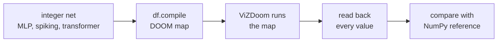

# Build your own DOOM-computed network

This guide shows how to build your own network that runs inside DOOM.
You write an integer net in Python, and DOOM computes it.



DOOM does the arithmetic: sums, staircase activations, attention products and spike thresholds.
Python builds the map, writes the inputs, reads the results and compares them.
You can also add rooms, doors, lights and scripts that the network drives.

> [!NOTE]
> "Bit-exact" means DOOM's integers equal the integer model's integers.
> Quantising a float model is an approximation. See [interop.md](interop.md).

Contents: [Concepts](#concepts) · [Install](#install-and-first-run) · [API](#the-api) ·
[Hooks](#hooks-world-and-actions) · [Limits](#limits-and-measured-sizes) ·
[Who does what](#what-python-does-vs-what-doom-does) · [Recipes](#recipes) · [Troubleshooting](#troubleshooting)

## Concepts

A network becomes floors, lines and walking dolls.

**Voodoo dolls are units.** A DOOM map may hold several player-1 starts.
The game spawns the last one as the player.
The others become inert copies, called voodoo dolls.
A doll walks like the player and fires every line special it crosses.
The compiler gives each lane one doll and its own corridor.

**Staircases are activations.** A value is written as the floor height of a gate sector.
A lane with threshold θ passes iff `value >= θ`.
A staircase of K lanes counts the thresholds the value clears.

```
adc_relu(z, thr)   = #{k : z >= thr[k]}
adc_signed(z, thr) = adc_relu(z, thr) - adc_relu(-z, thr)      # doomformer/intref.py
```

Different thresholds give ReLU, clamping, rounding, scaling or a step.

**Crossbars are lines.** A doll that passes crosses one line per output unit.
Each line adds its weight to that output.
The target is a light level (a saturating int16) or the next layer's gate.
Summed over all dolls, this gives `b + W @ a`.
Each output keeps a negated twin, so one gate kind tests both directions.

<p align="center"></p>

**Ports and readout.** Ports are the gate sectors that Python writes inputs into.
ACS scripts copy outputs and checked hidden values into `USER1..USER60`.
Python reads those variables.
In one map, a clock doll releases each layer in order, with no Python in between.

**One map vs tiles.** By default `df.compile` builds one map (`doomformer/pure.py`).
The whole net must then fit in it.
Tile mode (`doomformer/tile.py`) builds one small map per operation.
Python copies the integers between games. See [scaling.md](scaling.md).

## Install and first run

```sh
pip install git+https://github.com/mottopanikeiku/doomformer      # needs git, cmake and a C compiler on first use
doomformer doctor                                                  # python / vizdoom / Freedoom check; builds ACC
doomformer hello                                                   # a tiny MLP, 5 random inputs, EXACT per input
doomformer demo                                                    # a trained transformer writes a level name
```

`hello` prints `EXACT` per input and exits nonzero on any mismatch.
The first compile builds the ACS compiler ([ACC](https://github.com/rheit/acc), pinned commit).
It goes into `~/.cache/doomformer/`.
Demo modes and timings are in [DEMOS.md](DEMOS.md).

Shipped models load by name: `df.Transformer.load("doomnames_onemap")`.
Each of the [examples](../examples/README.md) is one runnable file.

## The API

The toolkit has four net types and one compile call.

### `df.MLP`: an integer MLP

```python
import numpy as np, doomformer as df

net = df.MLP(
    weights=[np.array([[1, 1], [1, 1]]), np.array([[1, -1]])],   # (out, in) int arrays, any depth >= 1
    biases=[np.array([0, -1]), np.array([0])],
    thresholds=[np.array([1]), np.array([1])],                   # positive nondecreasing ints, one staircase per layer
    signed_input=False,
)
```

DOOM must reproduce this exact contract.

```
a_0     = adc_signed(x, thr_0)   if signed_input else adc_relu(x, thr_0)
h_{l+1} = b_l + W_l @ a_l
a_l     = adc_relu(h_l, thr_l)   for l >= 1
output  = h_last                 (raw sums, no activation)
```

| call | does |
|---|---|
| `net.reference(x)` | `dict(y=..., hidden=[...])` in NumPy integers, the independent reference |
| `net.check(x)` | raises `df.RangeError` for an input outside the [limits](#limits-and-measured-sizes). Every input it accepts gives DOOM = reference at every `opt` |
| `df.MLP(...)` | rejects weights above ±255 and thresholds outside 1..12,000 |
| `df.compile(net)` | raises `RangeError` if any input could break a plane bound (`net.plane_errors()` lists it). `limits=False` skips this |
| `net.save(path)`, `df.MLP.load(path)` | `.npz` file |

Nets from `from_numpy` and `from_torch` keep `|b| + sum |W| K` at most 12,000 by construction.

### Quantising a float model

```python
net = df.MLP.from_torch(torch_sequential, calib_x, levels=8)        # Linear, Conv1d/2d, BatchNorm, Avg/MaxPool, ReLU, GELU, Tanh, ...
net = df.MLP.from_torch(torch_sequential, calib_x, levels=4, calibrate="mse")   # better at low K
qmodel = df.qat.fit(torch_sequential, loader, levels=4)             # optional quantisation-aware fine-tuning
net = df.MLP.from_numpy([(W1, b1), (W2, b2)], calib_x, levels=8)    # float weights, ReLU between layers
x_int = net.encode(x_float);  y_float = net.decode(net.reference(x_int)["y"])
print(net.quantization_report(x_float))                             # integer model vs float model
```

The integer MLP approximates the float model.
DOOM then reproduces the integer model exactly.
Details are in [interop.md](interop.md). Example: `examples/02_pytorch_to_doom.py`.

`df.with_argmax(net)` adds three layers that pick the top output inside DOOM.
Ties go to the first maximum, as in np.argmax.
The outputs become one-hot, so `actions` on `y{i}` fire for the winner only.
Large score layers are scaled down first (`net.score_scale`).
Check the accuracy with the reference afterwards. See [drawpad.md](drawpad.md).

### `df.compile`: build, load, run

```python
with df.compile(net) as brain:         # wad=None: a content-addressed file in ~/.cache/doomformer/brains
    y = brain(np.array([1, 0]))        # one pass in DOOM; y and every exposed hidden value checked against net.reference
print(brain.info)                      # kind, wad, dolls, sectors, runs, tics, checked
```

| call | does |
|---|---|
| `brain(x)` | takes integers, one input or a batch `(B, n_in)`. Raises `df.MismatchError` (`.mismatches` lists `(name, DOOM, reference)`) or `df.RangeError` before running |
| `brain.run(x, check=False)` | raw readback dict `y{o}`, `h{l}_{j}`, `-h{l}_{j}` |
| `brain.close()` | stops the game. The game starts lazily on the first pass |
| `brain.runner` | the live `TileRunner`. `brain.runner.game` is the `vizdoom.DoomGame` |
| `brain.run_script(n, *args, read=k)` | runs a world ACS script and returns `USER1..USER{k}` |
| `df.compile(..., resolution=, configure=fn, wad="my.wad")` | ViZDoom resolution, a `fn(game)` setup hook, a fixed map path |
| `df.plan(net)` | `dict(dolls, sectors, fits, span)` without building. `["map"]["world_area"]` is where your world may go |

Run `df.plan` first when your net is big.
`fits` is false if the map would exceed 32,000 units on either axis.

### `df.SpikingNet`: integer leaky integrate-and-fire neurons

```python
net = df.SpikingNet(names, inputs, W, U, theta=10, leak=0)     # = doomformer.spiking.IntNet
with df.compile(net) as brain:
    v, s = brain.step(x_spikes)        # one time step in DOOM; v and s verified against IntNet.step
```

```
s_t     = [v_t >= theta]
v_{t+1} = v_t - theta*s_t - leak*[v_t >= leak] + leak*[v_t <= -leak] + W @ s_t + U @ x_t
```

Potentials stay in the map between steps, so `brain.step` is stateful.
`net.run(X)` gives the reference trajectory.
`|v|` must stay within ±12,000.
`brain.step` checks the plane bound at each step and raises `RangeError`.

### `df.Transformer`: the one-map transformer

```python
t = df.Transformer.load("doomnames_onemap")                    # a shipped model name, or a QModel directory path
with df.compile(t) as brain:
    toks = [0] + [t.vocab.index(c) for c in "SH"]              # token 0 is the BOS/EOS marker
    logits = brain.logits(toks)                                # verified: every exposed pre-activation and the logits
    name = brain.generate("SH", temperature=0, seed=0, max_new=1)
```

`generate` verifies every step like `intref.generate`.
Python samples the next token.
With `doomformer demo --one-map --loop`, the map picks the next letter itself.
See [Generation without Python](HOW_IT_WORKS.md#generation-without-python).

| config key | effect | train with | trained example |
|---|---|---|---|
| `"attn": "softmax"`, `"R"` | dolls compute the exponentials and divide by their sum | `--attn softmax --R N` | `doomnames_softmax` (tiles), `doomnames_onemap_softmax` |
| `"norm": "rms"`, `"Rn"` | integer RMSNorm before q/k/v and the MLP. A learned gain folds into the next weights | `--norm rms --Rn N` | `doomnames_modern` (tiles) |
| `"mlp": "reglu"` | gated MLP, arrays `Wg, bg, thr_g, Wu, bu, thr_u` replace `Wup, bup, thr_m` | `--mlp reglu` | `doomnames_modern` (tiles) |

Defaults are `"attn": "relu"`, `"norm": "none"` and `"mlp": "relu"`.
All variants run in one map and in tiles.
`training/train_qat.py` and `training/train_brain.py` take the flags.
For reglu, pick `dm` so that `3·d·dm + 2·dm` is close to `2·d·dm + dm`.
The arithmetic: [softmax](HOW_IT_WORKS.md#softmax-attention), [RMSNorm](HOW_IT_WORKS.md#rmsnorm).

## Hooks: world and actions

Hooks add your own rooms and game events to the brain's map.
Pass them as `df.compile(net, world=..., actions=...)`.

<p align="center"></p>

### `world(m) -> str`

`world` gets the brain's `doomformer.udmf.MapBuilder` after layout.
It returns extra ACS source, or `""` for none.

| call | does |
|---|---|
| `m.rect(x0, y0, x1, y1, floor=0, ceil=128, light=160, tag=0, ftex=, ctex=, wall=, facing=)` | adds a rectangular sector and returns its index. Shared edges become two-sided lines, free edges walls |
| `m.link(a, b, special=..., arg0=..., playercross=True, repeatspecial=True)` | puts a special on every line between rects `a` and `b`. `playeruse=True` makes a switch |
| `m.thing(x, y, type, angle=0, id=tid)` | places a thing by doomednum: `1` player start, `2006` BFG9000, `3004` zombieman |

Rules for the world:

* Place a player start with `m.thing(x, y, 1)`. It must come after the dolls, and `df.compile` checks it exists.
* Build inside `df.plan(net)["map"]["world_area"]`. `df.compile` raises `ValueError` on overlap or excess span.
* The map must stay within 32,000 units per axis. See [engine_limits.md](engine_limits.md).
* Free numbers: sector tags 3..999, thing TIDs 1..9999, scripts >= 200. The `df.act` helpers enforce them.
* Your ACS may report through the globals `o1..o60`. Run such scripts between passes, since readout uses them too.
* `facing` on a rect sets the texture its neighbours see.
* Textures are Freedoom's, such as `FLOOR4_8`, `STARTAN3`, `DOOR1` and `COMPBLUE`.

> [!IMPORTANT]
> The world persists across passes. Script 3 resets only the brain.
> Doors, lights, things and the player stay as they are.
> A pass ends once every `DoomPlayer` stands still for 8 tics, so a sliding player delays it.

### `actions = {output_name: [special, ...]}`

Actions fire game events while the network computes.
Each special is `dict(special=<ZDoom number>, arg0=..., ..., arg4=...)`.
Every doll that adds a positive weight to that output crosses them.

* They fire once per passing lane. Weight +2 from staircase value 3 fires 3 times.
* They ignore the final value, and negative weights never fire.
* Make actions idempotent, or count on purpose.
* MLP keys are `y{o}`, `h{l}_{j}` and `-h{l}_{j}`. Spiking nets use neuron names.
* Transformer keys are value names such as `logits:t:j`.

| helper | ZDoom special | effect |
|---|---|---|
| `df.act.thrust_player(angle, force, tid, nolimit=False)` | `ThrustThing` (72) | kicks the thing with that TID. `angle` in degrees, 0 east. ZDoom caps speed at 30 unless `nolimit` |
| `df.act.door_open(tag, speed=16)` | `Door_Open` (11) | opens the tagged door and leaves it open |
| `df.act.light(tag, value)` | `Light_ChangeToValue` (112) | sets the tagged sectors' light |
| `df.act.script(n, *args)` | `ACS_ExecuteAlways` (226) | starts world script `n` with up to three arguments |

The activator is always a doll, so pass explicit tags and TIDs.
A special with a nonzero TID acts on that thing.
Give the player a TID in an ENTER script. Dolls never run those.

```
script 200 ENTER { Thing_ChangeTID(0, 900); }
```

Then tick once with `brain.runner.game.advance_action(3)` before the first pass.

## Limits and measured sizes

These are hard limits.
`net.check`, `RangeError` and `intref.check_limits` enforce them.

| quantity | limit | why |
|---|---|---|
| any value that feeds a gate | \|z\| <= 12,000 | gate heights are 16.16 fixed point |
| thresholds | positive, nondecreasing, <= 12,000 | they are heights |
| partial sums of an accumulation | \|sum\| <= 30,000 | saturating int16 light, dolls cross in any order |
| partial sums of a plane, one map | `bias + raises <= 14,018`, `bias - lowers >= -14,018` | [the plane-move bound](verification.md#the-plane-move-bound) |
| plane start height, one map | `-15,000 <= start <= 16,000` | the reset move stops at the sector's ceiling or pit |
| weights | \|w\| <= 255 | `W_MAX` |
| map extent, world included | 32,000 x 32,000 units | [engine_limits.md](engine_limits.md) |

> [!WARNING]
> Each staircase lane of each unit is one doll, so `levels` multiplies the map size.
> Plan first, and try fewer levels before shrinking layers.

These sizes come from random two-layer nets with thresholds `4, 8, ..., 4K`.
Every pass was exact. Setup and cost model: [scaling.md](scaling.md#cost-model).

| net (in, hidden, out), K | dolls | sectors | build | time per pass | game tics per pass | peak RAM |
|---|---|---|---|---|---|---|
| (2, 2, 1), K=1 | 8 | 104 | 0.01 s | 0.01 s | 200 | |
| (4, 8, 3), K=4 | 66 | 1,355 | 0.05 s | 0.07 s | 424 | |
| (16, 16, 10), K=4 | 194 | 6,806 | 0.25 s | 0.76 s | 960 | |
| (16, 32, 10), K=8 | 514 | 23,866 | 0.93 s | 7.5 s | 2,264 | |
| (32, 64, 10), K=8 | 1,026 | 77,678 | 3.2 s | 40.7 s | 4,360 | |
| (64, 128, 10), K=8 | 2,050 | 275,418 | 11.8 s | 209.5 s | 8,544 | 2.0 GB |
| `doomnames_onemap` transformer | 3,548 | 95,448 | about 4 s | 85-96 s | 3,488 | |

Maps with more than 4,095 dolls also hit ViZDoom's [object limit](engine_limits.md#object-list-vizdoom-lists-at-most-4096-objects).

## What Python does vs what DOOM does

This table splits every step between Python and DOOM.

<details><summary><b>Who does what, step by step</b></summary>


| step | who |
|---|---|
| build the map, compile ACS, write the WAD | Python (`pure.compile_pure`, ACC) |
| write the input values into the port sectors | Python (`puke` commands to ACS scripts), once per pass |
| staircase activations, sums of weights, products in attention, spike/leak/reset | **DOOM** (dolls, lines, light levels, plane heights) |
| softmax attention (`attn="softmax"`): the exponentials and the division by their sum | **DOOM** (a log-spaced staircase, then a count of comparisons) |
| RMSNorm (`norm="rms"`): the sum of squares, the integer RMS and the division by it | **DOOM** (odd-weight lanes, a fixed staircase, a count of comparisons) |
| gated MLP (`mlp="reglu"`): the product gate × up | **DOOM** (the gate's dolls climb the up value's multiplier corridor) |
| chaining layers, waiting between them | **DOOM** (clock doll, barriers), no Python in between |
| world actions (doors, lights, thrusts) | **DOOM**, as part of the same pass |
| read outputs and hidden values back | Python (`puke` readout scripts into `USER` variables) |
| the integer reference | Python/NumPy (independent implementation of the semantics) |
| comparison, `MismatchError` | Python |
| sampling the next token (softmax over the logits, the random draw) | Python (seeded, same code as the reference) |
| quantising a float model | Python, before DOOM sees anything |

</details>

## Recipes

Short paths to common projects, each with an example file.

| goal | how | example |
|---|---|---|
| run a quantised PyTorch MLP | `df.MLP.from_torch(model, calib_x)`, `df.compile`, `brain(net.encode(x))` | `02_pytorch_to_doom.py` |
| open a door, switch a light | `world` builds the room, `actions` attach `df.act.door_open` or `df.act.light` | `03_brain_opens_doors.py` |
| move the player | give him a TID, one `thrust_player` per direction, recentre with a script between passes | `06_shove_the_marine.py` |
| light show from a spiking net | neuron names as `actions` keys, `df.act.light` per panel | `04_spiking_disco.py` |
| hand-write a function | parity of `s` ones is `[s>=1] - [s>=2] + [s>=3]` | `01_xor.py` |
| walk around the circuit | `df.play(brain)` or `doomformer play x.wad`. Needs a display. The brain stays idle | |
| draw the map from above | `df.record.topdown(wad)` returns a PIL image | |
| plan before building | `df.plan(net)` or `doomformer plan model_dir_or_mlp.npz` | |

## Troubleshooting

Common errors and their fixes.

* **ACC not found or its build fails.** `doomformer doctor` builds a missing ACC and tests it.
  It looks in `$DOOMFORMER_ACC`, then `third_party/acc/build/acc`, then `~/.cache/doomformer/acc/<rev>/build/acc`.
  The build needs `git`, `cmake`, a C compiler and github.com. Linux does not need `glibc-static`.
  On Fedora: `sudo dnf install git cmake gcc gcc-c++ make`. Offline, set `DOOMFORMER_ACC`.
* **`MismatchError`.** Run `net.check(x)` first. If it passes, the mismatch is a bug. Save the map with
  `df.compile(net, wad="bug.wad")` and open an issue with the input and error text.
* **Slow or out of memory.** Check `df.plan(net)`. Millions of sectors need many GB and minutes to load.
* **`df.play` needs a display.** It needs `$DISPLAY` or `$WAYLAND_DISPLAY`. Headless, everything else works, and
  `brain.runner.game.get_state().screen_buffer` gives screenshots.
* **`RuntimeError: acc failed`.** Your world's ACS did not compile. The message is ACC's output. In an f-string,
  double the braces.
* **`ValueError: world rect ... overlaps`, span or player start.** See [the world hook](#hooks-world-and-actions).
* **The player sits somewhere unexpected.** The last `thing(type=1)` is the player.

## Going further

Where to read next.

| want to | read | example |
|---|---|---|
| an agent that senses, decides and acts entirely in the map (`df.Agent`, `df.sense`) | [`agents.md`](agents.md) | `07_autonomous_turret.py`, `08_your_own_agent.py` |
| a GIF/MP4 of the dolls computing (`brain.record`) | [`recording.md`](recording.md) | `09_record_a_gif.py` |
| models too big for one map (`df.compile(..., mode="tiles")`) | [`scaling.md`](scaling.md) | `10_big_model_tiles.py` |
| many inputs through one map in many DOOM games, here or on a Ray cluster (`df.run_many`) | [`scaling.md`](scaling.md#scaling-out-many-games-many-machines) | |
| conv layers, other activations, `df.staircase` | [`interop.md`](interop.md) | `11_conv_in_doom.py` |
| learning inside DOOM (`df.Perceptron`) | [`learning.md`](learning.md) | `12_doom_learns_live.py` |
| the engine's hard limits (map extent, object count) | [`engine_limits.md`](engine_limits.md) | |

## Share your project

Open a [Show and tell issue](https://github.com/mottopanikeiku/doomformer/issues/new/choose).
Include your repository, a screenshot and the `doomformer doctor` output.
Pull requests with new examples are welcome.
