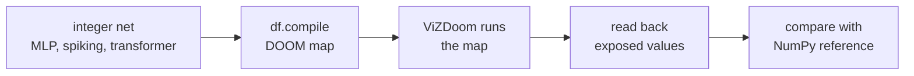

# Build your own DOOM-computed network

You write an integer network in Python, compile it into a DOOM map and then call it like a model, while the dolls
compute the arithmetic and Python reads back the exposed values and compares them with NumPy.



You can add rooms, doors, lights and scripts driven by network outputs. DOOM reproduces the integer model exactly, so
the only approximation is [quantising a float model](interop.md) before compilation.

## Concepts

The compiler turns the network into conveyor lanes, gates and weight lines.

Voodoo dolls: the last player-1 start spawns the player and the others become copies called voodoo dolls, and each lane
gets one doll, which rides a conveyor and triggers the line specials it crosses.

Staircase activations: a gate stores a value as its floor height, and a lane with threshold θ passes when
`value >= θ`, so K lanes count the thresholds the value clears.

```
adc_relu(z, thr)   = #{k : z >= thr[k]}
adc_signed(z, thr) = adc_relu(z, thr) - adc_relu(-z, thr)      # doomformer/intref.py
```

Different thresholds give ReLU, clamping, rounding, scaling or a step.

Crossbars: each passing doll crosses one line per output unit, which adds its weight to a light level (a saturating
int16) or moves the next layer's gate. Together the lines compute `b + W @ a`, and negated twins let the gates test both
directions.

<p align="center"></p>

Ports and readout: Python writes inputs into gate sectors called ports, and ACS scripts copy outputs and exposed hidden
values into `USER1..USER60` for Python to read. In one-map mode, a clock doll releases each layer in order.

One map or tiles: `df.compile` uses one map when the network fits, while tile mode builds a small map per operation and
Python copies integers between games ([scaling.md](scaling.md)).

## Install and first run

```sh
pip install git+https://github.com/mottopanikeiku/doomformer      # needs git, cmake and a C compiler on first use
doomformer doctor                                                  # python / vizdoom / Freedoom check; builds ACC
doomformer hello                                                   # a tiny MLP, 5 random inputs, EXACT per input
doomformer demo                                                    # a trained transformer writes a level name
```

`hello` prints `EXACT` per input and exits nonzero on a mismatch, and the first compile builds
[ACC](https://github.com/rheit/acc) in `~/.cache/doomformer/`. [DEMOS.md](DEMOS.md) lists demo modes and timings,
shipped models load by name, such as `df.Transformer.load("doomnames_onemap")`, and the
[examples](../examples/README.md) are runnable files.

## The API

`df.compile` takes an MLP, spiking net or transformer, and online learning has its own class,
[`df.Perceptron`](learning.md).

### `df.MLP`: an integer MLP

```python
import numpy as np, doomformer as df

net = df.MLP(
    weights=[np.array([[1, 1], [1, 1]]), np.array([[1, -1]])],   # (out, in) int arrays, any depth >= 1
    biases=[np.array([0, -1]), np.array([0])],
    thresholds=[np.array([1]), np.array([1])],                   # positive nondecreasing ints, one staircase per layer
    signed_input=False,
)
```

The MLP computes:

```
a_0     = adc_signed(x, thr_0)   if signed_input else adc_relu(x, thr_0)
h_{l+1} = b_l + W_l @ a_l
a_l     = adc_relu(h_l, thr_l)   for l >= 1
output  = h_last                 (raw sums, no activation)
```

| call | does |
|---|---|
| `net.reference(x)` | `dict(y=..., hidden=[...])` in NumPy integers, the independent reference |
| `net.check(x)` | checks the input, accumulation and plane bounds; raises `df.RangeError` outside the [limits](#limits-and-measured-sizes) |
| `df.MLP(...)` | rejects weights above ±255 and thresholds outside 1..12,000 |
| `df.compile(net)` | raises `RangeError` if any input could break a plane bound (`net.plane_errors()` lists it). `limits=False` skips this |
| `net.save(path)`, `df.MLP.load(path)` | `.npz` file |

Nets from `from_numpy` and `from_torch` keep `|b| + sum |W| K` at most 12,000 by construction.

### Quantising a float model

```python
net = df.MLP.from_torch(torch_sequential, calib_x, levels=8)        # Linear, Conv1d/2d, BatchNorm, Avg/MaxPool, ReLU, GELU, Tanh, ...
net = df.MLP.from_torch(torch_sequential, calib_x, levels=4, calibrate="mse")   # better at low K
qmodel = df.qat.fit(torch_sequential, loader, levels=4)             # optional quantisation-aware fine-tuning
net = df.MLP.from_numpy([(W1, b1), (W2, b2)], calib_x, levels=8)    # float weights, ReLU between layers
x_int = net.encode(x_float);  y_float = net.decode(net.reference(x_int)["y"])
print(net.quantization_report(x_float))                             # integer model vs float model
```

[interop.md](interop.md) covers conversion and quantisation-aware training, and
[`02_pytorch_to_doom.py`](../examples/02_pytorch_to_doom.py) is the place to start.

`df.with_argmax(net)` adds three layers that select the top output inside DOOM, giving ties to the first maximum as
`np.argmax` does. The outputs become one-hot, so `actions` on `y{i}` fire only for the winner. Large score layers are
scaled down first (`net.score_scale`), which is why the reference accuracy is worth checking after conversion
([drawpad.md](drawpad.md)).

### `df.compile`: build, load, run

```python
with df.compile(net) as brain:         # wad=None: a content-addressed file in ~/.cache/doomformer/brains
    y = brain(np.array([1, 0]))        # one pass in DOOM; y and every exposed hidden value checked against net.reference
print(brain.info)                      # kind, wad, dolls, sectors, runs, tics, checked
```

| call | does |
|---|---|
| `brain(x)` | takes integers, one input or a batch `(B, n_in)`. Raises `df.MismatchError` (`.mismatches` lists `(name, DOOM, reference)`) or `df.RangeError` before running |
| `brain.run(x, check=False)` | raw readback dict `y{o}`, `h{l}_{j}`, `-h{l}_{j}` |
| `brain.close()` | stops the game. The game starts lazily on the first pass |
| `brain.runner` | the live `TileRunner`. `brain.runner.game` is the `vizdoom.DoomGame` |
| `brain.run_script(n, *args, read=k)` | runs a world ACS script and returns `USER1..USER{k}` |
| `df.compile(..., resolution=, configure=fn, wad="my.wad")` | ViZDoom resolution, a `fn(game)` setup hook, a fixed map path |
| `df.plan(net)` | `dict(dolls, sectors, fits, span)` without building. `["map"]["world_area"]` is where your world may go |

Use `df.plan` before compiling a large net, since `fits` is false if the map would exceed 32,000 units on either axis.

### `df.SpikingNet`: integer leaky integrate-and-fire neurons

```python
net = df.SpikingNet(names, inputs, W, U, theta=10, leak=0)     # = doomformer.spiking.IntNet
with df.compile(net) as brain:
    v, s = brain.step(x_spikes)        # one time step in DOOM; v and s verified against IntNet.step
```

```
s_t     = [v_t >= theta]
v_{t+1} = v_t - theta*s_t - leak*[v_t >= leak] + leak*[v_t <= -leak] + W @ s_t + U @ x_t
```

Potentials stay in the map between steps, so `brain.step` is stateful, and `net.run(X)` gives the reference trajectory.
Potentials must stay in `[-12,000, 12,000]`, and each step checks the plane bound and raises `RangeError` if it is
exceeded.

### `df.Transformer`: the one-map transformer

```python
t = df.Transformer.load("doomnames_onemap")                    # a shipped model name, or a QModel directory path
with df.compile(t) as brain:
    toks = [0] + [t.vocab.index(c) for c in "SH"]              # token 0 is the BOS/EOS marker
    logits = brain.logits(toks)                                # verified: every exposed pre-activation and the logits
    name = brain.generate("SH", temperature=0, seed=0, max_new=1)
```

`generate` checks every pass against the reference and samples the next token in Python, while
[`doomformer demo --one-map --loop`](HOW_IT_WORKS.md#generation-without-python) selects tokens inside the map.

| config key | effect | train with | trained example |
|---|---|---|---|
| `"attn": "softmax"`, `"R"` | dolls compute the exponentials and divide by their sum | `--attn softmax --R N` | `doomnames_softmax` (tiles), `doomnames_onemap_softmax` |
| `"norm": "rms"`, `"Rn"` | integer RMSNorm before q/k/v and the MLP. A learned gain folds into the next weights | `--norm rms --Rn N` | `doomnames_modern` (tiles) |
| `"mlp": "reglu"` | gated MLP, arrays `Wg, bg, thr_g, Wu, bu, thr_u` replace `Wup, bup, thr_m` | `--mlp reglu` | `doomnames_modern` (tiles) |

The defaults are `"attn": "relu"`, `"norm": "none"` and `"mlp": "relu"`, and every variant supports one-map and tile
modes. `training/train_qat.py` and `training/train_brain.py` accept the training flags, and for a comparable parameter
count the reglu `dm` should make `3·d·dm + 2·dm` close to the ReLU model's `2·d·dm + dm`. The arithmetic is explained
under [softmax](HOW_IT_WORKS.md#softmax-attention) and [RMSNorm](HOW_IT_WORKS.md#rmsnorm).

## Hooks: world and actions

Add rooms and game events with `df.compile(net, world=..., actions=...)`.

<p align="center"></p>

### `world(m) -> str`

`world` receives the brain's `doomformer.udmf.MapBuilder` after layout and returns extra ACS source, or `""`.

| call | does |
|---|---|
| `m.rect(x0, y0, x1, y1, floor=0, ceil=128, light=160, tag=0, ftex=, ctex=, wall=, facing=)` | adds a rectangular sector and returns its index. Shared edges become two-sided lines, free edges walls |
| `m.link(a, b, special=..., arg0=..., playercross=True, repeatspecial=True)` | puts a special on every line between rects `a` and `b`. `playeruse=True` makes a switch |
| `m.thing(x, y, type, angle=0, id=tid)` | places a thing by doomednum: `1` player start, `2006` BFG9000, `3004` zombieman |

Rules for the world:

* Place a player start with `m.thing(x, y, 1)` after the dolls, which `df.compile` checks.
* Build inside `df.plan(net)["map"]["world_area"]`, because `df.compile` raises `ValueError` on overlap or excess span.
* The map must stay within 32,000 units per axis ([engine_limits.md](engine_limits.md)).
* Free numbers are sector tags 3..999, thing TIDs 1..9999 and scripts >= 200, which the `df.act` helpers enforce.
* Your ACS may report through the globals `o1..o60` if such scripts run between passes, since readout uses them too.
* `facing` on a rect sets the texture its neighbours see.
* Textures are Freedoom's, such as `FLOOR4_8`, `STARTAN3`, `DOOR1` and `COMPBLUE`.

The world persists across passes because script 3 resets only the brain, so doors, lights, things and the player keep
their state. A pass ends once every `DoomPlayer` stands still for 8 tics, which means a sliding player delays it.

### `actions = {output_name: [special, ...]}`

An action is a ZDoom special, `dict(special=<number>, arg0=..., ..., arg4=...)`. Every doll that contributes a positive
weight to the named output crosses the action lines.

* They fire once per passing lane, so weight +2 from staircase value 3 fires 3 times.
* They ignore the final value, and negative weights never fire.
* Make actions idempotent, or count on purpose.
* MLP keys are `y{o}`, `h{l}_{j}` and `-h{l}_{j}`, while spiking nets use neuron names.
* Transformer keys are value names such as `logits:t:j`.

| helper | ZDoom special | effect |
|---|---|---|
| `df.act.thrust_player(angle, force, tid, nolimit=False)` | `ThrustThing` (72) | kicks the thing with that TID. `angle` in degrees, 0 east. ZDoom caps speed at 30 unless `nolimit` |
| `df.act.door_open(tag, speed=16)` | `Door_Open` (11) | opens the tagged door and leaves it open |
| `df.act.light(tag, value)` | `Light_ChangeToValue` (112) | sets the tagged sectors' light |
| `df.act.script(n, *args)` | `ACS_ExecuteAlways` (226) | starts world script `n` with up to three arguments |

The activator is a doll, so pass explicit tags and TIDs to target the world and give the player a TID in an ENTER
script, which dolls never run:

```
script 200 ENTER { Thing_ChangeTID(0, 900); }
```

Then tick once with `brain.runner.game.advance_action(3)` before the first pass.

## Limits and measured sizes

`net.check`, compilation and `intref.check_limits` enforce these limits:

| quantity | limit | why |
|---|---|---|
| any value that feeds a gate | \|z\| <= 12,000 | gate heights are 16.16 fixed point |
| thresholds | positive, nondecreasing, <= 12,000 | they are heights |
| partial sums of an accumulation | \|sum\| <= 30,000 | saturating int16 light, dolls cross in any order |
| partial sums of a plane, one map | `bias + raises <= 14,018`, `bias - lowers >= -14,018` | [the plane-move bound](verification.md#the-plane-move-bound) |
| plane start height, one map | `-15,000 <= start <= 16,000` | the reset move stops at the sector's ceiling or pit |
| weights | \|w\| <= 255 | `W_MAX` |
| map extent, world included | 32,000 x 32,000 units | [engine_limits.md](engine_limits.md) |

Each staircase lane needs a doll, so `levels` multiplies the map size, and it is worth planning first and trying fewer
levels before shrinking layers.

These sizes come from random two-layer nets with thresholds `4, 8, ..., 4K`, every pass was exact, and
[scaling.md](scaling.md#cost-model) describes the setup and the cost model.

| net (in, hidden, out), K | dolls | sectors | build | time per pass | game tics per pass | peak RAM |
|---|---|---|---|---|---|---|
| (2, 2, 1), K=1 | 8 | 104 | 0.01 s | 0.01 s | 200 | |
| (4, 8, 3), K=4 | 66 | 1,355 | 0.05 s | 0.07 s | 424 | |
| (16, 16, 10), K=4 | 194 | 6,806 | 0.25 s | 0.76 s | 960 | |
| (16, 32, 10), K=8 | 514 | 23,866 | 0.93 s | 7.5 s | 2,264 | |
| (32, 64, 10), K=8 | 1,026 | 77,678 | 3.2 s | 40.7 s | 4,360 | |
| (64, 128, 10), K=8 | 2,050 | 275,418 | 11.8 s | 209.5 s | 8,544 | 2.0 GB |
| `doomnames_onemap` transformer | 3,548 | 95,448 | about 4 s | 85-96 s | 3,488 | |

With 4,095 dolls or more, the runtime uses an in-map motion check to work around ViZDoom's
[4,096-object readout limit](engine_limits.md#object-list-vizdoom-lists-at-most-4096-objects).

## What Python does vs what DOOM does

DOOM computes sums, staircase activations, attention products, RMSNorm and spike updates, clock dolls and barriers
chain one-map layers, and line specials trigger world actions. Python builds the WAD, writes each input, reads the
result and runs the integer comparison, and it also quantises float models and samples generated tokens.

Tile mode adds Python copies between layers, and the [per-demo table](HOW_IT_WORKS.md#who-does-what-per-demo) covers
closed-loop maps and the ACS copy bus.

## Recipes

| goal | how | example |
|---|---|---|
| run a quantised PyTorch MLP | `df.MLP.from_torch(model, calib_x)`, `df.compile`, `brain(net.encode(x))` | `02_pytorch_to_doom.py` |
| open a door, switch a light | `world` builds the room, `actions` attach `df.act.door_open` or `df.act.light` | `03_brain_opens_doors.py` |
| move the player | give him a TID, one `thrust_player` per direction, recentre with a script between passes | `06_shove_the_marine.py` |
| light show from a spiking net | neuron names as `actions` keys, `df.act.light` per panel | `04_spiking_disco.py` |
| hand-write a function | parity of `s` ones is `[s>=1] - [s>=2] + [s>=3]` | `01_xor.py` |
| walk around the circuit | `df.play(brain)` or `doomformer play x.wad`. Needs a display. The brain stays idle | |
| draw the map from above | `df.record.topdown(wad)` returns a PIL image | |
| plan before building | `df.plan(net)` or `doomformer plan model_dir_or_mlp.npz` | |

## Troubleshooting

* ACC not found or its build fails: `doomformer doctor` builds a missing ACC and tests it, looking in
  `$DOOMFORMER_ACC`, then `third_party/acc/build/acc`, then `~/.cache/doomformer/acc/<rev>/build/acc`. The build needs
  `git`, `cmake`, a C compiler and github.com but not `glibc-static`, so on Fedora
  `sudo dnf install git cmake gcc gcc-c++ make` is enough, and offline you can set `DOOMFORMER_ACC`.
* `MismatchError`: run `net.check(x)` first, and if it passes, the mismatch is a bug, so save the map with
  `df.compile(net, wad="bug.wad")` and open an issue with the input and error text.
* Slow or out of memory: check `df.plan(net)`, because millions of sectors need many GB and minutes to load.
* `df.play` needs a display (`$DISPLAY` or `$WAYLAND_DISPLAY`), although everything else works headless and
  `brain.runner.game.get_state().screen_buffer` gives screenshots.
* `RuntimeError: acc failed`: your world's ACS did not compile, and the message is ACC's output (in an f-string,
  double the braces).
* `ValueError: world rect ... overlaps`, span or player start: see [the world hook](#hooks-world-and-actions).
* The player sits somewhere unexpected: the last `thing(type=1)` is the player.

## Going further

| want to | read | example |
|---|---|---|
| an agent that senses, decides and acts entirely in the map (`df.Agent`, `df.sense`) | [`agents.md`](agents.md) | `07_autonomous_turret.py`, `08_your_own_agent.py` |
| a GIF/MP4 of the dolls computing (`brain.record`) | [`recording.md`](recording.md) | `09_record_a_gif.py` |
| models too big for one map (`df.compile(..., mode="tiles")`) | [`scaling.md`](scaling.md) | `10_big_model_tiles.py` |
| many inputs through one map in many DOOM games, here or on a Ray cluster (`df.run_many`) | [`scaling.md`](scaling.md#scaling-out-many-games-many-machines) | |
| conv layers, other activations, `df.staircase` | [`interop.md`](interop.md) | `11_conv_in_doom.py` |
| learning inside DOOM (`df.Perceptron`) | [`learning.md`](learning.md) | `12_doom_learns_live.py` |
| the engine's hard limits (map extent, object count) | [`engine_limits.md`](engine_limits.md) | |
