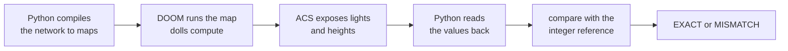
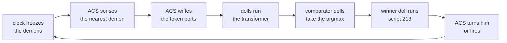

# Demos and results

This page lists every demo, what DOOM computes in it and what was measured. Each result names its log or command.

The code is in [`demos/`](../demos), [`training/`](../training) and [`models/`](../models). The films are on the
[v0.1.0 release](https://github.com/mottopanikeiku/doomformer/releases/tag/v0.1.0).

> [!TIP]
> Commands, run times and sample output are in [`demos/README.md`](../demos/README.md). Start with
> `python -m demos.brainlevel`.

## What DOOM computes and what Python does

DOOM runs the forward pass of an integer network on ViZDoom game mechanics. Voodoo dolls, gates and linedef specials
do the matrix products and staircase activations. Python compiles the maps and handles everything around them.



> [!NOTE]
> A value is exact when the number read back from the game equals the integer reference. There is no tolerance. A
> check covers the inputs of one run. Each negative control is a variant that must fail the same comparison.

The values are sector light and floor and ceiling heights. ACS exposes them as game variables.

> [!IMPORTANT]
> What the demos do not do:
> - The engine is ViZDoom 1.3.2's ZDoom with Freedoom2 assets, not vanilla DOOM.
> - It is slow, see [Speed](HOW_IT_WORKS.md#speed).
> - No model has LayerNorm. None is a drop-in float transformer.
> - The marine policies imitate scripted experts that read privileged scene features.
> - No demo is reward-driven RL or learns from pixels.
> - Demo seeds are picked. See [Seeds and selection](#seeds-and-selection).

More scope:

- Attention is integer. Every demo below uses ReLU-style attention. `doomnames_softmax`, `doomnames_onemap_softmax` and
  `doomnames_modern` compute softmax attention in the dolls. `doomnames_modern` adds an integer RMSNorm and a gated MLP.
- Transformer weights are trained offline in PyTorch with quantisation-aware training.
- The perceptron demos update their weights inside DOOM. The fly circuits use scaled connectome weights.

| Demo | DOOM computes | Python does | Games | The exact check compares |
|---|---|---|---|---|
| **Name generator** (`doomformer/orchestrator.py`, `doombrain`, `doomnames`) | every tile: embedding, q/k/v, q·k, weighted sums, output projection, MLP, unembedding, staircases | compiles tile maps (106 for `doombrain`, 38 for `doomnames`), moves tile outputs, samples letters, closes ablation doors | pool of games, reused and evicted | every exposed tile output and its negation vs `intref.forward`, and the generated string |
| **Marine policy** (`doomformer/policy.py`, `doomplayer`, `doomplayer_xl`) | a 3-token pass over (start, bearing, distance) to action logits | bins exact object positions into tokens, takes the argmax, holds buttons 4 tics. Episode statistics use the NumPy reference | pool of games (12 workers) | tile tensors, negations, logits and action vs `intref` (3 contexts in the check, every decision of a film) |
| **Walker** (`demos/walker.py`, `doomwalker`) | a 1-layer d=8 pass over 5 tokens to action logits | builds the level, computes tokens (waypoint, enemy bearing and distance, flags), maps logits to buttons | pool of games (55 games, 16 maps) | every exposed tile output, negations and logits vs `intref`, every decision (102/102, 120/120 lobotomised) |
| **One-game learner** (`demos/arena.py`, `demos/aimlearn.py`) | scores from 38 ceiling-height weights, the action, the perceptron update, the arena | bins the view into 19 binary features, supplies aimbot labels, freezes and wakes demons, counts lives | one game | both scores, the action and all 38 weights vs a NumPy perceptron, every decision |
| **His brain is the level** (`demos/brainlevel.py`, `doomformer/brainacs.py`) | the policy transformer, the argmax, the clock, sensing from actor positions, turning and firing | builds the map, advances tics, runs readout scripts, recomputes `policy.observe`, checks | one game | sensed tokens, all 540 exposed values and the received action, every decision (50/50) |
| **Learn to aim** (`demos/aimlearn.py`, `doomformer/learn.py`) | the same in-map perceptron | features, labels, copies the action into the arena | two games: arena and learner | both scores, the action and all 38 weights vs a NumPy twin, every decision |
| **Pure MLP** (`doomformer/pure.py`) | both layers of a 12→16→6 MLP in one map, a clock doll starts layer 2 | writes x and −x, reads results | one game | the 6 outputs, the 16 gate-floor heights layer 2 reads and the 16 hidden lights, every case |
| **Spiking network** (`doomformer/spiking.py`) | threshold, reset, leak, synapses. Potentials are floor heights | writes input spikes, converts the readback | one game | every spike and next potential, every step |
| **Fly marine** (`demos/fly.py`) | the spiking step of a 200-neuron FlyWire circuit while input arrives or spikes follow | builds the corridor, walks him, draws taste spikes, decides eat or refuse, fast-forwards silent decay into the map | one game | active and afterglow steps (219 of 1,578 in seed 1). The reference computes the 1,359 rest steps |
| **The fly is alive** (`demos/flyloop.py`) | the whole loop: clock, sensing, an in-map Park–Miller PRNG, the 255-neuron circuit, thrust and quake lines that move him | builds the map, calibrates the step on a twin game, advances tics, sends readout scripts | one game | every spike and potential every step (169/169), the PRNG state, and that action lines fired exactly when output neurons spiked |
| **Fly, day scenario** (`demos/fly.py`, `models/fly/brain.json`) | the spiking step of the 255-neuron circuit | as above, plus dust and looming spike trains, groom or takeoff from aDN1 and Giant Fiber counts | one game | active and afterglow steps (253 in seed 1) |

Thresholded activations, doll counts and partial sums of the name generator are not compared. Walker and policy episode statistics use the NumPy reference.

## The trilogy

<p align="center"></p>

**Trailer: [`trilogy.mp4`](https://github.com/mottopanikeiku/doomformer/releases/download/v0.1.0/trilogy.mp4)** (48 s),
*DOOM Dreams of DOOM*.

<p align="center"></p>

The name generator writes DEMON CANYON. A Python generator builds a level from the name. A marine
whose policy runs in 55 DOOM games plays it.

From decision 50 on, 3 neurons (`x0` units 1, 2, 5) are closed as doors in every consuming tile. He then veers and turns
right for the rest of the film. All 120 decisions are exact against the equally lesioned reference.

| lesion, seed 118 replay of 170 decisions | outcome |
|---|---|
| `x0 [1, 2, 5]` | never reaches the exit, route progress 0.54 |
| `x0 [1]` | reaches the end of the route, never presses USE, dies at decision 147 |

Both lesions come from a scan of every single neuron and 300 random blasts on all 5,848 walker observations
(`walker.all_contexts`).

## HIS BRAIN IS THE LEVEL

<p align="center"></p>

**[`brain_is_the_level_raw.mp4`](https://github.com/mottopanikeiku/doomformer/releases/download/v0.1.0/brain_is_the_level_raw.mp4)**
(53 s, thinking time-lapsed). The marine of [ONE DOOM GAME](#the-other-demos) has a transformer brain compiled into the
map he fights in. The dolls that compute it are voodoo dolls of himself. Command: `python -m demos.brainlevel`.

| | Stage A: host senses and acts | Stage B: the level senses and acts |
|---|---|---|
| sensing | Python `policy.observe` writes the token ports | ACS bins the nearest demon's bearing (17 bins) and distance (5 bins) |
| transformer | dolls, whole forward pass, one map | dolls, whole forward pass, one map |
| action | Python argmax, buttons held 4 tics | dolls take the argmax, ACS turns him or fires his pistol |
| seed 4, first 50 decisions | 50/50 exact, 5 kills | **50/50 exact, 5 kills** (5 shots, 26 → 21 bullets) |
| clock | 3,672 tics, 31.8 s per decision | 4,160-tic budget (dolls settle in 3,824), 4,205 tics per cycle, 35.3 s per decision |

One stage-B decision is one turn of the level's clock.



**The dolls choose the action.** For each pair a < b, the unembedding also writes d_ab = logit_a − logit_b + 1 into a
gate floor. These use weights Wun_a − Wun_b, so no logit is re-read or re-quantised. A gate passes a doll iff d_ab ≥ 1.
The dolls count wins, and a gate at 2 opens for exactly one action: the largest logit, lower index on ties, as
`np.argmax`.

| comparator bound | value |
|---|---|
| `doomplayer_onemap` Wun | [−78, 82] |
| pairwise differences | [−71, 139] ≤ 255 |
| worst port bound | 1,101 ≤ 12,000 |

The winner's doll crosses `ACS_ExecuteAlways(213, 0, action)`. Script 213 only stores the number. The clock reads no
logit and no sector. It waits out the 4,160-tic budget, then acts (`build_onemap(..., choose=...)` in
`doomformer/onemap.py`).

| map | value |
|---|---|
| dolls | 1,345 (1,337 transformer, 6 comparator, 2 clock) |
| sectors | 37,410 (37,109 without the comparator) |
| build / load | 1.4 s / 0.7 s |
| settle on the film's 24 contexts | 3,824 tics (3,656 without the comparator) |

Every demon is dormant while he thinks (`Thing_Deactivate`). This is not real-time play. The board shows doll positions
every 128 tics, white if moved.

**What Python does in stage B.** It sends 710 readout commands in the filmed run (260 status reads, 9 pages × 50) and
nothing else. It presses no button. The readout scripts copy values into ACS variables that nothing in the map reads.
Each decision is checked three ways:

- The sensed tokens equal `policy.observe` on the pose the map recorded at sensing time and the dormant demons. This
  checks selection and binning, not the map's pose capture.
- All 540 exposed values equal `intref` and a NumPy comparator: 525 transformer values and 15 comparator values.
- The action the level received equals the dolls' winner and `np.argmax` of the reference logits.

The filmed run matches an ACS-argmax run in all 50 decisions: tokens, logits, actions and every clock sample. No decision
had tied logits. `tests/research/test_tamper_stage_b.py` flips one comparator line and makes a winner line hand over the
wrong action. The check catches both.

**The model.** `models/doomplayer_onemap` is L=1, d=8, H=1, MLP 16, 2-level staircases, trained on the same aimbot data
(`training/train_policy.py --L 1 --d 8 --dm 16 --K 2`). The observation has only 86 distinct values, so this is a small
policy.

| policy, 100 NumPy episodes (seeds 9000–9099) | held-out agreement | kills per life |
|---|---|---|
| `doomplayer_onemap` | 96.7 % | 23.24 ± 0.46 |
| `doomplayer` | 97.2 % | 23.35 ± 0.35 |
| aimbot | | 24.50 ± 0.33 |

`models/doomplayer` also fits one map, and one forward pass in it is exact (all 969 values and the action). It is too
slow to play:

| `doomplayer` in one map | value |
|---|---|
| dolls / sectors | 8,825 / 528,366 |
| build / load | 20 s / 41 s |
| one pass | 29,088 tics, 1,861 s |

**Level design, not learned:** the sensing rule, the comparator, the turn size and the pistol. The pistol fires one
5-damage bullet from his facing, with no spread. A bearing within 0.0001° of a bin edge, or two demons at nearly equal
distance, can bin differently at ACS fixed-point precision. The check stops the run in that case.

## Live demons: what the latency costs him

`python -m demos.brainlevel --live` (`demos/brainlive.py`) leaves the demons awake while the dolls compute. The level
samples the sensor at the start of a cycle. The action lands 773 tics later (3 write + 738 compute + 32 hold at
`--opt 3`), 22 s at 35 tics/s. Every decision is still exact and Python is still readout-only.

**The arena nearly forces the result.** He cannot move. Three demons spawn 560 units away and walk at him. Over 90
control lives the first damage arrives a median 128 tics (124 to 154) after the life starts. Anything that waits 773
tics dies first.

A life ends at health 1 (buddha mode), an empty pistol, or 2,100 awake tics. Kills are counted until then. The controls
(`ControlRun`) use the same sensor, turning, pistol and life rules. Only the chooser and the latency differ.

| mode (seeds 4, 5, 6) | lives | kills per life | tics alive, median (range) | ended by |
|---|---|---|---|---|
| frozen, scripted aimbot | 150 | 22.1 | 922 | 32 dead, 118 out of ammo |
| frozen, integer policy in NumPy | 150 | 21.9 | 940 | 38 dead, 112 out of ammo |
| **live, his dolls, `--opt 3`, 773 tics** | 90 | **0.0** | **191 (147 to 317)** | 90 dead, 0 actions landed |
| live, integer policy in Python, 773 tics | 150 | 0.0 | 191 | 150 dead |
| live, latency 400 / 200 / 100 / 50 / 3 | 150 each | 0.00 / 0.02 / 0.07 / 0.17 / 3.27 | 196 / 191 / 191 / 195 / 286 | all dead |

The 90 live lives are 90 decisions and 48,600 values, all exact. The Python control at 773 tics gives the same 0 kills
and 191 tics, so the latency kills him, not the dolls. The aimbot and the policy make 22 kills a life when the world
waits, so the policy is not the weak part.

The sensor and `policy.observe` disagree on one case: a demon exactly behind him is −180 degrees (token `a`) to one and
+180 (token `q`) to the other. The check accepts it as the same value (2 of 90 samples, counted in the log).

**Frozen dolls in DOOM.** `demos.brainlevel --opt 3 --lives 1` on seeds 4, 5, 6 ran 163 to 165 decisions each, all exact,
with the life still on (17, 19 and 16 kills). Their actions diverge from the frozen control on seeds 4 and 6. The number
of dormant tics per decision changes the game: 1, 3 or 700 extra dormant tics in the control move the first differing
decision (`models/live_demons/dormant_tics.py`, `.log`). The frozen control is therefore a different life, not the same
one.

**Sensing age.** These rows keep an action every 4 tics but act on a sensing `d` tics old. The dolls cannot do this,
they compute one decision at a time.

| sensing age `d` (tics) | 3 | 6 | 9 | 12 | 16 | 20 | 25 | 50 | 100 |
|---|---|---|---|---|---|---|---|---|---|
| integer policy, kills per life (150 lives each) | 17.3 | 7.9 | 5.6 | 4.1 | 2.4 | 1.4 | 1.0 | 0.7 | 0.5 |
| tics alive, median | 793 | 519 | 369 | 331 | 267 | 233 | 217 | 222 | 202 |
| scripted aimbot, kills per life | 19.5 | | 6.0 | | 2.9 | | 1.0 | | |

At 3 tics (86 ms) he keeps 79 % of the frozen kills, at 6 tics (170 ms) 36 %, at 12 tics (340 ms) 19 %. The aimbot
loses kills the same way. Old information is the problem against demons that reach him in about 100 tics. The policy
turns 14 degrees per action and overshoots on old data.

Limits:

- The arena is the frozen demo's: 3 demons at once, 26 bullets, one-hit demons, buddha mode. A life is not a
  2,100-tic defend_the_center episode.
- He can only turn and fire. His brain takes 738 tics at `--opt 3` (3,824 at `--opt 0`).
- Frozen and live rows share seeds and life rules but not game RNG history. Compare them as distributions.

Logs, per-life rows and the sweep: [`models/live_demons/`](../models/live_demons/). Regenerate with
`python -m demos.brainlive sweep --seeds 4 5 6 --lives 50` and `python -m demos.brainlive brain --seed 4 --lives 30`.

## The other demos

These are the smaller demos and the films behind them.

<p align="center"></p>

**[`one_game.mp4`](https://github.com/mottopanikeiku/doomformer/releases/download/v0.1.0/one_game.mp4)** (44 s),
**ONE DOOM GAME.** The marine, his arena and his brain are one map. The dolls that compute and learn are 156 voodoo dolls
of himself. DOOM makes the last player-1 start the player and every earlier one a voodoo doll. Demons are deactivated and
the spawner paused while the brain runs. A life ends at 1 health (buddha mode) or when his 26 bullets are spent. The game
is never reloaded. His brain starts blank. Seed 4 only.

| seed 4, kills per life | lives 1–5 | exact decisions |
|---|---|---|
| film run | 4, 24, 26, 22, 24 | 931/931 |
| current compiler | 4, 22, 15, 20, 16 | 815/815 |
| aimbot (supplies the labels) | 9, 26, 26, 25, 26 | |
| blank brain | 0 every life | |

The film run does not reproduce with the current compiler, see [Run it yourself](#run-it-yourself). Each check covers
both scores, his action and all 38 weights.

**Learn to aim.** DOOM runs online perceptron updates from an aimbot. The brain has 38 weights (19 binary features × 2
heads), all 0 at the start. Each weight is a ceiling height. Each decision, dolls compute two scores from the ceilings and
two "act" dolls choose his action. A second layer of dolls applies the perceptron rule: on a wrong answer they cross
`Ceiling_RaiseByValue`/`LowerByValue` lines under that input's weights. Stored weights are capped at ±100 and read
clipped to ±3. The labels come from privileged binned positions.

| seed | kills per episode | exact decisions |
|---|---|---|
| main run | 5 → 18 → 24 (aimbot: 26, 25, 25) | 905/905 |
| second | 22 → 22 → 22 | 1,207/1,207 |
| third | 6 → 25 → 23 | 1,053/1,053 |

The blank brain spins left and never fires. Three negative-control learners (`rule`, `land`, `freeze`) must fail, and do:
0/40, 1/40 and 31/40 examples exact.

**Pure DOOM** (`doomformer/pure.py`). A whole MLP runs in one map with no Python between layers. Layer 1's dolls leave
their sums as floor heights. A clock doll drops layer 2's barriers when layer 1 is done. A 12→16→6 MLP is 40/40 cases
exact on the outputs and on the 16 hidden gate-floor heights layer 2 reads. With `pure.SERIAL = 0` a run was 0/10 exact.

### One-map transformer

<p align="center"></p>

**[`onemap_shil_raw.mp4`](https://github.com/mottopanikeiku/doomformer/releases/download/v0.1.0/onemap_shil_raw.mp4)**
(58 s, time-lapse). The trained model writes SHIL. Every dot is one of its 3,548 dolls, read every 8 tics. 5 forward
passes, 2,680/2,680 exposed values and every logit exact.

`doomformer/onemap.py` lowers a whole `intref` forward pass into one map. Python writes the token ids and their
negations, waits until every doll stops, reads the logits and samples. At `opt` 0 to 2 no Python and no ACS arithmetic
run between layers. At `opt` 3 an ACS script copies each layer's lights into the next layer's gates, see
[scheduling.md](scheduling.md). Dolls that would hit one sector in one tic are released in time-multiplexed waves.

| model | dolls | sectors | build / load | one forward pass | verified |
|---|---|---|---|---|---|
| tiny random transformer (L=1, d=4, H=1, T=3) | 593 | 12,620 | 0.4 s / 0.7 s | 1,810 tics, 4.6 s | 20 prompts + generated sequence, 3,347 values exact |
| `models/doomnames_onemap` (L=1, d=8, H=1, MLP 16, T=6) | 3,548 | 95,448 | 3.5 s / 11.1 s | 3,511–3,513 tics, ~84 s | 20 prompts + **SHIL** (seed 17, temperature 12.5) = `intref.generate`, 12,142 values exact |

The one-map model is trained with `training/train_brain.py` on the 416 real level names of at most 5 characters (328
train, 46 dev, 42 reserved). It reaches 25.5 % dev next-character accuracy. SHIL is not in the 12,934-name corpus.
`doomnames` and `doombrain` do not fit one map: the planner counts 116,968 dolls and 15.2 million sectors for
`doomnames` and 957,662 dolls for `doombrain`. `tests/test_onemap.py` runs the tiny model in DOOM and must catch two
conflicting writes released in one wave.

<p align="center"></p>

**[`doom_beats_doom.mp4`](https://github.com/mottopanikeiku/doomformer/releases/download/v0.1.0/doom_beats_doom.mp4)**
(37 s). DEMON CANYON is a name the DOOM brain wrote. `demos/levelgen.py` builds the level from a hash of the name. The
marine's brain is `models/doomwalker` in 55 DOOM games. It has 1 layer, d=8 and 1,242 integer parameters. It was
trained on 170 other generated levels. He walks, opens doors and shoots twice in 102 decisions, all exact. Inputs are a waypoint bearing and
privileged scene features. Film seed 118.

| NumPy reference, held-out levels | walker | scripted expert | random |
|---|---|---|---|
| DEMON CANYON, exits | 34/40 (85%) | same | 0/40 |
| 10 other levels, exits | 46/80 (57.5%) | same | |

Full tables: [`models/doomwalker/EVAL.md`](../models/doomwalker/EVAL.md).

The 2-layer d=32 `models/doomplayer_xl` runs over 230 DOOM games: 160 decisions, all exact, 8.5 s per move. One
"demon at point blank → FIRE" decision (tokens `[0, 12, 22]`) runs on up to 896 dolls.

<p align="center"></p>

**[`full_brain.mp4`](https://github.com/mottopanikeiku/doomformer/releases/download/v0.1.0/full_brain.mp4)** (28 s).
`models/doombrain_xl` (4 layers, d=64, 8 heads, MLP 256) writes UNHOLY STRONGHOLD. Its exposed tile outputs match the
reference.

| UNHOLY STRONGHOLD run | value |
|---|---|
| logical tile instances | 10,166 |
| compiled tile maps | 210 |
| voodoo dolls | 208,598 |
| game tics | 1.9 million |
| wall time with video | 968 s |

<p align="center"></p>

**[`lobotomy.mp4`](https://github.com/mottopanikeiku/doomformer/releases/download/v0.1.0/lobotomy.mp4)** (29 s). A
7-pellet blast from `demos/shotgun.py` hits `x0` units 0, 2, 3, 5, 7, 11, 14 of `doomplayer`. It makes the marine a pacifist that
never fires. He gets 0 kills over 74 decisions in DOOM, all exact. The healthy brain gets 23.35 ± 0.35. The pacifist is
a pick, and pacifists are rare:

| scan on all 86 observations | count |
|---|---|
| single neurons that change an action | 16 of 96 |
| random 7-pellet blasts that change an action | 2,531 of 3,000 |
| pacifist blasts | 4 of 3,000, all on `x0`, the film's is the first |
| pacifist 7-subsets of `x0` | 64 of 11,440 (0.56%) |
| smallest pacifist | 5 neurons, 26 sets |

Details: [Lesion statistics](#lesion-statistics). The film's last card, "shrugging off 83%", is `doomplayer_xl`: 2,478 of
3,000 blasts (82.6%) change no action on the 86 observations. It says nothing about play.

## Results

| | DOOM brain (`models/doombrain`) | first model (`models/doomnames`) |
|---|---|---|
| architecture | 2 layers, d=32, 4 heads, MLP 96, context 24 | 1 layer, d=16, 2 heads, MLP 32, context 16 |
| integer parameters (including thresholds) | 24,279 (23,838 without) | 3,606 (3,438 without) |
| training data | 12,934 cleaned level names (11,341 train, 300 dev, 1,293 held out) from 956 source WADs before deduplication, 901 contribute names | 136 official level names |
| next-character accuracy | 41.5 % on the 1,293 held-out names (7,710/18,588) | 82.1 % on its 136 training names (1,235/1,505), 17.8 % on 852 held-out names of the new corpus |
| compiled DOOM maps | 106 maps, 56,390 voodoo dolls, 785,460 sectors | 38 maps, 10,462 dolls, 114,988 sectors |
| one generation | `DEMON CANYON`: 1,690 tile runs over 1,594 logical tile instances, 256,962 game tics | `THE COURTYARD`: 518 tile runs, 453 logical tile instances |
| verification | every exposed tile output and its negation, exact | same |

Tile-instance counts are distinct identifiers over the run, not simultaneous processes. Sources:
`models/doombrain/run_model_log.txt`, `models/doombrain/eval_report.txt`, `training/data/levels.json`,
`train_info.json` and `training/data/SOURCES.md`.

Other names the DOOM brain wrote at temperature 150–200 are absent from the corpus. Whether a historical map uses them is
not known.

<details><summary><b>Generated names and their nearest corpus names</b></summary>

| name | nearest corpus name | edit distance |
|---|---|---|
| DEMON CANYON | DEMON BAYOU | 3 |
| BLOOD SHOCK | BLOOD SIEGE | 4 |
| NECROGENER | NECROGENESIS | 3 |
| DEMONIC CONTROL | DEMON CONTROL | 2 |
| GRAND TEMPLE | DEAD TEMPLE | 3 |
| DEAD SHIP | DEATH SHIP | 2 |
| HELL AND THE LAB | ESCAPE THE LAB | 6 |
| BARBATORY | ORATORY | 3 |

</details>


### Talk to DOOM: `models/doomoracle`

A question-answering model: `QUESTION>ANSWER` over 32 characters (`$ A-Z ' ! ? >`), 2 layers, d=32, 4 heads, MLP 96,
T=47. `training/data/oracle.json` holds 189 facts about DOOM. Each has a cited source URL and an evidence string, and
`training/data/make_oracle.py` re-checks each string against the cached source. Paraphrase and fact correctness are not
checked, see [`ORACLE_SOURCES.md`](../training/data/ORACLE_SOURCES.md).

Each fact has 3–7 question paraphrases. One per fact is held out, so held-out questions are new wordings of seen facts.
Train with `training/train_oracle.py`, evaluate with `training/eval_oracle.py` (`models/doomoracle/EVAL_REPORT.md`).

| exact answers, greedy, NumPy integer reference | accuracy |
|---|---|
| training paraphrases | 94.7 % (606/640) |
| held-out paraphrases | 35.4 % (67/189) |

## The marine: a transformer that plays DOOM (`models/doomplayer`)

ViZDoom's `defend_the_center`: turn left, turn right or fire, 26 bullets, demons from every side. One decision is a pass
over 3 tokens: start, bearing of the nearest enemy (17 bins), distance (5 bins). The host takes the argmax over `L R F`
and holds the buttons 4 tics. Python bins exact object positions from ViZDoom.

A scripted aimbot with exact positions labels the states: 800 rollouts with action noise, 260,694 decisions
(`training/train_policy.py`). The model is a 1-layer, d=16, 2-head, MLP 32 integer QModel in 12 tile maps, trained by
supervised imitation.

| 100 episodes (seeds 9000-9099), `intref.forward` in NumPy | kills (mean ± SEM) | survival (tics, mean ± SEM) |
|---|---|---|
| integer model | 23.35 ± 0.35 | 1651 ± 23 |
| scripted aimbot (the teacher) | 24.50 ± 0.33 | 1725 ± 23 |
| random | 1.45 ± 0.12 | 337 ± 7 |

Log: `models/doomplayer/eval_policy.txt`. Held-out agreement with the aimbot is 97.2 % (`train_info.json`). That equals
the majority-label ceiling of the binned observations, which take only 86 values. On states the model visits itself,
agreement is 96.5 % (39,815/41,273).

The DOOM check runs 3 in-game contexts. Every tile output and negation is exact, and the logits and action equal the
reference. A decision takes about 1.15 s with 12 workers after a 4.1 s warm-up. `models/doomplayer_xl` (2 layers, d=32)
takes about 5.9 s, with identical agreement and episode statistics.

```sh
.venv/bin/python training/train_policy.py --out models/doomplayer --L 1 --d 16 --dm 32
```

## Seeds and selection

Demo seeds are illustrations, not effect-size estimates.

- **Walker film, seed 118.** In the film setup 84 of the 120 seeds in `models/doomwalker/film_dc_seeds.txt` reach the
  exit: 46 with 0 kills, 37 with 1, only seed 118 with 2. The 85% / 57.5% evaluation is separate, from seed 9000.
- **Lesions.** The walker's `x0 [1, 2, 5]` and the player's pacifist were picked from scans for an interesting result.
  They show that lesions can have large effects, not how often. See [Lesion statistics](#lesion-statistics).
- **Names.** DEMON CANYON (seed 2, temperature 150) and the other names are hand-picked. The number of seeds tried is not
  recorded. Unselected statistics for seeds 0–99 are in `models/doombrain/eval_report.txt`.
- **DEMON DEATH** (`L1.m` unit 33 lesioned, temperature 150, seed 2) is a pick. 355 of 416 single neurons change that
  name, and `L1.m` 33 ranks 324th by KL.
- **Learning demos.** Learn to aim reports all 3 seeds run, including the flat 22 → 22 → 22. One-game reports seed 4.
- **His brain is the level**, seed 4. A run stops at its kill target, 5 by default. "50 decisions, 5 kills" is the window
  that ends at the fifth kill.
- **Fly**, film seed 1. The on/off logic holds on seeds 0–9 and 16000–16009, see [FLY.md](FLY.md).
- **Policy statistics.** All 100 episodes (seeds 9000–9099) are reported.

## Run it yourself

Every demo runs from a clone, from the repository root, after `pip install -e .`. Commands, flags, run times and sample
output: [`demos/README.md`](../demos/README.md).

| documented result | measured by the command on this tree |
|---|---|
| His brain is the level, `--decisions 50 --seed 4`: 50/50 exact, 5 kills, 26 to 21 bullets | the same, 27,000 values, 610 readout commands and no other, at `--period 4160` and the default 4,302 |
| Fly, `--steps 900 --seed 1`: 169/169 exact | the same, PRNG 169/169, 0 action-line differences, 1,863 readout commands and no other. Station table as in [FLY.md](FLY.md) |
| Lobotomy: 16 of 96 neurons, 2,531 of 3,000 blasts, a 0-kill pacifist | the same. 0.00 kills against 23.45 for the healthy brain over 20 episodes (seeds 9000 to 9019) |
| One-game learner, seed 4, film: kills 4, 24, 26, 22, 24, 931/931 exact | kills 4, 22, 15, 20, 16, 815/815 exact. Aimbot: 9, 26, 26, 25, 26, 1,061/1,061 exact |

**The learner's film kills do not reproduce.** Every decision stays exact. The film used the map compiler of 18 October.
The current compiler lays out the learner map differently, and the trajectory differs from life 2 on:

| learner map | sectors | settle tics per decision | kills, lives 1 and 2 |
|---|---|---|---|
| 18 October compiler (film) | 4,539 | 1,136 | 4, 24 |
| current compiler and `v0.1.0` tag | 4,579 | 1,152 | 4, 22 |

The aimbot baseline is the same under both compilers. The current numbers reproduce from the repository.

### Lesion statistics

This section gives the lobotomy numbers exactly. `doomformer/lesion.py` evaluates thousands of zero-ablation lesions at
once with float64 GEMMs. Every sum is an integer below 2^53, so it equals `intref.forward(m, tokens, ablate=...)` bit
for bit. `tests/test_lesion.py` checks this on `doomplayer`, `doomplayer_xl` and random models. Other interventions:
[interventions.md](interventions.md).

```sh
OMP_NUM_THREADS=1 python -m demos.lobotomy --minimal --null --json lesion_minimal.json   # 9.1 min under load
OMP_NUM_THREADS=1 python -m demos.lobotomy --names --json lesion_names.json              # 1.9 min under load
python -m demos.lobotomy --model doomplayer_xl                                           # the unchanged scan, 2.0 min
```

A pacifist chooses `F` on none of the 86 observations. Sites of 16 units are enumerated at every size. On `m` (32
units), sizes 1 to 6 and 29 to 32 are enumerated and 20,000 random subsets are drawn per size from 7 to 28.

<details><summary><b>Exact counts and effect size</b></summary>

**Marine, per site.**

| site | units | smallest pacifist size | pacifists at that size | hit rate at that size | pacifists among 7-subsets | 7-subsets that change at least one action |
|---|---|---|---|---|---|---|
| `x0` | 16 | 5 | 7 of 4,368 | 0.16% | 64 of 11,440 (0.56%) | 11,440 (100%) |
| `ao` | 16 | 8 | 16 of 12,870 | 0.12% | 0 of 11,440 | 11,430 (99.9%) |
| `x1` | 16 | 9 | 2 of 11,440 | 0.017% | 0 of 11,440 | 11,236 (98.2%) |
| `x2` | 16 | 13 | 1 of 560 | 0.18% | 0 of 11,440 | 9,078 (79.4%) |
| `m` | 32 | none | none | none | 0 of 20,000 (sampled, Wilson 95%: 0 to 0.019%) | 7,758 of 20,000 (sampled, 38.8%) |

| `x0` pacifists by subset size | 5 | 6 | 7 | 8 | 9 | 10 | 11 | 12 | 13 | 14 | 15 | 16 |
|---|---|---|---|---|---|---|---|---|---|---|---|---|
| count | 7 | 24 | 64 | 114 | 138 | 148 | 106 | 65 | 24 | 16 | 5 | 1 |

On `x0`, 7 of 16 single units change an action. So do 101 of 120 pairs and every subset from size 7 up. The command
prints every site and size.

**Marine, all 96 neurons pooled.**

| subset size | 1 | 2 | 3 | 4 | 5 |
|---|---|---|---|---|---|
| subsets | 96 | 4,560 | 142,880 | 3,321,960 | 61,124,064 |
| pacifists | 0 | 0 | 0 | 0 | 26 |

The global minimum is 5 neurons. Every one of the 26 sets contains `x0` units 0 and 11, and none uses `m`.

| composition of the 26 minimal sets | count |
|---|---|
| 5 `x0` | 7 |
| 4 `x0` + 1 `ao` | 9 |
| 4 `x0` + 1 `x1` | 3 |
| 4 `x0` + 1 `x2` | 1 |
| 3 `x0` + 1 `ao` + 1 `x1` | 4 |
| 3 `x0` + 2 `ao` | 2 |

**The documented blast.** `x0` units 0, 2, 3, 5, 7, 11, 14 is one of the 64 pacifist 7-subsets of `x0`. All 64 contain
units 0 and 11. It is the first of the scan's 4 pacifists. The other three are `x0` 0 3 5 8 11 12 14, 0 2 3 5 10 11 15
and 0 3 5 7 8 11 12. It contains no pacifist 5-subset of `x0`. None of its 126 proper subsets is a pacifist.

| pacifist 5-subset of `x0` | pacifist 7-subsets containing it (of 55) |
|---|---|
| `[0,3,11,12,14]` | 10 |
| `[0,3,11,12,15]` | 18 |
| `[0,6,11,12,15]` | 3 |
| `[0,7,11,12,15]` | 5 |
| `[0,7,11,14,15]` | 3 |
| `[0,8,11,12,15]` | 5 |
| `[0,10,11,12,15]` | 11 |

35 of the 64 pacifist 7-subsets contain one of the seven 5-sets.

**Hit rate of the original scan.** The scan draws a site uniformly, then 7 of its units. Replaying its random stream
gives the same 2,531 changing blasts and the same 4 pacifists. 3,000 uniform 7-subsets of all 96 neurons give 0
pacifists.

| site | blasts | pacifists observed | expected from exact rates |
|---|---|---|---|
| `x0` | 591 | 4 | 3.31 |
| `ao` | 601 | 0 | 0 |
| `x1` | 643 | 0 | 0 |
| `m` | 569 | 0 | 0 |
| `x2` | 596 | 0 | 0 |

**Effect size** (`--tau 150`). KL(softmax(healthy/tau) ‖ softmax(lesioned/tau)) of the three action logits, in nats,
mean over the 86 observations. The full-vocabulary value is in brackets. The median gap between the two largest action
logits is 3,237. At tau = 150 a changed action costs about 22 nats, so the measure is close to the negative
log-probability of the healthy action.

| lesion | KL | rank among same-size subsets of `x0` | population p5, p50, p95, max |
|---|---|---|---|
| `x0` 0, 3, 11, 12, 14 (first minimal set) | 3.30 [3.27] | 216 of 4,368 | 0.18, 0.90, 3.29, 5.48 (all 4,368 5-subsets) |
| the 7 minimal `x0` sets | 2.68 to 5.39 | 3 to 427 of 4,368 | same |
| documented 7-blast | 5.18 [5.11] | 282 of 11,440 | 0.55, 1.73, 4.57, 7.92 (all 11,440 7-subsets) |

All seven 5-sets are in the top 10% by KL. The documented blast is in the top 2.5%.

</details>


**Run in DOOM.** The minimal lesion `x0` [0, 3, 11, 12, 14] gets 0.00 kills in 20 episodes against 23.45 for the healthy
brain. Mean episode length is 295 against 1,719 tics. In DOOM with the doors closed, all 3 decisions are exact
(1,593 values). The doors change the action in all 3.

<details><summary><b>Null: weight-shuffled copies</b></summary>

**Null: weight-shuffled copies.** `--null` permutes every weight matrix of `doomplayer` for seeds 0 to 19 and keeps
embeddings, biases and thresholds. It then repeats the per-site search. The copies fire on 3 to 85 of the 86
observations, the real brain on 19. A copy that rarely fires is easy to make pacifist, so the last two columns keep the
7 copies that fire on 9.5 to 38 observations.

| site | real model | copies with a pacifist (of 20) | median smallest size | near-rate copies with one (of 7) | median smallest size, near-rate |
|---|---|---|---|---|---|
| `x0` | 5 | 15 | 4 | 7 | 5 (3 to 6) |
| `ao` | 8 | 9 | 3 | 5 | 8 (3 to 13) |
| `x1` | 9 | 15 | 5 | 7 | 5 (3 to 10) |
| `m` | none up to 6 | 6 | 3 | 2 | 4.5 |
| `x2` | 13 | 1 | 1 | 1 | 1 |

A 5-unit pacifist on `x0` is typical for copies with a similar firing rate. The real brain has no pacifist on `m` and
needs 13 units on `x2`.

</details>


**Name model** (`--names`, `models/doombrain`). The 416 single neurons are 32 `x0` and, per layer, 32 `ao`, 32 `x1`, 96 `m` and
32 `x2`. Teacher forcing covers the 18,588 positions of the 1,293 validation names at tau = 150. The text rows lesion
one neuron and generate with `intref.generate`.

| | neurons that change the text (of 416) | distinct texts |
|---|---|---|
| T=150, seed 2 (healthy: DEMON CANYON) | 355 | 257 |
| T=150, seed 3 (healthy: BASE MALL) | 343 | 261 |
| T=150, seed 7 (healthy: THE DEATH DEATHER) | 326 | 237 |
| greedy (healthy: THE SECRET OF THE THE S) | 368 | 228 |

In at least one run 410 neurons change the text. In all four, 267 do. 6 change none, all `L1.m` (9, 10, 55, 64, 82, 85).

| single-neuron teacher-forced KL | p0 | p5 | p25 | p50 | p75 | p95 | p100 |
|---|---|---|---|---|---|---|---|
| full vocabulary | 0.023 | 0.040 | 0.102 | 0.185 | 0.373 | 0.757 | 1.113 |

No neuron has KL 0. The largest are `x0` units 13, 0, 3, 6, 25. The three neurons that write DEMON DEATH at seed 2:

| neuron | KL | rank of 416 (1 = largest KL) |
|---|---|---|
| `L0.x1` 20 | 0.470 | 65 |
| `L1.x1` 29 | 0.250 | 154 |
| `L1.m` 33 | 0.087 | 324 |

By KL quartile, lowest first, 55, 92, 104 and 104 neurons change the seed-2 text. `L1.m` 33 is not a death neuron. It
sits in the lowest quartile, and most single neurons change the name. Generation is autoregressive, so one changed
letter conditions every later one. The lesion runs exactly in DOOM, see [commands.md](commands.md).

## Induction: a transformer that learned an algorithm (`models/induction`)

The name models memorise: a 5-gram table beats the largest. This model learns a task no table can solve. A sequence is
BOS, 5 to 8 distinct random tokens, then a repeat of 1 or 2 of them (`$ KFCAPJD CA`). At a repeated token the answer is
the token that followed its first occurrence. Only looking back in the sequence answers it.

Code: `doomformer/induction.py` (task and rule), `training/train_algo.py` (trainer, `--float` for the baseline),
`training/eval_algo.py` (table). The integer model is L=2, d=16, 2 heads, K=7, softmax attention.

| held-out accuracy | 4,000 random sequences | 2,000 `unseen` sequences |
|---|---|---|
| integer model | 0.9995 | 0.9995 |
| float GPT, same size | 0.9991 | 0.9981 |
| bigram table | 0.069 | 0.000 |
| 4-gram table | 0.233 | 0.000 |
| best heuristic | 0.22 | 0.20 |

More rows: [`models/induction/EVAL.md`](../models/induction/EVAL.md). `training/analyze_induction.py` reads the circuit:
both layer-0 heads attend to the previous token, and both layer-1 heads put 0.94 of their weight on the token after the
first occurrence. Zeroing either layer takes accuracy to chance.

```sh
python -m demos.induction --heldout 25 --workers 3     # 25 held-out sequences in tile maps, every value compared
python -m demos.induction KFCAPJDC                     # your sequence: what follows C?
python -m demos.induction --set unseen --heldout 5
```

| DOOM run | value |
|---|---|
| sequences exact | 25/25 |
| tile maps | 52, with 6,081 voodoo dolls and 191,566 sectors |
| tile runs | 13,868 |
| values compared | 520,749 |
| answer equals the rule | 38 of 38 queried tokens |
| wall time | 2,545 s, 3 games |

Log: `models/induction/doom25_tiles.log`. The model does not fit one map. `models/induction_onemap` (L=2, d=8, K=2,
context 7, 8,421 dolls) does, but scores 0.958 and 0.859 held-out. One held-out sequence in its map is exact: 2,247
values, 332 s (`models/induction_onemap/doom_onemap.log`).

**DOOM learns to read digits**: see [learning.md](learning.md#doom-learns-to-read-digits).
