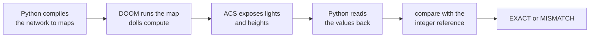
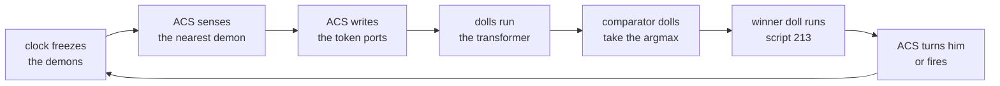

# Demos and results

Integer networks generate names, control marines and learn inside DOOM. The tables give model sizes, exactness checks and results.

The code is in [`demos/`](../demos), [`training/`](../training) and [`models/`](../models). The films are on the
[v0.1.0 release](https://github.com/mottopanikeiku/doomformer/releases/tag/v0.1.0). Each film is a picked run; its
section names the seed, and the tables cover every seed they list.

Commands, run times and sample output are in [`demos/README.md`](../demos/README.md). Start with `python -m demos.brainlevel`.

## What DOOM computes and what Python does

DOOM runs the forward pass of an integer network on ViZDoom game mechanics. Voodoo dolls, gates and linedef specials
do the matrix products and staircase activations. Python compiles the maps and handles everything around them.



`EXACT` means every checked value read from the game equals the integer reference, with zero tolerance. Values are
sector lights, floors and ceilings exposed through ACS. Negative controls deliberately change the computation and
must fail the same comparison.

The engine is ViZDoom 1.3.2's ZDoom with Freedoom2 assets, far slower than native inference ([speed](HOW_IT_WORKS.md#speed)). Transformers use integer attention and staircase activations. `doomnames_softmax`, `doomnames_onemap_softmax` and `doomnames_modern` compute softmax in the dolls; `doomnames_modern` adds integer RMSNorm and a gated MLP. There is no LayerNorm. Weights are trained offline with quantisation-aware training; the perceptron demos learn inside DOOM. Marine policies imitate scripted experts that see exact object positions, so there is no RL and no pixel input.

| Demo | DOOM computes | Python does | Games | The exact check compares |
|---|---|---|---|---|
| Name generator (`doomformer/orchestrator.py`, `doombrain`, `doomnames`) | every tile: embedding, q/k/v, q·k, weighted sums, output projection, MLP, unembedding, staircases | compiles tile maps (106 for `doombrain`, 38 for `doomnames`), moves tile outputs, samples letters, closes ablation doors | pool of games, reused and evicted | every exposed tile output and its negation vs `intref.forward`, and the generated string |
| Marine policy (`doomformer/policy.py`, `doomplayer`, `doomplayer_xl`) | a 3-token pass over (start, bearing, distance) to action logits | bins exact object positions into tokens, takes the argmax, holds buttons 4 tics. Episode statistics use the NumPy reference | pool of games (12 workers) | tile tensors, negations, logits and action vs `intref` (3 contexts in the check, every decision of a film) |
| Walker (`demos/walker.py`, `doomwalker`) | a 1-layer d=8 pass over 5 tokens to action logits | builds the level, computes tokens (waypoint, enemy bearing and distance, flags), maps logits to buttons | pool of games (55 games, 16 maps) | every exposed tile output, negations and logits vs `intref`, every decision (102/102, 120/120 lobotomised) |
| One-game learner (`demos/arena.py`, `demos/aimlearn.py`) | scores from 38 ceiling-height weights, the action, the perceptron update, the arena | bins the view into 19 binary features, supplies aimbot labels, freezes and wakes demons, counts lives | one game | both scores, the action and all 38 weights vs a NumPy perceptron, every decision |
| His brain is the level (`demos/brainlevel.py`, `doomformer/brainacs.py`) | the policy transformer, the argmax, the clock, sensing from actor positions, turning and firing | builds the map, advances tics, runs readout scripts, recomputes `policy.observe`, checks | one game | sensed tokens, all 540 exposed values and the received action, every decision (50/50) |
| Learn to aim (`demos/aimlearn.py`, `doomformer/learn.py`) | the same in-map perceptron | features, labels, copies the action into the arena | two games: arena and learner | both scores, the action and all 38 weights vs a NumPy twin, every decision |
| Pure MLP (`doomformer/pure.py`) | both layers of a 12→16→6 MLP in one map, a clock doll starts layer 2 | writes x and −x, reads results | one game | the 6 outputs, the 16 gate-floor heights layer 2 reads and the 16 hidden lights, every case |
| Spiking network (`doomformer/spiking.py`) | threshold, reset, leak, synapses. Potentials are floor heights | writes input spikes, converts the readback | one game | every spike and next potential, every step |
| Fly marine (`demos/fly.py`) | the spiking step of a 200-neuron FlyWire circuit while input arrives or spikes follow | builds the corridor, walks him, draws taste spikes, decides eat or refuse, fast-forwards silent decay into the map | one game | active and afterglow steps (219 of 1,578 in seed 1). The reference computes the 1,359 rest steps |
| The fly is alive (`demos/flyloop.py`) | the whole loop: clock, sensing, an in-map Park–Miller PRNG, the 255-neuron circuit, thrust and quake lines that move him | builds the map, calibrates the step on a twin game, advances tics, sends readout scripts | one game | every spike and potential every step (169/169), the PRNG state, and that action lines fired exactly when output neurons spiked |
| Fly, day scenario (`demos/fly.py`, `models/fly/brain.json`) | the spiking step of the 255-neuron circuit | as above, plus dust and looming spike trains, groom or takeoff from aDN1 and Giant Fiber counts | one game | active and afterglow steps (253 in seed 1) |

Thresholded activations, doll counts and partial sums of the name generator are not compared. Walker and policy episode statistics use the NumPy reference.

## The trilogy

<p align="center"></p>

**Trailer: [`trilogy.mp4`](https://github.com/mottopanikeiku/doomformer/releases/download/v0.1.0/trilogy.mp4)** (48 s),
*DOOM Dreams of DOOM*.

<p align="center"></p>

The name generator writes DEMON CANYON (seed 2, temperature 150, picked from generated samples; seeds 0 to 99 are in
`models/doombrain/eval_report.txt`). A Python generator builds a level from the name. A marine whose policy runs in
55 DOOM games plays it.

From decision 50 on, 3 neurons (`x0` units 1, 2, 5) are closed as doors in every consuming tile. He then veers and turns
right for the rest of the film. All 120 decisions are exact against the equally lesioned reference.

| lesion, seed 118 replay of 170 decisions | outcome |
|---|---|
| `x0 [1, 2, 5]` | never reaches the exit, route progress 0.54 |
| `x0 [1]` | reaches the end of the route, never presses USE, dies at decision 147 |

Both lesions come from a scan of every single neuron and 300 random blasts on all 5,848 walker observations
(`walker.all_contexts`).

## His brain is the level

<p align="center"></p>

**[`brain_is_the_level_raw.mp4`](https://github.com/mottopanikeiku/doomformer/releases/download/v0.1.0/brain_is_the_level_raw.mp4)**
(53 s, thinking time-lapsed). The marine's transformer is compiled into the map he fights in. Its voodoo dolls are
copies of the marine. Run it with `python -m demos.brainlevel`.

| | Stage A: host senses and acts | Stage B: the level senses and acts |
|---|---|---|
| sensing | Python `policy.observe` writes the token ports | ACS bins the nearest demon's bearing (17 bins) and distance (5 bins) |
| transformer | dolls, whole forward pass, one map | dolls, whole forward pass, one map |
| action | Python argmax, buttons held 4 tics | dolls take the argmax, ACS turns him or fires his pistol |
| seed 4, first 50 decisions | 50/50 exact, 5 kills | 50/50 exact, 5 kills (5 shots, 26 → 21 bullets) |
| clock | 3,672 tics, 31.8 s per decision | 4,160-tic budget (dolls settle in 3,824), 4,205 tics per cycle, 35.3 s per decision |

One stage-B decision follows the level's clock:



For each pair a < b, the unembedding writes d_ab = logit_a − logit_b + 1 into a gate floor, using weights
Wun_a − Wun_b. A gate passes a doll iff d_ab ≥ 1. Comparator dolls count wins; a gate at 2 opens for the largest
logit, with the lower index winning ties, as in `np.argmax`. This needs no extra quantisation.

| comparator bound | value |
|---|---|
| `doomplayer_onemap` Wun | [−78, 82] |
| pairwise differences | [−71, 139] ≤ 255 |
| worst port bound | 1,101 ≤ 12,000 |

The winner's doll crosses `ACS_ExecuteAlways(213, 0, action)`. Script 213 only stores the number. The clock reads no
logit and no sector. It waits out the 4,160-tic budget, then acts (`build_onemap(..., choose=...)` in
`doomformer/onemap.py`).

| map | value |
|---|---|
| dolls | 1,345 (1,337 transformer, 6 comparator, 2 clock) |
| sectors | 37,410 (37,109 without the comparator) |
| build / load | 1.4 s / 0.7 s |
| settle on the film's 24 contexts | 3,824 tics (3,656 without the comparator) |

Demons stay dormant while the dolls compute (`Thing_Deactivate`). The board shows doll positions every 128 tics,
white if moved.

In stage B, Python sends only readout commands: 710 in the film (260 status reads, 9 pages × 50). These scripts write
ACS variables that nothing in the map reads. Python presses no buttons.
Each decision is checked three ways:

- The sensed tokens equal `policy.observe` on the pose captured by the map and the dormant demons. This checks
  selection and binning; pose capture itself is outside the comparison.
- All 540 exposed values equal `intref` and a NumPy comparator: 525 transformer values and 15 comparator values.
- The action the level received equals the dolls' winner and `np.argmax` of the reference logits.

The filmed run matches an ACS-argmax run in all 50 decisions: tokens, logits, actions and every clock sample. No decision
had tied logits. `tests/research/test_tamper_stage_b.py` flips one comparator line and makes a winner line hand over the
wrong action. The check catches both.

`models/doomplayer_onemap` is L=1, d=8, H=1, MLP 16, with 2-level staircases. It uses the same aimbot training data
(`training/train_policy.py --L 1 --d 8 --dm 16 --K 2`). The observation space has 86 distinct values.

| policy, 100 NumPy episodes (seeds 9000–9099) | held-out agreement | kills per life |
|---|---|---|
| `doomplayer_onemap` | 96.7 % | 23.24 ± 0.46 |
| `doomplayer` | 97.2 % | 23.35 ± 0.35 |
| aimbot | | 24.50 ± 0.33 |

`models/doomplayer` also fits one map, and one forward pass in it is exact (all 969 values and the action). It is too
slow to play:

| `doomplayer` in one map | value |
|---|---|
| dolls / sectors | 8,825 / 528,366 |
| build / load | 20 s / 41 s |
| one pass | 29,088 tics, 1,861 s |

The sensing rule, comparator, turn size and pistol are built into the level. The pistol fires one 5-damage bullet
without spread. ACS fixed-point precision can change the bin for a bearing within 0.0001° of an edge or for nearly
equidistant demons; the check stops the run if that happens.

## Live demons: what the latency costs him

`python -m demos.brainlevel --live` (`demos/brainlive.py`) leaves the demons awake while the dolls compute. The level
samples the sensor at the start of a cycle. The action lands 773 tics later (3 write + 738 compute + 32 hold at
`--opt 3`), 22 s at 35 tics/s. Every decision is still exact and Python is still readout-only.

The marine cannot move. Three demons spawn 560 units away and approach him. Over 90 control lives, first damage
arrives after a median 128 tics (124 to 154), well before the 773-tic decision completes.

A life ends at health 1 (buddha mode), an empty pistol, or 2,100 awake tics. Kills are counted until then. The controls
(`ControlRun`) use the same sensor, turning, pistol and life rules. Only the chooser and the latency differ.

| mode (seeds 4, 5, 6) | lives | kills per life | tics alive, median (range) | ended by |
|---|---|---|---|---|
| frozen, scripted aimbot | 150 | 22.1 | 922 | 32 dead, 118 out of ammo |
| frozen, integer policy in NumPy | 150 | 21.9 | 940 | 38 dead, 112 out of ammo |
| live, his dolls, `--opt 3`, 773 tics | 90 | 0.0 | 191 (147 to 317) | 90 dead, 0 actions landed |
| live, integer policy in Python, 773 tics | 150 | 0.0 | 191 | 150 dead |
| live, latency 400 / 200 / 100 / 50 / 3 | 150 each | 0.00 / 0.02 / 0.07 / 0.17 / 3.27 | 196 / 191 / 191 / 195 / 286 | all dead |

All 90 live decisions and 48,600 values are exact. The Python control at the same 773-tic latency also gets 0 kills
and lasts a median 191 tics. With demons frozen between actions, both the aimbot and integer policy average about
22 kills per life.

The sensor and `policy.observe` disagree on one case: a demon exactly behind him is −180 degrees (token `a`) to one and
+180 (token `q`) to the other. The check accepts it as the same value (2 of 90 samples, counted in the log).

`demos.brainlevel --opt 3 --lives 1` on seeds 4, 5 and 6 ran 163 to 165 exact decisions each, with the lives still
running at 17, 19 and 16 kills. Actions diverge from the frozen control on seeds 4 and 6: adding 1, 3 or 700 dormant
tics per decision changes when the trajectories diverge (`models/live_demons/dormant_tics.py`, `.log`).

The next runs act every 4 tics using observations `d` tics old. This separates observation age from action latency;
the dolls compute only one decision at a time.

| sensing age `d` (tics) | 3 | 6 | 9 | 12 | 16 | 20 | 25 | 50 | 100 |
|---|---|---|---|---|---|---|---|---|---|
| integer policy, kills per life (150 lives each) | 17.3 | 7.9 | 5.6 | 4.1 | 2.4 | 1.4 | 1.0 | 0.7 | 0.5 |
| tics alive, median | 793 | 519 | 369 | 331 | 267 | 233 | 217 | 222 | 202 |
| scripted aimbot, kills per life | 19.5 | | 6.0 | | 2.9 | | 1.0 | | |

At 3 tics (86 ms) he keeps 79 % of the frozen kills, at 6 tics (170 ms) 36 %, at 12 tics (340 ms) 19 %. The aimbot
loses kills the same way. Old information is the problem against demons that reach him in about 100 tics. The policy
turns 14 degrees per action and overshoots on old data.

The arena is the frozen demo's: 3 demons at once, 26 bullets, one-hit demons, buddha mode. Frozen and live rows share seeds and life rules but not game RNG history, so compare them as distributions.

Logs, per-life rows and the sweep: [`models/live_demons/`](../models/live_demons/). Regenerate with
`python -m demos.brainlive sweep --seeds 4 5 6 --lives 50` and `python -m demos.brainlive brain --seed 4 --lives 30`.

## The other demos

<p align="center"></p>

**[`one_game.mp4`](https://github.com/mottopanikeiku/doomformer/releases/download/v0.1.0/one_game.mp4)** (44 s),
**ONE DOOM GAME.** The marine, his arena and his brain are one map. The dolls that compute and learn are 156 voodoo dolls
of himself. DOOM makes the last player-1 start the player and every earlier one a voodoo doll. Demons are deactivated and
the spawner paused while the brain runs. A life ends at 1 health (buddha mode) or when his 26 bullets are spent. The game
is never reloaded. His brain starts blank.

| seed 4, kills per life | lives 1–5 | exact decisions |
|---|---|---|
| film run | 4, 24, 26, 22, 24 | 931/931 |
| current compiler | 4, 22, 15, 20, 16 | 815/815 |
| aimbot (supplies the labels) | 9, 26, 26, 25, 26 | |
| blank brain | 0 every life | |

Each check covers both scores, the action and all 38 weights. The film used an older compiler; its map layout and decision timing differ, so trajectories diverge from life 2.

**Learn to aim.** DOOM runs online perceptron updates from an aimbot. The brain has 38 weights (19 binary features × 2
heads), all 0 at the start. Each weight is a ceiling height. Each decision, dolls compute two scores from the ceilings and
two "act" dolls choose his action. A second layer of dolls applies the perceptron rule: on a wrong answer they cross
`Ceiling_RaiseByValue`/`LowerByValue` lines under that input's weights. Stored weights are capped at ±100 and read
clipped to ±3. The labels come from privileged binned positions.

| seed | kills per episode | exact decisions |
|---|---|---|
| main run | 5 → 18 → 24 (aimbot: 26, 25, 25) | 905/905 |
| second | 22 → 22 → 22 | 1,207/1,207 |
| third | 6 → 25 → 23 | 1,053/1,053 |

These are the only three seeds run.

The blank brain spins left and never fires. Three negative-control learners (`rule`, `land`, `freeze`) must fail, and do:
0/40, 1/40 and 31/40 examples exact.

**Pure DOOM** (`doomformer/pure.py`). A whole MLP runs in one map with no Python between layers. Layer 1's dolls leave
their sums as floor heights. A clock doll drops layer 2's barriers when layer 1 is done. A 12→16→6 MLP is 40/40 cases
exact on the outputs and on the 16 hidden gate-floor heights layer 2 reads. With `pure.SERIAL = 0` a run was 0/10 exact.

### One-map transformer

<p align="center"></p>

**[`onemap_shil_raw.mp4`](https://github.com/mottopanikeiku/doomformer/releases/download/v0.1.0/onemap_shil_raw.mp4)**
(58 s, time-lapse). The trained model writes SHIL. Every dot is one of its 3,548 dolls, read every 8 tics. 5 forward
passes, 2,680/2,680 exposed values and every logit exact.

`doomformer/onemap.py` lowers a whole `intref` forward pass into one map. Python writes the token ids and their
negations, waits until every doll stops, reads the logits and samples. At `opt` 0 to 2 no Python and no ACS arithmetic
run between layers. At `opt` 3 an ACS script copies each layer's lights into the next layer's gates, see
[scheduling.md](scheduling.md). Dolls that would hit one sector in one tic are released in time-multiplexed waves.

| model | dolls | sectors | build / load | one forward pass | verified |
|---|---|---|---|---|---|
| tiny random transformer (L=1, d=4, H=1, T=3) | 593 | 12,620 | 0.4 s / 0.7 s | 1,810 tics, 4.6 s | 20 prompts + generated sequence, 3,347 values exact |
| `models/doomnames_onemap` (L=1, d=8, H=1, MLP 16, T=6) | 3,548 | 95,448 | 3.5 s / 11.1 s | 3,511–3,513 tics, ~84 s | 20 prompts + SHIL (seed 17, temperature 12.5) = `intref.generate`, 12,142 values exact |

The one-map model is trained with `training/train_brain.py` on the 416 real level names of at most 5 characters (328
train, 46 dev, 42 reserved). It reaches 25.5 % dev next-character accuracy. SHIL is not in the 12,934-name corpus.
`doomnames` and `doombrain` do not fit one map: the planner counts 116,968 dolls and 15.2 million sectors for
`doomnames` and 957,662 dolls for `doombrain`. `tests/test_onemap.py` runs the tiny model in DOOM and must catch two
conflicting writes released in one wave.

<p align="center"></p>

**[`doom_beats_doom.mp4`](https://github.com/mottopanikeiku/doomformer/releases/download/v0.1.0/doom_beats_doom.mp4)**
(37 s). DEMON CANYON is a name the DOOM brain wrote. `demos/levelgen.py` builds the level from a hash of the name. The
marine's brain is `models/doomwalker` in 55 DOOM games. It has 1 layer, d=8 and 1,242 integer parameters. It was
trained on 170 other generated levels. He walks, opens doors and shoots twice in 102 decisions, all exact. Inputs are a waypoint bearing and
privileged scene features. The film is seed 118, the one film seed of 120 with 2 kills; the exit rates below use
separate seeds from 9000.

| NumPy reference, held-out levels | walker | scripted expert | random |
|---|---|---|---|
| DEMON CANYON, exits | 34/40 (85%) | same | 0/40 |
| 10 other levels, exits | 46/80 (57.5%) | same | |

Full tables: [`models/doomwalker/EVAL.md`](../models/doomwalker/EVAL.md).

The 2-layer d=32 `models/doomplayer_xl` runs over 230 DOOM games: 160 decisions, all exact, 8.5 s per move. One
"demon at point blank → FIRE" decision (tokens `[0, 12, 22]`) runs on up to 896 dolls.

<p align="center"></p>

**[`full_brain.mp4`](https://github.com/mottopanikeiku/doomformer/releases/download/v0.1.0/full_brain.mp4)** (28 s).
`models/doombrain_xl` (4 layers, d=64, 8 heads, MLP 256) writes UNHOLY STRONGHOLD. Its exposed tile outputs match the
reference.

| UNHOLY STRONGHOLD run | value |
|---|---|
| logical tile instances | 10,166 |
| compiled tile maps | 210 |
| voodoo dolls | 208,598 |
| game tics | 1.9 million |
| wall time with video | 968 s |

<p align="center"></p>

**[`lobotomy.mp4`](https://github.com/mottopanikeiku/doomformer/releases/download/v0.1.0/lobotomy.mp4)** (29 s). A
7-pellet blast from `demos/shotgun.py` hits `x0` units 0, 2, 3, 5, 7, 11, 14 of `doomplayer`. It makes the marine a pacifist that
never fires. He gets 0 kills over 74 decisions in DOOM, all exact. The healthy brain gets 23.35 ± 0.35. The film uses
the first of the 4 pacifist blasts found in 3,000.

| scan on all 86 observations | count |
|---|---|
| single neurons that change an action | 16 of 96 |
| random 7-pellet blasts that change an action | 2,531 of 3,000 |
| pacifist blasts | 4 of 3,000, all on `x0` |
| pacifist 7-subsets of `x0` | 64 of 11,440 (0.56%) |
| smallest pacifist | 5 neurons, 26 sets |

[Lesion statistics](#lesion-statistics). The film's "shrugging off 83%" refers to `doomplayer_xl`: 2,478 of
3,000 blasts (82.6%) leave all 86 observed actions unchanged. These counts measure action changes, not episode outcomes.

## Results

| | DOOM brain (`models/doombrain`) | first model (`models/doomnames`) |
|---|---|---|
| architecture | 2 layers, d=32, 4 heads, MLP 96, context 24 | 1 layer, d=16, 2 heads, MLP 32, context 16 |
| integer parameters (including thresholds) | 24,279 (23,838 without) | 3,606 (3,438 without) |
| training data | 12,934 cleaned level names (11,341 train, 300 dev, 1,293 held out) from 956 source WADs before deduplication, 901 contribute names | 136 official level names |
| next-character accuracy | 41.5 % on the 1,293 held-out names (7,710/18,588) | 82.1 % on its 136 training names (1,235/1,505), 17.8 % on 852 held-out names of the new corpus |
| compiled DOOM maps | 106 maps, 56,390 voodoo dolls, 785,460 sectors | 38 maps, 10,462 dolls, 114,988 sectors |
| one generation | `DEMON CANYON`: 1,690 tile runs over 1,594 logical tile instances, 256,962 game tics | `THE COURTYARD`: 518 tile runs, 453 logical tile instances |
| verification | every exposed tile output and its negation, exact | same |

Tile-instance counts are distinct identifiers over the run, not simultaneous processes. Sources:
`models/doombrain/run_model_log.txt`, `models/doombrain/eval_report.txt`, `training/data/levels.json`,
`train_info.json` and `training/data/SOURCES.md`.

These generated names, sampled at temperature 150–200, are absent from the training corpus:

<details><summary><b>Generated names and their nearest corpus names</b></summary>

| name | nearest corpus name | edit distance |
|---|---|---|
| DEMON CANYON | DEMON BAYOU | 3 |
| BLOOD SHOCK | BLOOD SIEGE | 4 |
| NECROGENER | NECROGENESIS | 3 |
| DEMONIC CONTROL | DEMON CONTROL | 2 |
| GRAND TEMPLE | DEAD TEMPLE | 3 |
| DEAD SHIP | DEATH SHIP | 2 |
| HELL AND THE LAB | ESCAPE THE LAB | 6 |
| BARBATORY | ORATORY | 3 |

</details>


### Talk to DOOM: `models/doomoracle`

A question-answering model: `QUESTION>ANSWER` over 32 characters (`$ A-Z ' ! ? >`), 2 layers, d=32, 4 heads, MLP 96,
T=47. `training/data/oracle.json` holds 189 facts about DOOM. Each has a cited source URL and an evidence string, and
`training/data/make_oracle.py` re-checks each string against the cached source. Paraphrase and fact correctness are not
checked, see [`ORACLE_SOURCES.md`](../training/data/ORACLE_SOURCES.md).

Each fact has 3–7 question paraphrases. One per fact is held out, so held-out questions are new wordings of seen facts.
Train with `training/train_oracle.py`, evaluate with `training/eval_oracle.py` (`models/doomoracle/EVAL_REPORT.md`).

| exact answers, greedy, NumPy integer reference | accuracy |
|---|---|
| training paraphrases | 94.7 % (606/640) |
| held-out paraphrases | 35.4 % (67/189) |

## The marine: a transformer that plays DOOM (`models/doomplayer`)

ViZDoom's `defend_the_center`: turn left, turn right or fire, 26 bullets, demons from every side. One decision is a pass
over 3 tokens: start, bearing of the nearest enemy (17 bins), distance (5 bins). The host takes the argmax over `L R F`
and holds the buttons 4 tics. Python bins exact object positions from ViZDoom.

A scripted aimbot with exact positions labels the states: 800 rollouts with action noise, 260,694 decisions
(`training/train_policy.py`). The model is a 1-layer, d=16, 2-head, MLP 32 integer QModel in 12 tile maps, trained by
supervised imitation.

| 100 episodes (seeds 9000-9099), `intref.forward` in NumPy | kills (mean ± SEM) | survival (tics, mean ± SEM) |
|---|---|---|
| integer model | 23.35 ± 0.35 | 1651 ± 23 |
| scripted aimbot (the teacher) | 24.50 ± 0.33 | 1725 ± 23 |
| random | 1.45 ± 0.12 | 337 ± 7 |

Log: `models/doomplayer/eval_policy.txt`. Held-out agreement with the aimbot is 97.2 % (`train_info.json`). That equals
the majority-label ceiling of the binned observations, which take only 86 values. On states the model visits itself,
agreement is 96.5 % (39,815/41,273).

The DOOM check runs 3 in-game contexts. Every tile output and negation is exact, and the logits and action equal the
reference. A decision takes about 1.15 s with 12 workers after a 4.1 s warm-up. `models/doomplayer_xl` (2 layers, d=32)
takes about 5.9 s, with identical agreement and episode statistics.

```sh
.venv/bin/python training/train_policy.py --out models/doomplayer --L 1 --d 16 --dm 32
```

## Run it yourself

Every demo runs from the repository root after `pip install -e .`. Commands, flags, run times and sample output are in [`demos/README.md`](../demos/README.md).

| command | result |
|---|---|
| `python -m demos.brainlevel --decisions 50 --seed 4` | 50/50 exact, 5 kills, 26 to 21 bullets |
| `python -m demos.flyloop --steps 900 --seed 1` | 169/169 exact, PRNG 169/169, no action-line differences |
| `python -m demos.lobotomy` | 16 of 96 neurons, 2,531 of 3,000 blasts, a 0-kill pacifist |
| `python -m demos.aimlearn --lives 5 --seed 4` | 815/815 exact; kills per life 4, 22, 15, 20, 16 (the film shows 4, 24, 26, 22, 24, from an older compiler) |

### Lesion statistics

`doomformer/lesion.py` evaluates thousands of zero-ablation lesions at once with float64 GEMMs. Every sum is an integer below 2^53, so it equals `intref.forward(m, tokens, ablate=...)` exactly; `tests/test_lesion.py` checks this. Other interventions: [interventions.md](interventions.md).

```sh
OMP_NUM_THREADS=1 python -m demos.lobotomy --minimal --null --json lesion_minimal.json   # about 9 min
OMP_NUM_THREADS=1 python -m demos.lobotomy --names --json lesion_names.json              # about 2 min
python -m demos.lobotomy --model doomplayer_xl                                           # about 2 min
```

A pacifist chooses `F` on none of the 86 observations. Sites of 16 units are enumerated at every size. On `m` (32 units), sizes 1 to 6 and 29 to 32 are enumerated, with 20,000 random subsets per size from 7 to 28.

| site | units | smallest pacifist | pacifists at that size | pacifists among 7-subsets |
|---|---|---|---|---|
| `x0` | 16 | 5 | 7 of 4,368 | 64 of 11,440 (0.56%) |
| `ao` | 16 | 8 | 16 of 12,870 | 0 of 11,440 |
| `x1` | 16 | 9 | 2 of 11,440 | 0 of 11,440 |
| `x2` | 16 | 13 | 1 of 560 | 0 of 11,440 |
| `m` | 32 | none | none | 0 of 20,000 sampled |

Across all 96 neurons the smallest pacifist has 5 neurons, and there are 26 such sets. Each contains `x0` units 0 and 11, and none uses `m`. The film's blast (`x0` units 0, 2, 3, 5, 7, 11, 14) is one of the 64 pacifist 7-subsets of `x0`. Shuffling the weights of `doomplayer` gives copies with similar firing rates that are just as easy to make pacifist (`--null`), so a 5-unit pacifist on `x0` is typical for a model like this.

In DOOM, the minimal lesion `x0` [0, 3, 11, 12, 14] gets 0.00 kills in 20 episodes against 23.45 for the healthy brain. Mean episode length is 295 against 1,719 tics. With the doors closed, all 3 checked decisions are exact (1,593 values) and the doors change the action in all 3.

Name model (`--names`, `models/doombrain`): of 416 single neurons, 326 to 368 change the generated text depending on seed and temperature (355 at seed 2, temperature 150), and 6 change none in any run, all in `L1.m`. No neuron has zero teacher-forced KL. The three neurons that write DEMON DEATH at seed 2 are `L0.x1` 20, `L1.x1` 29 and `L1.m` 33, ranked 65th, 154th and 324th of 416 by KL.

## Induction: a transformer that learned an algorithm (`models/induction`)

The induction model learns to copy from earlier in its context. A sequence starts with BOS, then 5 to 8 distinct
random tokens, then a repeat of 1 or 2 of them (`$ KFCAPJD CA`). At a repeated token, the target is the token that
followed its first occurrence.

Code: `doomformer/induction.py` (task and rule), `training/train_algo.py` (trainer, `--float` for the baseline),
`training/eval_algo.py` (table). The integer model is L=2, d=16, 2 heads, K=7, softmax attention.

| held-out accuracy | 4,000 random sequences | 2,000 `unseen` sequences |
|---|---|---|
| integer model | 0.9995 | 0.9995 |
| float GPT, same size | 0.9991 | 0.9981 |
| bigram table | 0.069 | 0.000 |
| 4-gram table | 0.233 | 0.000 |
| best heuristic | 0.22 | 0.20 |

More rows: [`models/induction/EVAL.md`](../models/induction/EVAL.md). `training/analyze_induction.py` reads the circuit:
both layer-0 heads attend to the previous token, and both layer-1 heads put 0.94 of their weight on the token after the
first occurrence. Zeroing either layer takes accuracy to chance.

```sh
python -m demos.induction --heldout 25 --workers 3     # 25 held-out sequences in tile maps, every value compared
python -m demos.induction KFCAPJDC                     # your sequence: what follows C?
python -m demos.induction --set unseen --heldout 5
```

| DOOM run | value |
|---|---|
| sequences exact | 25/25 |
| tile maps | 52, with 6,081 voodoo dolls and 191,566 sectors |
| tile runs | 13,868 |
| values compared | 520,749 |
| answer equals the rule | 38 of 38 queried tokens |
| wall time | 2,545 s, 3 games |

Log: `models/induction/doom25_tiles.log`. The model does not fit one map. `models/induction_onemap` (L=2, d=8, K=2,
context 7, 8,421 dolls) does, but scores 0.958 and 0.859 held-out. One held-out sequence in its map is exact: 2,247
values, 332 s (`models/induction_onemap/doom_onemap.log`).

**DOOM learns to read digits**: see [learning.md](learning.md#doom-learns-to-read-digits).
