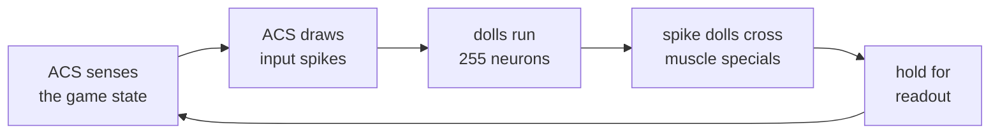

# Side quest: a fruit-fly circuit in DOOM

A small piece of a real fruit-fly brain runs inside a DOOM map. Its neurons sense the level and move the marine.

`doomformer/spiking.py` runs integer spiking neurons with voodoo dolls.

| neuron part | in the map |
|---|---|
| membrane potential | a floor height |
| spike | a doll getting through a gate |
| synapse | a line the doll crosses, raising or lowering a target's potential |
| 1 ms of model time | one run of the map |

The circuits come from the FlyWire connectome of *Drosophila*. They follow the whole-brain model of
[Shiu et al. 2024](https://doi.org/10.1038/s41586-024-07763-9).

How they are built, and where they differ from that model: [fly_circuit.md](fly_circuit.md). Code:
[`demos/fly.py`](../demos/fly.py), [`demos/flyloop.py`](../demos/flyloop.py). Circuits: [`models/fly/`](../models/fly).

| demo | circuit | loop | result |
|---|---|---|---|
| [the fly is alive](#the-fly-is-alive) | `brain.json`, 255 neurons | closed, in the map | 169/169 steps bit-exact |
| [the fly marine](#the-fly-marine-host-driven) | `feeding.json`, 200 neurons | host-driven | 219/219 steps bit-exact |
| [a day in the life](#a-day-in-the-life-three-behaviours-in-one-circuit) | `brain.json`, 255 neurons | host-driven | 253/253 steps bit-exact |

## THE FLY IS ALIVE

The 255-neuron circuit runs a closed loop inside one live DOOM map. It senses, decides and moves the marine. The host
makes no sensory or motor decision.

> [!TIP]
> Run it with `python -m demos.flyloop`. The full film is
> [`fly_alive.mp4`](https://github.com/mottopanikeiku/doomformer/releases/download/v0.1.0/fly_alive.mp4) (71 s).

- **Clock**: an ACS script runs every 1 ms step. It rewinds the dolls, senses and draws the input spikes. Then it
  releases the dolls and waits 689 tics.
- **Wait**: 689 tics is the worst settle on a clock-free twin map, plus 12 %. Nothing is fast-forwarded.
- **Senses**: ACS reads the game state: food, nukage, dust, a demon in sight. Each input spike is a Bernoulli draw from
  a Park–Miller generator written in ACS.
- **Muscles**: each output spike doll crosses a special aimed at the marine. MN9 lunges at food. The Giant Fiber
  launches a takeoff. aDN1 twitches to clear dust.
- **Python**: builds the map and sets the period on a separate twin game. During the run it only advances tics and
  runs readouts.
- **Host writes**: only readout commands are sent. A wrapper on every game API call saw no host write in 50 steps.
- **Readback**: this is the one map built without the readout guard. Guarded, its 9 pages take 18 tics, and its hold
  window is 16 tics of world time. A longer window would change every documented run and the film.

The check replays the circuit with `IntNet.step` and a Python copy of the PRNG. It uses the sensory mask the map
reports.

So the check is an independent neural reference. It does not model the sensing rules.

| station | sensed | output spikes | what his body did |
|---|---|---|---|
| sugar on a counter | sugar, 35 steps | MN9 4 | 4 lunges, 84 units: **ate it** 34 ms after onset; the sugar input stops |
| dusty patch | antennal touch, 38 steps | aDN1 1 | grooming twitch: **dust cleared** 37 ms after onset |
| sugar + bitter in nukage | sugar + bitter, 59 steps | none | **refused**: the food stays on its counter |
| platform facing a demon pen | looming, 7 steps | Giant Fiber 1 | **takeoff** (peak 75–77 units) into the pit 14 ms after onset; the looming stops |

> [!NOTE]
> All 169 steps are bit-exact: every spike and potential of 255 neurons. The PRNG state matched every step. The dolls
> were at rest in every readout window, and the action lines fired exactly when the outputs spiked.

| map | value |
|---|---|
| voodoo dolls | 1,222 |
| sectors | 31,615 |
| tics per step | 728 |
| wall time per step | ~4–5.5 s |

[`tests/research/test_flyloop.py`](../tests/research/test_flyloop.py) checks the PRNG copy. It also runs a small closed
loop in DOOM. Speed in general: [HOW_IT_WORKS.md](HOW_IT_WORKS.md#speed).

## THE FLY MARINE (host-driven)

Here Python drives the loop, and the circuit only decides whether he eats.

The marine carries 200 neurons around MN9, the proboscis motor neuron (`models/fly/feeding.json`). 64 synthetic taste
lines drive it: 23 sugar and 41 bitter.

Python walks him, makes the input spike trains and applies a threshold to the output.

- Each snack is labelled `sugar` or `sugar+bitter`. When he stops at it, the matching lines get 200 Hz Bernoulli trains.
- He eats once the two MN9 outputs have spiked three times in total. Otherwise he refuses after 120 ms.
- Rest between snacks is fast-forwarded. The reference runs the silent leak decay. The host writes the result into the
  map, and the bit-exact claim does not cover those steps.

Result on seed 1:

| snack | MN9 | he |
|---|---|---|
| sugar | threshold at 44 ms | eats |
| sugar + bitter | silent for 120 ms | refuses |
| sugar | threshold at 47 ms | eats |

219/219 DOOM steps are bit-exact, over the active and afterglow steps.

One map holds his corridor and the circuit. It has 861 voodoo dolls, 23,914 sectors and 3,794 synapses.

### A day in the life: three behaviours in one circuit

`models/fly/brain.json` drives feeding, escape and grooming from one 255-neuron circuit. Sugar, looming and
Johnston's-organ input each drive only their own output.

Seed 1, one corridor, four stations:

| station | input | output | he |
|---|---|---|---|
| sugar | sugar | 3rd MN9 spike at 36 ms | eats |
| dust puffs | Johnston's organ | 2nd aDN1 spike at 68 ms | grooms (a head wiggle) |
| sugar + bitter | sugar + bitter | MN9 silent for 120 ms | refuses |
| a demon frozen 200 units away | LC4 looming | 3rd Giant Fiber spike at 14 ms | takes off, 760 units back and 78 up |

253/253 DOOM steps are bit-exact. The map has 1,222 voodoo dolls and 32,819 sectors. Each 1 ms step takes 4.9 s of wall
time.

Walking, spike trains, thresholds and rest are host-driven, as in the feeding version.

## Limits

> [!IMPORTANT]
> - The sensing rules, stations and the special each output drives are level design.
> - Input trains are Bernoulli draws with no sensory physics. One seed is reported per film.
> - The circuits keep the on/off logic of the float model. Spike rates are not matched ([deviations](fly_circuit.md)).
> - The connectome data is CC BY-NC 4.0 (FlyWire). See [Licensing](../README.md#licensing).
