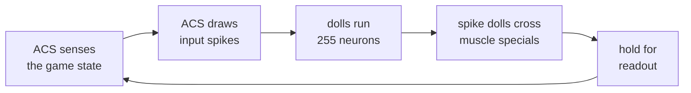

# A fruit-fly circuit in DOOM

Integer spiking circuits from a fruit-fly connectome control the marine inside a DOOM map, where
`doomformer/spiking.py` implements the neurons with voodoo dolls.

| neuron part | in the map |
|---|---|
| membrane potential | a floor height |
| spike | a doll getting through a gate |
| synapse | a line the doll crosses, raising or lowering a target's potential |
| 1 ms of model time | one run of the map |

The circuits come from the FlyWire connectome of *Drosophila* and follow the whole-brain model of
[Shiu et al. 2024](https://doi.org/10.1038/s41586-024-07763-9). [fly_circuit.md](fly_circuit.md) explains how they are
built and where they differ from that model, the code is in [`demos/fly.py`](../demos/fly.py) and
[`demos/flyloop.py`](../demos/flyloop.py), and the circuits are in [`models/fly/`](../models/fly).

| demo | circuit | loop | result |
|---|---|---|---|
| [the fly is alive](#the-fly-is-alive) | `brain.json`, 255 neurons | closed, in the map | 169/169 steps bit-exact |
| [the fly marine](#the-fly-marine-host-driven) | `feeding.json`, 200 neurons | host-driven | 219/219 steps bit-exact |
| [a day in the life](#a-day-in-the-life-three-behaviours-in-one-circuit) | `brain.json`, 255 neurons | host-driven | 253/253 steps bit-exact |

## The fly is alive

The 255-neuron circuit runs a closed loop in one map, where level scripts sense the world and generate input spikes
while the dolls compute the circuit and trigger movement.

> [!TIP]
> Run it with `python -m demos.flyloop --seed 1`, which is the seed in the film, and the full 71 s film is
> [`fly_alive.mp4`](https://github.com/mottopanikeiku/doomformer/releases/download/v0.1.0/fly_alive.mp4).

- Clock: for each 1 ms model step, ACS rewinds the dolls, senses the level, draws input spikes, releases the dolls and
  waits 689 tics, which is the worst settle time on a clock-free twin map plus 12%.
- Senses: food, nukage, dust and a demon in sight drive Bernoulli input spikes from an ACS Park–Miller generator.
- Movement: output dolls cross specials aimed at the marine, so MN9 lunges at food, Giant Fiber triggers takeoff and
  aDN1 twitches to clear dust.
- Python: builds the map and calibrates its period on a twin game, and during the run it only advances tics and reads
  values, which a wrapper around every game API call confirmed by finding no host writes in 50 steps.

This map skips the readout sentinel because checking all 9 pages would take 18 tics, longer than its 16-tic readout
window. The reference replays `IntNet.step` and the PRNG from the map's sensory mask, so the sensing rules themselves
are outside that comparison.

| station | sensed | output spikes | what his body did |
|---|---|---|---|
| sugar on a counter | sugar, 35 steps | MN9 4 | 4 lunges, 84 units: **ate it** 34 ms after onset; the sugar input stops |
| dusty patch | antennal touch, 38 steps | aDN1 1 | grooming twitch: **dust cleared** 37 ms after onset |
| sugar + bitter in nukage | sugar + bitter, 59 steps | none | **refused**: the food stays on its counter |
| platform facing a demon pen | looming, 7 steps | Giant Fiber 1 | **takeoff** (peak 75–77 units) into the pit 14 ms after onset; the looming stops |

All 169 steps match the reference exactly: every spike, every potential and the PRNG state. Dolls were at rest during
every readout window, and action lines fired exactly when output neurons spiked.

| map | value |
|---|---|
| voodoo dolls | 1,222 |
| sectors | 31,615 |
| tics per step | 728 |
| wall time per step | ~4–5.5 s |

[`tests/research/test_flyloop.py`](../tests/research/test_flyloop.py) checks the PRNG copy and runs a small closed loop
in DOOM, and [HOW_IT_WORKS.md](HOW_IT_WORKS.md#speed) covers speed in general.

## The fly marine (host-driven)

Python walks the marine, generates input spikes and decides when the circuit's output is enough to eat. The 200-neuron
circuit (`models/fly/feeding.json`) surrounds MN9, the proboscis motor neuron, and has 64 synthetic taste inputs, 23 for
sugar and 41 for bitter.

- Each snack is labelled `sugar` or `sugar+bitter`, and when he stops at it the matching lines get 200 Hz Bernoulli
  trains.
- He eats once the two MN9 outputs have spiked three times in total, and otherwise he refuses after 120 ms.
- Between snacks, Python computes the silent leak decay and writes the resulting potentials into the map, so only
  active and afterglow steps run in DOOM.

On seed 1 he eats twice and refuses once:

| snack | MN9 | he |
|---|---|---|
| sugar | threshold at 44 ms | eats |
| sugar + bitter | silent for 120 ms | refuses |
| sugar | threshold at 47 ms | eats |

219/219 DOOM steps, active and afterglow, are bit-exact on one map that holds his corridor and the circuit with 861
voodoo dolls, 23,914 sectors and 3,794 synapses.

### A day in the life: three behaviours in one circuit

`models/fly/brain.json` drives feeding, escape and grooming from one 255-neuron circuit, in which sugar, looming and
Johnston's-organ input each drive only their own output.

This run uses seed 1 and one corridor with four stations:

| station | input | output | he |
|---|---|---|---|
| sugar | sugar | 3rd MN9 spike at 36 ms | eats |
| dust puffs | Johnston's organ | 2nd aDN1 spike at 68 ms | grooms (a head wiggle) |
| sugar + bitter | sugar + bitter | MN9 silent for 120 ms | refuses |
| a demon frozen 200 units away | LC4 looming | 3rd Giant Fiber spike at 14 ms | takes off, 760 units back and 78 up |

253/253 DOOM steps are bit-exact on a map of 1,222 voodoo dolls and 32,819 sectors, and each 1 ms step takes 4.9 s of
wall time.

Walking, spike trains, thresholds and rest are host-driven, as in the feeding version.
