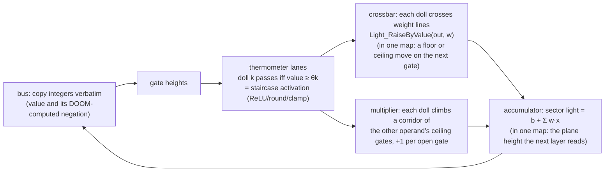

# How DOOM computes

DOOM turns every extra player-1 start into a voodoo doll: a copy of the player that rides conveyors and triggers every
line it crosses. The compiler turns a network into a map in which those dolls do the arithmetic. Python reads the results
back from the running game and compares them with a NumPy integer reference.

| In the network | In the map |
|---|---|
| a number: an activation of 5 | five dolls released onto a conveyor |
| a weight | a line. A doll that crosses it adds the weight to a sector's light level, or moves a later gate's floor or ceiling by it |
| a sum | a sector's light level or a plane height. Tile maps accumulate in light levels and Python copies each result into the next tile's gate heights. In one-map designs (`mnist`, `draw`, `demo --one-map`, `--loop`, his brain is the level) a line special moves the next layer's gate directly, so the sum is a floor or ceiling height, and only outputs nobody consumes end in light levels. Light is a saturating int16, an accumulator while partial sums stay within ±30,000 |
| an activation function | a staircase of gates. A doll gets past a step only if the value clears its height, and the spacing of the steps gives ReLU, rounding or clamping |
| attention, a product of two live values | the dolls of one value climb a corridor of ceiling gates that the other value has set, and each open gate adds 1 |
| an embedding lookup | an equality test: one doll passes a floor gate `tok ≤ t`, then a floor gate `-tok ≤ -t` |
| ablating a neuron | a door in front of its dolls. Closed, they never arrive and the neuron leaves every sum |

The pieces fit together as follows. In tile maps the bus copies a value (and its negation) into gate heights, a staircase
turns the gate heights into dolls, and crossbars and multiplier corridors add up the next layer's sums.

- **Activation functions are staircases.** The bus sets a gate's height. Lane k's doll gets past only if the
  value clears that lane's threshold. Thresholds encode ReLU, scaling, rounding and clamping
  (`adc_signed`, `adc_relu` in [`intref.py`](../doomformer/intref.py)).
- **Matrix–vector products are crossbars.** Every released doll crosses one linedef per output whose special
  adds that weight to the output sector's light level (a saturating int16 accumulator), or, in one-map designs, moves the
  next layer's gate plane by it.
- **Attention multiplies two runtime values.** Dolls of `q` climb a corridor of ceiling gates set by `k`.
  A doll fits under gate *l* only if `k ≥ φl` and crosses a `±1` line after each one, giving `count(q)·count(k)`.
  Most shipped transformers use this as ReLU-style integer attention. `doomnames_softmax`,
  `doomnames_onemap_softmax` and `doomnames_modern` use the softmax mode below, and `doomnames_modern` adds an integer
  [RMSNorm](#rmsnorm). No model has LayerNorm.
- **Embedding lookup is an equality test.** One doll passes a floor gate `tok ≤ t`, then a floor gate `-tok ≤ -t`.
- **Ablation is a door.** Every block of lanes has a door at its zone entrance. Closing it removes that
  input from the sum. `DoomTransformer(ablate=...)` closes the right doors in every consuming tile (Python tells the
  game which doors to close). One film shows it in a single tile, with a switch the player shoots. Set, mean, resample
  and scale interventions, per position and per head, patch the exposed value instead (Python writes the new pre-activation
  into the consuming tiles' ports); both ways are checked against the equally intervened reference
  ([interventions.md](interventions.md)).
- **The bus performs no arithmetic.** Every tile also accumulates the negation of each output (duplicate lines with
  flipped signs), so consumers compare with `≥` or `≤` by choosing which value to read. Python copies
  integers between games, supplies the prompt and samples a letter from DOOM's logits (the temperature softmax over the
  logits and the random draw run in Python, seeded and mirrored by the reference; only `demo --one-map --loop` lets the
  dolls pick every letter). ACS scripts write gate heights, read light levels, reset tiles and
  sequence the start of a run (timing and barriers).

A model too large for one map is cut into tiles: per generated letter and layer
`qkv → score × (heads × positions) → wsum × d → out → mlp_up → mlp_dn`, plus `embed` and `unembed`, which makes 106
distinct tile maps for the DOOM brain. A pool of games runs the tiles. Workers keep a bounded set of live games and reuse
or evict them, so "tile instance" counts logical runs and not games running at once.

## Softmax attention

A model with `"attn": "softmax"` in its config replaces the fixed `thr_o[t]` staircase (the 1/(t+1) normalisation)
with a quantised softmax whose exponential and division happen in DOOM (contract in the
[`intref.py`](../doomformer/intref.py) docstring). It uses only staircases, crossbars and multiplier corridors.

- **A log-spaced staircase is a quantised exponential.** `e = adc_relu(score, thr_a)` counts the thresholds the score
  clears. With `thr_a[k] = c + σ·ln(k+1)`, `score ≥ thr_a[k]` iff `exp((score − c)/σ) ≥ k + 1`, so
  `e = min(KA, ⌊exp((score − c)/σ)⌋)` (0 below `c`), up to threshold rounding. Training learns `c` and `σ`; the map only
  sees integer thresholds.
- **Truncated division is a count of comparisons.** With `den ≥ 1` and `LV = R·KV − 1` (`KV = len(thr_v)`),
  `trunc(R·num/den) = #{l ≤ LV : P_l ≥ 1} − #{l ≤ LV : N_l ≥ 1}`, where `P_l = R·num − l·den + 1` and
  `N_l = −R·num − l·den + 1`. `|num| ≤ KV·(den − 1)`, so `LV` levels per sign always suffice. `R` sets the resolution.
- **The null slot.** `den = 1 + Σ_u e_u`: one extra key whose logit sits at the first threshold and whose value is 0.
  It keeps `den ≥ 1`, so a query whose scores all fall below `thr_a[0]` attends to nothing (`ao = 0`).

What DOOM computes, per layer: `den` per head and position (a crossbar of the `e` lanes, bias 1); per position and
unit `zo = num = Σ e·v`, `P_l` and `N_l` (bias `1 − l`). The `e` lanes of each key position climb two multiplier
corridors, gated by `zv ≥ θ` and by `−zv ≥ θ`; each open gate adds `±1` to `zo`, `±R` to every `P_l` and `∓R` to every
`N_l`. The `+v` corridor starts with an ungated stage where every `e` doll adds `−l` to each `P_l` and `N_l` once
(`ops.attend`). The out layer has one lane per `P_l` and `N_l` (threshold 1) crossing `Wo` or `−Wo` lines into `z1`,
plus the residual. Python computes none of it: in tiles mode it copies the integers between games, and in both modes
it checks `den`, `zo`, `P`, `N` and their negation twins against the reference with tolerance 0
([`tests/test_softmax.py`](../tests/test_softmax.py); it also changes the `−l` lines of one `P_l` light from 3 to 4
and gets exactly that value off by `den − 1`).
A corridor whose first stage is ungated walks on its first gate's floor; before, such a corridor started lower down
and the compiler refused it as descending.

Sizes from `df.plan` (map: one-map layout; tiles: distinct tile WADs; thresholds from the shipped relu models with
`thr_o` dropped, except the last row, the trained `doomnames_onemap_softmax` with `thr_a` = 1, 3, 4, 5):

| shape | attention | map dolls | map sectors | map fits (span) | tiles | tile dolls | tile sectors |
|---|---|---|---|---|---|---|---|
| doomnames (T=16, d=16, H=2, dm=32, K=KA=KM=7) | relu | 116,968 | 15,190,214 | no (31,989 x 919,832) | 38 | 10,462 | 135,912 |
| doomnames | softmax R=1 | 118,361 | 20,680,158 | no (31,993 x 969,288) | 39 | 4,662 | 131,290 |
| doomnames | softmax R=2 | 121,945 | 27,235,594 | no (31,993 x 1,010,568) | 39 | 4,886 | 198,266 |
| doomnames_onemap (T=6, d=8, H=1, dm=16, K=KA=KM=2) | relu | 3,548 | 95,448 | yes (31,947 x 6,728) | 18 | 728 | 11,498 |
| doomnames_onemap | softmax R=1 | 3,495 | 100,373 | yes (31,993 x 6,728) | 19 | 434 | 8,083 |
| doomnames_onemap | softmax R=2 | 3,687 | 119,125 | yes (31,951 x 6,920) | 19 | 466 | 9,771 |
| doomnames_onemap_softmax (KA=4, trained) | softmax R=1 | 4,209 | 123,066 | yes (31,981 x 7,304) | 19 | 560 | 8,961 |

Softmax has one `out` tile instead of one per position, hence fewer distinct tile dolls. Per 16-position doomnames pass
the tile games run 117,216 (relu), 118,608 (softmax R=1) and 122,192 (softmax R=2) dolls in 624, 656 and 656 tile
runs.

`models/doomnames_onemap_softmax` is the one-map shape with KA=4, trained with `training/train_brain.py --attn softmax
--R 1` in 22 s. Training learned c = 1.23 and σ = 2.61, so `thr_a` = 1, 3, 4, 5 and `e` takes every value 0..4.
`doomformer demo --one-map --softmax` runs it. One forward pass (one letter) settles in 4,144 game tics and takes
116 to 128 s of wall time on one core, against 3,488 tics and 83 s for the relu `doomnames_onemap` on the same machine.
Greedy generation from an empty prompt wrote DAGE in five passes, every exposed value exact. Accuracy against the relu
model is in [its EVAL.md](../models/doomnames_onemap_softmax/EVAL.md).

## RMSNorm

A model with `"norm": "rms"` in its config normalises the input of q/k/v and the input of the MLP (pre-norm; the
residuals `r1·x` and `r2·x1` keep the raw values). The norm reads the staircase counts `c` of the `d` units
(`|c_i| ≤ K`); the exact definition is in the [`intref.py`](../doomformer/intref.py) docstring. It uses only crossbars
and indicator lanes:

- **A square is a sum of odd numbers.** Lane `k` of a staircase (either sign) adds `2k − 1` to `s`. The lanes that pass
  are always the first `c` of a sign, and `1 + 3 + … + (2c − 1) = c²`, so `s = Σ c_i²` is one accumulator.
- **The integer RMS is a fixed staircase.** `r = #{k ≤ K : s ≥ d·k²} = ⌊√(s/d)⌋`, exactly, because `s ≤ d·K²`. The
  thresholds `d·k²` are fixed, not learned (16 to 784 at d = 16, K = 7).
- **The division is the softmax's count of comparisons.** `n_i = trunc(Rn·c_i/(1 + r)) = #{l ≤ LN : P_l ≥ 1} −
  #{l ≤ LN : N_l ≥ 1}` with `P_l = Rn·c_i − l·(1 + r) + 1` and `N_l = −Rn·c_i − l·(1 + r) + 1`. The 1 in `1 + r` keeps
  the divisor at least 1 (`s = 0` gives `n = 0`). Since `c_i² ≤ s < d·(1 + r)²`, `|n_i| < Rn·√d`, so
  `LN = min(Rn·K, isqrt(Rn²·d − 1))` levels per sign always suffice (`tests/test_arch.py` checks every `c` vector for
  small `d` and `K`).
- **Gains fold away.** A learned gain `γ_i` multiplies `n_i` just before a weight matrix, so it is a column scale of that
  matrix and the model stores none.

What DOOM computes per norm site and position: `s` (one one-lane block per staircase lane of every unit, weight
`2k − 1`), then `P_i,l` and `N_i,l` (bias `1 − l`) and `r`: each lane of `c_i` adds `±Rn` to `P_i,l` and `∓Rn` to
`N_i,l`, each lane of the `s` staircase adds `−l` to every `P` and `N` and 1 to `r`. The consumer (qkv, or the MLP's
first layer) reads `n_i` through one block per unit and sign whose `LN` lanes are the indicator gates `[P_i,l ≥ 1]` (or
`[N_i,l ≥ 1]`), crossing `W` or `−W` lines. In tiles mode a norm site is two tiles, `sumsq_<site>` and `norm_<site>`,
before `qkv` and before `mlp_up`; Python copies `s` into the norm tile and `P`/`N` into the consumer like any other bus
value. Both modes check `s`, `r`, `P`, `N` and their negation twins with tolerance 0.

## Gated MLP

A model with `"mlp": "reglu"` has `m_j = adc_relu(zg_j, thr_g) · adc_signed(zu_j, thr_u)` with `zg = Wg·x + bg`,
`zu = Wu·x + bu`, and `z2 = Wdn·m + r2·x1 + bdn` as before (arrays `Wg, bg, thr_g, Wu, bu, thr_u` replace
`Wup, bup, thr_m`). `m` never exists as a value: the `g` dolls of unit `j` climb two multiplier corridors of `zu_j`'s
ceiling gates (`zu ≥ θ` and `−zu ≥ θ`), and every gate they pass adds `±Wdn[:, j]` to all `d` outputs `z2`
(`ops.gated`). A gated unit costs `2·KM` dolls in the down layer, a relu unit `KM`. DOOM exposes `zg`, `zu` and `z2`.

`models/doomnames_modern` combines RMSNorm, softmax attention and the gated MLP (accuracy in
[its EVAL.md](../models/doomnames_modern/EVAL.md)). In tiles it is 43 tile maps with 6,890 voodoo dolls and 247,164
sectors (doomnames: 38, 10,462, 135,912). `doomformer demo --model doomnames_modern` wrote MILL in 170 tile runs on 6
games in 34 s, 62,000 values checked, all exact.

## Generation without Python

`doomformer demo --one-map --loop` (add `--softmax` for the softmax model) runs
[`selfgen.py`](../doomformer/selfgen.py): one map writes a whole name. The dolls pick every token, the winner's doll
writes it into the next position, and the level repeats the passes. Python advances the clock and reads.

- **Greedy decoding as a fixed point.** The context starts as BOS, the prompt and placeholders (token 0) up to T. A
  pass computes the logits at every position. Then every position t from len(prompt) to T−2 writes its argmax (lowest
  index on ties) into position t+1. Attention is causal, so after pass p the positions up to len(prompt)+p hold their
  final tokens, and T−1−len(prompt) passes give greedy generation (`intref.generate`, temperature 0) up to its first
  EOS. `selfgen.iterate` is the NumPy reference of every pass. `tests/test_selfgen.py` checks it against
  `intref.generate` on 300 random models and prompts (relu and softmax attention, T = 3 to 7).
- **An argmax at every writing position.** This is the `choose` comparator of [`onemap.py`](../doomformer/onemap.py)
  over the whole vocabulary at several positions: the unembedding writes `d_ab = logit_a − logit_b + 1` for every pair
  (435 pairs for 30 tokens), `argmax.compare` counts wins and `argmax.winner` lights exactly one `argz:t:a`. All
  positions share these two layers.
- **The winner writes the next token.** The token ports are state values, so the rewind leaves them alone. They start
  at the prompt's tokens and 0. After its light line, the winner's doll at position t crosses two `Floor_MoveToValue`
  lines: port `tok:t+1` to height a, port `-tok:t+1` to −a. Losing dolls stop at their gates. No script picks or
  computes a token. Positions inside the prompt have no comparator.
- **The level repeats the passes.** An OPEN script runs T−1−len(prompt) passes. Each pass: the rewind (script 3, from
  the second pass on), the start barriers drop (script 7), every 8 tics the script compares every doll's position with
  the previous sample (the test `TileRunner.settle` runs from Python), and once no doll moved for a window the
  finished pass holds for a readout window. The script reads positions and the clock, never a value.
- **Python only reads.** It advances the clock and runs readout scripts (the pages, a status script, the motion
  script) through `readout.ReadoutOnly`. In every hold window it reads every exposed value at all positions, the
  comparators and the token ports after the writes. It confirms with the motion script and the status that nothing
  moved and the window did not close during the read, and compares every value with the reference pass (tolerance 0).
  The final text must equal `intref.generate`.

Measured on this machine (empty prompt, one core per game, two games at once; tics from the barrier drop to the hold):

| model | dolls | sectors | span | tics per pass | wall time per pass | passes | values per pass | wrote |
|---|---|---|---|---|---|---|---|---|
| doomnames_onemap | 5,875 | 274,483 | 31,947 x 9,464 | 4,000 | 186 to 190 s | 5 | 5,898 | DAN |
| doomnames_onemap_softmax | 6,536 | 301,381 | 31,981 x 10,088 | 4,656 | 237 to 259 s | 5 | 6,102 | DAGE |

Without the comparators the same models have 3,548 and 4,209 dolls, and a plain one-map pass settles in 3,488 and
4,144 tics (see above): a pass here takes 512 tics more in both. Both maps fit in one 32,000 x 32,000 map with room to
spare, so every position writes. Loading took 32 s and 47 s. The two `demo --one-map --loop` runs (relu, then with
`--softmax`, three games on the machine) wrote DAN and DAGE in 1,051 s and 1,281 s, loading included, with 29,490 and
30,510 values checked and a clean audit (1,704 and 1,912 readout commands, nothing else). The test map is a random T=4
model whose three passes each change the context. Its negative controls are one winner line that writes token 1
instead of 4 (pass 1 fails on `tok:1`) and a pass read 400 tics into computing (fails).

### Stopping at EOS

`doomformer demo --one-map --loop --until-eos` runs [`selfhalt.py`](../doomformer/selfhalt.py). The network also
decides when the loop ends, and one map file serves every prompt of one length.

- **A halt latch per position.** `halt:t` is a state value (start 0) for every writing position t. The winner lines of
  position t cross a third `Floor_MoveToValue` line on its port: height 1 for the EOS winner, 0 for every other winner.
  Each position has one winner per pass, so after every pass `halt:t` is 1 exactly when the winner at t is EOS. The
  port's sector is the floor gate of one extra lane per position in layer `embed`. That gate never closes and its doll
  crosses no effect line.
- **One latch per position.** In pass p only the winner at the frontier, position len(prompt)+p−1, is final. Later
  positions read placeholders and can pick EOS. In the test model the prompt `B` gets EOS at position 2 in pass 1, so
  one latch for all positions would stop at `BA` instead of `BAA`.
- **The level leaves its loop.** The OPEN script runs at most T−1−len(prompt) passes. After a pass settles it reads one
  plane height, the frontier's latch (`GetSectorFloorZ`), holds the pass for the readout and leaves the loop if the
  height was 1. That is the only value the script reads, and it picks no token. The latch is written by the line the
  winner's doll crosses.
- **One map, many prompts.** Every token port starts at 0, so the map file depends only on the prompt length. Before
  the first pass Python writes the prompt's tokens into `tok:t` and `-tok:t` with `readout.LoadThenReadout.load` (the
  map's mover script 1), seals, and reads the state values back inside the level's boot wait. After that it only
  advances the clock and runs readout scripts; `audit()` counts the loads apart from the readout commands.
- **Checks.** `UntilEosRun` compares every value of every pass with `selfgen.iterate` plus the latches, checks the
  latch the level read, and requires the level to stop after the first pass whose frontier winner is EOS, or after the
  bound. The text must equal `intref.generate`.

Measured with one game at a time while other jobs ran (load average 24 to 46 at the times checked, 16 cores), so the
wall times are longer than on a quiet machine. Wall time runs from opening the game (map load included) to the end.
The test map was built once and run with both prompts; the two `--fast` maps were built in separate runs and have the
same sha256.

| map | dolls | sectors | prompt | passes run / bound | tics per pass | wall time | wrote |
|---|---|---|---|---|---|---|---|
| test model (T=4, V=5, seed 24) | 978 | 21,834 | C | 1 / 2 | 2,168 | 14 s | C |
| same file | | | B | 2 / 2 | 2,168 | 27 s | BAA |
| `--fast` toy model | 611 | 13,195 | A | 1 / 1 | 1,992 | 9 s | AC |
| `--fast`, same sha256 | | | B | 1 / 1 | 1,992 | 16 s | BC |
| `doomnames_onemap` | 4,482 | 167,171 | DAN | 1 / 2 | 4,000 | 227 s | DAN |

The `doomnames_onemap` run is one pass: the frontier picked EOS, the level read latch 1 and stopped. Its audit: 6 prompt
loads before the seal, then 301 readout commands, nothing else. The negative control is a map whose EOS winner at
position 1 writes latch 0: with prompt `C`, pass 1 fails on `halt:1` (DOOM 0, reference 1), and the level starts pass
2 instead of stopping.

## Engine facts

Measured with ViZDoom 1.3.2 in this setup. Its engine is ZDoom 2.8.1 (the binary's version string reads `1.3.2 (ZDOOM 2.8.1+)`), so each row is ZDoom 2.8.1 behaviour. Whether GZDoom or Zandronum behave the same is untested: `doomformer facts --export DIR` writes the probe maps and the command lines to find out. `doomformer facts` runs 23 probes covering most of these rows as tiny maps in ViZDoom and prints PASS or FAIL per row ([`facts.py`](../doomformer/facts.py), about 15 s). The last column says how each row is known: a **probe** map built to
measure it, a **test** in [`tests/`](../tests), or **compiler** (a rule the compiler or runtime relies on, found while
debugging; violating it breaks the exact checks).

| Finding | Consequence | How it is known |
|---|---|---|
| `puke N` drops a second start of script N in the same tic | inputs are written with `puke -N` (ExecuteAlways) | compiler (`runtime.py`); probe `puke` |
| `Sector_SetCurrent` moves no thing: not the voodoo dolls, not the real player, not a barrel (it is not doll-specific; no thing was found that it does move) | conveyors are stacked `Scroll_Floor` carry scrollers (arg2 = 1) | compiler; probe `setcurrent` (a carry scroller on the same kind of sector moves the doll and the player) |
| sector light is a **saturating int16**, not 0–255 | it is the accumulator; partial sums bounded to ±30,000 | compiler; bound enforced by `intref.check_limits`; probe `light_saturates`, `light_same_tic` |
| heights are 16.16 fixed point: a floor-to-ceiling span of 32,768 or more overflows and freezes the player and the dolls (32,767 does not) | ports and thresholds live in ±12,000 | compiler; bound enforced by `intref.check_limits`; probe `plane_span` |
| a plane mover steps speed/8 units per tic in 16.16: speeds of 150,000 and 262,144 reach a 12,000-unit target in one tic, 300,000 and 500,000 pass through wrong heights on the way (speeds in between untested) | gate writes take ≤ 2 tics | compiler; probe `mover_speed` |
| a doll straddling a gate and the next stair is judged against the higher floor | flat run-off after every gate | compiler (map geometry) |
| falling dolls mis-read gates | corridors only climb, using ceiling gates | probe; without landing pads the random-teacher perceptron is exact on 1/40 examples, and `tests/test_learnkit.py::test_broken_maps_are_caught` |
| a doll already pushing against a gate never climbs it when it opens to a 1–24 unit step | dolls wait at start barriers that drop to step 0 only after every port has settled | compiler; probe `gate_opens` |
| voodoo dolls do not inherit player-start TIDs | each doll tags itself by crossing an `ACS_ExecuteAlways` line; reset = `TeleportOther` home | compiler; probe `voodoo_tid`, `self_tag` |
| a plane mover refuses a second request on the same plane of a sector for as long as the first is still moving (not only in the same tic): the first request runs, the later one is lost; a floor and a ceiling mover on one sector do not block each other | dolls that write the same plane get distinct time slots (a colouring of their conflict graph: first fit at `opt=0`; from `opt=1` dolls that cannot both pass their gates share a wave, light targets never conflict and DSATUR colours the rest, [`scheduling.md`](scheduling.md)); per-lane sync barriers absorb ~8 tics of arrival jitter | compiler (`pure.py`, `waves.py`); probe `mover_same_tic`, `mover_active_lock`; `tests/test_waves.py` (a light line loses no same-tic hit) |
| a doll stuck at a closed gate walks on as soon as a **later** layer moves that gate's plane | freeze barriers behind every gate, raised by the clock before the next layer starts | probe (31/40 exact without freeze barriers vs 40/40 with them); `tests/test_doom_exact.py::test_freeze_barriers_are_necessary` |
| lines crossed in one tic are processed last-crossed first, and a `TeleportOther` stops the rest: 0 of 70 lanes break that rule at 4- and 8-unit spacing; a floor line sharing a tic with a teleport fired 0/17 when crossed first, 17/17 when crossed last; at 64-unit spacing everything fires | freezing uses floor movers, never teleport lines | probe; `doomformer facts`: `teleport_cancels`, `teleport_first` |
| a doll crosses a floor gate on top of the port, then falls back for ~6 tics (~70 units); DOOM's step check uses its current height | 128 extra units of post after every floor gate, so it lands before the next gate (without them a falling doll at z=−15 stepped onto a port 26 above the walkway) | probe; `doll_fall` measures a free fall of 70 units from rest at 10 tics, so the ~6 tics are not a plain free fall |
| ViZDoom's `advance_action` repeats the last action every tic | while his brain runs, his buttons are released (`set_action`); otherwise he spins or empties his pistol into a wall while thinking | compiler (runtime); probe `advance_action` |
| a freshly pressed turn key turns slowly for its first tics, and he lets go of every key while he thinks | exact per-tic turning (`TURN_LEFT_RIGHT_DELTA`, 3.515625° = DOOM's held-key speed); with keys the aimbot turned ~6° per decision instead of ~14° and got 1–3 kills per life | compiler (runtime); probe `turn_key` |
| dormant (`Thing_Deactivate`d) monsters take no damage (0 kills from 10 aimed shots while frozen, 10 from 10 awake), and the pistol's bullet leaves a few tics after the trigger | after pulling the trigger he stays awake, hands off, until the bullet is out | probe; `doomformer facts`: `dormant` (with `Thing_Damage2`; the pistol shots above are not repeated there) |
| a line special with a nonzero TID crossed by a voodoo doll acts on the thing with that TID (the real player); with TID 0 it acts on the doll | output spikes move the marine with `ThrustThing`/`ThrustThingZ` lines aimed at his TID | probe (8/8 steps exact in both variants); `line_special_tid` |
| buddha mode plus an empty pistol means he punches 1-health demons for as long as he lives (30+ kills from 26 bullets) | a life also ends when his 26 bullets are spent | compiler (runtime) |
| 16.16 fixed-point coordinate differences wrap beyond 32,767 units: a thing more than 32,767 units from a BSP node's partition line can be filed under the wrong sector, and whether it is depends on the BSP (in the brains' maps the first failures came at 34,000 to 35,000 units: the player in a plain room was carried 422 units in 35 tics by the brain's conveyors and DOOM-trained perceptrons lost weight updates; in a map with one lone room at 32,800; in a balanced row of rooms at 65,000) | every compiled map (one-map brains with their world, and every tile map) must fit 32,000 x 32,000 units. The compiler packs one-map brains into that square and refuses anything larger. The earlier one-map runs (SHIL, his brain is the level, the fly loop) used ~58,000-unit maps. Every value in them was read back and checked exact, but in such maps exactness depends on the BSP | probe (78 maps, [`engine_limits.md`](engine_limits.md)); `tests/test_span.py`; probes `wrap_lone_room`, `wrap_balanced` |
| ViZDoom's state lists at most 4,096 objects, so with more than 4,095 voodoo dolls a settle check that watches the object list can declare a pass finished while hidden dolls still move | an in-map ACS script compares every doll's position each window, and settling requires it to report zero movement as well | `tests/test_settle.py` (a 4,204-doll map: the list-only check settles falsely, the motion check is exact); probe `object_list` |

## Who does what, per demo

Three kinds of actor appear in every run. **Dolls and line specials** (`Light_RaiseByValue`, `Floor_MoveToValue`,
`Ceiling_RaiseByValue`, teleports home, `ACS_ExecuteAlways` lines) do the multiply-adds, staircases, comparisons and
counts. **ACS level scripts** are small programs inside the map. The compiler's generic ones are: script 1 and 2 move a
port gate to a height they are given, 3 rewinds the dolls, 7 drops the start barriers, scripts 100 and up copy sector
light levels and plane heights into ZDoom user variables, and the motion script counts dolls that moved (maps with more
than 4,095 dolls). **Python** builds the map and, depending on the demo, writes inputs, advances the clock, reads
and compares. In the closed-loop levels the allowlist in [`readout.py`](../doomformer/readout.py) makes Python
read-only: any console command other than an exact readout string, and any game call outside a short read-only
set, raises.

| demo | Python | ACS scripts | dolls and line specials | source |
|---|---|---|---|---|
| `mnist`, `df.compile`, `run_many` | compiles the map; quantises and encodes the input; sends `puke -3` (rewind), `puke -1 tag h neg` once per input port (784 for MNIST), `puke -7` (drop the start barriers); advances until every doll stopped; sends the readout pages; compares with the NumPy reference; takes the index of the 1 in the one-hot answer | scripts 1, 3, 7 move the gates, rewind and release; readout scripts copy values out | everything numeric, including the 45 comparisons, the 10 win counts and the winner | [`runtime.py`](../doomformer/runtime.py), [`kit.py`](../doomformer/kit.py), [`cli.py`](../doomformer/cli.py) |
| `draw` (window) | opens the window; after each tic it advances, runs the STATUS readout to notice READ; after the pass advances until everything stopped, reads, checks the display fired once, compares every value | the pen (3 x 3 brush into a canvas array, lights tiles), the READ switch (scripts 3, then script 1 per pixel, then 7), CLEAR, the HUD counter, and the SHOW script that the winner's doll starts and that lights the segments | the whole network and the choice; the winner's doll crosses its `y_d` line | [`drawpad.py`](../doomformer/drawpad.py) |
| `draw --digit d` | as `draw`, plus a stand-in player: presses the movement keys and FIRE along the strokes of a built-in digit, presses USE once, then releases every key; read-only from the READ press on | as `draw` | as `draw` | `drawpad.py` (`Walker`) |
| `demo` (tiles), `ask`, `--nightmare`, `--softmax`, `--model doomnames_modern` | compiles the tile maps; copies every tile output (and its DOOM-computed negation) into the next tile's inputs; schedules tiles and games; supplies the prompt; samples each letter from the logits (temperature, seed); closes ablation doors; compares every exposed value | scripts 1, 3, 7 and the readout pages in each tile | every tile's arithmetic: embedding, q/k/v, attention products, MLP, unembedding; softmax mode: the exponential staircase and the division as a count; modern: sums of squares, integer square root, division, gated product | [`orchestrator.py`](../doomformer/orchestrator.py), [`tiled.py`](../doomformer/tiled.py), [`model_tiles.py`](../doomformer/model_tiles.py) |
| `demo --one-map` | writes the token ids and their negations, waits until the dolls stopped, reads the logits, samples the letter; one forward pass per letter | scripts 1, 3, 7, readout | embedding to logits in one map; layers chained by clock dolls and barriers; no Python and no ACS arithmetic between layers | [`onemap.py`](../doomformer/onemap.py) |
| `demo --one-map --loop` | builds the map and the reference, then only advances the clock and runs readout scripts through `ReadoutOnly`; reads every value in each hold window; compares with `selfgen.iterate`; the final text must equal `intref.generate` | one OPEN script: boot wait, rewind (3), drop barriers (7), sample every doll's position every 8 tics, hold the finished pass for the readout window, repeat for the fixed number of passes. It reads positions and the clock, never a value, and chooses no token | comparators over all 30 logits at every writing position; the winner's doll crosses two `Floor_MoveToValue` lines that set token port t+1 to a and -a; the prompt tokens are state values the rewind leaves alone | [`selfgen.py`](../doomformer/selfgen.py) |
| `demo --one-map --loop --until-eos` | builds one map per prompt length and the reference; before the first pass writes the prompt's tokens into `tok:t` and `-tok:t` (`puke -1 tag h neg` through `LoadThenReadout.load`), reads them back, seals; then as `--loop` | as `--loop`, with an upper bound of passes and a longer boot wait; after each pass it reads one plane height, the frontier's halt latch, and leaves the loop after the hold if it is 1 | as `--loop`; the winner's doll also crosses a `Floor_MoveToValue` line that sets its position's halt latch (1 for EOS, else 0) | [`selfhalt.py`](../doomformer/selfhalt.py) |
| *his brain is the level* | builds the map; advances tics; runs readout scripts (710 in the filmed run); recomputes the sensed tokens with `policy.observe` from the pose the map recorded; compares every exposed value; checks the action the level received equals the dolls' winner and the argmax of the reference logits | the clock: freezes the demons (`Thing_Deactivate`), senses the nearest live demon in fixed-point arithmetic (17 bearing bins, 5 distance bins, exact positions), writes the token ports, releases the dolls, waits a fixed tic budget without looking at the dolls (4,160 in the film; `demos.brainlevel` measures it per map, 4,302 now), stores the action that script 213 receives, turns him, fires the script pistol | the policy transformer and the argmax over L, R, F; the winner's doll runs `ACS_ExecuteAlways(213, 0, action)` | [`demos/brainlevel.py`](../demos/brainlevel.py), [`brainacs.py`](../doomformer/brainacs.py) |
| *DOOM learns* | bins what the marine sees into 19 binary features; supplies the aimbot's labels (exact positions); freezes and unfreezes demons; keeps the lives; films | the arena rules | the scores from ceiling-height weights, the "act" dolls that choose the action, the perceptron update (`Ceiling_RaiseByValue` and `LowerByValue`), kept in the map between decisions | [`demos/arena.py`](../demos/arena.py), [`aimlearn.py`](../demos/aimlearn.py), [`learn.py`](../doomformer/learn.py) |
| *the fly* (`flyloop`) | builds the map; calibrates the step period on a separate twin game that it does write; then only advances the clock and reads; replicates the random generator and the circuit to check | a clock per 1 ms step; the sensing rules (zones, food, dust, a demon in view); every input spike, drawn from an in-map Park-Miller generator; the conveyors and timed gates that carry him between stations | 255 neurons: potentials, spikes; output spikes cross `ThrustThing` and `ThrustThingZ` lines aimed at his TID | [`demos/flyloop.py`](../demos/flyloop.py), [`spiking.py`](../doomformer/spiking.py) |
| *DOOM plays DOOM* (walker) | builds the level; computes the five tokens (bearing to a precomputed route waypoint, enemy bearing and distance from ViZDoom objects, flags); runs the policy tiles on a pool of games; turns the argmax of the logits into key presses | tile scripts only | the policy transformer's arithmetic | [`demos/walker.py`](../demos/walker.py), [`levelgen.py`](../demos/levelgen.py) |

Where the answer is chosen: by the dolls in `mnist`, `draw`, `--loop`, *his brain is the level* and *the fly*; by
Python (argmax or sampling over logits DOOM computed) in the tile demos, `--one-map`, `ask` and the walker.

**Words that are always safe.** "The dolls compute the sums, activations, comparisons and counts." "Python reads the
values back and compares them with the NumPy integer reference, tolerance 0." "Python advances the clock and reads"
(only for `--loop`, *his brain is the level* and *the fly*, where `ReadoutOnly` enforces it). "The level senses and acts"
(ACS does the sensing arithmetic and the actuating, never the network). "The sector light levels and plane heights are
read back."

**Words that are not.** "Python only compares" (Python writes the inputs in every mode except the closed-loop levels
and `draw`). "ACS writes the inputs" without saying who gives it the value. "The light levels hold the sums" (inside a
one-map network a sum is often a plane height; only outputs nobody consumes end in light levels). "No Python" for
`--one-map` (Python writes the token and samples the letter after each pass; only `--loop` has none). "The dolls
choose" for the tile demos, `ask` and the walker. "The level writes the inputs" for `mnist`. "Reads the connectome",
"a fly's brain" for the fly circuit (derived from FlyWire, selected neurons, simplified dynamics, synthetic input).

## Speed

DOOM is slow. In a paired measurement DOOM and NumPy get identical
inputs; 3 warm-up runs are excluded and 30 timed runs give mean ± standard deviation. One DOOM process runs headless on a
shared 16-core Linux AArch64 host with other load (Python 3.14.7, NumPy 2.5.4, ViZDoom 1.3.2):

| workload | DOOM: write inputs, run, read back (wall time) | NumPy reference | ratio | exact |
|---|---|---|---|---|
| integer MLP 12→16→6, one forward pass (202 voodoo dolls, 6,521 sectors) | 726 ms ± 20 | 11.1 µs ± 0.2 | ~65,000× slower | 33/33 |
| FlyWire feeding circuit, one 1 ms model step (200 neurons, 861 dolls, 23,912 sectors) | 2.95 s ± 0.06 | 40.6 µs ± 4.3 | ~73,000× slower | 33/33 |

One millisecond of the fly circuit takes about 3 s of wall time, roughly 3,000× slower than the fly. The DOOM time covers
writing the inputs, running the game until every doll stops and reading the results back. The reference computation and
the comparison are outside the timer. Compilation, engine start-up and the warm-up runs are excluded.

Other measured times:

- the random 180-neuron/5,102-synapse network: 2.34 s per step
- the combined 255-neuron fly brain: 4.9 s per step
- the 8-feature perceptron: 74 ms per example (40 examples)
- the one-game learner: 554.7 s for 931 decisions (about 0.6 s per decision, including arena and readback, no video)
- the name generator: 69.3 s for NECROGENER (11 positions, 1,342 tile executions, 16 workers;
  [`run_model_log.txt`](../models/doombrain/run_model_log.txt))

Edited video durations are not experiment wall time: the fly film's 219 DOOM steps took 582 s to record, including video.
The film's 219 DOOM steps are an example of the gap, not a throughput figure for any other use.

### What the time is made of

The ratio in the table is the smallest case. DOOM's engine visits every sector on every tic, and every compiled sector
carries idle conveyor scrollers, so one pass costs about `tics x (sectors x 100 ns + dolls x 1 us)` of engine CPU, flat in
how many dolls are busy (about 100 ns per sector-tic from 843 to 528,000 sectors; removing the scrollers from a real map
makes an idle tic 20 to 40 times cheaper). `plan` predicts it (`predicted_seconds`; 18 % root-mean-square error on 11
validation nets for one map, 22 % for tiles; [scaling.md, Cost model](scaling.md#cost-model)). Dolls are under 1 % of a tic;
Python is 3 to 4 % of a pass.

So the ratio against NumPy (`MLP.reference`, 13 to 48 us) is not one number. Engine CPU of one pass in one map:
about 23,000x for a 12-16-6 MLP, 200,000x at 32-32-10, 740,000x at 64-64-10, one to two million times for the shipped MNIST
net (about 100 s). The 65,000x of the table is the 12-16-6 case. A one-map layer releases its dolls in serial waves
(784 for MNIST layer 0), which is where the tics come from: the same MNIST net as four tile maps needs 216 game tics instead
of 5,696 and takes 0.83 s per digit instead of 104 s (`doomformer mnist --tiles`), about 18,000x NumPy. The price of the
tile design is that Python copies the integer values between the layers' games. All 10,000 MNIST test digits ran through
DOOM that way, every one exact, in 23 minutes on 6 games ([scaling.md](scaling.md#all-10000-mnist-test-digits-in-doom)).
