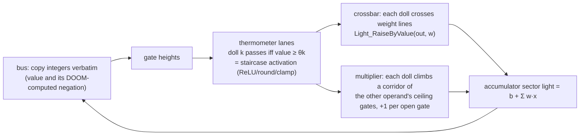

# How DOOM computes

- **Numbers are voodoo dolls.** An activation of 5 is five dolls released onto a conveyor.
- **Activation functions are staircases.** The bus sets a gate's height. Lane k's doll gets past only if the
  value clears that lane's threshold. Thresholds encode ReLU, scaling, rounding and clamping
  (`adc_signed`, `adc_relu` in [`intref.py`](../doomformer/intref.py)).
- **Matrix–vector products are crossbars.** Every released doll crosses one linedef per output whose special
  adds that weight to the output sector's light level (a saturating int16 accumulator).
- **Attention multiplies two runtime values.** Dolls of `q` climb a corridor of ceiling gates set by `k`.
  A doll fits under gate *l* only if `k ≥ φl` and crosses a `±1` line after each one, giving `count(q)·count(k)`.
  The shipped transformers use this as ReLU-style integer attention, except `doomnames_softmax`, which uses the softmax
  mode below. There is no LayerNorm.
- **Embedding lookup is an equality test.** One doll passes a floor gate `tok ≤ t`, then a floor gate `-tok ≤ -t`.
- **Ablation is a door.** Every block of lanes has a door at its zone entrance. Closing it removes that
  input from the sum. `DoomTransformer(ablate=...)` closes the right doors in every consuming tile (Python tells the
  game which doors to close). One film shows it in a single tile, with a switch the player shoots.
- **The bus performs no arithmetic.** Every tile also accumulates the negation of each output (duplicate lines with
  flipped signs), so consumers compare with `≥` or `≤` by choosing which value to read. Python copies
  integers between games, supplies the prompt and samples a letter from DOOM's logits. Softmax and sampling run in
  Python, seeded and mirrored by the reference. ACS scripts write gate heights, read light levels, reset tiles and
  sequence the start of a run (timing and barriers).

Tiles per generated letter and layer: `qkv → score × (heads × positions) → wsum × d → out → mlp_up → mlp_dn`,
plus `embed` and `unembed`: 106 distinct tile maps for the DOOM brain. Workers keep a bounded set of live games
and reuse or evict them, so "one game per tile" names logical instances. It is not an allocation guarantee.

## Softmax attention

A model with `"attn": "softmax"` in its config replaces the fixed `thr_o[t]` staircase (the 1/(t+1) normalisation)
with a quantised softmax whose exponential and division happen in DOOM (contract in the
[`intref.py`](../doomformer/intref.py) docstring). It uses only staircases, crossbars and multiplier corridors.

- **A log-spaced staircase is a quantised exponential.** `e = adc_relu(score, thr_a)` counts the thresholds the score
  clears. With `thr_a[k] = c + σ·ln(k+1)`, `score ≥ thr_a[k]` iff `exp((score − c)/σ) ≥ k + 1`, so
  `e = min(KA, ⌊exp((score − c)/σ)⌋)` (0 below `c`), up to threshold rounding. Training learns `c` and `σ`; the map only
  sees integer thresholds.
- **Truncated division is a count of comparisons.** With `den ≥ 1` and `LV = R·KV − 1` (`KV = len(thr_v)`),
  `trunc(R·num/den) = #{l ≤ LV : P_l ≥ 1} − #{l ≤ LV : N_l ≥ 1}`, where `P_l = R·num − l·den + 1` and
  `N_l = −R·num − l·den + 1`. `|num| ≤ KV·(den − 1)`, so `LV` levels per sign always suffice. `R` sets the resolution.
- **The null slot.** `den = 1 + Σ_u e_u`: one extra key whose logit sits at the first threshold and whose value is 0.
  It keeps `den ≥ 1`, so a query whose scores all fall below `thr_a[0]` attends to nothing (`ao = 0`).

What DOOM computes, per layer: `den` per head and position (a crossbar of the `e` lanes, bias 1); per position and
unit `zo = num = Σ e·v`, `P_l` and `N_l` (bias `1 − l`). The `e` lanes of each key position climb two multiplier
corridors, gated by `zv ≥ θ` and by `−zv ≥ θ`; each open gate adds `±1` to `zo`, `±R` to every `P_l` and `∓R` to every
`N_l`. The `+v` corridor starts with an ungated stage where every `e` doll adds `−l` to each `P_l` and `N_l` once
(`ops.attend`). The out layer has one lane per `P_l` and `N_l` (threshold 1) crossing `Wo` or `−Wo` lines into `z1`,
plus the residual. Python computes none of it: in tiles mode it copies the integers between games, and in both modes
it checks `den`, `zo`, `P`, `N` and their negation twins against the reference with tolerance 0
([`tests/test_softmax.py`](../tests/test_softmax.py); it also changes the `−l` lines of one `P_l` light from 3 to 4
and gets exactly that value off by `den − 1`).
A corridor whose first stage is ungated walks on its first gate's floor; before, such a corridor started lower down
and the compiler refused it as descending.

Sizes from `df.plan` (map: one-map layout; tiles: distinct tile WADs; thresholds from the shipped models, `thr_o`
dropped; for KA=4, `thr_a` = 1, 4, 6, 7):

| shape | attention | map dolls | map sectors | map fits (span) | tiles | tile dolls | tile sectors |
|---|---|---|---|---|---|---|---|
| doomnames (T=16, d=16, H=2, dm=32, K=KA=KM=7) | relu | 116,968 | 15,190,214 | no (31,989 x 919,832) | 38 | 10,462 | 135,912 |
| doomnames | softmax R=1 | 118,361 | 20,680,158 | no (31,993 x 969,288) | 39 | 4,662 | 131,290 |
| doomnames | softmax R=2 | 121,945 | 27,235,594 | no (31,993 x 1,010,568) | 39 | 4,886 | 198,266 |
| doomnames_onemap (T=6, d=8, H=1, dm=16, K=KA=KM=2) | relu | 3,548 | 95,448 | yes (31,947 x 6,728) | 18 | 728 | 11,498 |
| doomnames_onemap | softmax R=1 | 3,495 | 100,373 | yes (31,993 x 6,728) | 19 | 434 | 8,083 |
| doomnames_onemap | softmax R=2 | 3,687 | 119,125 | yes (31,951 x 6,920) | 19 | 466 | 9,771 |
| doomnames_onemap, KA=4 | softmax R=1 | 4,209 | 123,137 | yes (31,981 x 7,304) | 19 | 560 | 8,965 |

Softmax has one `out` tile instead of one per position, hence fewer distinct tile dolls. Per 16-position doomnames pass
the tile games run 117,216 (relu), 118,608 (softmax R=1) and 122,192 (softmax R=2) dolls in 624, 656 and 656 tile
runs.

## Engine facts

Measured with ViZDoom 1.3.2 in this setup. The last column says how each row is known: a **probe** map built to
measure it, a **test** in [`tests/`](../tests), or **compiler** (a rule the compiler or runtime relies on, found while
debugging; violating it breaks the exact checks).

| Finding | Consequence | How it is known |
|---|---|---|
| `puke N` drops a second start of script N in the same tic | inputs are written with `puke -N` (ExecuteAlways) | compiler (`runtime.py`) |
| `Sector_SetCurrent` never moves voodoo dolls | conveyors are stacked `Scroll_Floor` carry scrollers (arg2 = 1) | compiler |
| sector light is a **saturating int16**, not 0–255 | it is the accumulator; partial sums bounded to ±30,000 | compiler; bound enforced by `intref.check_limits` |
| heights are 16.16 fixed point: floor/ceiling spans ≥ 32768 overflow and dolls freeze | ports and thresholds live in ±12,000 | compiler; bound enforced by `intref.check_limits` |
| mover `height + speed` overflows for speeds above ~150,000 | gate writes take ≤ 2 tics | compiler |
| a doll straddling a gate and the next stair is judged against the higher floor | flat run-off after every gate | compiler (map geometry) |
| falling dolls mis-read gates | corridors only climb, using ceiling gates | probe; without landing pads the random-teacher perceptron is exact on 1/40 examples, and `tests/test_learnkit.py::test_broken_maps_are_caught` |
| a doll already pushing against a gate never climbs it when it opens to a 1–24 unit step | dolls wait at start barriers that drop to step 0 only after every port has settled | compiler |
| voodoo dolls do not inherit player-start TIDs | each doll tags itself by crossing an `ACS_ExecuteAlways` line; reset = `TeleportOther` home | compiler |
| two floor/ceiling moves (plane-mover specials) aimed at the **same sector in the same tic**: one is silently lost | dolls that write the same plane get distinct time slots (greedy colouring of their target sets); per-lane sync barriers absorb ~8 tics of arrival jitter | compiler (`pure.py`) |
| a doll stuck at a closed gate walks on as soon as a **later** layer moves that gate's plane | freeze barriers behind every gate, raised by the clock before the next layer starts | probe (31/40 exact without freeze barriers vs 40/40 with them); `tests/test_doom_exact.py::test_freeze_barriers_are_necessary` |
| lines crossed in one tic are processed last-crossed first, and a `TeleportOther` stops the rest: 0 of 70 lanes break that rule at 4- and 8-unit spacing; a floor line sharing a tic with a teleport fired 0/17 when crossed first, 17/17 when crossed last; at 64-unit spacing everything fires | freezing uses floor movers, never teleport lines | probe |
| a doll crosses a floor gate on top of the port, then falls back for ~6 tics (~70 units); DOOM's step check uses its current height | 128 extra units of post after every floor gate, so it lands before the next gate (without them a falling doll at z=−15 stepped onto a port 26 above the walkway) | probe |
| ViZDoom's `advance_action` repeats the last action every tic | while his brain runs, his buttons are released (`set_action`); otherwise he spins or empties his pistol into a wall while thinking | compiler (runtime) |
| a freshly pressed turn key turns slowly for its first tics, and he lets go of every key while he thinks | exact per-tic turning (`TURN_LEFT_RIGHT_DELTA`, 3.515625° = DOOM's held-key speed); with keys the aimbot turned ~6° per decision instead of ~14° and got 1–3 kills per life | compiler (runtime) |
| dormant (`Thing_Deactivate`d) monsters take no damage (0 kills from 10 aimed shots while frozen, 10 from 10 awake), and the pistol's bullet leaves a few tics after the trigger | after pulling the trigger he stays awake, hands off, until the bullet is out | probe |
| a line special with a nonzero TID crossed by a voodoo doll acts on the thing with that TID (the real player); with TID 0 it acts on the doll | output spikes move the marine with `ThrustThing`/`ThrustThingZ` lines aimed at his TID | probe (8/8 steps exact in both variants) |
| buddha mode plus an empty pistol means he punches 1-health demons for as long as he lives (30+ kills from 26 bullets) | a life also ends when his 26 bullets are spent | compiler (runtime) |
| 16.16 fixed-point coordinate differences wrap beyond 32,767 units: in maps wider or taller than about 34,000 units the engine puts things in the wrong sector (the player in a plain room was carried 422 units in 35 tics by the brain's conveyors; DOOM-trained perceptrons lost weight updates) | every compiled map (one-map brains with their world, and every tile map) must fit 32,000 x 32,000 units. The compiler packs one-map brains into that square and refuses anything larger. The earlier one-map runs (SHIL, his brain is the level, the fly loop) used ~58,000-unit maps. Every value in them was read back and checked exact, but in such maps exactness depends on the BSP | probe (78 maps, [`engine_limits.md`](engine_limits.md)); `tests/test_span.py` |
| ViZDoom's state lists at most 4,096 objects, so with more than 4,095 voodoo dolls a settle check that watches the object list can declare a pass finished while hidden dolls still move | an in-map ACS script compares every doll's position each window, and settling requires it to report zero movement as well | `tests/test_settle.py` (a 4,204-doll map: the list-only check settles falsely, the motion check is exact) |

## Speed

Model time is not wall time, and DOOM is an absurdly slow computer. In a paired measurement DOOM and NumPy get identical
inputs; 3 warm-up runs are excluded and 30 timed runs give mean ± standard deviation. One DOOM process runs headless on a
shared 16-core Linux AArch64 host with other load (Python 3.14.7, NumPy 2.5.4, ViZDoom 1.3.2):

| workload | DOOM: write inputs, run, read back (wall time) | NumPy reference | ratio | exact |
|---|---|---|---|---|
| integer MLP 12→16→6, one forward pass (202 voodoo dolls, 6,521 sectors) | 726 ms ± 20 | 11.1 µs ± 0.2 | ~65,000× slower | 33/33 |
| FlyWire feeding circuit, one 1 ms model step (200 neurons, 861 dolls, 23,912 sectors) | 2.95 s ± 0.06 | 40.6 µs ± 4.3 | ~73,000× slower | 33/33 |

One millisecond of the fly circuit takes about 3 s of wall time, roughly 3,000× slower than the fly. The DOOM time covers
writing the inputs, running the game until every doll stops and reading the results back. The reference computation and
the comparison are outside the timer. Compilation, engine start-up and the warm-up runs are excluded.

Other measured times:

- the random 180-neuron/5,102-synapse network: 2.34 s per step
- the combined 255-neuron fly brain: 4.9 s per step
- the 8-feature perceptron: 74 ms per example (40 examples)
- the one-game learner: 554.7 s for 931 decisions (about 0.6 s per decision, including arena and readback, no video)
- the name generator: 69.3 s for NECROGENER (11 positions, 1,342 tile executions, 16 workers;
  [`run_model_log.txt`](../models/doombrain/run_model_log.txt))

Edited video durations are not experiment wall time: the fly film's 219 DOOM steps took 582 s to record, including video.
This is a demonstration of computing with game mechanics. It is not an acceleration result, and these times should not be
compared with an RL environment's frames per second.
