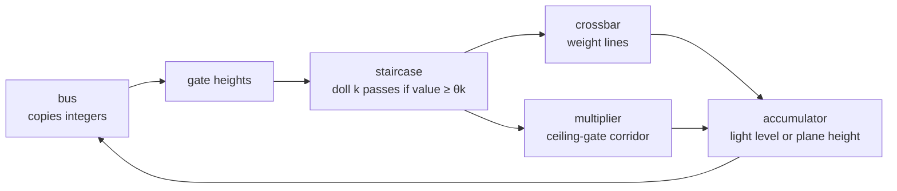
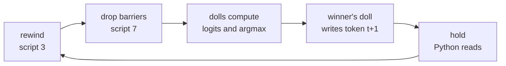

# How DOOM computes

This page shows how a DOOM map does neural-network arithmetic. Voodoo dolls carry the values, and lines on the floor
add the weights.

DOOM turns every extra player-1 start into a voodoo doll. A doll is a copy of the player. It rides conveyors and
triggers every line it crosses. The compiler builds a map in which dolls do the arithmetic.

> [!NOTE]
> Python reads every result back from the running game. It compares each one with a NumPy integer reference.

| In the network | In the map |
|---|---|
| a number: an activation of 5 | five dolls released onto a conveyor |
| a weight | a line. A crossing doll adds the weight to a light level or moves a later gate |
| a sum | a light level (tile maps) or a plane height (one-map designs). Light is a saturating int16 |
| an activation function | a staircase of gates. Step spacing gives ReLU, rounding or clamping |
| attention, a product of two live values | dolls of one value climb ceiling gates set by the other. Each open gate adds 1 |
| an embedding lookup | an equality test: floor gate `tok ≤ t`, then floor gate `-tok ≤ -t` |
| ablating a neuron | a closed door in front of its dolls |

<table>
<tr>
<td width="50%" valign="top"> <b>A crossbar.</b> Each doll crosses one weight line per output.</td>
<td width="50%" valign="top"> <b>Attention.</b> Dolls squeeze under ceiling gates set by another value.</td>
</tr>
</table>

One layer works like this in tile maps. The bus copies each value and its negation into gate heights. A staircase turns
gate heights into dolls. Crossbars and multiplier corridors add up the next layer's sums.

- **Activations are staircases.** The bus sets a gate's height. Lane k's doll passes only if the value clears its
  threshold. Thresholds give ReLU, scaling, rounding and clamping (`adc_signed`, `adc_relu` in
  [`intref.py`](../doomformer/intref.py)).
- **Matrix-vector products are crossbars.** Each doll crosses one line per output. The line adds the weight to a light
  level. In one map it moves the next layer's gate instead.
- **Attention multiplies two runtime values.** Dolls of `q` climb ceiling gates set by `k`. A doll fits under gate *l*
  only if `k ≥ φl`. It crosses a `±1` line after each gate, giving `count(q)·count(k)`.
- **Embedding lookup is an equality test.** One doll passes a floor gate `tok ≤ t`, then a floor gate `-tok ≤ -t`.
- **Ablation is a door.** Each block of lanes has a door. Closing it removes that input from the sum. Other
  interventions patch the exposed value ([interventions.md](interventions.md)).
- **The bus does no arithmetic.** Each tile also sums the negation of each output. A consumer picks `≥` or `≤` by
  choosing which value to read.

Most shipped transformers use ReLU-style integer attention. Three use [softmax](#softmax-attention):
`doomnames_softmax`, `doomnames_onemap_softmax` and `doomnames_modern`. `doomnames_modern` also has [RMSNorm](#rmsnorm).
No model has LayerNorm.

## One map or tiles

A network runs either in one map or cut into tile maps.

In one map, such as `mnist`, `draw` or `demo --one-map`, a line special moves the next layer's gate directly. So the
sum is a plane height. Only outputs nobody reads end in light levels.

A model too large for one map is cut into tiles. Per letter and layer the tiles are
`qkv → score × (heads × positions) → wsum × d → out → mlp_up → mlp_dn`, plus `embed` and `unembed`. The DOOM brain has
106 distinct tile maps.

Python copies integers between tiles, and a pool of games runs them. "Tile instance" counts logical runs, not live
games. Cost and throughput of both designs are in [scaling.md](scaling.md).

ACS scripts write gate heights, read light levels, reset tiles and start runs. Python supplies the prompt. It samples
each letter from DOOM's logits, seeded and mirrored by the reference. Only `demo --one-map --loop` lets the dolls pick
every letter.

## Softmax attention

Softmax attention computes the exponential and the division in DOOM. It uses only staircases, crossbars and
multiplier corridors.

A model with `"attn": "softmax"` replaces the fixed `thr_o[t]` staircase, the 1/(t+1) normalisation. The contract is
in the [`intref.py`](../doomformer/intref.py) docstring.

- **A log-spaced staircase is a quantised exponential.** `e = adc_relu(score, thr_a)` counts the thresholds the score
  clears. Let `thr_a[k] = c + σ·ln(k+1)`. Then `score ≥ thr_a[k]` iff `exp((score − c)/σ) ≥ k + 1`.
  So `e = min(KA, ⌊exp((score − c)/σ)⌋)`, up to threshold rounding. Training learns `c` and `σ`.
- **Truncated division is a count of comparisons.** Let `den ≥ 1`, `KV = len(thr_v)` and `LV = R·KV − 1`. Then
  `trunc(R·num/den) = #{l ≤ LV : P_l ≥ 1} − #{l ≤ LV : N_l ≥ 1}`.
  Here `P_l = R·num − l·den + 1` and `N_l = −R·num − l·den + 1`.
  `|num| ≤ KV·(den − 1)`, so `LV` levels per sign suffice. `R` sets the resolution.
- **The null slot.** `den = 1 + Σ_u e_u` adds one key with logit at the first threshold and value 0. It keeps
  `den ≥ 1`. A query whose scores all fall below `thr_a[0]` attends to nothing.

Per layer, DOOM computes `den` per head and position. It is a crossbar of the `e` lanes with bias 1. Per position and
unit, DOOM computes `zo = num = Σ e·v`, `P_l` and `N_l` with bias `1 − l`.

The `e` lanes of each key climb two multiplier corridors, gated by `zv ≥ θ` and `−zv ≥ θ`. Each open gate adds `±1`
to `zo`, `±R` to every `P_l` and `∓R` to every `N_l`.

The `+v` corridor starts with an ungated stage. There every `e` doll adds `−l` to each `P_l` and `N_l` once
(`ops.attend`). The out layer has one lane per `P_l` and `N_l`, threshold 1. These lanes cross `Wo` or `−Wo` lines
into `z1`.

Python checks `den`, `zo`, `P`, `N` and their negations with tolerance 0
([`tests/test_softmax.py`](../tests/test_softmax.py)).

<b>Map and tile sizes from <code>df.plan</code></b>

Thresholds come from the shipped relu models with `thr_o` dropped. The last row is the trained
`doomnames_onemap_softmax` with `thr_a` = 1, 3, 4, 5.

| shape | attention | map dolls | map sectors | map fits (span) | tiles | tile dolls | tile sectors |
|---|---|---|---|---|---|---|---|
| doomnames (T=16, d=16, H=2, dm=32, K=KA=KM=7) | relu | 116,968 | 15,190,214 | no (31,989 x 919,832) | 38 | 10,462 | 135,912 |
| doomnames | softmax R=1 | 118,361 | 20,680,158 | no (31,993 x 969,288) | 39 | 4,662 | 131,290 |
| doomnames | softmax R=2 | 121,945 | 27,235,594 | no (31,993 x 1,010,568) | 39 | 4,886 | 198,266 |
| doomnames_onemap (T=6, d=8, H=1, dm=16, K=KA=KM=2) | relu | 3,548 | 95,448 | yes (31,947 x 6,728) | 18 | 728 | 11,498 |
| doomnames_onemap | softmax R=1 | 3,495 | 100,373 | yes (31,993 x 6,728) | 19 | 434 | 8,083 |
| doomnames_onemap | softmax R=2 | 3,687 | 119,125 | yes (31,951 x 6,920) | 19 | 466 | 9,771 |
| doomnames_onemap_softmax (KA=4, trained) | softmax R=1 | 4,209 | 123,066 | yes (31,981 x 7,304) | 19 | 560 | 8,961 |

Softmax has one `out` tile instead of one per position. So it has fewer distinct tile dolls.

`models/doomnames_onemap_softmax` is the one-map shape with KA=4. Training learned c = 1.23 and σ = 2.61. So `e`
takes every value 0..4. `doomformer demo --one-map --softmax` runs it. Accuracy, tics and wall time per letter are in
[its EVAL.md](../models/doomnames_onemap_softmax/EVAL.md).

## RMSNorm

RMSNorm divides each value by the root mean square of its vector. Here it uses only crossbars and indicator lanes.

A model with `"norm": "rms"` normalises the input of q/k/v and of the MLP. The residuals keep the raw values. The norm
reads the staircase counts `c` of the `d` units, `|c_i| ≤ K`. The exact definition is in the
[`intref.py`](../doomformer/intref.py) docstring.

- **A square is a sum of odd numbers.** Lane `k` of a staircase adds `2k − 1` to `s`. The passing lanes are always the
  first `c` of a sign, and `1 + 3 + … + (2c − 1) = c²`. So `s = Σ c_i²` is one accumulator.
- **The integer RMS is a fixed staircase.** `r = #{k ≤ K : s ≥ d·k²} = ⌊√(s/d)⌋` exactly, because `s ≤ d·K²`. The
  thresholds `d·k²` are fixed, 16 to 784 at d = 16, K = 7.
- **The division reuses the softmax count.** The target is `n_i = trunc(Rn·c_i/(1 + r))`.
  It equals `#{l ≤ LN : P_l ≥ 1} − #{l ≤ LN : N_l ≥ 1}`.
  Here `P_l = Rn·c_i − l·(1 + r) + 1` and `N_l = −Rn·c_i − l·(1 + r) + 1`.
  The 1 in `1 + r` keeps the divisor at least 1.
- **The level count is bounded.** `c_i² ≤ s < d·(1 + r)²` gives `|n_i| < Rn·√d`. So
  `LN = min(Rn·K, isqrt(Rn²·d − 1))` levels per sign suffice. `tests/test_arch.py` checks every `c` for small `d`, `K`.
- **Gains fold away.** A gain `γ_i` multiplies `n_i` before a weight matrix. So it becomes a column scale of that matrix.

Per norm site and position, DOOM computes `s`, then `P_i,l`, `N_i,l` and `r`. Each lane of `c_i` adds `±Rn` to
`P_i,l` and `∓Rn` to `N_i,l`. Each lane of the `s` staircase adds `−l` to every `P` and `N`, and 1 to `r`.

The consumer reads `n_i` through indicator lanes `[P_i,l ≥ 1]` and `[N_i,l ≥ 1]`. They cross `W` or `−W` lines.

In tiles a norm site is two tiles, `sumsq_<site>` and `norm_<site>`. Both modes check `s`, `r`, `P`, `N` and their
negations with tolerance 0.

## Gated MLP

A gated MLP multiplies two hidden values. In DOOM the product never exists as a value.

A model with `"mlp": "reglu"` has `m_j = adc_relu(zg_j, thr_g) · adc_signed(zu_j, thr_u)`. Here `zg = Wg·x + bg`,
`zu = Wu·x + bu` and `z2 = Wdn·m + r2·x1 + bdn`.

The `g` dolls of unit `j` climb two multiplier corridors of `zu_j`'s ceiling gates. Each gate they pass adds
`±Wdn[:, j]` to all `d` outputs (`ops.gated`). A gated unit costs `2·KM` dolls in the down layer, a relu unit `KM`.
DOOM exposes `zg`, `zu` and `z2`.

`models/doomnames_modern` combines RMSNorm, softmax attention and the gated MLP. In tiles it is 43 tile maps with
6,890 dolls and 247,164 sectors. `doomformer demo --model doomnames_modern` writes MILL in 170 tile runs on 6 games.
It takes 34 s and checks 62,000 values, all exact. Accuracy is in [its EVAL.md](../models/doomnames_modern/EVAL.md).

## Generation without Python

Here one map writes a whole name with no help from Python. The dolls pick every token and write it into the next
position.

`doomformer demo --one-map --loop` runs [`selfgen.py`](../doomformer/selfgen.py). Add `--softmax` for the softmax
model. Python only advances the clock and reads.

- **Greedy decoding as a fixed point.** The context starts as BOS, the prompt and placeholder zeros up to T. Each
  pass, every position from len(prompt) to T−2 writes its argmax into the next position. Attention is causal. So
  T−1−len(prompt) passes give greedy generation up to the first EOS.
- **Reference.** `selfgen.iterate` mirrors every pass. `tests/test_selfgen.py` checks it against `intref.generate` on
  300 random models and prompts.
- **An argmax at every writing position.** The unembedding writes `d_ab = logit_a − logit_b + 1` for every pair, 435
  pairs for 30 tokens. `argmax.compare` counts wins. `argmax.winner` lights exactly one `argz:t:a`
  ([`onemap.py`](../doomformer/onemap.py)).
- **The winner writes the next token.** Token ports are state values the rewind leaves alone. The winner's doll at t
  crosses two `Floor_MoveToValue` lines: `tok:t+1` to a, `-tok:t+1` to −a. No script picks a token.
- **The level repeats the passes.** An OPEN script rewinds and drops the barriers. It samples doll positions every 8
  tics. Once nothing moves, it holds the pass for readout. It reads positions and the clock, never a value.
- **Python only reads.** Through `readout.ReadoutOnly` it advances the clock and runs readout scripts. In each hold it
  reads every value and compares with the reference pass. The text must equal `intref.generate`.

Results with an empty prompt, one core per game:

| model | dolls | sectors | span | tics per pass | wall time per pass | passes | values per pass | wrote |
|---|---|---|---|---|---|---|---|---|
| doomnames_onemap | 5,875 | 274,483 | 31,947 x 9,464 | 4,000 | 186 to 190 s | 5 | 5,898 | DAN |
| doomnames_onemap_softmax | 6,536 | 301,381 | 31,981 x 10,088 | 4,656 | 237 to 259 s | 5 | 6,102 | DAGE |

The comparators cost 512 tics per pass in both models. The audits show only readout commands.

Two negative controls fail as they should. A winner line that writes the wrong token fails pass 1 on `tok:1`. A read
400 tics into a pass fails too.

### Stopping at EOS

With `--until-eos` the network also decides when the loop ends. One map file serves every prompt of one length.

`doomformer demo --one-map --loop --until-eos` runs [`selfhalt.py`](../doomformer/selfhalt.py).

- **A halt latch per position.** The winner lines of position t cross a third `Floor_MoveToValue` line on port
  `halt:t`. It writes 1 for EOS, 0 otherwise. The port's sector is the floor gate of an extra `embed` lane that never
  closes.
- **Only the frontier counts.** In pass p only the winner at position len(prompt)+p−1 is final. Later positions read
  placeholders and can pick EOS. In the test model, prompt `B` gets EOS at position 2 in pass 1.
- **The level leaves its loop.** After each pass the OPEN script reads one plane height, the frontier's latch. It holds
  the pass for readout and stops if the latch is 1. It reads no other value and picks no token.
- **One map, many prompts.** Every token port starts at 0, so the map depends only on prompt length. Python writes the
  prompt with `readout.LoadThenReadout.load`, reads it back and seals. After that it only reads. `audit()` counts loads
  apart.
- **Checks.** `UntilEosRun` compares every value of every pass with `selfgen.iterate`. It checks the latch. It requires
  the level to stop at the first EOS or at the bound.

Results with one game at a time on a loaded machine. Wall time includes map load.

| map | dolls | sectors | prompt | passes run / bound | tics per pass | wall time | wrote |
|---|---|---|---|---|---|---|---|
| test model (T=4, V=5, seed 24) | 978 | 21,834 | C | 1 / 2 | 2,168 | 14 s | C |
| same file | | | B | 2 / 2 | 2,168 | 27 s | BAA |
| `--fast` toy model | 611 | 13,195 | A | 1 / 1 | 1,992 | 9 s | AC |
| `--fast`, same sha256 | | | B | 1 / 1 | 1,992 | 16 s | BC |
| `doomnames_onemap` | 4,482 | 167,171 | DAN | 1 / 2 | 4,000 | 227 s | DAN |

Negative control: a map whose EOS winner writes latch 0. With prompt `C`, pass 1 fails on `halt:1`. The level then
starts pass 2.

## Engine features it needs

These are the engine features the compiler uses for the network itself. Demos add more, such as `Thing_Damage` and
cameras.

| feature | what it does here | in Boom |
|---|---|---|
| voodoo dolls (extra player 1 starts) | one doll is one unit of a value | yes |
| `Scroll_Floor` carry scrollers | conveyors move the dolls along their lanes | yes |
| `Light_RaiseByValue`, `Light_LowerByValue` | a weight line adds to a light-level sum | no: only fixed light levels |
| `Floor_` and `Ceiling_RaiseByValue`, `LowerByValue` | a weight line adds to a height sum | no: only fixed steps and neighbour heights |
| `Floor_MoveToValue`, `Ceiling_MoveToValue` | write an input, reset a value | no |
| `Floor_LowerToLowest` | open the start barrier of a layer | yes |
| `Teleport_NoFog`, `TeleportOther` | send dolls home between passes | silent teleport yes, by TID no |
| `Thing_ChangeTID`, `ACS_ExecuteAlways` lines | dolls tag themselves | no |
| ACS scripts | write inputs, rewind, copy values out for Python to read | no |
| UDMF map format | large maps, sector tags above 32,767 | no |

The Boom column comes from the Boom specification, not from a test. Boom has no ACS and no line that adds an arbitrary
amount to a light or a height. A Boom version would need weights built from fixed steps and another way to read the
values out. None is built.

## Engine facts

DOOM has sharp edges that break exact arithmetic. This table lists each one and how the compiler avoids it.

> [!TIP]
> `doomformer facts` runs 28 probes as tiny maps in about 10 s. It prints PASS or FAIL per row
> ([`facts.py`](../doomformer/facts.py)).

All rows are measured in ViZDoom 1.3.2, whose engine is ZDoom 2.8.1. Other engines are covered in
[Other ports](engine_limits.md#other-ports). The last column names a **probe** map, a **test** in [`tests/`](../tests),
or a **compiler** rule. Breaking a compiler rule breaks the exact checks.

| Finding | Consequence | How it is known |
|---|---|---|
| `puke N` drops a second start of script N in the same tic | inputs use `puke -N` (ExecuteAlways) | compiler (`runtime.py`); probe `puke` |
| `Sector_SetCurrent` moves no thing: no doll, player or barrel | conveyors are stacked `Scroll_Floor` carry scrollers (arg2 = 1) | compiler; probe `setcurrent` |
| sector light is a **saturating int16**, not 0–255 | it is the accumulator; partial sums within ±30,000 | `intref.check_limits`; probes `light_saturates`, `light_same_tic` |
| heights are 16.16: a span of 32,768 or more freezes player and dolls, 32,767 does not | ports and thresholds stay in ±12,000 | `intref.check_limits`; probe `plane_span` |
| a plane mover steps speed/8 per tic: 150,000 and 262,144 reach 12,000 in one tic, 300,000 and 500,000 overshoot | gate writes take ≤ 2 tics | compiler; probe `mover_speed` |
| a move starting beyond about ±14,018 keeps the mover busy 3 tics and drops requests in that window | moved planes stay within ±14,018 | `net.check`, `compile`, `intref.check_limits(planes=True)`; probe `mover_busy` |
| a doll straddling a gate and the next stair is judged against the higher floor | flat run-off after every gate | compiler (map geometry) |
| falling dolls mis-read gates | corridors only climb, using ceiling gates | probe; `tests/test_learnkit.py::test_broken_maps_are_caught` |
| a doll already pushing on a gate never climbs a 1–24 unit step when it opens | dolls wait at start barriers that drop after every port settles | compiler; probe `gate_opens` |
| voodoo dolls do not inherit player-start TIDs | each doll tags itself on an `ACS_ExecuteAlways` line; reset = `TeleportOther` home | compiler; probes `voodoo_tid`, `self_tag` |
| a plane mover refuses a second request on one plane while the first moves | dolls that write one plane get distinct time slots ([scheduling.md](scheduling.md)); sync barriers absorb ~8 tics of jitter | compiler (`pure.py`, `waves.py`); probes `mover_same_tic`, `mover_active_lock`; `tests/test_waves.py` |
| a doll stuck at a closed gate walks on when a **later** layer moves that gate | freeze barriers behind every gate, raised before the next layer | probe (31/40 exact without, 40/40 with); `tests/test_doom_exact.py::test_freeze_barriers_are_necessary` |
| lines crossed in one tic run last-crossed first, and a `TeleportOther` stops the rest | freezing uses floor movers, never teleport lines | probes `teleport_cancels`, `teleport_first` |
| a doll crossing a floor gate falls back ~70 units over ~6 tics, then steps from there | 128 extra units of post after every floor gate | probe `doll_fall` |
| ViZDoom's `advance_action` repeats the last action every tic | his buttons are released while his brain runs | compiler (runtime); probe `advance_action` |
| a freshly pressed turn key turns slowly at first | exact per-tic turning (`TURN_LEFT_RIGHT_DELTA`, 3.515625°) | compiler (runtime); probe `turn_key` |
| dormant (`Thing_Deactivate`d) monsters take no damage, and a pistol bullet leaves a few tics after the trigger | he stays awake, hands off, until the bullet is out | probe `dormant` |
| a doll crossing a special with a nonzero TID acts on that thing, with TID 0 on itself | output spikes move the marine with `ThrustThing` lines aimed at his TID | probe `line_special_tid` (8/8 exact) |
| buddha mode plus an empty pistol lets him punch 1-health demons forever | a life also ends when his 26 bullets are spent | compiler (runtime) |
| coordinates wrap beyond 32,767 units, so a far thing can land in the wrong sector | every compiled map must fit 32,000 x 32,000 units | probe (78 maps, [engine_limits.md](engine_limits.md)); `tests/test_span.py`; probes `wrap_lone_room`, `wrap_balanced` |
| ViZDoom's state lists at most 4,096 objects, so a list-based settle check misses hidden dolls | an in-map ACS script compares every doll's position each window | `tests/test_settle.py`; probe `object_list` |

The compiler refuses any map that exceeds 32,000 units on either axis. The busy-mover bound is 14,018 for a floor raise
and 14,017 for a ceiling raise, mirrored for lowers ([verification.md](verification.md#the-plane-move-bound)).

## Who does what, per demo

Three actors take part in every run: dolls, ACS scripts and Python. This section says who does what in each demo.

- **Dolls and line specials** do the multiply-adds, staircases, comparisons and counts.
- **ACS level scripts** are small programs in the map. Scripts 1 and 2 move a port gate. Script 3 rewinds the dolls,
  and 7 drops the start barriers. Scripts 100 and up copy values into user variables. A motion script counts moving
  dolls in maps over 4,095 dolls.
- **Python** builds the map. Per demo, it writes inputs, advances the clock, reads and compares. In the closed-loop
  levels, [`readout.py`](../doomformer/readout.py) makes Python read-only. Any other call raises.

| demo | Python | ACS scripts | dolls and line specials | source |
|---|---|---|---|---|
| `mnist`, `df.compile`, `run_many` | compiles; encodes and writes inputs (`puke -1`, 784 ports for MNIST); rewinds, releases, waits; reads and compares | 1, 3, 7; readout | everything numeric, including 45 comparisons, 10 win counts and the winner | [`runtime.py`](../doomformer/runtime.py), [`kit.py`](../doomformer/kit.py), [`cli.py`](../doomformer/cli.py) |
| `draw` (window) | advances, polls STATUS for READ, reads and compares after the pass | pen, READ, CLEAR, HUD, SHOW; at `--opt 3` a copy script between layers | the network and the choice; the winner's doll crosses its `y_d` line | [`drawpad.py`](../doomformer/drawpad.py) |
| `draw --digit d` | as `draw`, plus a stand-in player that walks the digit and presses USE; read-only from READ on | as `draw` | as `draw` | `drawpad.py` (`Walker`) |
| `demo` (tiles), `ask`, `--nightmare`, `--softmax`, `--model doomnames_modern` | compiles tiles; copies outputs and negations between tiles; schedules games; samples letters; closes ablation doors; compares | 1, 3, 7, readout per tile | each tile's arithmetic, including softmax and RMSNorm | [`orchestrator.py`](../doomformer/orchestrator.py), [`tiled.py`](../doomformer/tiled.py), [`model_tiles.py`](../doomformer/model_tiles.py) |
| `demo --one-map` | writes tokens, waits, reads logits, samples the letter | 1, 3, 7, readout | embedding to logits in one map | [`onemap.py`](../doomformer/onemap.py) |
| `demo --one-map --loop` | advances the clock and reads through `ReadoutOnly`; compares | one OPEN script: rewind, release, watch motion, hold, repeat. Reads no value | comparators over 30 logits; the winner writes the next token | [`selfgen.py`](../doomformer/selfgen.py) |
| `demo --one-map --loop --until-eos` | writes the prompt once, reads it back, seals; then as `--loop` | as `--loop`, and stops when the frontier latch reads 1 | as `--loop`, plus the halt latch | [`selfhalt.py`](../doomformer/selfhalt.py) |
| *his brain is the level* | advances tics; reads; recomputes sensed tokens; compares values and the received action | freezes demons, senses in fixed point, writes tokens, releases dolls, waits a fixed budget, turns him, fires | the policy transformer and the argmax; the winner runs `ACS_ExecuteAlways(213, 0, action)` | [`demos/brainlevel.py`](../demos/brainlevel.py), [`brainacs.py`](../doomformer/brainacs.py) |
| *DOOM learns* | bins 19 binary features; gives aimbot labels; freezes demons; films | arena rules | scores, action choice and the perceptron update in ceiling heights | [`demos/arena.py`](../demos/arena.py), [`aimlearn.py`](../demos/aimlearn.py), [`learn.py`](../doomformer/learn.py) |
| *the fly* (`flyloop`) | calibrates on a twin game; then advances and reads; replicates the circuit | 1 ms step clock; sensing; input spikes from an in-map Park-Miller generator; transport | 255 neurons; output spikes thrust the marine | [`demos/flyloop.py`](../demos/flyloop.py), [`spiking.py`](../doomformer/spiking.py) |
| *DOOM plays DOOM* (walker) | computes the five tokens; runs policy tiles; turns the argmax into key presses | tile scripts only | the policy transformer's arithmetic | [`demos/walker.py`](../demos/walker.py), [`levelgen.py`](../demos/levelgen.py) |

The dolls choose the answer in `mnist`, `draw`, `--loop`, *his brain is the level* and *the fly*. In the tile demos,
`--one-map`, `ask` and the walker, Python chooses from DOOM's logits.

<b>Accurate and inaccurate ways to describe a run</b>

| wording | accurate |
|---|---|
| "The dolls compute the sums, activations, comparisons and counts." | yes |
| "Python reads the values back and compares them with the NumPy integer reference, tolerance 0." | yes |
| "Python advances the clock and reads." | only for `--loop`, *his brain is the level* and *the fly* |
| "The level senses and acts." | yes. ACS does sensing and actuation, never the network |
| "Python only compares." | no. Python writes inputs except in the closed-loop levels and `draw` |
| "The light levels hold the sums." | no. In one map a sum is often a plane height |
| "No Python" for `--one-map` | no. Python writes tokens and samples letters. Only `--loop` has none |
| "The dolls choose" for the tile demos, `ask`, the walker | no. Python chooses from DOOM's logits |
| "Reads the connectome", "a fly's brain" | no. The circuit is derived from FlyWire, simplified, with synthetic input |

## Speed

> [!WARNING]
> DOOM is slow. Every sector runs idle conveyor scrollers on every tic.

A pass costs roughly `tics x sectors x 90 ns + tics x dolls x 1 us` of engine CPU. `doomformer plan` predicts it.

A one-map layer releases its dolls in serial waves. That is where the tics come from. Tiles cut the tics but add
Python copies between layers.

Measured times, ratios against NumPy and the cost model are in [scaling.md](scaling.md#cost-model).
