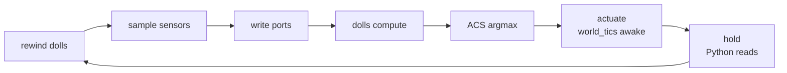

# Autonomous agents: the brain and the world in one map

An `Agent` puts sensors, an integer MLP or transformer, and actuators in one map. ACS samples the world, runs the
network and selects an action from its scores.

During the live game, Python advances tics and runs allowlisted readout scripts. The map writes inputs, resets the
network and runs its own clock.

```python
from doomformer.agent import Agent, Actuator
from doomformer import sense
from doomformer.kit import MLP

net = MLP([[[1], [-1], [0]]], [[-8, 8, 1]], [list(range(1, 18))],
          signed_input=False)

def world(m):
    m.rect(-1024, -3072, 0, -2048, floor=0, ceil=128, tag=20)
    m.thing(-112, -2560, 3002, id=901)  # sensed monsters share this TID
    m.thing(-512, -2560, 1, angle=45)   # final player start is the marine
    return ""

with Agent(net, sensors=[sense.bearing()],
           actuators={0: Actuator.turn(640), 1: Actuator.turn(-640),
                      2: Actuator.fire()},
           world=world, world_tics=4) as agent:
    records = agent.run(32)
    print(records[-1], agent.audit())
```

Start from [`08_your_own_agent.py`](../examples/08_your_own_agent.py), a two-sensor example.
[`07_autonomous_turret.py`](../examples/07_autonomous_turret.py) is a smaller turret with a one-health demon.

## Execution

| Component | Responsibility |
|---|---|
| Python, before the live game | Build geometry and ACS, time a separate twin, build the integer reference |
| DOOM engine queries | Health, ammo, positions, angles, distance, visibility, sector membership |
| ACS level scripts | Pick the nearest live monster, bin sensors, write ports, run dolls, read outputs, argmax, actuate |
| DOOM dolls and geometry | All network arithmetic, including Transformer attention and MLP |
| Python, during the live game | Advance tics, read samples and network values, replicate sensors and network, compare at tolerance 0 |

The example networks are hand-written. They compute action scores; the surrounding level defines spawns, monster
health, freezing, sensing, the clock, argmax and actuation.

Calibration runs on a separate clock-free twin, which closes before the live game opens. An Agent therefore uses at
most one DOOM process. `audit()` covers the live game.

## Sensors

Each sensor samples once, before that decision's computation. Verification uses the values recorded at sample time.

| Constructor | Integer result |
|---|---|
| `bearing(tokens=False)` | Nearest live monster's relative-bearing bin 0..16; no live monster = 17 |
| `distance(tokens=False)` | Nearest live monster's distance bin 0..4, edges 100/200/350/550 map units; no monster = 4 |
| `health(scale=1, offset=0)` | `trunc_toward_zero((health - offset) / scale)` |
| `ammo(scale=1, offset=0)` | Same expression on the integer `Clip` inventory |
| `x_bin(width=64, origin=0)` | `trunc_toward_zero((floor(X) - origin) / width)` |
| `y_bin(width=64, origin=0)` | Same on Y; floor is the arithmetic right shift of the raw 16.16 coordinate |
| `monster_count()` | Count of actors with `monster_tid` and sampled health > 0 |
| `sector_flag(tag)` | `int(ThingCountSector(T_NONE, player_tid, tag) != 0)` |
| `line_of_sight()` | `CheckSight(player_tid, nearest_tid, 0)` converted to 0/1; no live monster = 0 |
| `constant(value)` | The specified integer, e.g. Transformer BOS token 0 |

* **Nearest**: smallest `VectorLength(dx,dy)`, then smallest signed bearing. Exact ties keep the engine's first actor.
  Dead actors are recorded, not selected.
* **Distance edges** are raw 16.16 query results. Each edge belongs to the higher bin.
* **Bearing edges** in degrees: `-100,-60,-35,-20,-12,-7,-4,-2,2,4,7,12,20,35,60,100`.
* **Bearing method**: the engine's 16-bit `VectorAngle`. Within 12 angle units of an edge, a fixed-point cross product.
  Formulas: `sense.nearest_replica`, `brainacs.sensor_acs`.
* **`tokens=True`** returns `policy.VOCAB` indexes. Bearing starts at `'a'`, distance at `'0'`, absent bearing is `'?'`.

Python checks selection and binning from the recorded primitive queries. It trusts the engine's visibility, sector
lookup, health, distance and angle functions. Kills are engine statistics, not network outputs.

## MLP and Transformer wiring

An MLP takes one sensor per input; bins are passed directly as integers.
A transformer takes 1 to `net.T` sensor tokens. For the policy vocabulary:

```python
sensors = [sense.constant(0), sense.bearing(tokens=True),
           sense.distance(tokens=True)]
actuators = {'L': Actuator.turn(640), 'R': Actuator.turn(-640),
             'F': Actuator.fire()}
```

Actuator keys name output scores:

- A character is a vocabulary logit at the last sensor position.
- An integer is an output index.
- Explicit `yN` and `logits:t:j` names also work.

ACS pads unused Transformer positions with zero, and Python checks the padding too. Token sensors must produce valid
vocabulary indexes.

## Actions and timing

`actuators` maps each output to one actuator or a sequence. ACS picks the largest score among these entries. A tie
goes to the first entry. The winner's actuators run once, in order.

| Actuator | Effect |
|---|---|
| `turn(delta)` | Add `delta`/65536 turns to the angle. Positive turns left. `640` is 3.515625° |
| `fire()` | Give one ScriptFireToken. ScriptPistol fires straight ahead without horizontal spread. Shots do not queue and may miss |
| `thrust(angle, force)` | Thrust at integer degrees (256 directions), force 0..255 |
| `door(tag, speed=16)` | `Door_Open`, tag 3..999, speed 1..255 |
| `script(number, *args)` | `ACS_ExecuteAlways` for script 200..29999, up to three integer arguments |

Each decision runs this loop inside the map:



`run(steps)` returns one record per action. A record holds inputs, network values, action, scores, checked count,
sample and kills. Repeated `run()` calls continue the same game.

`freeze_monsters=True` is the default. It keeps monsters dormant during compute and readout. Dormant monsters cannot be
shot, so give firing enough awake tics. The player and world scripts are not frozen.

`world_tics` defaults to 20. The tiny examples use 4 after a 70-tic boot.

With `period=None` the twin measures settling time. The live period adds `max(64, ceil(0.2 * settled_tics))` to it.
An explicit `period` skips this. A too-short period raises `MismatchError`. World hooks run for both builds and must be
deterministic.

## Readout-only audit

`ReadoutOnly` accepts generated readout commands, status and sample pages. It rejects and counts port writes, resets,
other console commands, `set_action`, `make_action` and `new_episode`.

`audit()` returns `commands`, `forbidden` and `non_readout_commands`. Tests also wrap the live game in an outer
allowlist.

ACS argmax reads sectors directly, not the USER slots Python reads. So status polling cannot race the selector.

Do not advance the game between `run()` calls: a missed decision raises an error.

## Limits

* Sector tags 3..999 and thing TIDs 1..9999 are free except the Agent's player and monster IDs. Agent reserves scripts
  30000..30003, `ag_*`, `AG_PLAYER` and TIDs 50000..50000+max_monsters-1.
* Defaults are `player_tid=900`, `monster_tid=901`, `max_monsters=64`. Corpses count toward capacity; overflow raises
  `RangeError`.
* Input ports must stay within ±12,000 and tokens within the vocabulary. An out-of-range sample stops the clock and raises.
* Whole zero-weight layers are unsupported. Large networks have the usual map-size and runtime costs.
* Custom worlds, scripts and `Actuator(source)` are trusted level code. Do not overwrite sensor arrays, ports or
  USER variables.

## Measured runs

With ViZDoom 1.3.2 and `OMP_NUM_THREADS=1`:

| example | steps | kills | non-readout commands | comparison |
|---|---|---|---|---|
| `07_autonomous_turret.py` | 32 | 1 | 0 | every step exact |
| `08_your_own_agent.py` | 8 | 1 | 0 | every step exact |

The turret takes 2.4 s. Its twin settles in 168 tics; the 64-tic margin gives a live period of 232.
[`tests/test_agent.py`](../tests/test_agent.py) covers sensors, actuators, hidden values, transformer padding, ties,
sequential runs, rejected writes, corrupted readback and an undersized period.
