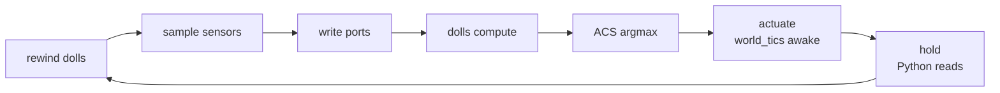

# Agents: sensors, brain and actuators in one map

`df.Agent` puts sensors, an integer MLP or transformer, and actuators in one map, where ACS samples the world, runs the
network and picks an action from its scores. During the live game Python only advances tics and runs allowlisted
readout scripts, while the map writes inputs, resets the network and runs its own clock.

```python
from doomformer.agent import Agent, Actuator
from doomformer import sense
from doomformer.kit import MLP

net = MLP([[[1], [-1], [0]]], [[-8, 8, 1]], [list(range(1, 18))],
          signed_input=False)

def world(m):
    m.rect(-1024, -3072, 0, -2048, floor=0, ceil=128, tag=20)
    m.thing(-112, -2560, 3002, id=901)  # sensed monsters share this TID
    m.thing(-512, -2560, 1, angle=45)   # final player start is the marine
    return ""

with Agent(net, sensors=[sense.bearing()],
           actuators={0: Actuator.turn(640), 1: Actuator.turn(-640),
                      2: Actuator.fire()},
           world=world, world_tics=4) as agent:
    records = agent.run(32)
    print(records[-1], agent.audit())
```

Start from [`08_your_own_agent.py`](../examples/08_your_own_agent.py), a two-sensor example, or from
[`07_autonomous_turret.py`](../examples/07_autonomous_turret.py), a smaller turret with a one-health demon.

## Execution

| Component | Responsibility |
|---|---|
| Python, before the live game | Build geometry and ACS, time a separate twin, build the integer reference |
| DOOM engine queries | Health, ammo, positions, angles, distance, visibility, sector membership |
| ACS level scripts | Pick the nearest live monster, bin sensors, write ports, run dolls, read outputs, argmax, actuate |
| DOOM dolls and geometry | All network arithmetic, including Transformer attention and MLP |
| Python, during the live game | Advance tics, read samples and network values, replicate sensors and network, compare at tolerance 0 |

The example networks are hand-written and compute action scores, while the surrounding level defines spawns, monster
health, freezing, sensing, the clock, argmax and actuation.

Calibration runs on a separate clock-free twin, which closes before the live game opens, so an Agent uses at most one
DOOM process at a time and `audit()` covers the live game.

## Sensors

Each sensor samples once, before that decision's computation, and verification uses the values recorded at sample
time. Sensors look at actors tagged `monster_tid` (default 901), the marine is `player_tid` (900), and the Agent tracks
up to `max_monsters=64` of them, corpses included, so one more raises `RangeError`.

| Constructor | Integer result |
|---|---|
| `bearing(tokens=False)` | Nearest live monster's relative-bearing bin 0..16; no live monster = 17 |
| `distance(tokens=False)` | Nearest live monster's distance bin 0..4, edges 100/200/350/550 map units; no monster = 4 |
| `health(scale=1, offset=0)` | `trunc_toward_zero((health - offset) / scale)` |
| `ammo(scale=1, offset=0)` | Same expression on the integer `Clip` inventory |
| `x_bin(width=64, origin=0)` | `trunc_toward_zero((floor(X) - origin) / width)` |
| `y_bin(width=64, origin=0)` | Same on Y; floor is the arithmetic right shift of the raw 16.16 coordinate |
| `monster_count()` | Count of actors with `monster_tid` and sampled health > 0 |
| `sector_flag(tag)` | `int(ThingCountSector(T_NONE, player_tid, tag) != 0)` |
| `line_of_sight()` | `CheckSight(player_tid, nearest_tid, 0)` converted to 0/1; no live monster = 0 |
| `constant(value)` | The specified integer, e.g. Transformer BOS token 0 |

* Nearest: smallest `VectorLength(dx,dy)`, then smallest signed bearing, with exact ties keeping the engine's first
  actor. Dead actors are recorded but never selected.
* Distance edges: raw 16.16 query results, each edge belonging to the higher bin.
* Bearing edges: in degrees: `-100,-60,-35,-20,-12,-7,-4,-2,2,4,7,12,20,35,60,100`.
* Bearing method: the engine's 16-bit `VectorAngle`, or a fixed-point cross product within 12 angle units of an edge
  (formulas in `sense.nearest_replica` and `brainacs.sensor_acs`).
* `tokens=True`: `policy.VOCAB` indexes, with bearing starting at `'a'`, distance at `'0'` and an absent bearing as
  `'?'`.

Python checks selection and binning from the recorded primitive queries but trusts the engine's visibility, sector
lookup, health, distance and angle functions, and kills are engine statistics rather than network outputs.

## MLP and Transformer wiring

An MLP takes one sensor per input, with bins passed directly as integers, while a transformer takes 1 to `net.T` sensor
tokens, as here for the policy vocabulary:

```python
sensors = [sense.constant(0), sense.bearing(tokens=True),
           sense.distance(tokens=True)]
actuators = {'L': Actuator.turn(640), 'R': Actuator.turn(-640),
             'F': Actuator.fire()}
```

Actuator keys name output scores:

- A character is a vocabulary logit at the last sensor position.
- An integer is an output index.
- Explicit `yN` and `logits:t:j` names also work.

MLP inputs must stay within ±12,000 and token sensors must produce valid vocabulary indexes, because an out-of-range
sample stops the clock and raises. ACS pads unused Transformer positions with zero, and Python checks the padding too,
but a layer whose weights are all zero is not supported.

## Actions and timing

`actuators` maps each output to one actuator or a sequence. ACS picks the largest score among these entries, giving a
tie to the first entry, and runs the winner's actuators once, in order.

| Actuator | Effect |
|---|---|
| `turn(delta)` | Add `delta`/65536 turns to the angle. Positive turns left. `640` is 3.515625° |
| `fire()` | Give one ScriptFireToken. ScriptPistol fires straight ahead without horizontal spread. Shots do not queue and may miss |
| `thrust(angle, force)` | Thrust at integer degrees (256 directions), force 0..255 |
| `door(tag, speed=16)` | `Door_Open`, tag 3..999, speed 1..255 |
| `script(number, *args)` | `ACS_ExecuteAlways` for script 200..29999, up to three integer arguments |

`world` code, `script` targets and `Actuator(source)` run as ordinary, trusted level code. They may use sector tags
3..999 and thing TIDs 1..9999 other than `player_tid` and `monster_tid`. The Agent owns scripts 30000..30003, the
`ag_*` names, `AG_PLAYER`, TIDs 50000..50000+max_monsters-1, the sensor arrays, the ports and the USER variables;
world code must leave those alone.

Each decision runs this loop inside the map:



`run(steps)` returns one record per action, holding the inputs, network values, action, scores, checked count, sample
and kills, and repeated `run()` calls continue the same game.

`freeze_monsters=True` is the default and keeps monsters dormant during compute and readout, while the player and world
scripts keep running. Dormant monsters cannot be shot, so give firing enough awake tics. `world_tics` defaults to 20,
and the tiny examples use 4 after a 70-tic boot.

With `period=None` the twin measures settling time and the live period adds `max(64, ceil(0.2 * settled_tics))` to it,
while an explicit `period` skips this and raises `MismatchError` if it is too short. World hooks run for both builds, so
they must be deterministic.

## Readout-only audit

`ReadoutOnly` accepts generated readout commands, status and sample pages, and it rejects and counts port writes,
resets, other console commands, `set_action`, `make_action` and `new_episode`. `audit()` returns `commands`,
`forbidden` and `non_readout_commands`, and the tests also wrap the live game in an outer allowlist.

ACS argmax reads sectors directly rather than the USER slots Python reads, so status polling cannot race the selector.
Do not advance the game between `run()` calls, because a missed decision raises an error.

## Measured runs

These ran with ViZDoom 1.3.2 and `OMP_NUM_THREADS=1`:

| example | steps | kills | non-readout commands | comparison |
|---|---|---|---|---|
| `07_autonomous_turret.py` | 32 | 1 | 0 | every step exact |
| `08_your_own_agent.py` | 8 | 1 | 0 | every step exact |

The turret takes 2.4 s, and because its twin settles in 168 tics, the 64-tic margin gives a live period of 232.
[`tests/test_agent.py`](../tests/test_agent.py) covers sensors, actuators, hidden values, transformer padding, ties,
sequential runs, rejected writes, corrupted readback and an undersized period.
