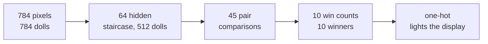

# DrawPad: walk a digit, the level reads it

DrawPad is one DOOM map that holds a trained MNIST network and a room to draw in. You walk a digit onto the floor, and
the voodoo dolls in the map read it.

<p align="center"></p>

You hold FIRE while you walk, and the tiles under you light up. Then you press READ. The dolls compute the network and
light the winning digit on a 7-segment display.

Python only checks afterwards. Every value must equal the NumPy integer reference.

> [!TIP]
> No display? Let Python walk a 7 for you.
> ```sh
> doomformer draw --digit 7
> ```

```sh
doomformer draw                  # you play in a window (needs a display)
doomformer draw --digit 7        # headless: Python presses the marine's keys to walk a built-in 7, then READ
doomformer mnist                 # the same network on MNIST test digits, also decided by DOOM
```

## How to play (`doomformer draw`)

The map builds in about 10 s. Then a DOOM window opens, and the terminal prints the controls.

| key | does |
|---|---|
| arrow keys, W / S | walk; Left / Right turn |
| mouse | turns (moving it forward or back does not walk) |
| A / D | step sideways |
| Shift | run |
| Ctrl or the left mouse button | FIRE: hold it on the canvas to ink tiles (3 x 3 brush) |
| Space or E | USE: press a switch |
| Esc | DOOM's menu: frees the mouse, pauses the game |

The marine starts facing north, between two switches on podiums. The right one is READ, the left one is CLEAR. The
canvas lies ahead, and the display rises behind it.

* **Draw**: walk over the canvas with FIRE held. Walk backwards to keep the stroke in view.
* **READ**: press USE at the right switch. The HUD counts seconds, then shows `DOOM reads 7`.
* **While DOOM reads**, the pen, READ and CLEAR are off.
* **CLEAR**: the left switch wipes the canvas and the display.
* **Quit**: close the window, pick Quit Game in DOOM's menu, or press Ctrl+C.

The terminal prints the canvas, the digit and the check once every doll and the marine stand still.

If you press READ or CLEAR before that, the pass is cut short. The terminal says that READ was not checked. The next
READ is checked as usual.

### READ time by `--opt`

`doomformer draw` builds the map with `--opt 3`. The Python API `DrawPad(opt=...)` defaults to 0.

At `--opt 3` every layer runs as one wave. An ACS script copies each layer's light levels into the next layer's gates.
Every level checks the same 248 values.

Time from the READ press until every doll stands still, shipped net:

| `--opt` | game tics | game time at 35 tics/s | wall |
|---|---|---|---|
| 3 | 273 | 8 s | 3 s |
| 0 | 5,705 | 163 s | 76-99 s |

The HUD estimate comes from `drawpad.MEASURED_READ_TICS` for the shipped net. Other nets, and `--opt 1` or `2`, use
the schedule plan's estimate. That runs 11 % high at opt 3. Schedules: [scheduling.md](scheduling.md).

## The level

The room is built from ordinary sectors, switches and ACS scripts.

| part | what it is |
|---|---|
| canvas | 28 x 28 sectors of 32 x 32 units, one per pixel. Each tile starts ACS script 201 on entry |
| pen | while the player holds FIRE, stamps a 3 x 3 block into the canvas array and lights those tiles |
| READ | a USE switch. Runs the brain's scripts 3 (rewind), 1 per pixel (-16 ink, 0 paper), 7 (start) |
| CLEAR | the other podium: rewinds, wipes the canvas, zeroes every pixel port, switches the display off |
| display | a staircase of 14 x 8 sector cells. Output `y_d` runs `ACS_ExecuteAlways(206, d)`, which lights digit `d` |
| STATUS, CANVAS, pixel pages, ACK | scripts 207, 208, 210..223 copy values into ACS globals 1..60. Script 209 is the ACK |

The 20 x 20 box where MNIST centres its digits is lit brighter. An OPEN script paints every tic FIRE is held. So
standing still paints too.

`doomformer.drawpad.world` builds the room through the normal `df.compile(net, world=..., actions=...)` hooks. Nothing
in `pure.py` is special-cased.

## The network: DOOM picks the digit

`models/mnist/mlp.npz` is `784 -> 64 -> 45 -> 10 -> 10`. The last layers pick the winning digit inside the map.



```
a0 = [pixel >= 8]           (ink encodes to 16)              784 dolls
h1 = b + W a0,  a1 = 8-level staircase                       64 x 8 = 512 dolls
d_ij = s_i - s_j + 1 for the 45 pairs i < j                  (s = the 10 digit scores, never formed themselves)
c_ij = [d_ij >= 1] = [s_i >= s_j]                            45 dolls
w_i  = sum_{j>i} c_ij - sum_{j<i} c_ji + i                   = #{j > i: s_i >= s_j} + #{j < i: s_i > s_j}
z_i  = [w_i >= 9]                                            10 dolls; exactly one passes: the first maximal score
y    = I z                                                   one-hot; its doll fires the display action
```

`df.with_argmax(net)` adds these winner layers to any integer MLP that ends in scores. Each `d_ij` row is a linear
combination of the layer before the scores. So nothing is re-quantised.

Every row must satisfy `|b_i - b_j + 1| + sum_k |W_ik - W_jk| * 8 <= 12,000` and `|W_ik - W_jk| <= 255`.
`with_argmax` scales the score layer by the largest factor that fits. For the shipped net that is x0.2545.

DOOM then computes `np.argmax` of the rescaled scores. Ties go to the lowest index.

`tests/test_drawpad.py` checks 9,000 random score vectors with many ties. It also checks a rescaled random net and one
DOOM run. With one clock doll per layer, the map has 1,355 dolls.

## Who does what

| step | DOOM (dolls, lines, sectors) | level ACS (`drawpad.level_acs`) | Python |
|---|---|---|---|
| drawing | the marine moves; sector actions fire on the tile he enters | stamps the brush, lights the tiles | `draw` polls STATUS each tic. `--digit` presses keys and records the path |
| READ | the USE line runs the level script | runs scripts 3, 1 (x784), 7; counts seconds | `--digit`: presses USE once, then releases every key |
| the network | every sum, staircase, comparison, win count and the one-hot | nothing | nothing (`ReadoutOnly`: any write raises) |
| the answer | the winner's doll crosses its `y_d` line | lights the segments of `d` | nothing |
| after the pass | | readout scripts copy values into `USER1..60` | compares every value with `MLP.reference`, the display and the ports |

> [!NOTE]
> The level's ACS does no network arithmetic. It addresses tiles, sets lights and floors, and writes 0 or 16 into
> ports. It also looks up segments and divides tics by 35 for the HUD.

## Readouts

A readout script copies values into ACS globals 1..60. ViZDoom reports them as `USER1..USER60`.

Python sends the readout (`puke -207`), then the ACK script (`puke -209`). The ACK adds 1 to the map reward.

Python advances one tic at a time until the reward rises by one. Then it reads (`DrawPad._users`). Both commands run in
the same tic, so the values are the readout's.

The ACK matters in spectator mode, where the engine keeps real time. There one advance runs 1-10 tics. So a command can
land after the next read.

<details><summary><b>Stale reads with and without the ACK</b> (READ passes under Xvfb)</summary>

| readout | load average | readouts | stale |
|---|---|---|---|
| command, one advance, read | 17 | 300 | 32 (20 all-zero STATUS, 12 CANVAS holding the STATUS before) |
| command, one advance, read, 0-40 ms host delays | 17 | 800 | 1 |
| command, one advance, read | 31-34 (4 busy loops added) | 1,200 | 0 |
| readout + ACK, read once the ACK ran | 17-34 | 2,300 | 0 |

</details>

In player mode, one advance is one tic. 600 STATUS readouts confirm it.

`tests/test_drawpad.py` checks the protocol against a fake engine whose commands land up to two tics late. It also
runs 300 readouts in a real spectator game.

## Measurements

One machine (aarch64, 16 cores shared with other jobs), ViZDoom 1.3.2, `OMP_NUM_THREADS=1`, load average 8-39.

| what | measured |
|---|---|
| DrawPad map | 1,355 voodoo dolls, 159,467 sectors, 31,912 x 5,768 map units, built in 7-14 s |
| `doomformer draw --digit d --seed s`, d = 0..9, s = 0..2, `--opt 3` | **30/30 read right**, **30/30 EXACT**, ports match canvas and path 30/30 ([log](../models/schedule/revalidate/draw-opt3-30walked.log)) |
| walking (stand-in player) | 243-449 tics per digit, then 74-155 tics to the READ podium |
| peak memory | 1.23 GB per game process (`/usr/bin/time -v`, Python included) |
| quitting | Ctrl+C during a READ: `stopped`, exit 130, no process left. Quit Game: `the DOOM window closed`, exit 0 |

The map limit is 32,000 units per axis. `--seed` seeds `[seed, digit]`.

The SimWalker reads all 30 walks right with the shipped net, as DOOM does. MNIST test-set results in DOOM are in
[scaling.md](scaling.md#all-10000-mnist-test-digits-in-doom).

### Keyboard sessions

These were played under Xvfb with real X key and mouse events (XTest,
[`models/drawpad_opt3/xdrive.py`](../models/drawpad_opt3/xdrive.py)).

<p align="center"></p>

| net, `--opt` | drawn with | DOOM reads | check | tics | wall |
|---|---|---|---|---|---|
| 784-64-10, 3 | arrow keys, `,` `.`, Ctrl, READ with Space | 7 | EXACT, 248 values | 273 | 8 s |
| 784-48-10, 0 | arrow keys, `,` `.`, Ctrl, READ with Space | 7 | EXACT | 5,288 | 175 s |
| 784-48-10, 0 | W/A/S/D, Ctrl | 1 | EXACT | 5,181 | 148 s |
| 784-48-10, 0, all 5 sessions | | 9 READs | 9 EXACT | 5,181-5,288 | |

CLEAR pressed during a READ is refused, and the pass is checked. Esc opens the menu and frees the mouse.

## Training (`training/train_mnist.py`)

The shipped net is 784 -> 64 -> 10 on binarised pixels. `python training/train_mnist.py` rebuilds it byte for byte.

Every batch holds 128 augmented MNIST digits and 128 synthetic walked digits. The walked digits come from 450,000
painted with the canvas brush.

* `walked_strokes` stretch, rotate, slant and place the three `drawpad.DIGIT_STROKES` variants per digit.
* `varied_strokes` add 3 to 6 more variants per digit, such as open 4s and single-stroke 8s.
* Each is painted along the strokes (`rasterise`) and at every tic of a `SimWalker` with DOOM's player physics.

Training runs 20 float epochs. Then come 15 quantisation-aware epochs with a straight-through gradient. The staircase is
clip(round(relu(h) / D), 0, 8).

Before each of those epochs, `equalise` rescales the hidden units. `step_size` then picks the D with the least staircase
error on 5,000 calibration digits. The step size matters most.

| model | MNIST test (10,000) | walked digits, strokes (5,000) | walked digits, SimWalker (5,000) |
|---|---|---|---|
| 784-32-10 trained on MNIST alone, np.argmax of the scores | 95.44 % | 41.08 % | 41.58 % |
| 784-32-10 + `with_argmax` (score layer x0.4244) | 95.41 % | 41.44 % | 41.86 % |
| 784-48-10 + `with_argmax` (score layer x0.2828) | 95.86 % | 97.16 % | 97.14 % |
| shipped score net (784-64-10, np.argmax of the scores) | 97.21 % | 98.72 % | 98.90 % |
| shipped `mlp.npz` (winner layers, x0.2545; DOOM's one-hot) | 97.16 % | 98.70 % | 98.92 % |

Accuracies come from the NumPy integer reference (`MLP.reference`). DOOM computes that model exactly.

The walked test digits use a separate random stream. The SimWalker paints within 0 to 6 pixels of what the level paints
for the same strokes.

## Notes

* **The stand-in player.** In `draw --digit`, Python presses movement keys and FIRE. The report says so. From the READ
  press on, Python only reads.
* **Pixels against the walked path.** The level can put the marine in the next tile while his position is 0.021 units
  past the edge. So positions within 0.1 units of an edge count for either tile (`Walker.explains`).
