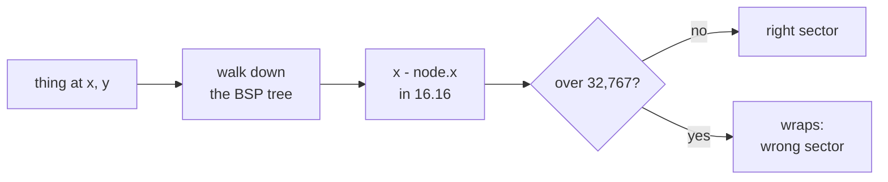
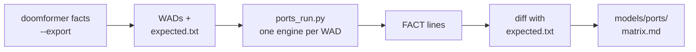

# Engine limits

Maps must fit within 32,000 units per axis, and large maps need an in-map motion check because ViZDoom exposes only
4,096 objects. These limits affect layout and when the runtime can safely read a result.

The measurements use ViZDoom 1.3.2, whose version string is `1.3.2 (ZDOOM 2.8.1+)`, and [Other ports](#other-ports)
compares ZDoom, GZDoom, LZDoom, UZDoom and Zandronum.

## The coordinate wrap

ZDoom 2.8.1 keeps map coordinates in 16.16 fixed point, so a coordinate *difference* over 32,767 units does not fit and
wraps around. The sector lookup does exactly that subtraction, because `R_PointInSubsector` calls this for every BSP node
on its path:

```c
inline int R_PointOnSide (fixed_t x, fixed_t y, const node_t *node)
{
	return DMulScale32 (y-node->y, node->dx, node->x-x, node->dy) > 0;
}
```

The source is ViZDoom 1.3.0's [`r_utility.h`](https://github.com/Farama-Foundation/ViZDoom/blob/1.3.0/src/vizdoom/src/r_utility.h).



Only a map wider or taller than 32,767 units can produce such a difference, and even then the thing must meet such a
node, so whether it happens depends on the BSP.

## What it does to a brain

The probe uses `pure.compile_pure` to build brains beside a plain 2,048 × 2,048 room with tag 0, bypassing the span
check and moving rows to test oversized layouts. Each map measures the player's drift over 35 idle tics and compares
every light and hidden gate floor with the integer reference, while the learner cases compare 25 perceptron training
steps with their integer twin, and in total the probe builds 78 maps in 73 s.

| case | what is moved | span (units) | player drift in 35 idle tics | exact passes |
|---|---|---|---|---|
| x | room east of the brain (3 nets) | 30,000 / 32,000 / 32,700 / 33,000 / 33,500 / 34,000 | 0 for all | all |
| x | | 35,000 | 422.5 in one net, 0 in two | all |
| x | | 36,000 / 40,000 | 422.5 in two nets, 0 in one | all |
| x | | 46,000 | 422.5 for all three | all |
| y | brain rows from y = 16,000, room south (3 nets) | 30,000 ... 33,500 | 0 for all | all |
| y | | 34,000 ... 46,000 | 422.5 in two nets, 62.6 in one | all |
| far | 3-layer MLP lanes moved east, room at x = -30,000 | 31,000 ... 40,000 | 0 | 3/3 each |
| far | | 46,000 | 422.5 | 3/3 |
| row | tiny transformer, rows 32,000 / 58,000 / 60,000 wide, room central or far west | 31,884 ... 61,929 | 0 | 2/2 each (every exposed scalar) |
| learn | `Perceptron(5, 3)`, 78 dolls: rows 32,000 / 58,000 wide | 31,762 / 57,505 | 0 / 0 | 25/25 steps / 2/25 (step 3: `w2_4` stayed 0, twin -1) |
| learn | `Perceptron(8, 2)`, 77 dolls: rows 32,000 / 58,000 wide | 31,945 / 57,150 | 0 / 0 | 25/25 steps / 0/25 (step 1: 6 values differ) |

A 422.5-unit drift is conveyor motion, because the engine places the player in a brain strip, and at 62.6 units a wall
stops him. Drift starts at different spans for different BSP trees, even with the same player room.

Forward passes can remain exact in oversized maps while learners lose updates within 1–3 steps, and the 32,000-unit
layouts keep all learner steps exact. A drifting player can also prevent settling, which requires every `DoomPlayer` to
stand still for 8 tics, so the span rule covers the whole map, including the world.

## The wrap by itself

`doomformer facts --only wrap_lone_room --only wrap_balanced` isolates the wrap with maps of plain rooms at distinct
floor heights, where an ACS script spawns a `MapSpot` in each room and reads `GetActorFloorZ`.

The unbalanced layout has 150 rooms of 256 units square at floor 0, filling x = 0..5,856, y = 0..3,856, and one lone
room with floor 64 whose west edge sits at the x given.

| layout | lone room west edge x | the lone room is found in |
|---|---|---|
| unbalanced | 28,000 / 32,000 / 32,700 | its own sector |
| unbalanced | 32,800 / 33,000 / 34,000 | a neighbour's sector |
| unbalanced | 36,000 | its own sector again |
| unbalanced, west | -30,000 | its own sector |
| unbalanced, west | -32,000 | a neighbour's sector |
| balanced: 100 rooms in a row, 60,000 / 64,000 units wide, x or y | | all 100 rooms found |
| balanced: 65,000 units wide, y | | 1 of 100 rooms filed under another sector |

The first wrong lookup depends on the BSP tree, since the balanced layout finds every room through 64,000 units while
the unbalanced layout first fails at 32,800. A coordinate difference beyond 32,767 can therefore produce a correct
lookup by chance, so testing one wide layout does not establish a safe span, and the 32,000-unit rule keeps every
difference under 32,768, whatever the tree.

## The rule

Every map the toolkit builds stays within `MAX_SPAN = 32,000` units per axis, world included, which leaves a 767-unit
margin below the wrap. One-map builds (`pure.compile_pure`) pack their layout to fit, and tile maps
(`tile.compile_tile`) are checked.

<p align="center"></p>

* Layout: layer strips fold into rows in x = [-16,000, 16,000] (`X_ORIGIN`, `X_END`), and rows stack north from y = 0
  up to `Y_END = 27,904`.
* Below the rows: output lights sit below y = -512, and scroller closets sit at (-4096, -4096) and eastwards.
* Packing moves strips only, because timing and arithmetic do not depend on where a strip lies.
* Too large: when the rows pass `Y_END`, a corridor is wider than a row or the span exceeds 32,000, `fits` is False,
  plan gives a `reason` and compiling raises `ValueError`.
* World area: `df.plan(net)["map"]["world_area"]` is [-16,000, top - 32,000, 16,000, -2,048], where `top` is the
  brain's northern edge, and a world built inside it stays within the limit.
* World check: `df.compile(net, world=fn)` rejects a world that pushes the map too far, and `compile_pure` checks the
  finished map again.
* Metadata: `layout` holds `bounds`, `span`, `max_span` and `world_area`, and `df.plan` reports `span`, with `span`,
  `bounds` and `world_area` under `map`.
* Tile maps: `compile_tile` raises `ValueError` beyond the limit, so a too-large tile is refused rather than repacked.
* Tile plan: `tiled.tile_plan` reports the largest tile span per axis and `fits` when every tile is within the limit
  and under 20,000 dolls.

A check of zone coordinates against ±32,768 alone would call MLP 1600x256 a fit, although its layer-0 tile is 32,488
units wide, and `tests/test_span.py` pins this case. In auto mode `df.plan` picks tiles only if they fit, and if neither
fits, `df.compile` raises.

<details><summary><b>Measured sizes: which nets fit</b></summary>

These were measured with `df.plan` and `layout_only` on one map without a world, where MLP NxH has layer 0 of H x N and
layer 1 of 4 x H, with random weights in -3..3 and thresholds [5, 10].

| net | tile_plan | largest tile (w x h) | one map (w x h) | auto |
|---|---|---|---|---|
| MLP 1024x256 | fits | 24,424 x 19,312 | 31,771 x 20,072, fits | map |
| MLP 1600x256 | **does not fit** (`mlp_l0`) | 32,488 x 23,952 | 31,965 x 28,904, fits | map |
| MLP 2048x512 | does not fit (`mlp_l0`) | 54,264 x 29,568 | 31,771 x 61,976, does not fit | neither: `df.compile` raises |
| MLP 4096x512 | does not fit | 108,576 x 29,568 | | |
| MLP 3000x1000 | does not fit | 142,704 x 30,720 | | |
| `models/doomnames` | fits | 8,416 x 5,808 | 31,989 x 919,832, does not fit | tiles |
| `models/doomplayer` | fits | 6,100 x 4,128 | 31,993 x 21,992, fits | map |

Sizes under the packed layout, from `layout_only` builds with the worlds named:

| model | dolls | sectors | span (w x h) | world area y range |
|---|---|---|---|---|
| tiny transformer | 593 | 12,620 | 31,884 x 4,520 | -31,576 ... -2,048 |
| `models/doomnames_onemap` | 3,548 | 95,448 | 31,947 x 6,728 | -29,368 ... -2,048 |
| `models/doomplayer_onemap` + arena + dolls' argmax | 1,345 | 37,410 | 31,962 x 7,928 | -30,856 ... -2,048 |
| `models/doomplayer` (d=16) + arena | 8,825 | 528,366 | 31,993 x 24,680 | -14,104 ... -2,048 |
| fly circuit (`models/fly/brain.json`) + fly_alive level | 1,222 | 31,615 | 31,855 x 8,664 | -29,944 ... -2,048 |

</details>

## Object list: ViZDoom lists at most 4,096 objects

ViZDoom 1.3's game state copies at most `VIZ_MAX_OBJECTS = 4096` objects
([`viz_defines.h`](https://github.com/Farama-Foundation/ViZDoom/blob/1.3.0/src/vizdoom/src/viz_defines.h)).

It walks the sectors in index order and lists the things in each
([`VIZ_GameStateUpdateObjects`](https://github.com/Farama-Foundation/ViZDoom/blob/1.3.0/src/vizdoom/src/viz_game.cpp)),
so once the list is full, the rest is cut off.

On the d=16 map `get_state().objects` returns 4,096 DoomPlayers out of 8,826, the earliest layers' dolls, because their
sectors come first.

A settle check based only on that list can stop while later-layer and clock dolls are still moving.
Every one-map brain and tile map therefore carries ACS script 8 (`tile.motion_acs`), which tracks positions in
`mo_x`, `mo_y` and `mo_z`.

The script compares every doll and the player with their last positions, finding the dolls by the TIDs they give
themselves (`DOLL_TID0 + i`), and writes the count that moved to USER1 and the count of dolls without a TID to USER2.

`TileRunner.settle` has four rules:

* Small maps: with fewer dolls than the list holds and the list not full, every listed DoomPlayer must stand still for
  8 tics, and the 202-doll MLP still takes 992 tics per pass.
* Large maps: with 4,095 dolls or more, or a full list, the script also runs on the last tic of every 8-tic window, and
  settling also needs zero dolls moved and zero dolls without a TID.
* No script: a map without the script and with too many dolls raises `RuntimeError` ("recompile it").
* Timeout: twice `layout["estimated_settle_tics"]`, with a floor of 20,000 tics.

[`tests/test_settle.py`](../tests/test_settle.py) uses a map with 4,204 dolls and 46,242 sectors, where an unlisted
clock doll walks to the release line while 4,201 dolls wait at a sync barrier, and a second layer then reads the first
layer's result.

| settle check | tics | `-h`, `y` for x = 1 / 0 / 1 (want -1, 1 / 0, 0 / -1, 1) |
|---|---|---|
| objects list + motion script | 184 each run | exact all three runs |
| objects list only (forced with `VIZ_MAX_OBJECTS` patched to 10^9) | 40, 24, 40 | 0, 0 every run: nothing computed |

### The d=16 `models/doomplayer`

This map holds the d=16 model in its arena with 8,825 dolls, 528,366 sectors and 31,993 x 24,680 units, and it builds in
20 s, loads in 41 s and uses 3.6 GB. Plan's settle estimate is 28,976 tics, and the log is
[`models/doomplayer/onemap_measure.json`](../models/doomplayer/onemap_measure.json).

| settle check | result |
|---|---|
| list only, default cap | "not settled after 20000 tics" after 1,260 s |
| list only, cap lifted | false settle at 20,992 tics, 471 of 969 exposed values wrong from `wsum` on |
| fixed budget of 34,000 tics | exact, 2,065 s, 16.5 tics/s |
| motion script | settled at 29,088 tics, decision 29,110 tics in 1,861 s (15.6 tics/s), exact |

With the motion check, all 969 exposed values and action L match for tokens `[0, 21, 26]`, and the two tic rates were
measured under different machine loads.

## Other ports

`doomformer facts` runs 28 probes with 55 cases in about 10 s on ViZDoom 1.3.2, covering
[engine arithmetic](HOW_IT_WORKS.md#engine-facts), coordinates and object readout. Most probes are ACS-only, where the
map builds the situation, waits and prints one line with `Log`:

```
FACT light_saturates up1=30160 up2=32767 down=-32768
```

`doomformer facts --export DIR` writes three sets:

| set | content | expected lines from |
|---|---|---|
| probes | the 51 ACS-only maps as `<case>.wad`, plus `RUN.txt` with command lines | ViZDoom |
| hello brains | `hello/` and `hello_tags15/`: the `doomformer hello` net (MLP 4-6-5-3, seed 0) | NumPy (`MLP.reference`) |
| same-tic | `same_tic/`: four maps of the doll clock's same-tic probe | ViZDoom |

Four probes need ViZDoom's Python side, so `puke`, `object_list`, `advance_action` and `turn_key` are not exported, and
`doomformer facts --export DIR --check` runs each WAD in ViZDoom, where 51 of 51 match.

The hello brains carry an ACS driver instead of the Python runner, which works like this:

1. Write the input ports and drop the start barriers.
2. Wait until every doll stands still for 8 tics.
3. Log `FACT hello run=k` with the 25 values the runner reads.
4. Rewind the map and do the next of 5 inputs.

`hello_tags15` moves the stage and freeze tag bases below 32,768 for Zandronum, and both exports produce the expected
values in ViZDoom (`tests/test_ports.py`).

The machine is a separate export, `doomformer machine PROGRAM ARGS --clock dolls --export DIR`, described under
[The machine](#the-machine).

### What was run

Run the port comparison with `gh workflow run ports.yml --ref <branch>`; it takes about 15–30 minutes.
The workflow is [ports.yml](../.github/workflows/ports.yml). For local runs, use the commands in the export's `RUN.txt`.



Every port gets the same WADs and Freedoom's `freedoom2.wad` as IWAD. The runner `.github/scripts/ports_run.py` starts
up to three engines at a time and ends each one a second after its `FACT` lines appear, with a time limit of 90 s per
probe, 300 s for hello and 900 s for the museum and DrawPad self-tests.

The runners are `ubuntu-latest` (Ubuntu 26.04.1, x86_64), with software OpenGL and Vulkan under Xvfb and no sound.

[models/ports/](../models/ports/) holds `matrix.md` and each port's `results.json`, `observed.txt`, `summary.md` and version.

<details><summary><b>Ports, sources and command lines</b></summary>

| port | version, source | video |
|---|---|---|
| GZDoom | 4.14.2, the `.deb` of the GitHub release (`gh release download -R ZDoom/gzdoom -p 'gzdoom_*_amd64.deb'`) | OpenGL 4.5 (`+vid_preferbackend 0`) and Vulkan (`1`) |
| LZDoom | 3.88b, apt package `lzdoom` of `debian.drdteam.org` | OpenGL |
| UZDoom | 5.0.3, apt package `uzdoom` of `debian.drdteam.org` | OpenGL (`+vid_preferbackend 0`) |
| ZDoom | 2.8.1 (the version ViZDoom embeds), apt package `zdoom` of `debian.drdteam.org` | software renderer |
| Zandronum | 3.2.1 (250804-2140), apt package `zandronum` of `debian.drdteam.org` | OpenGL |


The GZDoom command line needs `stdbuf` because the engine block-buffers stdout into a pipe:

```
xvfb-run -n N -s "-screen 0 800x600x24" stdbuf -oL -eL gzdoom -iwad {iwad} -file {wad} +map MAP01 -stdout \
  -nosound -nomusic -noautoload -nojoy -width 320 -height 200 -config {work}/gzdoom.ini -savedir {work}/save \
  -logfile {work}/log.txt +vid_preferbackend 0        # environment: HOME={work} LIBGL_ALWAYS_SOFTWARE=1
```

ZDoom and Zandronum take `<port> -iwad {iwad} -file {wad} +map MAP01 -stdout -nosound`.

No port quits on the map's `ConsoleCommand("quit")`, so the runner ends every process. ZDoom and the GZDoom family log
that they do not run console commands from scripts, and ViZDoom refuses the command too, which is why the `--check` run
and the tests bound the number of tics instead.

</details>

### Results

Results from [models/ports/matrix.md](../models/ports/matrix.md), shown as PASS / DIFF / map refused:

| port | 51 probe maps | 4 same-tic | 2 hello | machine rows | museum | all rows run |
|---|---|---|---|---|---|---|
| ZDoom 2.8.1 | 51 / 0 / 0 | 4 / 0 | 2 / 0 | 2 PASS | PASS | 60 rows: 60 PASS |
| Zandronum 3.2.1 | 49 / 2 / 0 | 2 / 2 | 1 / 1 | 2 PASS (low tags), 2 DIFF | PASS (low tags), no line (default) | 63 rows: 55 PASS, 7 DIFF, 1 no line |
| GZDoom 4.14.2 (GL, Vulkan), LZDoom 3.88b, UZDoom 5.0.3 | 42 / 4 / 5 | 4 / 0 | 2 / 0 | 3 PASS | PASS | 61 rows: 52 PASS, 4 DIFF, 5 refused |

Where the rows differ:

* Zandronum: `tag_range`, `tag_wrap`, the default-tag same-tic maps 4 and 16, and default-tag `hello`.
* GZDoom family: `mover_speed`, `mover_busy`, `plane_span_32768` and `plane_span_33000`.
* GZDoom family refusals: the five `wrap_lone_room` maps from 32,700 up.
* Museum: the self-test logs 12 lines, and the details are in [museum.md](museum.md#ports).

43 rows hold in all six runs (40 probe maps, the two `same_tic_*_tags15` maps and `hello_tags15`), covering conveyors,
the 24-unit step, gate sectors, falls, teleport order, line specials with a TID, light levels and voodoo-doll TIDs.

The five `hello` outputs match NumPy in GZDoom (OpenGL and Vulkan), LZDoom, UZDoom and ZDoom, `hello_tags15` also
matches in Zandronum, and each port takes 72–77 s for the five inputs.

### Differences

These observed values come from `models/ports/matrix.md` and are identical in the four GZDoom-family runs.

| row | ViZDoom 1.3.2, ZDoom 2.8.1, Zandronum | GZDoom family |
|---|---|---|
| `mover_speed` | `t1_300000=9464`, `t1_500000=-6072`, `t3_500000=-12144` | `12000` for these three and the other nine values |
| `mover_busy` | `fr_14019=12`, `fl_m14018=-12`, `cr_14018=12`, `cl_m14019=-12`: second request dropped | `-243`, `243`, `-243`, `243`: accepted, like the five other keys |
| `plane_span_32768`, `plane_span_33000` | `moved=0` (the player does not move) | `moved=1` |
| `wrap_lone_room_32700`, `_32800`, `_33000`, `_34000`, `_36000` | `floor=64, 0, 0, 0, 64` | map refused: `Value 32956.000000 out of range for a coordinate 'X'` |

The refusal message ends with `Valid range is [-32768 .. 32768]`.

GZDoom does not overflow in the plane rows where ZDoom's 16.16 planes do, because its `secplane_t` holds `double D` and
its floor mover holds `double m_Speed` ([`r_defs.h`](https://github.com/ZDoom/gzdoom/blob/g4.14.2/src/gamedata/r_defs.h),
[`a_floor.h`](https://github.com/ZDoom/gzdoom/blob/g4.14.2/src/playsim/mapthinkers/a_floor.h)). LZDoom and UZDoom print
the same values, so the plane bound of +-14,018 units (`doomformer/planes.py`) and the 32,768-unit plane span are
ZDoom 2.8.1 limits.

GZDoom's [UDMF parser](https://github.com/ZDoom/gzdoom/blob/g4.14.2/src/maploader/udmf.cpp) refuses maps with
coordinates outside [-32768, 32768]. The probe `wrap_shifted` keeps every coordinate inside that range, and on it
GZDoom, LZDoom and UZDoom print the same five values as ViZDoom, as they do for `wrap_balanced_y_65000`. Their
`R_PointOnSide` does the same 32-bit subtraction
([`p_maputl.cpp`](https://github.com/ZDoom/gzdoom/blob/g4.14.2/src/playsim/p_maputl.cpp),
[`r_utility.h`](https://github.com/ZDoom/gzdoom/blob/g4.14.2/src/rendering/r_utility.h)), so the 32,000-unit rule holds
for the GZDoom family too.

Zandronum does not find sector tags from 32,768 up: `tag_range` finds tags 1,000, 20,000 and 32,767 but returns `0` for
32,768 and above. The cause is in the source of [`ZA_3.2.1`](https://foss.heptapod.net/zandronum/zandronum-stable):

* The sector tag is a 16-bit `short` (`src/r_defs.h:709`).
* The UDMF parser casts the `id` key to `short` (`src/p_udmf.cpp:1312`).
* `P_FindSectorFromTag` compares it with an `int` (`src/p_spec.cpp:274`).

`tag_wrap` confirms it, finding tag 40,000 as -25,536 and 65,541 as 5. The compiler's tags reach 64,0xx, so in `hello`
the later waves are never released, while `hello_tags15` keeps every tag below 32,768 and matches.

The compiler still emits the high bases, and only the low-tag exports move them (`ports.build_hello(low_tags=True)`,
`machine ... --low-tags --export` and `museum export --low-tags`), so with default tags the museum self-test logs nothing
in 900 s.

### The machine

`doomformer machine multiply 7 9 --clock dolls` is one map with 43 voodoo dolls and 721 sectors, driven by a loop doll
and line specials, that runs 464 steps in 235,567 game tics.

`doomformer machine PROGRAM ARGS --clock dolls --export DIR` writes `DIR/machine.wad` (`doomformer/ports_machine.py`)
with an ACS logger that does four things:

1. Wait for each step.
2. Wait until no doll moves for 8 tics.
3. Log every value the runner reads as `FACT machine step=k ...`.
4. If a step takes over 6,000 tics, log `FACT machine step=k stalled pass=P`.

`DIR/expected.txt` holds the 465 lines (26,040 values) from the interpreter, `Program.want`.

`--low-tags` keeps every sector tag and TID below 32,768, and all 465 lines match in ViZDoom with and without it
(`tests/test_ports.py`). `subleq add 3 4` exports the same way, as 5 lines from 713 dolls in 17,718 sectors.

The 464-step run takes 1.9 hours at 35 tics per second, so the workflow runs the engine behind
`.github/scripts/ports_timeshim.c`, an `LD_PRELOAD` library that runs the clock 200 times faster without changing the
game tics. UZDoom needs `TIMESHIM_SPEED=20` (`models/ports/uzdoom/speed_subleq_add/`), and because the shim does not
speed up ZDoom and Zandronum, they run `multiply 2 3` and `subleq add 3 4` in real time.

| row | ZDoom 2.8.1 | Zandronum 3.2.1 | GZDoom 4.14.2 GL | GZDoom Vulkan | LZDoom 3.88b | UZDoom 5.0.3 (x20) |
|---|---|---|---|---|---|---|
| `same_tic_cell4`, dolls not home (ViZDoom: 14) | 14 | 11 | 14 | 14 | 14 | 14 |
| `same_tic_cell16` (ViZDoom: 0) | 0 | 11 | 0 | 0 | 0 | 0 |
| both `same_tic_*_tags15` | as ViZDoom | as ViZDoom | as ViZDoom | as ViZDoom | as ViZDoom | as ViZDoom |
| `multiply 7 9`, 465 lines | not run | not run | PASS, 183 s | PASS, 279 s | PASS, 71 s | PASS, 343 s |
| `multiply 2 3`, 51 lines | PASS, 721 s | stalled at step 1; `--low-tags`: PASS, 722 s | PASS, 24 s | PASS, 33 s | PASS, 9 s | PASS, 43 s |
| `subleq add 3 4`, 5 lines | PASS, 302 s | stalled at step 1; `--low-tags`: PASS, 304 s | PASS, 57 s | PASS, 82 s | PASS, 36 s | PASS, 75 s |

* The GZDoom family runs all 464 steps of `multiply 7 9` exactly, since the machine's maps stay inside the plane bound
  and the 32,768-unit span.
* ZDoom 2.8.1, and Zandronum with low tags, run `multiply 2 3` and `subleq add 3 4` exactly.
* The same-tic loss appears in every port, where two line specials crossed in one tic do not both act, so the 16-unit
  cell (`dollclock.CELL`) is needed everywhere.
* Zandronum with default tags stalls at step 1 because of the tag limit above.

### The wrap is a Linux behaviour of the ViZDoom wheel

On macOS arm64 the ViZDoom 1.3.2 wheel does not wrap, and `doomformer facts --json` on `macos-14` and `ubuntu-latest`
differs in 8 of 54 cases, all of them wrap rows.

| row | Linux (x86_64 here, arm64 on the development machine) | macOS arm64 |
|---|---|---|
| `wrap_lone_room_-32000`, `_32800`, `_33000`, `_34000` | `floor=0` (filed under a neighbour) | `floor=64` (found) |
| `wrap_balanced_y_65000` | `bad=1` | `bad=0` |
| `wrap_shifted_30000`, `_31000`, `_32000` | `floor=0` | `floor=64` |

The logs are `models/ports/facts_macos14.json` and `facts_ubuntu_x86.json`, and the cause is unknown. `facts.py`
expects the found values on `darwin` for these eight rows (`facts_macos14_platform_aware.json`), while `MAX_SPAN`
applies on every platform.

## Queued console commands: about 880 per tic crash the engine process

On Linux arm64 with ViZDoom 1.3.2, queuing 880 calls to `game.send_game_command("puke -5 1 <i> 0")` before one
`advance_action(3)` crashes the engine.

| N | result |
|---|---|
| 400, 800, 860 | all N script starts run |
| 880, 1,000 | `ViZDoomErrorException` ("Unexpected ViZDoom instance crash") |
| 3,000 with no arguments | all run |

The trigger depends on the command form, so `runtime.TileRunner.start` steps one tic after every 512 port writes. This
case is left out of `doomformer facts` because the crash opens a dialog on desktops with `xmessage`.
