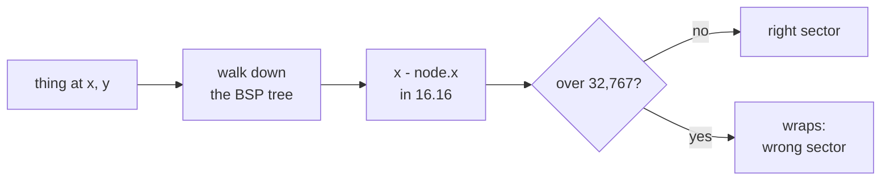
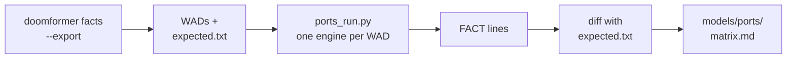

# Engine limits: map extent (32,000 units per axis) and the object list (4,096 objects)

This page covers the engine limits that break exact results, and the rule that avoids each one. It also shows how the
same maps run in other Doom ports.

ViZDoom 1.3.2 embeds ZDoom 2.8.1. Its version string reads `1.3.2 (ZDOOM 2.8.1+)`.

> [!IMPORTANT]
> Every map the toolkit builds stays within 32,000 units per axis. Wider maps put things in the wrong sector.

## The coordinate wrap

ZDoom 2.8.1 keeps map coordinates in 16.16 fixed point. A coordinate *difference* over 32,767 units does not fit. It
wraps around.

The sector lookup does exactly that subtraction. `R_PointInSubsector` calls this for every BSP node on its path:

```c
inline int R_PointOnSide (fixed_t x, fixed_t y, const node_t *node)
{
	return DMulScale32 (y-node->y, node->dx, node->x-x, node->dy) > 0;
}
```

Source: [`src/vizdoom/src/r_utility.h`](https://github.com/Farama-Foundation/ViZDoom/blob/1.3.0/src/vizdoom/src/r_utility.h)
in ViZDoom 1.3.0. The installed 1.3.2 was not checked against it.



Only a map wider or taller than 32,767 units can produce such a difference. Even then the thing must meet such a node.
So whether it happens depends on the BSP.

## What it does to a brain

A probe builds real brains next to a plain 2048 x 2048 room with tag 0. The player stands in that room. The probe uses
the shipping emitter, `pure.compile_pure`.

It moves the brain's rows and lifts the span guard to build maps the compiler refuses. In each map it measures two
things:

* How far the idle player moves in 35 tics.
* How many forward passes are exact.

A pass is exact when every light and hidden gate floor equals the integer reference. The probe also runs 25 training
steps of a DOOM-trained perceptron (`learnkit`). Each step is checked against its twin. The probe builds 78 maps in 73 s.

| case | what is moved | span (units) | player drift in 35 idle tics | exact passes |
|---|---|---|---|---|
| x | room east of the brain (3 nets) | 30,000 / 32,000 / 32,700 / 33,000 / 33,500 / 34,000 | 0 for all | all |
| x | | 35,000 | 422.5 (`repro`), 0 (`mine`, `mlp3`) | all |
| x | | 36,000 / 40,000 | 422.5 (`repro`, `mine`), 0 (`mlp3`) | all |
| x | | 46,000 | 422.5 for all three | all |
| y | brain rows from y = 16,000, room south (3 nets) | 30,000 ... 33,500 | 0 for all | all |
| y | | 34,000 ... 46,000 | 422.5 (`repro`, `mine`), 62.6 (`mlp3`) | all |
| far | 3-layer MLP lanes moved east, room at x = -30,000 | 31,000 ... 40,000 | 0 | 3/3 each |
| far | | 46,000 | 422.5 | 3/3 |
| row | tiny transformer, rows 32,000 / 58,000 / 60,000 wide, room central or far west | 31,884 ... 61,929 | 0 | 2/2 each (every exposed scalar) |
| learn | `Perceptron(5, 3)`, 78 dolls: rows 32,000 / 58,000 wide | 31,762 / 57,505 | 0 / 0 | 25/25 steps / 2/25 (step 3: `w2_4` stayed 0, twin -1) |
| learn | `Perceptron(8, 2)`, 77 dolls: rows 32,000 / 58,000 wide | 31,945 / 57,150 | 0 / 0 | 25/25 steps / 0/25 (step 1: 6 values differ) |

What the table shows:

* **The player rides the brain.** A drift of 422.5 units is the conveyor speed. At 62.6 a wall stopped him. The engine
  filed him in a conveyor strip.
* **The threshold belongs to the BSP.** Drift starts at 34,000 (y) and 35,000 (x). It never starts at 33,500 or less.
  The same room drifts with one net and not with another.
* **Learners break.** Forward passes stay exact, even 62,000 units from the player's room. Learners lose weight updates
  within 1 to 3 steps at 58,000 units wide. At 32,000 they stay exact.
* **Bigger learners too.** Maps of about 75 or more dolls show the same
  (`tests/test_learnkit.py::test_bigger_maps_stay_exact`).
* **Settling can hang.** A run settles once every DoomPlayer stands still for 8 tics. A drifting player can block that.

An exact forward pass in a wide map is luck. So the rule covers the whole map.

## The wrap by itself

`doomformer facts --only wrap_lone_room --only wrap_balanced` isolates the wrap. Each map holds plain rooms with
distinct floor heights. An ACS script spawns a `MapSpot` in each room and reads `GetActorFloorZ`.

The unbalanced layout has 150 rooms of 256 units square at floor 0. They fill x = 0..5,856, y = 0..3,856. One lone room
with floor 64 has its west edge at the x given.

| layout | lone room west edge x | the lone room is found in |
|---|---|---|
| unbalanced | 28,000 / 32,000 / 32,700 | its own sector |
| unbalanced | 32,800 / 33,000 / 34,000 | a neighbour's sector |
| unbalanced | 36,000 | its own sector again (wrap luck) |
| unbalanced, west | -30,000 | its own sector |
| unbalanced, west | -32,000 | a neighbour's sector |
| balanced: 100 rooms in a row, 60,000 / 64,000 units wide, x or y | | all 100 rooms found |
| balanced: 65,000 units wide, y | | 1 of 100 rooms filed under another sector |

* A node difference of 32,768 or more never fits. Where the first miss falls depends on the tree.
* The balanced tree is symmetric about the middle. It files every room correctly up to 64,000 units.
* A difference above the limit does not always misfile. The room at -30,000 is found. It lies 36,000 units west of
  x = 5,856.
* The probe has one room per spawn. The brain table above shows dolls crossing misfiled regions.

The 32,000-unit rule keeps every difference under 32,768, whatever the tree.

## The rule

Every map the toolkit builds stays within `MAX_SPAN = 32,000` units per axis. That includes the world. It leaves a
767-unit margin below the wrap.

One-map builds (`pure.compile_pure`) pack their layout to fit. Tile maps (`tile.compile_tile`) are checked.

<p align="center"></p>

* **Layout.** Layer strips fold into rows in x = [-16,000, 16,000] (`X_ORIGIN`, `X_END`). Rows stack north from y = 0
  up to `Y_END = 27,904`.
* **Below the rows.** Output lights sit below y = -512. Scroller closets sit at (-4096, -4096) and eastwards.
* **Packing moves strips only.** Timing and arithmetic do not depend on where a strip lies.
* **Too large.** The rows pass `Y_END`, a corridor is wider than a row, or the span exceeds 32,000. Then `fits` is False
  and plan gives a `reason`. Compiling raises `ValueError`.
* **World area.** `df.plan(net)["map"]["world_area"]` is [-16,000, top - 32,000, 16,000, -2,048]. `top` is the brain's
  northern edge. A world built inside it stays within the limit.
* **World check.** `df.compile(net, world=fn)` rejects a world that pushes the map too far. `compile_pure` checks the
  finished map again.
* **Metadata.** `layout` holds `bounds`, `span`, `max_span` and `world_area`. `df.plan` reports `span`, and `span`,
  `bounds` and `world_area` under `map`.
* **Tile maps.** `compile_tile` raises `ValueError` beyond the limit. A too-large tile is refused, not repacked.
* **Tile plan.** `tiled.tile_plan` reports the largest tile span per axis. It `fits` when every tile is within the limit
  and under 20,000 dolls.

A check of zone coordinates against ±32,768 alone would call MLP 1600x256 a fit. Its layer-0 tile is 32,488 units wide.
`tests/test_span.py` pins this case.

In auto mode `df.plan` picks tiles only if they fit. If neither fits, `df.compile` raises.

<details><summary><b>Measured sizes: which nets fit</b></summary>

Measured with `df.plan` and `layout_only`, one map without a world. MLP NxH is layer 0 H x N and layer 1 4 x H.
Weights are random in -3..3, thresholds [5, 10].

| net | tile_plan | largest tile (w x h) | one map (w x h) | auto |
|---|---|---|---|---|
| MLP 1024x256 | fits | 24,424 x 19,312 | 31,771 x 20,072, fits | map |
| MLP 1600x256 | **does not fit** (`mlp_l0`) | 32,488 x 23,952 | 31,965 x 28,904, fits | map |
| MLP 2048x512 | does not fit (`mlp_l0`) | 54,264 x 29,568 | 31,771 x 61,976, does not fit | neither: `df.compile` raises |
| MLP 4096x512 | does not fit | 108,576 x 29,568 | | |
| MLP 3000x1000 | does not fit | 142,704 x 30,720 | | |
| `models/doomnames` | fits | 8,416 x 5,808 | 31,989 x 919,832, does not fit | tiles |
| `models/doomplayer` | fits | 6,100 x 4,128 | 31,993 x 21,992, fits | map |

Sizes under the packed layout, from `layout_only` builds with the worlds named:

| model | dolls | sectors | span (w x h) | world area y range |
|---|---|---|---|---|
| tiny transformer | 593 | 12,620 | 31,884 x 4,520 | -31,576 ... -2,048 |
| `models/doomnames_onemap` | 3,548 | 95,448 | 31,947 x 6,728 | -29,368 ... -2,048 |
| `models/doomplayer_onemap` + arena + dolls' argmax | 1,345 | 37,410 | 31,962 x 7,928 | -30,856 ... -2,048 |
| `models/doomplayer` (d=16) + arena | 8,825 | 528,366 | 31,993 x 24,680 | -14,104 ... -2,048 |
| fly circuit (`models/fly/brain.json`) + fly_alive level | 1,222 | 31,615 | 31,855 x 8,664 | -29,944 ... -2,048 |

</details>

## Object list: ViZDoom lists at most 4,096 objects

ViZDoom 1.3's game state copies at most `VIZ_MAX_OBJECTS = 4096` objects
([`viz_defines.h`](https://github.com/Farama-Foundation/ViZDoom/blob/1.3.0/src/vizdoom/src/viz_defines.h)).

It walks the sectors in index order and lists the things in each
([`VIZ_GameStateUpdateObjects`](https://github.com/Farama-Foundation/ViZDoom/blob/1.3.0/src/vizdoom/src/viz_game.cpp)).
Once the list is full, the rest is cut off.

On the d=16 map `get_state().objects` returns 4,096 DoomPlayers out of 8,826. These are the earliest layers' dolls.
Their sectors come first.

> [!WARNING]
> A settle check that watches only that list stops too early. Unlisted dolls of later layers and the clock dolls are
> still working.

So the toolkit checks motion inside the map. Every one-map brain and tile map carries ACS script 8 (`tile.motion_acs`).
It keeps positions in the map arrays `mo_x`, `mo_y` and `mo_z`.

The script compares every doll and the player with their last positions. Dolls are found by the TIDs they give
themselves (`DOLL_TID0 + i`). It writes the count that moved to USER1. It writes the count of dolls without a TID to
USER2.

`TileRunner.settle` has four rules:

* **Small maps.** Fewer dolls than the list holds, and the list not full: every listed DoomPlayer must stand still for 8
  tics. The 202-doll MLP still takes 992 tics per pass.
* **Large maps.** 4,095 dolls or more, or a full list: the script also runs on the last tic of every 8-tic window.
  Settling then also needs zero dolls moved and zero dolls without a TID.
* **No script.** A map without the script and with too many dolls raises `RuntimeError` ("recompile it").
* **Timeout.** Twice `layout["estimated_settle_tics"]`, with a floor of 20,000 tics.

The regression test is `tests/test_settle.py`. Its map has 4,204 dolls and 46,242 sectors.

In it, 4,201 dolls wait at their sync barrier. The unlisted clock doll walks to the release line. A second layer then
reads the first layer's result.

| settle check | tics | `-h`, `y` for x = 1 / 0 / 1 (want -1, 1 / 0, 0 / -1, 1) |
|---|---|---|
| objects list + motion script | 184 each run | exact all three runs |
| objects list only (forced with `VIZ_MAX_OBJECTS` patched to 10^9) | 40, 24, 40 | 0, 0 every run: nothing computed |

### The d=16 `models/doomplayer`

This map holds the d=16 model in its arena: 8,825 dolls, 528,366 sectors, 31,993 x 24,680 units. It builds in 20 s. It
loads in 41 s and uses 3.6 GB.

Plan's settle estimate is 28,976 tics. Log:
[`models/doomplayer/onemap_measure.json`](../models/doomplayer/onemap_measure.json).

| settle check | result |
|---|---|
| list only, default cap | "not settled after 20000 tics" after 1,260 s |
| list only, cap lifted | false settle at 20,992 tics, 471 of 969 exposed values wrong from `wsum` on |
| fixed budget of 34,000 tics | exact, 2,065 s, 16.5 tics/s |
| motion script | settled at 29,088 tics, decision 29,110 tics in 1,861 s (15.6 tics/s), exact |

With the motion check, all 969 exposed values and the action (L) match. The input tokens are [0, 21, 26]. The two tic
rates come from runs under different load. They do not isolate the script's cost.

## Other ports

`doomformer facts` runs 28 probes with 55 cases in about 10 s on ViZDoom 1.3.2. It is the executable form of
[the Engine facts table](HOW_IT_WORKS.md#engine-facts) and of this page.

Most probes are ACS-only. The map builds the situation, waits and prints one line with `Log`:

```
FACT light_saturates up1=30160 up2=32767 down=-32768
```

`doomformer facts --export DIR` writes three sets.

| set | content | expected lines from |
|---|---|---|
| probes | the 51 ACS-only maps as `<case>.wad`, plus `RUN.txt` with command lines | ViZDoom |
| hello brains | `hello/` and `hello_tags15/`: the `doomformer hello` net (MLP 4-6-5-3, seed 0) | NumPy (`MLP.reference`) |
| same-tic | `same_tic/`: four maps of the doll clock's same-tic probe | ViZDoom |

Four probes need ViZDoom's Python side, so they are not exported: `puke`, `object_list`, `advance_action` and
`turn_key`. `doomformer facts --export DIR --check` runs each WAD in ViZDoom: 51 of 51 match.

The hello brains carry an ACS driver instead of the Python runner. It works like this:

1. Write the input ports and drop the start barriers.
2. Wait until every doll stands still for 8 tics.
3. Log `FACT hello run=k` with the 25 values the runner reads.
4. Rewind the map and do the next of 5 inputs.

`hello_tags15` moves the stage and freeze tag bases below 32,768 (see Zandronum below). ViZDoom prints both byte for
byte (`tests/test_ports.py`).

The machine is a separate export: `doomformer machine PROGRAM ARGS --clock dolls --export DIR`. See
[The machine](#the-machine).

### What was run

> [!TIP]
> Run the whole port matrix on GitHub Actions with `gh workflow run ports.yml --ref <branch>`. It takes about 15 to
> 30 minutes.

The workflow is `.github/workflows/ports.yml`. For any other machine, `RUN.txt` in the export has the commands.



Every port gets the same WADs and Freedoom's `freedoom2.wad` as IWAD. The runner `.github/scripts/ports_run.py` starts
three engines at a time.

It ends each engine one second after its `FACT` lines appear. The time limit is 90 s per probe, 300 s for hello and
900 s for the museum.

Runners are `ubuntu-latest`: Ubuntu 26.04.1, x86_64, software OpenGL and Vulkan under Xvfb, no sound.

Logs are in `models/ports/`: `matrix.md`, and per port `results.json`, `observed.txt`, `summary.md` and version lines.
The museum rows come from run 40907926589. Every other cell of that run equals run 40724317546.

<details><summary><b>Ports, sources and command lines</b></summary>

| port | version, source | video |
|---|---|---|
| GZDoom | 4.14.2, the `.deb` of the GitHub release (`gh release download -R ZDoom/gzdoom -p 'gzdoom_*_amd64.deb'`) | OpenGL 4.5 (`+vid_preferbackend 0`) and Vulkan (`1`) |
| LZDoom | 3.88b, apt package `lzdoom` of `debian.drdteam.org` | OpenGL |
| UZDoom | 5.0.3, apt package `uzdoom` of `debian.drdteam.org` | OpenGL (`+vid_preferbackend 0`) |
| ZDoom | 2.8.1 (the version ViZDoom embeds), apt package `zdoom` of `debian.drdteam.org` | software renderer |
| Zandronum | 3.2.1 (250804-2140), apt package `zandronum` of `debian.drdteam.org` | OpenGL |

Ubuntu's own apt has none of them. The DRD Team server sometimes refuses runners. So the workflow retries the download
and caches the `.deb` files.

GZDoom command line. `stdbuf` is needed because the engine block-buffers stdout into a pipe:

```
xvfb-run -n N -s "-screen 0 800x600x24" stdbuf -oL -eL gzdoom -iwad {iwad} -file {wad} +map MAP01 -stdout \
  -nosound -nomusic -noautoload -nojoy -width 320 -height 200 -config {work}/gzdoom.ini -savedir {work}/save \
  -logfile {work}/log.txt +vid_preferbackend 0        # environment: HOME={work} LIBGL_ALWAYS_SOFTWARE=1
```

ZDoom and Zandronum take `<port> -iwad {iwad} -file {wad} +map MAP01 -stdout -nosound`.

No port quits on the map's `ConsoleCommand("quit")`. So the runner ends every process. ZDoom and the GZDoom family log
that they do not run console commands from scripts. ViZDoom refuses the command too. The `--check` run and the tests
bound the number of tics instead.

</details>

### Results

Cells are PASS / DIFF / map refused, from `models/ports/matrix.md`.

| port | 51 probe maps | 4 same-tic | 2 hello | machine rows | museum | all rows run |
|---|---|---|---|---|---|---|
| ZDoom 2.8.1 | 51 / 0 / 0 | 4 / 0 | 2 / 0 | 2 PASS | PASS | 60 rows: 60 PASS |
| Zandronum 3.2.1 | 49 / 2 / 0 | 2 / 2 | 1 / 1 | 2 PASS (low tags), 2 DIFF | PASS (low tags), no line (default) | 63 rows: 55 PASS, 7 DIFF, 1 no line |
| GZDoom 4.14.2 (GL, Vulkan), LZDoom 3.88b, UZDoom 5.0.3 | 42 / 4 / 5 | 4 / 0 | 2 / 0 | 3 PASS | PASS | 61 rows: 52 PASS, 4 DIFF, 5 refused |

Where the rows differ:

* **Zandronum.** `tag_range` and `tag_wrap`, the default-tag same-tic cells 4 and 16, and the default-tag `hello`.
* **GZDoom family.** `mover_speed`, `mover_busy`, `plane_span_32768` and `plane_span_33000`.
* **GZDoom family refusals.** The five `wrap_lone_room` maps from 32,700 up.
* **Museum.** The self-test logs 12 lines. Details are in [museum.md](museum.md#ports).

43 rows hold in all six runs: 40 probe maps, the two `same_tic_*_tags15` maps and `hello_tags15`. They cover conveyors,
the 24-unit step, gate sectors, falls and teleport order. They also cover line specials with a TID, light levels and
voodoo-doll TIDs.

The whole `hello` brain runs elsewhere too. Its 5 lines equal the NumPy reference byte for byte in GZDoom (OpenGL and
Vulkan), LZDoom, UZDoom and ZDoom.

`hello_tags15` matches in all six runs, Zandronum included. A port takes 72 to 77 s for the 5 inputs.

### Differences

Observed values from `models/ports/matrix.md`. They are identical in the four GZDoom-family runs.

| row | ViZDoom 1.3.2, ZDoom 2.8.1, Zandronum | GZDoom family |
|---|---|---|
| `mover_speed` | `t1_300000=9464`, `t1_500000=-6072`, `t3_500000=-12144` | `12000` for these three and the other nine values |
| `mover_busy` | `fr_14019=12`, `fl_m14018=-12`, `cr_14018=12`, `cl_m14019=-12`: second request dropped | `-243`, `243`, `-243`, `243`: accepted, like the five other keys |
| `plane_span_32768`, `plane_span_33000` | `moved=0` (the player does not move) | `moved=1` |
| `wrap_lone_room_32700`, `_32800`, `_33000`, `_34000`, `_36000` | `floor=64, 0, 0, 0, 64` | map refused: `Value 32956.000000 out of range for a coordinate 'X'` |

The refusal message ends with `Valid range is [-32768 .. 32768]`.

**Plane rows.** GZDoom does not overflow where ZDoom's 16.16 planes do. Its `secplane_t` holds `double D`. Its floor
mover holds `double m_Speed`. Sources: [`r_defs.h`](https://github.com/ZDoom/gzdoom/blob/g4.14.2/src/gamedata/r_defs.h)
and [`a_floor.h`](https://github.com/ZDoom/gzdoom/blob/g4.14.2/src/playsim/mapthinkers/a_floor.h).

LZDoom and UZDoom print the same values. The plane bound of +-14,018 units (`doomformer/planes.py`) is a ZDoom 2.8.1
limit. So is the 32,768-unit span rule.

**Refused maps.** GZDoom's UDMF parser rejects coordinates outside [-32768, 32768]. Source:
[`udmf.cpp`](https://github.com/ZDoom/gzdoom/blob/g4.14.2/src/maploader/udmf.cpp), line 277.

The probe `wrap_shifted` keeps every coordinate inside that range. GZDoom, LZDoom and UZDoom print the same five values
as ViZDoom. `wrap_balanced_y_65000` agrees too.

Their `R_PointOnSide` does the same 32-bit subtraction. Sources:
[`p_maputl.cpp`](https://github.com/ZDoom/gzdoom/blob/g4.14.2/src/playsim/p_maputl.cpp) and
[`r_utility.h`](https://github.com/ZDoom/gzdoom/blob/g4.14.2/src/rendering/r_utility.h). So the 32,000-unit rule holds
for the GZDoom family.

**Zandronum tags.** Zandronum does not find sector tags from 32,768 up. `tag_range` finds tags 1,000, 20,000 and
32,767. It returns `0` for 32,768 and above.

The cause is in the source of [`ZA_3.2.1`](https://foss.heptapod.net/zandronum/zandronum-stable):

* The sector tag is a 16-bit `short` (`src/r_defs.h:709`).
* The UDMF parser casts the `id` key to `short` (`src/p_udmf.cpp:1312`).
* `P_FindSectorFromTag` compares it with an `int` (`src/p_spec.cpp:274`).

`tag_wrap` confirms it. Tag 40,000 is found as -25,536, and 65,541 as 5.

The compiler's tags reach 64,0xx. So in `hello` the later waves are never released. `hello_tags15` keeps every tag
below 32,768 and matches.

The compiler still emits the high bases. Only the low-tag exports move them: `ports.build_hello(low_tags=True)`,
`machine ... --low-tags --export` and `museum export --low-tags`. With default tags the museum self-test logs nothing in
900 s.

### The machine

`doomformer machine multiply 7 9 --clock dolls` is one map with 43 voodoo dolls and 721 sectors. A loop doll and line
specials drive it. It runs 464 steps, 235,567 game tics.

`doomformer machine PROGRAM ARGS --clock dolls --export DIR` writes `DIR/machine.wad` (`doomformer/ports_machine.py`).
It adds an ACS logger:

1. Wait for each step.
2. Wait until no doll moves for 8 tics.
3. Log every value the runner reads as `FACT machine step=k ...`.
4. If a step takes over 6,000 tics, log `FACT machine step=k stalled pass=P`.

`DIR/expected.txt` holds the 465 lines (26,040 values) from the interpreter, `Program.want`.

`--low-tags` keeps every sector tag and TID below 32,768. ViZDoom prints the 465 lines byte for byte, with and without
it (`tests/test_ports.py`). `subleq add 3 4` exports the same way: 5 lines, 713 dolls, 17,718 sectors.

The 464-step run takes 1.9 hours at 35 tics per second. So the workflow runs the engine behind
`.github/scripts/ports_timeshim.c`.

That `LD_PRELOAD` library runs the clock 200 times faster. Game tics do not change. UZDoom needs `TIMESHIM_SPEED=20`
(`models/ports/uzdoom/speed_subleq_add/`).

The shim does not speed up ZDoom and Zandronum. So they run `multiply 2 3` and `subleq add 3 4` in real time.

| row | ZDoom 2.8.1 | Zandronum 3.2.1 | GZDoom 4.14.2 GL | GZDoom Vulkan | LZDoom 3.88b | UZDoom 5.0.3 (x20) |
|---|---|---|---|---|---|---|
| `same_tic_cell4`, dolls not home (ViZDoom: 14) | 14 | 11 | 14 | 14 | 14 | 14 |
| `same_tic_cell16` (ViZDoom: 0) | 0 | 11 | 0 | 0 | 0 | 0 |
| both `same_tic_*_tags15` | as ViZDoom | as ViZDoom | as ViZDoom | as ViZDoom | as ViZDoom | as ViZDoom |
| `multiply 7 9`, 465 lines | not run | not run | PASS, 183 s | PASS, 279 s | PASS, 71 s | PASS, 343 s |
| `multiply 2 3`, 51 lines | PASS, 721 s | stalled at step 1; `--low-tags`: PASS, 722 s | PASS, 24 s | PASS, 33 s | PASS, 9 s | PASS, 43 s |
| `subleq add 3 4`, 5 lines | PASS, 302 s | stalled at step 1; `--low-tags`: PASS, 304 s | PASS, 57 s | PASS, 82 s | PASS, 36 s | PASS, 75 s |

* The GZDoom family runs all 464 steps of `multiply 7 9` exactly. The machine's maps stay inside the plane bound and the
  32,768-unit span.
* ZDoom 2.8.1, and Zandronum with low tags, run `multiply 2 3` and `subleq add 3 4` exactly.
* The same-tic loss appears in every port. Two line specials crossed in one tic do not both act. The 16-unit cell
  (`dollclock.CELL`) is needed everywhere.
* Zandronum with default tags stalls at step 1. That is the tag limit above.

### The wrap is a Linux behaviour of the ViZDoom wheel

On macOS arm64, the ViZDoom 1.3.2 wheel does not wrap. `doomformer facts --json` on `macos-14` and `ubuntu-latest`
differs in 8 of 54 cases. All 8 are wrap rows.

| row | Linux (x86_64 here, arm64 on the development machine) | macOS arm64 |
|---|---|---|
| `wrap_lone_room_-32000`, `_32800`, `_33000`, `_34000` | `floor=0` (filed under a neighbour) | `floor=64` (found) |
| `wrap_balanced_y_65000` | `bad=1` | `bad=0` |
| `wrap_shifted_30000`, `_31000`, `_32000` | `floor=0` | `floor=64` |

Logs: `models/ports/facts_macos14.json` and `facts_ubuntu_x86.json`. The cause is unknown.

`facts.py` expects the found values on `darwin` for these eight rows (`facts_macos14_platform_aware.json`). `MAX_SPAN`
applies on every platform.

### Limits of this result

* All five ports are ZDoom descendants. GZDoom, LZDoom and UZDoom share one source line.
* Boom-family ports are not tested. They lack ACS and UDMF, which the maps need.
* Other ports ran only on Linux x86_64 with software rendering.
* The probe `expected.txt` files are ViZDoom's output. Only `hello` and the machine have an independent reference.
* The transformer, MNIST and the learners did not run in another port.
* `multiply 7 9` did not run in ZDoom or Zandronum.
* ViZDoom 1.3.2 crashes on a `wrap_shifted` map with the lone room at x = 32,512. That value is not probed.

## Queued console commands: about 880 per tic crash the engine process

This test calls `game.send_game_command("puke -5 1 <i> 0")` N times before one `advance_action(3)`. ViZDoom crashes at
N = 880.

| N | result |
|---|---|
| 400, 800, 860 | all N script starts run |
| 880, 1,000 | `ViZDoomErrorException` ("Unexpected ViZDoom instance crash") |
| 3,000 with no arguments | all run |

The trigger depends on the command form. So `runtime.TileRunner.start` steps one tic after every 512 port writes.

This is not a `doomformer facts` probe. A crash opens a dialog on desktops with `xmessage`. Measured on Linux arm64,
ViZDoom 1.3.2.
