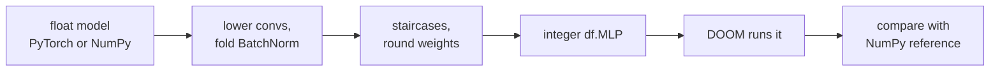
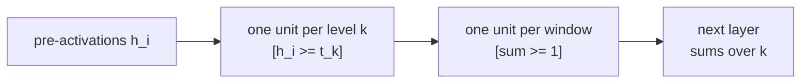

# Float-model interop: convolutions, pooling, BatchNorm, activations, quantisation-aware training

This page shows how to bring a float model from PyTorch or NumPy into DOOM.
Python turns it into an integer `df.MLP` or transformer, and DOOM runs that.



> [!NOTE]
> Every step before DOOM happens in Python.
> DOOM computes the integer model exactly, checked with tolerance 0.
> The integer model only approximates the float model.

The code is in [`interop.py`](../doomformer/interop.py), [`quantize.py`](../doomformer/quantize.py),
[`qat.py`](../doomformer/qat.py), and `MLP` in [`kit.py`](../doomformer/kit.py).
Tests:
[`test_interop.py`](../tests/test_interop.py), [`test_quant.py`](../tests/test_quant.py).
Results are in [`models/quant/EVAL.md`](../models/quant/EVAL.md).

## Who does what

Python prepares and checks. DOOM does the network arithmetic.

<details><summary><b>Step-by-step split</b></summary>


| step | who |
|---|---|
| walk the torch module / take your NumPy layers, lower convs to matrices, pick staircase thresholds, round weights | Python (`interop.py`, `MLP.from_numpy`) |
| input quantisation (`net.encode`), writing the integers into the input gates | Python |
| staircase activations (counting passed gates), every weighted sum, every layer chaining | **DOOM** (voodoo dolls, gate sectors, line specials; see [BUILD_YOUR_OWN](BUILD_YOUR_OWN.md#concepts)) |
| ACS level scripts | move the dolls home between passes and copy sector heights/lights into `USER` variables for readback; they compute no network arithmetic |
| compare with the integer reference | Python (NumPy integers, independent of the map) |
| argmax of the outputs (`MLP.predict`), decoding to floats (`net.decode`) | Python |

</details>

## What is exact and what is not

Some steps keep the float function exactly. Others approximate it.

| piece | status |
|---|---|
| conv (1-D, 2-D, stride, zero padding, dilation, groups) as a linear layer | exact in float: equals `torch.nn.Conv*` to 1e-12 in 13 tested configurations |
| BatchNorm (eval) folded into a layer, AvgPool as a matrix | exact in float, to 1e-9 against float64 torch |
| rounding weights to integers | approximation, one scale per layer |
| ReLU, ReLU6, Hardtanh, clamp, Sigmoid, Tanh, any monotone function as a K-level staircase | approximation, within half an output step inside the calibrated range, constant outside |
| GELU, SiLU as a staircase | approximation of the monotone envelope, which adds half the dip depth: GELU 0.085, SiLU 0.14 |
| MaxPool after a staircase | exact maximum of the staircase counts |
| `calibrate="mse"`, `equalise` | a different approximation, still an approximation |
| DOOM running the integer model | exact, checked per pass, tolerance 0 |
| `predict` | Python's `numpy.argmax` of DOOM's integers, first index wins ties |

## `MLP.from_torch(model, calib_x, levels=8, *, input_shape=None, calibrate="max", equalise=None)`

`from_torch` lowers a trained torch model to an integer MLP. `model` is an `nn.Sequential`, nested or not.
A single supported module also works.

| module | handling |
|---|---|
| `Linear` | a layer |
| `Conv1d`, `Conv2d` | lowered to a dense layer by `interop.conv1d_matrix` / `conv2d_matrix`. `padding_mode='zeros'` only |
| `Flatten` | row-major, default `start_dim=1, end_dim=-1` only |
| `Identity`, `Dropout` | skipped. `Dropout` must be in `eval()` mode or `p=0` |
| `ReLU`, `ReLU6`, `Hardtanh(min, max)`, `Sigmoid`, `Tanh`, `GELU`, `SiLU` | staircases |
| `BatchNorm1d`, `BatchNorm2d` (eval mode) | folded into the previous layer's rows, or after an activation into the next layer's columns and bias |
| `AvgPool1d/2d`, `AdaptiveAvgPool1d/2d` | an exact averaging matrix, merged into the next layer |
| `MaxPool1d`, `MaxPool2d` next to a monotone activation | exact on the counts, see [MaxPool](#maxpool-exact-by-comparisons). `ceil_mode` and `return_indices` refused |
| `qat.InputStair`, `qat.Stair` | the trained quantisers of a `qat.fit` model |

Convs accept `stride`, `padding` (int, pair, `"same"`, `"valid"`), `dilation`, `groups` and `bias=False`.
A layer with no activation after it merges with the next one.
So `Conv -> Flatten -> Linear` is two layers.
The last layer has no activation.
Apply `sigmoid` or `softmax` to `net.decode(y)` in Python.

`from_torch` raises `ValueError` for these, naming the module.

* `LayerNorm`, `GroupNorm`, `InstanceNorm`. Their statistics depend on the input.
* `MaxPool` with no staircase next to it, after the input, or between a BatchNorm and its activation.
* BatchNorm in training mode or with `track_running_stats=False`, and `ceil_mode` pools.

`calib_x` is `(N, *sample_shape)`, or flat with `input_shape=(1, 5, 5)`.
The net remembers `input_shape`.
So `net.encode` and `net.float_forward` accept `(C, H, W)` and `(N, C, H, W)`.
The brain itself takes flat `(n_in,)` vectors.

`levels` is one int for all staircases, or a list.
A list gives the input first, then one entry per activation.
Every level of every unit is a doll, so levels multiply the map size.
A binary glyph needs `levels=[1, ...]`.
8x8 digits with values 0..16 are lossless at `levels=[16, K, ...]`.
At `levels=K` they lose information.

### `MLP.from_numpy`

`from_numpy` does the same for plain float matrices.

```python
MLP.from_numpy(layers, calib_x, levels=8, *, input_shape=None, calibrate="max", equalise=None, input_stair=None)
```

`layers` is `[(W, b), (W, b, activation), ...]`. ReLU is the default activation.
These activations are accepted.

* `"relu"`, `"identity"`, `"relu6"`, `"sigmoid"`, `"tanh"`, `"hardtanh"`, `"gelu"`, `"gelu_tanh"`, `"silu"`.
* `("clamp", lo, hi)` or `("hardtanh", lo, hi)`.
* a vectorised nondecreasing callable, checked on 257 points.
* a `df.staircase(...)` result.

For convolutions, `interop.conv2d_matrix(weight, bias, in_shape, stride, padding, dilation, groups)` helps.
It returns `(M, b, out_shape)`. `conv1d_matrix` is the 1-D version.

## Activations as staircases: `df.staircase`

DOOM's activation is `#{k : z >= thr[k]}`, a nondecreasing step function.
`df.staircase(fn, x_range, levels)` picks K thresholds for any nondecreasing `fn`.

```python
st = df.staircase(np.tanh, (-3, 3), 8)        # a Staircase: ndarray of 8 float thresholds
st.lo, st.step                                # tanh(-3), (tanh(3) - tanh(-3)) / 8
st.value(z)                                   # lo + step * counts(z): what the staircase stands for
st.counts(z)                                  # #{k : z >= thr[k]}: what DOOM's gates produce
st.max_error()                                # max |fn - value| on x_range
t, shift = st.int_thresholds(scale)           # integer thresholds for h = z / scale, plus the bias shift to make them >= 1
```

The output range is cut into K equal steps.
Threshold `k` sits where `fn` reaches the middle of step `k`.
So the error is at most half a step. This is `max_error()` on `x_range`.

| K | tanh on (-3, 3) | sigmoid on (-6, 6) | relu6 on (-2, 9) |
|---|---|---|---|
| 2 | 0.498 | 0.249 | 1.499 |
| 4 | 0.249 | 0.124 | 0.750 |
| 8 | 0.124 | 0.062 | 0.375 |
| 16 | 0.062 | 0.031 | 0.188 |

`from_numpy` places the staircase over the calibrated pre-activation range.
If you pass a `Staircase`, it uses yours.
The count `a` stands for `lo + step * a`.
The next layer's weights absorb `step`, and its bias absorbs `lo`.

DOOM's thresholds are positive.
For Sigmoid, Tanh and Hardtanh, the quantiser shifts the staircase up.
It adds `shift` to that layer's integer biases.
The hidden value DOOM stores is then `h + shift`.

Errors grow through layers. They roughly halve when the levels double.

> [!TIP]
> Run `quantization_report` on your data before spending DOOM time.
> Try `calibrate="mse"` first, and QAT for K = 2.

## Calibration: `calibrate="max"` and `"mse"`, `equalise`

Calibration picks each staircase's step from your data.
`calibrate="max"` is the default and keeps the integer nets of v0.5.0.
`equalise` is on by default with `"mse"`.

* **max** sets a ReLU step to `max(h) / K` and an input step to `max|x| / K`. One outlier stretches every level.
* **mse** searches the step `a * max / K` for the least squared error (`quantize.relu_step`).
  `a` runs over 0.25..1 in 61 steps.
* Other staircases search clipping quantiles the same way (`quantize.fit_staircase`).
* **equalise** rescales each ReLU unit by `c` in 1/4..4 towards a common 99th percentile.
  The float function stays the same, and one layer step then fits every unit.
* equalise skips pooled layers and fixed staircases.

The table shows mean test accuracy in percent on 8x8 digits, over three seeds.
All levels are K. Command: `python training/quant_digits.py --aggregate`.
Source: [EVAL.md](../models/quant/EVAL.md).

| net, K = all levels | float | PTQ max (v0.5.0) | PTQ mse | QAT |
|---|---|---|---|---|
| CNN (1,954 parameters), K = 2 | 95.9 | 79.8 | 92.4 | 92.5 |
| CNN, K = 4 | 95.9 | 92.7 | 95.1 | 94.8 |
| CNN, K = 8 | 95.9 | 95.0 | 95.8 | 95.7 |
| depth-6 MLP (width 48), K = 2 | 95.9 | 45.5 | 90.3 | 91.9 |
| depth-6 MLP, K = 4 | 95.9 | 88.9 | 93.7 | 93.8 |
| depth-6 MLP, K = 8 | 95.9 | 94.6 | 95.5 | 95.3 |
| BatchNorm + MaxPool + AvgPool CNN, K = 4 | 97.8 | 93.9 | 96.0 | 96.4 |
| BatchNorm + MaxPool + AvgPool CNN, K = 8 | 97.8 | 97.0 | 97.3 | 97.6 |

The test set has 1,797 digits, so the standard error is 0.5 points.
Here the input is cut to K levels too.

## MaxPool: exact, by comparisons

MaxPool is built from comparisons, so it stays exact.
Staircase counts `a_i` lie in `0..K`, and `max_i a_i = sum_k [some a_i >= k]`.



It uses only staircases of sums.
`tests/test_quant.py` checks it against a NumPy window maximum.
It also checks against torch's `MaxPool2d` on the counts, and in DOOM.

This is the cost from `df.plan` for `Conv2d(1>8, 3x3, p1) -> ReLU -> Pool(2) -> Flatten -> Linear(128>10)` on 8x8 input.

| K | pool | layers | dolls | sectors |
|---|---|---|---|---|
| 2 | MaxPool2d(2) | 3 | 1,411 | 55,590 |
| 2 | AvgPool2d(2) | 2 | 1,154 | 42,916 |
| 4 | MaxPool2d(2) | 3 | 2,819 | 173,100 |
| 4 | AvgPool2d(2) | 2 | 2,306 | 85,282 |
| 8 | MaxPool2d(2) | 3 | 5,632 | 145,560 as tiles (no longer one map) |
| 8 | AvgPool2d(2) | 2 | 4,610 | 170,064 |

## Quantisation-aware training: `doomformer.qat`

```python
from doomformer import qat                          # also df.qat; needs torch
qmodel = qat.fit(model, loader, levels=4, steps=3000)          # model: a trained nn.Sequential, loader: (x, y) batches
net = df.MLP.from_torch(qmodel, calib_x)                       # carries the trained staircases and the input quantiser
qat.lowering_gap(qmodel, net, x_test, y_test, float_model=model)   # accuracy float / staircase model / integer, agreement
```

Quantisation-aware training fine-tunes a torch model through the same staircases DOOM uses.

`fit` replaces every supported activation with a `qat.Stair`.
It adds a `qat.InputStair` in front.
It trains with a straight-through gradient.
The mse rule resets the steps before training and every `refresh` steps.
BatchNorm trains with frozen statistics.
The docstring covers `calib_x`, `loss_fn`, `distill`, `equalise` and the optimiser.

`from_torch(qmodel)` reads every trained staircase, so the integer net counts the same ones.
Only weight rounding and the integer input encoding differ.
On the digits nets, both models agree on 98.8 % of test digits on average.
Their accuracies differ by 0.26 points on average.

On ReLU nets, QAT and PTQ mse are within the seed spread at K = 3, 4 and 8.
QAT helps at K = 2 and on nets with several MaxPools or GELU.
Validation logs: `models/quant/qat_equalise_validation.log`, `models/quant/sweep_validation.log`.

## `MLP.predict(brain, x)`

```python
y_class = net.predict(brain, x_int)                       # int
classes = net.predict(brain, X_int)                       # (B,) array
net.predict(brain, x_float, encode=True)                  # applies net.encode first
```

`predict` returns the class DOOM computed.
`brain(x)` runs and checks DOOM, then Python takes the argmax.
`brain` must come from the same `net`, or it raises `ValueError`.

## `quantization_report` and `range_report`

These reports run in NumPy. DOOM is not involved.
`net.quantization_report(x_float)` compares the integer and float models.

<details><summary><b>Report keys</b></summary>


| key | meaning |
|---|---|
| `n`, `max_abs_error`, `mean_abs_error`, `float_max_abs`, `in_range`, `argmax_agreement` | accuracy of the integer model |
| `input_range` | `peak` of `\|x_int\|` and `usage` of the ±12,000 gate range |
| `layers` | per layer: `partial_sum_peak/usage` against ±30,000, `gate_peak/usage`, `top_level_fraction`, `worst_case` bound for any input, `rows_over` |
| `warnings` | a range that is exceeded, or 90 % used while `worst_case` exceeds it |

</details>

`net.range_report(x_int)` reports the same ranges for any integer MLP, hand-built ones included.

## Example 11: a conv net reads a glyph in DOOM

This example trains a small conv net and runs it in DOOM.
It classifies 7x7 arrow glyphs.

```sh
python examples/11_conv_in_doom.py [--glyphs 12] [--seed 0] [--numpy]
```

The model is `Conv2d(1->3, 3x3) -> Hardtanh(-1, 1) -> Flatten -> Linear(75 -> 4)`.
It is quantised with `levels=[1, 3]`.
The script exits nonzero on any mismatch. Results for seed 0:

| | PyTorch | NumPy (`--numpy`) |
|---|---|---|
| accuracy on 2,000 fresh glyphs, float model / integer model (reference arithmetic, not DOOM) | 0.955 / 0.945 | 0.957 / 0.949 |
| `df.plan` | 276 dolls, 5,938 sectors, fits | same |
| 12 glyph passes in DOOM | 13 s, **12/12 exact** | 14 s, **12/12 exact** |
| DOOM class == truth / float class == truth (12 test glyphs) | 11/12 / 11/12 | 12/12 / 12/12 |

## Transformers: `Transformer.from_torch`

```python
from doomformer import torch_models as tm
net = tm.GPT(V, T, d, H, dm, K, KA, KM, L, attn="relu", norm="none", mlp="relu")    # a torch module
tm.fit(net, train, dev, steps=(2000, 2500, 2000))                                  # (tok, tgt, valid) tensors, see tm.pack
qm = df.Transformer.from_torch(net, vocab)                                         # a QModel, range-checked
```

`Transformer.from_torch` exports a trained integer GPT for DOOM.
`tm.GPT` in `doomformer/torch_models.py` mirrors `intref.forward`.
The shipped models were trained with it. It has these variants.

| option | values |
|---|---|
| `attn` | `relu` (counts of passed score thresholds) or `softmax` |
| `norm` | `none` or `rms` |
| `mlp` | `relu` or `reglu` |

`tm.fit` trains in four stages:

1. calibrate the thresholds,
2. train a float stage,
3. QAT on activations,
4. QAT on all parameters, keeping the best dev integer cross-entropy.

Afterwards the module is the integer model.
`from_torch` exports it as a `QModel`.
`tm.save(net, path)` and `tm.load(path)` round-trip a GPT to the same sha256.

The lowered `QModel` equals the torch integer forward bit for bit (`tests/test_torch_models.py`).
DOOM equals `intref.forward` with `df.compile(qm, mode="tiles")`.
Everything between the float model and the integers is approximation.
Python applies the learned logit scale `exp(net.lg)` from `info.json`.
Perplexities and the DOOM run: [`models/quant/TRANSFORMER.md`](../models/quant/TRANSFORMER.md).

`from_torch` raises an error with the reason for these cases.

* a `FloatGPT` or any other module. A float transformer cannot be lowered by rounding.
* a GPT never calibrated or trained. `calib_tokens=` calibrates it, which is plain rounding and can be far off.
* a wrong `vocab` length.
* a model outside DOOM's ranges, by `intref.check_limits` on the model's limit sequences.

## Limits

> [!WARNING]
> The integer model is an approximation. Staircases are nondecreasing, and inputs outside the calibration range saturate.

* Levels, layers and width have no cap beyond the range checks and the map size from `df.plan`.
* Transformers trained elsewhere cannot be imported. Their weights must be trained through these staircases.
* On the level names the transformer does not beat its 5-gram baseline. See TRANSFORMER.md.
* Lowered convs are dense matrices, mostly zero. Zeros cost nothing in DOOM but cost NumPy and `.npz` memory.
* MaxPool multiplies the pooled layer's lines by K. AvgPool and BatchNorm merge into the weights.
* Softmax inside an MLP is not supported.
* `save` keeps the float model only for built-in activations without pools. Other nets load with no `float_forward`.
* Encodings beyond ±12,000 raise `RangeError` before DOOM runs.
