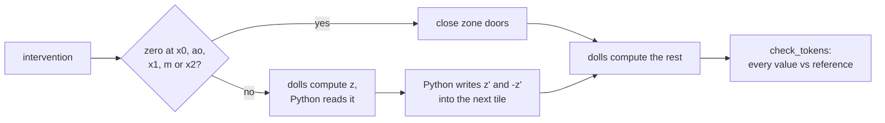
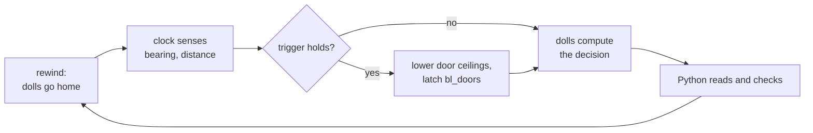

# Causal interventions

This page shows how to change a network's activations while it runs in DOOM. You can zero units, patch in values from
another run, or push along a direction, and every run is still checked.

Each intervened run executes on voodoo dolls. It is compared with the equally intervened NumPy reference at tolerance 0.

| tool | what it does |
|---|---|
| `ablate=` | zeroes units |
| `interventions=[...]` | more modes, per position and per head |
| `df.patch_recovery` | builds a recovery table from single-cell patches |
| `df.probe` | fits a direction to steer with |
| lane doors | let a one-map level zero units on its own clock |

```python
import doomformer as df
from doomformer import intervene as iv
from doomformer.intref import QModel, forward

m = QModel.load("doomplayer")                       # 1 layer, d=16, 2 heads, T=3
clean, corrupt = [0, 12, 23], [0, 16, 23]           # BOS, bearing i (aligned) or m (12 to 20 degrees left), distance 1
logits = forward(m, corrupt, interventions=[
    iv.resample("L0.v", clean, heads=[1], pos=[1]),          # head 1's value at position 1 from the clean run
    iv.scale("L0.x1", 1, 2, pos=[2]),                        # halve x1 at position 2
    iv.zero("L0.ao", units=[0, 3]),                          # zero two units (doors in DOOM)
])
table = df.patch_recovery(m, clean, corrupt, doom=True, workers=3)   # every (site, position, head) row, run in DOOM
print(table.text())
```

## Modes and sites

A site is one integer activation of the model. Sites are named as in `ablate=`.

| site | what it is |
|---|---|
| `x0`, `L{l}.x1`, `L{l}.x2` | the residual stream |
| `L{l}.ao` | the attention output |
| `L{l}.m` | the MLP hidden units |
| `L{l}.q`, `L{l}.k`, `L{l}.v` | the counts after the q, k and v staircases |

`ao`, `q`, `k` and `v` have `H` heads of `dh` consecutive units. `heads=[h]` selects units `h*dh` to `(h+1)*dh - 1`.
Pick cells with `pos=[...]` and `units=[...]` or `heads=[...]`. The default is every position and every unit.

| mode | the activation becomes |
|---|---|
| `zero(site)` | 0 |
| `set_value(site, v)` | `v` (an int, or an array broadcast to [positions, units]) |
| `mean(site, clean, by="position")` | the rounded (half up) mean over the clean token lists, per position (`by="all"`: over all positions) |
| `resample(site, clean, src_pos=None)` | the activation of the clean run at `src_pos` (default: the same position) |
| `scale(site, num, den=1)` | `trunc(x * num / den)`, clipped to the site's range |
| `add_direction(site, u, alpha=1)` | `x + alpha * u`, clipped; `u` has one integer entry per selected unit |
| `project_out(site, u)` | `x - c * u` with `c = trunc((x . u) / (u . u))`, clipped; leaves `|x' . u|` below `u . u` |

`set`, `mean` and `resample` become fixed integers before the run. The other modes read the run's own activation.

`forward(..., interventions=[...])` applies them in order, before any consumer reads the activation. Zeros from
`ablate=` come first. `intref.generate` takes the same argument.

Positions past the end of a run are skipped. So a prefix run agrees with the full run.

These raise `ValueError`:

- A count a staircase cannot output, in the reference and in DOOM.
- An unknown site, a missing layer, `units` with `heads`, or units outside the site.
- Any mode but `zero` at `m` of the gated MLP (`mlp="reglu"`). There m = g * u is a product of two gates.

## How DOOM runs them

The tile engine applies each intervention in one of two ways, and reports which.

- **Doors.** `zero` at `x0`, `ao`, `x1`, `m`, `x2` closes the zone doors of the unit's blocks in every consuming tile.
- **Bus patch.** Every other case, including `zero` at `q`, `k`, `v` and any mix at one site.



`DoomTransformer(model, tile_dir, interventions=[...])` takes them. `use(...)` changes them between runs. A tile brain
from `df.compile(net, mode="tiles")` takes `brain.intervene(...)`.

In a bus patch the dolls compute a tile output's pre-activation `z`. Python reads it and applies the intervention to
its staircase count. Then it writes `z'` and `-z'` into the ports of the consuming tiles.

`z'` is the smallest-magnitude integer with the new count. For softmax attention, Python writes the `P`/`N` comparison
lanes of the new count instead.

`check_tokens` compares every exposed tensor and its negation twin, and the logits. It also checks that each written
value has the count the reference's patched activation has.

> [!NOTE]
> The check does not cover the patch value itself. A wrong patch value gives a consistent but wrong run.
> `tests/test_interventions.py` patches one level off. Each tensor then differs by exactly what the reference predicts
> (`predicted == got`).

`engine.forward(tokens, reuse=True)` reuses the longest prefix with the same tokens and interventions. It still checks
the whole context.

Relu attention, softmax attention, RMSNorm and the gated MLP all run under `tests/test_interventions.py`.

## One map

A one-map brain has no host between its layers, so interventions must live in the map. There are two ways: lane doors
the level closes at runtime, or a lesion folded into the weights.

### Lane doors

A lane is a doll walking to a gate set by a unit's pre-activation. `iv.lane_doors(model, ablate)` names the doors for a
set of units. `build_onemap(..., doors=...)` or `compile_pure(doors=...)` builds them.

Every lane that reads a listed unit gets a door in its pad. The door is a sector with the unit's tag (UDMF `moreids`)
and a ceiling 128 units up.

Lowering the ceiling stops the lane's doll. That zero-ablates the unit at every consumer, just like `ablate=`.

Maps built without `doors=` are byte for byte the maps of the v0.5.0 tree, at opt 0 and opt 3.

| trigger | flag | the doors close |
|---|---|---|
| decision counter | `--lesion-at N` | at the top of decision N, after the rewind |
| sensed event | `--lesion-when near` | the nearest live demon is within 200 units (distance token '0' or '1') |
| | `--lesion-when ahead` | the bearing token is 'i', in the sights |
| | `--lesion-when near+ahead` | both terms hold |



Both triggers are compiled into the level's clock script. The clock lowers the ceilings (`Ceiling_LowerByValue`) and
sets a flag the status readout shows.

A sensed event is tested on the tokens that `bl_sense()` feeds the transformer. Once it holds, the doors latch shut
(`bl_doors`).

Python sends neither trigger, only readout scripts.

Each decision, Python checks every value against a reference. That is the healthy reference before the doors close and
the masked one after. It also checks the level's flag.

The doors close after the rewind. Closed right after a run without one, the next run had 23 values off the masked
reference (`tests/test_interv2.py::test_lane_doors_close_between_decisions_and_match_the_masked_reference`). The likely
cause, not measured, is a doll stuck under the falling ceiling.

### Closing on a decision

`--lesion-at` closes the doors of a pacifist lesion in the middle of a fight.

<p align="center"></p>

The lesion is one of the 12 five-neuron pacifists of `doomplayer_onemap`. They come from an exhaustive search over its 48
neurons.

Its doors sit on 78 lanes. It turns every 'in sights' context from FIRE to TURN RIGHT.

Seed 2 is used because its healthy brain fires at decision 3. Healthy seeds 1 and 3 only turn right
(`models/interventions/brainlevel_healthy_seed{1,2,3}_opt3.txt`).

```sh
python -m demos.brainlevel --seed 2 --decisions 12 --opt 3 --lesion 'x0:0;L0.ao:7;L0.x1:7;L0.m:0;L0.x2:0' --lesion-at 3
```

| decisions | doors | what he sees | healthy brain | the level's brain | values at tolerance 0 |
|---|---|---|---|---|---|
| 1, 2 | open | demon 100 to 180 degrees right, then 12 to 20 left | TURN RIGHT, TURN LEFT | the same | 540 each, EXACT |
| 3 | closed before it | demon in his sights, far | FIRE | TURN RIGHT | 540, EXACT against the masked reference |
| 4 to 12 | closed | the aim swings between 'in sights' and 12 to 20 left | FIRE on every 'in sights' | TURN RIGHT there, TURN LEFT otherwise | 540 each, EXACT |

| run | result | compute tics per decision | wall |
|---|---|---|---|
| `--opt 3` ([log](../models/interventions/brainlevel_lesion_at3_seed2_opt3.txt)) | 12 of 12 EXACT, 6,480 values, actions differ at 3, 5, 7, 9, 11, 0 kills | 738 | 73 s |
| `--opt 0` ([log](../models/interventions/brainlevel_lesion_at3_seed2_opt0.txt)) | 12 of 12 EXACT, the same actions | 4,302 | 494 s |
| `--lesion-at 99`, 6 decisions ([log](../models/interventions/brainlevel_doors_never_closed_seed2_opt3.txt)) | 6 of 6 EXACT against the healthy reference, kills at decision 3 | | |

The healthy run kills a demon at decision 3. The lesioned level kills nothing. Python sends 154 console commands, all
readout scripts.

### Closing on a sensed event

`--lesion-when` closes the same doors when the clock senses the event.

> [!TIP]
> Try `python -m demos.brainlevel --lesion-when near`. The level closes neuron doors when a demon comes close.

The lesion changes the action in 14 of the 34 'near' contexts. Seed 4 is the first logged healthy run with a near
demon. That happens at decision 22, where the healthy brain fires and the lesion turns left
(`models/brainlevel_opt/opt3_seed4_50.log`).

| run | event | actions differ at | result | wall |
|---|---|---|---|---|
| seed 2, `ahead`, 12 decisions ([log](../models/interventions/brainlevel_lesion_when_ahead_seed2_opt3.txt)) | decision 3 | 3, 5, 7, 9, 11 | 12 of 12 EXACT, 6,480 values, 0 kills | 71 s |
| seed 4, `near`, 30 decisions ([log](../models/interventions/brainlevel_lesion_when_near_seed4_opt3.txt)) | decision 22 | 22, 24, 27, 28, 29, 30 | 30 of 30 EXACT, 16,200 values, 0 kills (healthy: one at 22) | 176 s |
| seed 2, `near`, 12 decisions ([log](../models/interventions/brainlevel_lesion_when_never_seed2_opt3.txt)) | never | none | 12 of 12 EXACT against the healthy reference, kills at decision 3 | 74 s |

All three runs use `--opt 3` and send only readout commands. Before the event every value equals the healthy
reference. From the event decision on, every value equals the masked reference.

The 'never' run shows only one thing. The doors stay open while the condition is false.

### Fold: a different map

`iv.fold(model, interventions)` bakes constant interventions into a copy of the model's weights. It takes `zero`,
`set` and `mean(by="all")` at `x0`, `ao`, `x1`, `m` and `x2`.

Column `u` of each consumer weight is zeroed. `W[:, u] * v` moves into the bias, residual weights included.
`tests/test_interventions.py` compiles a folded model into one map and checks every value.

`python -m demos.brainlevel --lesion SPEC` without `--lesion-at` uses the fold. Over 14 decisions on seed 4 it is 14 of
14 EXACT, with 7,560 values ([log](../models/interventions/brainlevel_lesion14.txt)). No action changes, because the
demon stays to his right.

## Patching with recovery

Patching asks how much of a result one cell carries. `df.patch_recovery` runs the corrupt tokens with one cell copied
from the clean run.

```python
df.patch_recovery(model, clean, corrupt, sites, answer=None, direction="denoising", doom=False)
```

A cell is a site, a position, and units or a head. Each row of the table is one cell.

| quantity | definition |
|---|---|
| metric | `logit[a] - logit[b]` at the last position |
| default `a`, `b` | the argmax of the clean run and of the corrupt run |
| recovery, `"denoising"` | `(metric(patched) - metric(corrupt)) / (metric(clean) - metric(corrupt))` |
| recovery, `"noising"` | patches corrupt into clean: `(metric(clean) - metric(patched)) / (metric(clean) - metric(corrupt))` |

| `doom=` | rows run in DOOM |
|---|---|
| `True` | every row |
| `N` | the N largest, unflagged rows first |
| an iterable | the rows it lists |

`patching.grid(m, ...)` builds the row list (`per_head=True`, `per_unit=True`, `positions=[...]`).

### Flags

Some rows rewrite a whole site where the metric reads. Those rows carry a `flag` and are not findings. `table.headline`
and all counts use the unflagged rows only.

| flag | rows | why |
|---|---|---|
| `tautological` | the last layer's `x1` or `x2` at the last position | the logits are a function of that vector, so recovery is 1 |
| `whole residual` | every unit of `x0`, `x1` or `x2` elsewhere | shows where the information is, not which units carry it |
| `whole site` | every unit of `ao`, `m`, `q`, `k` or `v` at the last position | near-tautological |

Every head together counts as every unit. A patch of some units, or of one head, is never flagged.

### The marine's policy

The marine's policy shows where the bearing token enters. It also shows that its two heads are redundant.

```sh
python -m doomformer.patching doomplayer --clean i1 --corrupt m1 --answer FL --per-head --pos 1,2 --doom all --workers 3
python -m doomformer.patching doomplayer_xl --clean i1 --corrupt m1 --answer FL --per-head --pos 1,2 --site L0.v --site L1.ao --doom all --workers 3
```

The clean context `i1` fires. The corrupt `m1` turns left. The metric `logit[F] - logit[L]` is 2,881 clean and -3,072
corrupt.

All 24 rows are EXACT in DOOM, in 320 s with 3 games ([log](../models/interventions/patch_doomplayer.txt)).

| site | position | cells | cells changed by the patch | recovery | in DOOM |
|---|---|---|---|---|---|
| `x0` | 1 | all units | 15 | 1.000 | EXACT, 546 values; whole residual |
| `L0.v` | 1 | head 0 | 8 | 0.698 | EXACT, 539 values |
| `L0.v` | 1 | head 1 | 6 | 0.829 | EXACT, 537 values |
| `L0.ao` | 2 | head 0 | 6 | 0.698 | EXACT, 537 values |
| `L0.ao` | 2 | head 1 | 6 | 0.829 | EXACT, 537 values |
| `L0.x1` | 2 | all units | 14 | 1.000 | EXACT, 545 values; tautological |
| `L0.m` | 2 | all units | 12 | 0.911 | EXACT, 543 values; whole site |
| `L0.x2` | 2 | all units | 13 | 1.000 | EXACT, 544 values; tautological |

The bearing enters through both heads' values at position 1. The heads sum above 1, so they are redundant. The other 16
rows recover nothing.

`doomplayer_xl` has 2 layers, d=32 and 4 heads. On the same pair the metric is 3,997 clean and -4,147 corrupt. Its 16
rows of `L0.v` and `L1.ao` are EXACT in 718 s with 3 games.

| site | position | head | recovery |
|---|---|---|---|
| `L0.v` | 1 | 0 | 0.565 |
| `L0.v` | 1 | 3 | 0.573 |
| `L1.ao` | 2 | 2 | 0.435 |
| `L1.ao` | 2 | 0 | 0.159 |
| `L1.ao` | 2 | 1 | 0.099 |

## A planted circuit

A planted circuit tests patching against a known answer. `doomformer/groundtruth.py` builds a one-layer transformer
by hand, with weights 0 and 1.

It maps `[BOS, a, b, c]`, digits 0 to 3, to `(b + c) mod 4`. It is right on all 64 contexts. It is saved in
`models/planted` (`python -m doomformer.groundtruth --save DIR`).

| part | what it does |
|---|---|
| head 0 | attends to `t - 1` and copies that token into a residual block called PREV |
| residual weight `r1` | carries the current token to the MLP |
| MLP unit `4a + b` | fires on PREV `a` and current token `b`, adds 1 to output `(a + b) mod 4` |
| head 1, the decoy | attends to `t - 2` and writes to dimensions nothing reads |

`planted_cells(kind, clean, corrupt)` derives the cells that can recover from the construction alone. "prev" pairs
change `b`, and "cur" pairs change `c`.

`check_recovery` patches every unit and head of every site and position, one at a time. It compares the nonzero cells
with the planted set. `python -m doomformer.groundtruth` runs it in the reference in 1.5 min.

| pairs | cells tested | planted | nonzero recovery | disagreements |
|---|---|---|---|---|
| "prev": 192 (every `a`, `b`, `c`, and a changed `b`) | 104,448 | 2,688 | 2,688 | 0 |
| "cur": 192 | 104,448 | 1,536 | 1,536 | 0 |
| "decoy": 192 (a changed `a`, read only by head 1) | head 1's output changes in 192 pairs | | | the logits change in 0 |

Patching finds exactly the planted cells.

<details><summary><b>Recovery per site over the "prev" pairs</b></summary>

| site | position | level | planted cells per pair | mean recovery of the nonzero cells |
|---|---|---|---|---|
| `x0` | 2 | unit | 2 (the old and the new token) | 0.50 |
| `L0.v` | 2 | head 0 | the head | 1.00 |
| `L0.v` | 2 | unit | 2 | 0.50 |
| `L0.ao` | 3 | head 0 | the head | 1.00 |
| `L0.ao` | 3 | unit | 2 | 0.50 |
| `L0.x1` | 3 | unit | 2 | 0.50 |
| `L0.m` | 3 | unit | 2 (units `4b + c` and `4b' + c`) | 0.50 |
| `L0.x2` | 3 | unit | 2 | 0.50 |

</details>

A single unit recovers 0.50. The corrupt run keeps its own active unit, which ties the logits. The "cur" pairs recover
through the residual and the MLP only.

Head 1 recovers nothing. But its output is never read, so this is not a hard case.

`circuit_check` keeps some components and mean-ablates the rest, over the 64 contexts.

| kept | logit difference restored | top-1 |
|---|---|---|
| H0 + MLP | 1.000 | 1.000 |
| H1 + MLP | 0.000 | |
| any subset without both H0 and the MLP | 0.000 | |

The smallest faithful circuit is the planted one, 2 of 3 components.

| DOOM run, tile maps, Python patching the bus | rows | result | log |
|---|---|---|---|
| `--doom 3 --doom-off 10` | planted rows of 3 "prev" and 3 "cur" pairs, 10 random others | 126 of 126 EXACT, 564 to 566 values each | [planted_circuit.txt](../models/interventions/planted_circuit.txt) |
| `--doom-circuit 64` | circuit-only and all-ablated models, all 64 contexts | 128 of 128 EXACT, 72,448 values, 42 min with 2 games | [planted_circuit_doom64.txt](../models/interventions/planted_circuit_doom64.txt) |

### The same circuit with a backup head

`planted_model(backup=True)` makes head 1 also copy `t - 1` into PREV (`--backup`, `models/planted_backup`,
[log](../models/interventions/planted_backup.txt)). Either head alone saturates the staircase.

A patch into one head leaves the other writing the corrupt token. So PREV holds both tokens, and the logits tie.

| | one head, decoy head 1 | backup head 1 |
|---|---|---|
| single-cell patches, 192 "prev" pairs: planted / nonzero / disagreements | 2,688 / 2,688 / 0 | 3,072 / 3,072 / 0 |
| `L0.v` at 2, `L0.ao` at 3, head 0 alone | 1.00 | 0.50 |
| the same, head 1 alone | 0 | 0.50 |
| zero-ablating head 0 alone, top-1 on the 64 contexts | 0.000 | 1.000 |
| zero-ablating head 1 alone | 1.000 | 1.000 |
| circuit search: faithful subsets | H0 + MLP only | H0 + MLP and H1 + MLP, 1.000 each |

> [!IMPORTANT]
> Single-cell patching and single-head knock-out mislead under redundancy. They read "two heads that each do half".
> In fact either head does all of it. Split credit in trained models, like 0.70 and 0.83 in `doomplayer`, does not rank
> heads either.

Only the circuit search shows the two minimal circuits. Nothing ranks them.

| DOOM run, tile maps, 3 games | rows | result |
|---|---|---|
| `--doom 2 --doom-off 8` | planted rows of 2 "prev" and 2 "cur" pairs, 8 random others | 80 of 80 EXACT |
| `--doom-circuit 8` | both minimal circuits and the all-ablated model, first 8 contexts | 16 of 16 per circuit, 9,072 values each |

### The two heads as an AND, and a head with a negative sign

`planted_model(backup=True, need_both=True)` makes `x1` need both heads (`--need-both`, `models/planted_and`,
[log](../models/interventions/planted_and.txt)). Its planted rule has 0 disagreements over 192 "prev" and 192 "cur"
pairs.

| | OR (backup head) | AND |
|---|---|---|
| head 0 alone, head 1 alone (patch) | 0.50, 0.50 | 0.50, 0.50 |
| zeroing either head alone, top-1 | 1.000 | 0.000 |
| faithful subsets | H0 + MLP, H1 + MLP | H0 + H1 + MLP only |
| unit that recovers | `b` | `b'` |

Head-level patching cannot tell OR from AND. Knock-out, the circuit search and unit-level rows can.

`planted_model(negative=True)` makes head 1 write -1 on the logit of the current token (`--negative`,
`models/planted_negative`, [log](../models/interventions/planted_negative.txt)). The model is still right on all 64
contexts.

With H1 mean-ablated, the logit difference moves by +1 or -1 in 32 contexts. The ratio of means cancels these out. So
`circuit_check` reports three per-context numbers next to it:

- `agree_top1`: the share of contexts where the circuit keeps the top-1 token.
- `agree_ld`: the share where it keeps the exact logit difference.
- `ratio_min`: the smallest per-context ratio.

| kept | ratio of means | `agree_top1` | `agree_ld` | `ratio_min` |
|---|---|---|---|---|
| H0 + MLP | 1.000 | 1.000 | 0.500 | 0.67 |
| H1 + MLP | 0.000 | | | |
| H0 + H1 + MLP | | 1.000 | 1.000 | 1.000 |

Patching does see head 1. Its recovery at `L0.ao` position 3 ranges from -1.00 to +0.33 over the 192 "cur" pairs.

| DOOM run, `--doom 2 --doom-circuit 8 --workers 3` | result |
|---|---|
| heads, `v` of head 1 and `x2` units on 2 "cur" pairs, 8 random units | 24 of 24 rows EXACT |
| H0 + MLP and the all-ablated model on the first 8 contexts | 16 of 16 runs EXACT, 9,088 values |

A ratio of means alone can miss a component that pushes both ways. Read `agree_ld` and `ratio_min` next to it.

## The induction circuit

The induction circuit is the trained case. `models/induction` copies the token that followed the first occurrence of
the current token.

It has 2 layers, d=16, 2 heads, softmax attention, MLP 32 and T=10. It is right on 99.95% of held-out queries
(`models/induction/train_info.json`).

`doomformer/circuit.py` builds two kinds of pair:

- **Answer** pairs swap the answer token with another prefix token. They test what is copied.
- **Source** pairs swap the first occurrence of the query token. They test how it is found.

| position | role |
|---|---|
| `query` | the last token |
| `src` | the first occurrence j |
| `ans` | j+1 |
| `src2`, `ans2` | the swapped positions |

`python -m demos.circuit` patches each cell on 200 held-out pairs of each kind, seed 0. It takes 1.5 min. The table
shows mean recovery and omits cells below 0.05.

| cell | answer pairs | source pairs |
|---|---|---|
| `L1.ao` head 0, head 1 at `query` | 0.55, 0.47 | 0.52, 0.47 |
| `L1.x1`, `L1.x2` at `query` | 1.00, 1.00 (tautological) | 1.00, 1.00 (tautological) |
| `L1.v` head 0, head 1 at `ans` | 0.56, 0.47 | below 0.05 |
| `L0.x1`, `L0.x2` at `ans` | 1.01, 1.01 (whole residual) | 0.50, 0.50 (and 0.49 at `ans2`) (whole residual) |
| `L0.ao` head 0, head 1 at `ans`, `ans2` | below 0.05 | 0.22, 0.06 at `ans`; 0.35, 0.13 at `ans2` |
| `L0.v` head 0, head 1 at `src`, `src2` | below 0.05 | 0.23, 0.06 at `src`; 0.36, 0.13 at `src2` |
| `L1.k` head 0, head 1 at `ans`, `ans2` | below 0.05 | 0.21, 0.19 at `ans`; 0.20, 0.16 at `ans2` |
| `L0.m` at `ans` / `L1.m` at `query` | 0.37 / 0.37 (the second is a whole site) | 0.01 / 0.35 (the second is a whole site) |

Flagged rows are left out of the reading ([circuit_ref_flags.txt](../models/interventions/circuit_ref_flags.txt)).

The two layer-1 heads read the answer from the value at `ans`. They write it to the last position. Together they carry
more than all of it, so they are redundant.

Layer-0 head 0 writes the key the layer-1 heads look for. Head 1 does about a third of that.

`python training/analyze_induction.py models/induction` agrees, on 2,760 queried tokens.

| heads | share of attention weight |
|---|---|
| layer 0, heads 0 and 1 | 59.5% and 53.0% on position t-1 |
| layer 1, heads 0 and 1 | 93.6% and 94.0% on position j+1 |

In answer pairs the attended position is the same in all 200 pairs. The query's attention weights match in only 27.

### Circuit search

`demos.circuit` keeps every subset of the 4 heads and 2 MLP layers. It mean-ablates the rest at every position.

| components | best subset | logit difference restored |
|---|---|---|
| 0 | | 0.000 |
| 1 | L0.MLP | 0.001 |
| 2 | L0.H0, L1.H0 | 0.083 |
| 3 | + L0.MLP | 0.347 |
| 4 | + L1.MLP | 0.580 |
| 5 | L0.H0, L1.H0, L1.H1, both MLPs | 0.874 (top-1 0.94) |
| 6 | all | 1.000 |

No proper subset reaches 0.9 under mean ablation. But the dataset mean is an activation the model never sees. So this
may say more about the method than the model.

`--baseline corrupt` uses the corrupt run's activations instead
([log](../models/interventions/circuit_baseline_corrupt.txt)).

| pairs | kept | restored |
|---|---|---|
| answer | L1.H0, L1.H1, L0.MLP, L1.MLP: no layer-0 head | 0.991 (top-1 1.00) |
| answer | best 5 of 6 | 0.998 |
| source | the four heads and L1.MLP | 0.963 |

The smallest faithful circuit depends on what replaces the rest. Neither baseline is the true one.

### In DOOM

| command | pairs | cells or circuit | runs EXACT | patched cells | values | log |
|---|---|---|---|---|---|---|
| `--doom-rows 4` | pair 0 of each kind | the 4 largest cells per kind, flagged cells included | 8 of 8 | 110 | about 9,270 per run | [circuit_doom2.txt](../models/interventions/circuit_doom2.txt) |
| `--doom-rows 2 --doom-pairs 10` | answer pairs 0 to 9 | `L1.v` head 0 at `ans`, `L1.ao` head 0 at `query` | 20 of 20 | 146 | 209,206 | [circuit_doom_10pairs.txt](../models/interventions/circuit_doom_10pairs.txt) |
| the same, `--doom-kind source` | source pairs 0 to 9 | `L1.ao` heads 0 and 1 at `query` | 20 of 20 | 147 | 209,207 | [circuit_doom_10pairs_source.txt](../models/interventions/circuit_doom_10pairs_source.txt) |
| `--doom-circuits 2` | 2 pairs | the best proper subset (L0.H1 mean-ablated) and the all-ablated model | 4 of 4 | 807 | 37,831 | [circuit_doom3.txt](../models/interventions/circuit_doom3.txt) |

A run takes 50 to 300 s. So the 200-pair means stay reference numbers.

### The relu model

`models/induction_relu` has the same shape, with relu attention.

| | `induction` (softmax) | `induction_relu` |
|---|---|---|
| layer-1 head outputs at `query` | 0.55, 0.47 | 0.57, 0.44 |
| layer-1 values at `ans` | 0.56, 0.47 | 0.57, 0.44 |
| previous-token head, source pairs | layer-0 head 0: value 0.23/0.36, output 0.22/0.35 | layer-0 head 1: value 0.47/0.48, output 0.47/0.48 |
| layer-0 head 0, answer pairs | below 0.05 | 0.34 |
| best 4 components | 0.580 | 0.810, all four heads |
| best 5 components | 0.874 | 0.949 with L1.MLP (top-1 0.99) |

The previous-token head differs between the two trained models.

## Steering

Steering adds a fitted direction to an activation and watches the policy change.

`df.probe(model, site, contexts, labels, pos=...)` takes the difference of the two class means at one site and
position. It rounds that to integers, with largest entry `scale` (default 4).

`probe.add(alpha)` applies it as `add_direction`. `probe.project()` applies it as `project_out`. `probe.accuracy` is fit
accuracy, not held out.

`python -m demos.steer` fits the probe on `doomplayer` ([log](../models/interventions/steer_doomplayer.txt)). It
separates 5 'i' contexts (aim aligned) from 5 'm' contexts (12 to 20 degrees left). Fit accuracy is 1.00.

Steering then adds alpha times the direction in all 86 contexts of `policy.all_contexts()`. Four of the five 'm'
contexts do not fire in the healthy policy.

| site | alpha | 'm' that fire (of 4) | actions changed (of 86) | now F | random: 'm' fire / changed | held-out 'm' that fire |
|---|---|---|---|---|---|---|
| `x0`, 1 | 1 | 1 | 16 | 14 | 0.10 / 10.1 | 0 of 2 |
| `x0`, 1 | 2 | 4 | 39 | 35 | 0.40 / 28.4 | 2 of 2 |
| `x0`, 1 | 3 | 4 | 44 | 34 | 0.39 / 39.8 | 2 of 2 |
| `L0.ao`, 2 | 1 | 1 | 22 | | | |
| `L0.ao`, 2 | 2 | 4 | 44 | 44 | 0.38 / 22.5 | 2 of 2 |
| `L0.ao`, 2 | 3 | 4 | 57 | 57 | 0.61 / 34.7 | 2 of 2 |
| `L0.x1`, 2 | 1 | 1 | 13 | | | |
| `L0.x1`, 2 | 2 | 3 | 27 | 27 | 0.14 / 15.4 | 1 of 2 |
| `L0.x1`, 2 | 3 | 4 | 45 | 45 | 0.28 / 29.2 | 2 of 2 |

Random is the mean over 200 integer directions in -4..4. Held-out uses a probe fitted on distances 0 to 2. It tests 'm'
at distances 3 and 4.

Alpha -2 turns 'i' contexts from FIRE to TURN LEFT. `project_out` changes only 2 of the 86 contexts at each site.

### Controls

The controls ask if any direction built from these activations does as well. Each uses alpha 2 and 200 draws.

| column | meaning |
|---|---|
| m fire | the mean count of 'm' contexts that fire |
| P | the share of draws at least as good as the real probe |
| distinct | the number of different directions drawn |

<details><summary><b>Control directions at the three sites</b></summary>

| site | direction | m fire | P(>= real) | changed (of 86) | end in F | distinct |
|---|---|---|---|---|---|---|
| `x0`, 1 | real probe ('i' vs 'm') | 4 | | 39 | 35 | |
| | random, largest entry 4 | 0.41 | 0.000 | 30.6 | 5.1 | 200 |
| | the probe's entries permuted, random signs (same L2 norm) | 0.29 | 0.005 | 22.4 | 4.2 | 200 |
| | random in the span of the 86 contexts' activations, the probe's L2 norm | 0.35 | 0.000 | 34.1 | 5.7 | 200 |
| | probe on 5 against 5 random contexts | 0.41 | 0.000 | 30.9 | 6.6 | 200 |
| | shuffled-label probe ('i' vs 'm' labels permuted) | 1.80 | 0.450 | 30.8 | 15.8 | **2: not a null** |
| | 'fire vs not fire' probe (all 86 contexts) | 4 | | 49 | 46 | |
| `L0.ao`, 2 | real probe | 4 | | 44 | 44 | |
| | random, largest entry 4 | 0.46 | 0.010 | 23.2 | 9.8 | 200 |
| | the probe's entries permuted | 0.30 | 0.000 | 19.1 | 7.0 | 200 |
| | random in the span of the data | 0.47 | 0.025 | 34.3 | 10.7 | 200 |
| | probe on 5 against 5 random contexts | 0.43 | 0.010 | 32.5 | 9.5 | 200 |
| | shuffled-label probe | 1.29 | 0.195 | 27.5 | 16.2 | 102 |
| | 'fire vs not fire' probe | 3 | | 62 | 62 | |
| `L0.x1`, 2 | real probe | 3 | | 27 | 27 | |
| | random, largest entry 4 | 0.12 | 0.005 | 14.7 | 4.0 | 200 |
| | the probe's entries permuted | 0.08 | 0.000 | 10.1 | 3.1 | 200 |
| | random in the span of the data | 0.34 | 0.005 | 25.6 | 7.6 | 200 |
| | probe on 5 against 5 random contexts | 0.26 | 0.020 | 25.6 | 7.1 | 200 |
| | shuffled-label probe | 0.97 | 0.210 | 20.3 | 12.7 | 138 |
| | 'fire vs not fire' probe | 4 | | 62 | 62 | |

</details>

The `x0` shuffled-label row is not a null. The activation there takes only two distinct vectors. So every shuffle gives
the real direction or its negation.

The real probe beats every other control except the shuffled labels at `L0.ao` and `L0.x1`. So firing all four 'm'
contexts does not show that the direction means "bearing is 'i'". Any direction from these ten contexts pushes the
policy toward FIRE.

In DOOM, 18 steered runs over the three sites are EXACT. They patch 226 cells and compare 9,784 values. The DOOM logits
give the steered reference's action in every run.

## Lesions

`demos.lobotomy --minimal --null` and `--names` use the exact batch evaluator `doomformer/lesion.py`. Results and
commands are in [DEMOS.md, Lesion statistics](DEMOS.md#lesion-statistics).

## Limits

- One-map levels only zero units, through lane doors. They need relu attention, no norm and the relu MLP.
- The closable units are fixed when the map is built.
- Closing is all-or-none. One clock line lowers every armed door.
- `set`, `mean`, `scale`, directions and per-position values need a host. They exist in tile mode only, or as `fold`.
- `fold` does not take `scale`, directions, per-position values, `q`/`k`/`v` or RMSNorm models.
- The level lesion runs cover one lesion and seeds 2 and 4, in the level's own arena.
- The patch value is Python's choice. It is checked only through its effects ([How DOOM runs them](#how-doom-runs-them)).
- Rows are single cells. There is no path patching. Pass a resolved path patch as `set_value` arrays.
- The planted circuits are tiny and hand-built. Their cell sets come from hand-written rules.
- The backup-head DOOM runs cover 8 contexts. The AND variant and the relu induction model run in the reference only.
- Induction patching in DOOM covers 10 pairs per kind.
- Steering uses one probe family and one model. It fits and tests on the same 10 contexts, except the held-out column.
- A patching row takes 6 to 21 s for `doomplayer` and 25 to 77 s for `doomplayer_xl`, with 3 games.
