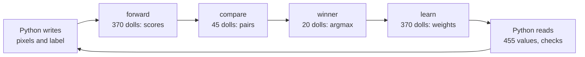

# DOOM learns

Here a DOOM map learns while it runs. The weights are ceiling heights, and voodoo dolls raise and lower them.

After every example, Python reads every value back. It compares each one with a NumPy integer twin, at tolerance 0.

| | what it learns | weights | decision | section |
|---|---|---|---|---|
| `doomformer learn digits` | 8x8 digits from a blank brain, 10 classes | 370 | argmax of 10 scores | [below](#doom-learns-to-read-digits) |
| `df.Perceptron` | binary yes/no heads (the arena marine learns to aim) | 2 to 64 | first head with a score of 1 or more | [`df.Perceptron`](#dfperceptron-binary-heads) |

## DOOM learns to read digits

A blank brain learns to read 8x8 digits, one example per run of the map.

> [!TIP]
> Try the small version first. It takes 5 minutes.
> ```sh
> doomformer learn digits --classes 4 --steps 300     # digits 0 to 3, a quarter of the sectors
> ```

```sh
doomformer learn digits --steps 1500        # about 80 minutes; one line per step, then the held-out accuracy
doomformer learn digits --steps 40 --tamper 0 1 raise            # negative control: diverges at the predicted step
```

The learner is an online multiclass perceptron. Python designed the rule and supplies the labels. The dolls execute
the rule and pick the winner.

### One step

The 370 weights are ceiling heights. They start at 0.

The 37 inputs are the 36 centre pixels of an 8x8 digit, plus a constant 1. A pixel is on where its grey level is at
least 8.

One example is one run of the map. Python writes the inputs and the one-hot label into gate heights. The dolls do the
rest, in four layers.



| layer | dolls | each doll | result |
|---|---|---|---|
| forward | 370 | for a pixel that is on, adds 1 per ceiling gate (thresholds -2 to 3) it fits under | `s_c = sum_i x_i (3 + clamp(w_ci, -3, 3))`, and the 9 differences `d_cb` |
| compare | 45 | per pair a < b, passes iff `s_a - s_b + 1 >= 1`: +1 to `wins_a`, -1 to `wins_b` | win counts `W_c`, the comparator of `df.with_argmax` |
| winner | 20 | one per class passes iff `W_c >= 9` and lights `z_c`. A second, behind the label's gate, sets `q_c` | the first maximal score, as `np.argmax`. `q_c = 1 + y_c - z_c` |
| learn | 370 | lowers `w_ci` by 1, then raises it under gates `q_c >= 1` and `q_c >= 2` | net change `y_c - z_c` |

On a mistake, the true class gains +x and the predicted class loses x. The weights are `state` in `doomformer/pure.py`.
They survive the rewind between examples.

### What is checked, and what Python does

After every step, Python compares 455 values with `DigitRef`. That covers every score, difference, win count, winner
light, update signal and all 370 weights.

A difference raises `df.MismatchError`. The prediction is DOOM's winner light, not Python's.

`StepAudit` classifies every console command and rejects any other kind. Counts for the 1,500-step run:

| command | does | count |
|---|---|---|
| `puke -1\|-2` | input write: 36 pixels, bias, 10 label values | 70,500 (47 per step) |
| `puke -3` | rewind: dolls home, non-state values restored | 1,499 |
| `puke -7` | start: drops the start barriers | 1,500 |
| `puke -100..` | readout | 12,000 (8 pages per step) |
| motion check, other | | 0 |

A write to a weight sector is rejected. The map of this run has no readout guard. A guarded map also sends one guard
command (`puke -9 100003`) before each page.

The tamper option breaks one update line of one weight, so it moves by 2. DOOM must then differ first at the step the
twin predicts, in that weight.

| line | crossed when | caught at step | log |
|---|---|---|---|
| `lower` | the pixel is on | 19 | `models/digits/tamper_lower.log` |
| `keep` | on and `q >= 1` | 19 | `models/digits/tamper_keep.log` |
| `raise` | on and the true class was not predicted | 14 | `models/digits/tamper_raise.log` |

### Results (one game, `doomformer learn digits --steps 1500 --every 50 --seed 0`)

All 1,500 steps are exact (`models/digits/learn_1500.log`). 445 of them changed weights.

<p align="center"></p>

Held-out accuracy on 500 digits:

| examples seen | DOOM weights (read from the ceilings) | NumPy, same stream and clamp | NumPy, textbook perceptron (no clamp), same stream |
|---|---|---|---|
| 0 (blank) | 10.0 % | 10.0 % | 10.0 % |
| 50 | 43.4 % | 43.4 % | 40.0 % |
| 100 | 46.6 % | 46.6 % | 55.0 % |
| 200 | 65.0 % | 65.0 % | 64.8 % |
| 300 | 62.8 % | 62.8 % | 64.2 % |
| 500 | 64.4 % | 64.4 % | 71.8 % |
| 750 | 75.6 % | 75.6 % | 75.2 % |
| 1,000 | 72.4 % | 72.4 % | 76.0 % |
| 1,250 | 79.2 % | 79.2 % | 85.4 % |
| 1,500 | 71.2 % | 71.2 % | 81.0 % |

DOOM and NumPy agree at all 30 checkpoints. The curve jumps by up to 13 points between checkpoints.

Over 20 NumPy streams at 1,500 examples (`models/digits/numpy_seeds.txt`):

| learner | mean | range |
|---|---|---|
| clamped, as in DOOM | 74.8 % +- 5.3 | 63.0 to 82.6 |
| textbook, no clamp | 78.4 % +- 4.8 | |

The learned weights also run through `df.MLP` with `df.with_argmax`. They read 71 of the first 100 held-out digits
right, with every value exact.

The 4-class run is exact in all 300 steps. It reaches 83.5 % (`models/digits/learn_4class_300.log`).

### The clamp

> [!NOTE]
> The forward corridor has 6 gates, so a score sees only `clamp(w, -3, 3)`. The weight keeps moving past that, and
> the scores stop following it. This costs 10 points on this stream, 3.6 on average over 20.

A corridor of K = 8 needs 2.2 times the sectors. In NumPy it gives 82.4 % against 77.5 % at 3,000 steps.

### Cost

At opt 3, the default, each layer runs as one wave. An ACS script copies lights into the next layer's gates. It
computes nothing.

At opt 0 to 2, the forward layer needs one wave per doll ([scheduling](scheduling.md)). That is why those rows are slow.

The table comes from `models/digits/cost_curve.txt`. All rows are exact, on a loaded machine.

<details><summary><b>Cost per step</b></summary>

| classes x features | opt | dolls | sectors | game tics per step | seconds per step |
|---|---|---|---|---|---|
| 4 x 6 | 3 | 66 | 2,196 | 296 | 0.08 |
| 4 x 37 | 3 | 314 | 12,240 | 296 | 0.62 |
| 10 x 12 | 3 | 309 | 15,117 | 304 | 0.75 |
| 10 x 25 | 3 | 569 | 30,327 | 304 | 1.45 |
| **10 x 37** (the 1,500-step run) | 3 | 809 | 44,367 | 304 | 2.14 (3.23 over the run, load 30 to 40) |
| 10 x 65 (the whole 8x8 image and a bias) | 3 | 1,369 | 77,127 | 304 | 4.30 |
| 4 x 6 | 0 | 66 | 2,207 | 1,448 | 0.44 |
| 4 x 6 | 2 | 66 | 2,207 | 1,312 | 0.34 |
| 10 x 37 | 2 | 809 | 44,729 | 20,304 | 152.9 |
| 10 x 37 | 1 | 809 | 44,729 | 20,448 | 174.9 |
| 10 x 37 | 0 | 809 | 44,735 | 20,472 | 202.9 |

</details>

### Limits

* It is supervised and online, over a random stream of the 1,297 training digits.
* It runs at most 9,999 steps, so plane values stay exact.
* It is a perceptron on 36 binary pixels. It does not reach 90 %.

### Data

`models/digits/digits8x8.npz` is the UCI "Optical Recognition of Handwritten Digits" test set, CC BY 4.0. See
[`models/digits/README.md`](../models/digits/README.md).

# `df.Perceptron`: binary heads

This is the same idea with yes/no heads. You feed it labelled examples one at a time.

```python
import numpy as np, doomformer as df
from doomformer.learnkit import Perceptron        # (also exported as df.Perceptron)

spec = Perceptron(n_features=3, heads=1)           # weights start at 0
with spec.compile() as learner:                    # builds the map; the game starts on the first step
    scores, action = learner.step([1, 1, 0], [+1]) # x in {0,1}^3, one label per head in {-1, 0, +1}
    print(scores, action, learner.weights)         # all three come from DOOM
```

In `examples/12_doom_learns_live.py`, DOOM learns "shoot iff left of centre". Then the teacher flips the rule, and DOOM
learns again.

<p align="center"></p>

## What DOOM, the ACS scripts and Python each do

One `step(x, y)` is one run of the map (`doomformer/learn.py`, `doomformer/learnkit.py`).

| who | what |
|---|---|
| **DOOM, forward layer** | per head and active feature, a doll walks `clip` gates under the weight and its negated twin |
| **DOOM, learn layer** | action dolls choose the action, verdict dolls light `right{h}` / `wrong{h}`, update dolls apply the rule below |
| **ACS level scripts** | plumbing only: write inputs, rewind, start, motion check, copy values into `USER1..60`. No network arithmetic |
| **Python** | builds the map, writes `x` and `y`, reads back and compares with `PerceptronRef` |

The forward layer computes `s_h = sum_i x_i * clamp(w_hi, -clip, clip)`.

An update doll passes three gates: cap (`y*w < cap`), label and mistake. Then it moves the weight by 1.

### The learning rule, exactly

With `s_h` the score before the update and `y_h in {-1, 0, +1}`:

```
s_h      = sum_i x_i * clip(w_hi, -clip, clip)
mistake  = (y_h != 0) and (y_h * s_h <= 0)                 # s = 0 counts as a mistake for either label
w_hi    <- clip(w_hi + y_h * x_i, -cap, cap)   for every active i, only when `mistake`
```

`y_h = 0` means no lesson. `cap` bounds the weights. `clip` bounds what one weight adds to a score.

### The action DOOM chooses

```
action = 1 + (index of the first head with s_h >= 1)      or 0 if no head has s_h >= 1
```

`right{h} = 1` iff `y_h = +1 and s_h >= 1` or `y_h = -1 and s_h <= 0`. Otherwise `wrong{h} = 1`.

With `s = 0` and `y = -1`, the verdict is right. The rule still updates.

## API

```python
spec = Perceptron(n_features, heads=1, cap=100, clip=3)
spec.plan()            # dict(dolls, sectors, fits): counts the map without building it
spec.reference()       # a fresh PerceptronRef twin (all weights 0)
spec.action_names()    # keys valid in compile(actions=...)
learner = spec.compile(wad=None, world=None, actions=None, resolution=None, configure=None)

scores, action = learner.step(x, y)     # one example; raises df.MismatchError on any difference
scores, action = learner.predict(x)     # step with all labels 0: no lesson, still a full checked run
learner.weights                         # (heads, n_features) read from the game (ceiling heights), not from the twin
learner.twin                            # the PerceptronRef (advances every step)
learner.info                            # dolls, sectors, runs, tics, steps, lessons, checked
learner.run_script(n, ..., read=k)      # your world scripts, as for any df.Brain
learner.close()                         # or use `with`
```

`Learner` is a `df.Brain` subclass. It works as in [`BUILD_YOUR_OWN.md`](BUILD_YOUR_OWN.md).

### What every step checks

`step` compares every score, action, verdict and weight. `learner.info["checked"]` holds the count.

A difference raises `df.MismatchError` with `.mismatches`. After that, the learner is only good for diagnosis.

### Hooks: `world` and `actions`

`world=` and `actions=` work as in `df.compile`. `df.act` specials attach to `pick{k}`, `right{h}` and `wrong{h}`.

The deciding doll crosses them once per step. In example 12, the lamps they light are read back and checked.

## Limits and measured numbers (arm64, one DOOM process, other jobs running)

| map | dolls | sectors | step time |
|---|---|---|---|
| 8 features x 1 head | 40 | 1,096 | about 75 ms |
| 19 x 2 | 165 | | about 650 ms |
| 32 x 2 | 269 | 7,862 | about 1.8 s |
| `Perceptron(5, 3)` | 78 | 2,137 | |

> [!IMPORTANT]
> * All 30 timed steps of each map are exact. There is no batching.
> * The map must stay within 32,000 units per axis ([`engine_limits.md`](engine_limits.md)).
> * Integers only: features 0/1, labels -1/0/+1, `cap <= 1000`.

## Examples and tests

| file | time | covers |
|---|---|---|
| `examples/12_doom_learns_live.py` | about 9 s | lamps match verdicts, accuracy rises, drops on the flip, recovers |
| `tests/test_learnkit.py` | | multi-head, cap, wrong twin, broken maps, `test_bigger_maps_stay_exact`, hooks |
| `tests/test_learn_digits.py` | about 15 s | textbook twin, 4-class map at opt 3 and 0, tamper lines, rejected weight write |
