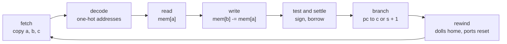
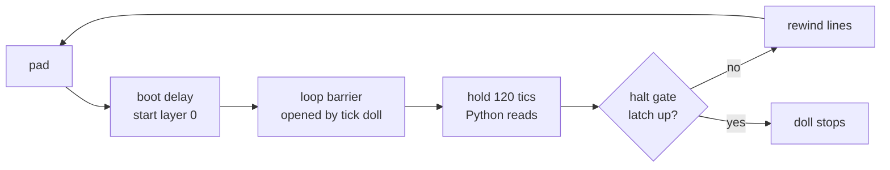

# A counter machine and a SUBLEQ machine inside one DOOM map

This page shows two small computers built inside a DOOM level. Voodoo dolls run the program, and Python checks every step.

`df.Machine` is a counter machine. Its registers and program counter are floor and ceiling heights. The program is the
map geometry. `df.SubleqMachine` is a stored-program machine with 18 memory cells. Its programs rewrite their own code.

> [!TIP]
> Try `doomformer machine multiply 7 9`. It computes 63 in 464 steps and checks every step.

```
doomformer machine multiply 7 9                # 63, 464 steps, every step checked
doomformer machine multiply 7 9 --clock dolls  # the same, with no OPEN script: a loop doll and line specials are the clock
doomformer machine multiply 7 9 --clock dolls --blind   # no command during the run, one read at the end
doomformer machine fib 20                      # 6765 in four base-16 limbs, 196 steps
doomformer machine subleq all                  # one map: add, multiply 7 x 9 and a self-modifying program, one sha256
doomformer machine subleq selfmod --tamper 13  # change one decode line of the map; the trace diverges at the predicted step
doomformer machine subleq models/subleq/loop.sq     # a 103-step loop, every step checked
doomformer machine subleq models/subleq/ownwrite.sq --latch   # a step the host refuses: the MAP raises its violation latch
doomformer machine stored                      # one map file, two programs loaded as initial state (inc/dec/jmp, no indirection)
doomformer machine multiply 7 9 --tamper 2     # change one line of the map; the trace diverges at the predicted step
doomformer machine list                        # every ready program and its arguments
```

```python
import doomformer as df
m = df.Machine("""
top:  jzdec b done          ; b == 0 -> done, else b -= 1
      inc a
      jmp top
done: halt""", registers={"a": 3, "b": 4})
result = m.run()             # compile, play, check every step; MachineMismatch on the first differing step
result.registers             # {"a": 7, "b": 0}
```

## What is claimed, and what is not

Each run below checks these claims:

* The map holds the whole machine state as plane heights.
* Dolls execute every instruction. Python executes none.
* Every value at every step equals the interpreter's, at tolerance 0. That covers the pc, each register or cell, the
  negated twins and every intermediate value. Otherwise `play` raises `MachineMismatch` and names the step.
* Python sends only readout scripts and clock advances. `result.audit` counts them.
* Initial-state writes are counted on their own and sealed before the first tic.
* The halt depends on data. A doll raises the halt latch (pc_halt), and the level stops.
* The SUBLEQ machine has indirect addressing and self-modifying code. See
  [The SUBLEQ machine](#the-subleq-machine-dfsubleqmachine-doomformersubleqpy).
* With `--clock dolls` the map has no OPEN script. See
  [The doll-driven clock](#the-doll-driven-clock---clock-dolls-doomformerdollclockpy).

What is not claimed:

* The default clock is an ACS script: OPEN script 900, `machine.controller_acs`. It rewinds the level and drops the start
  barriers. It waits until no doll moves, then holds while Python reads.
* That script reads the halt latch once per step. It reads no register and decides nothing else.
* The doll clock is not "dolls alone". Its rewind is a list of engine line specials. The engine acts, the doll decides when.
* Both machines are bounded. See [Limits](#limits) and [Turing completeness](#turing-completeness).
* No stack and no subroutines are built.
* The machines run in ViZDoom. Some doll-clock maps run in other ZDoom-family ports. See [Other engines](#other-engines).

## The construction

The counter machine keeps its state in plane heights. Each step is one pass of the level.

State values (`compile_pure(state=...)`) are `pc0 ... pcN` and one value per register. Each has a negated twin. The pc is
one-hot, and `pcN` is the halted pc.

A value is a plane height with a tag. Dolls change it by crossing `Floor_RaiseByValue` or `Floor_LowerByValue` lines on
that tag. The rewind leaves state values alone and resets every other value to its bias.

One machine step is one pass through two layers:

| layer | dolls | what they do |
|---|---|---|
| decide | one per instruction, two for `jzdec`/`jge`/`jlt`, a gate corridor for `addr` | lane gate pc_k >= 1, then gates on the tested registers raise a fire value. Writes no state |
| apply | one per fire, plus base-1 ADC lanes per `addr` | a fire >= 1 opens the lane; the doll lowers pc_k, raises pc_next, changes the register |

Reads and writes sit in different layers for a reason. Inside one layer, dolls that share a target sector run in waves.
So the zero branch of `jzdec` could read `r` after the other branch changed it, and both branches would run.

The apply layer is a crossbar. Every doll passes its gate before any effect line opens. So the lane gates read the old state.

| instruction | effect | decide gates |
|---|---|---|
| `inc r` / `add r k` | r += 1 / k | pc_k >= 1 |
| `jzdec r L` | r == 0: goto L, else r -= 1 | pc_k >= 1, then r <= 0 or r >= 1 |
| `jge r k L`, `jlt r k L` | compare with a constant | r >= k, r <= k-1 |
| `jmp L`, `halt` (= `jmp` to pc_N) | | pc_k >= 1 |
| `addr a b` | a += b, 0 <= b <= base-1 | pc_k >= 1, then base-1 ceiling gates on b, one fire `b_k` per gate passed |

Fire values are named `f`, `z`, `n`, `t`, `u`, `b` plus the instruction number. For `addr`, the apply layer reads the
`b_k` copy through base-1 lanes. Each lane adds 1 to a.

`addr` makes multi-limb numbers fast. `limbs={"a": 4}` stores a register as a.0 ... a.3, base 16 by default.

* `bigadd A B` is one `addr` per limb, then a `jlt` / `add` carry for each limb but the top.
* `addr a a` doubles a limb. The decide layer reads the copy before the apply layer changes it.
* The interpreter refuses an `addr` source outside 0..base-1. So a top-limb overflow fails loudly.
* Macros `clear`, `move s d` and `copy s d t` expand to the instructions above.

The runner checks two more things at every step. The readout sits between two motion checks and two status reads. After
the halt, the level must reach phase DONE with the last pass number, and nothing may move.

## The stored-program machine (`df.StoredMachine`, `doomformer/stored.py`)

Here the program is data, not geometry. The compiled WAD is the same bytes for every program.

One map has `slots` instruction slots and `registers` registers. A slot's instruction is a few one-hot flags: op, register,
target pc.

The host writes the program and registers as plane heights before the first tic. It uses `readout.LoadThenReadout.load`,
then seals the load. `result.audit["loaded"]` counts the writes.

Instructions are `inc r L`, `jmp L`, `dec r L` and `halt`. `dec` falls through to the next slot when r is 0. Each step
has three layers:

* fetch copies the active slot's flags into `cur_*` values,
* decide picks the register and the next pc,
* apply updates them.

`doomformer machine stored` runs `multiply` (c = a * b) and `power` (c = 2^a) on one map. It prints the map's sha256
before and after each program. The hashes are equal.

This machine cannot rewrite its own code and has no indirect addressing. The SUBLEQ machine does both.

## The SUBLEQ machine (`df.SubleqMachine`, `doomformer/subleq.py`)

SUBLEQ has one instruction: subtract, and jump if the result is at most zero. Code and data share 18 cells, so programs
can edit themselves.

```
doomformer machine subleq all                    # add, multiply 7 9, selfmod on one map
doomformer machine subleq multiply 7 9
doomformer machine subleq models/subleq/fill.sq  # a program from a source file
doomformer machine subleq selfmod --tamper 13    # negative control
doomformer machine subleq all --clock dolls      # the same with no OPEN script
```

```python
import doomformer as df
from doomformer.subleq import MULTIPLY, SELFMOD
sm = df.SubleqMachine(slots=6)       # 6 instruction slots = 18 memory cells
wad = sm.compile("subleq.wad")       # one map; its bytes do not depend on the program
sm.run(wad, MULTIPLY(7, 9))          # program and data are initial state; every step is checked
sm.run(wad, SELFMOD())               # another program, the same sha256
```

One step, as the reference interpreter `subleq.interpret` runs it. Step 0 is the initial state.

```
s = pc;  a, b, c = mem[3s], mem[3s+1], mem[3s+2]     # an instruction is three memory cells
mem[b] = mem[b] - mem[a]                             # a and b are addresses: an indirect read and an indirect write
pc = c if mem[b] <= 0 else s + 1                     # c is a slot number; c < 0, c >= slots or s + 1 == slots: halt
```

Memory is 3 x slots cells. Each cell holds an integer in [-64, 63]. The pc counts instruction triples, so a jump target is
a slot number.

Any cell can be data or code. `subleq m1, loop.a, next` adds one to the operand of the instruction at `loop`. A pointer
is made by patching another instruction's operand (`models/subleq/indcopy.sq`).

The interpreter refuses three kinds of step:

* An address out of range.
* A result outside [-64, 63].
* A write to one of the executing instruction's own three cells. The map flags this case itself, with the violation latch.

Programs are text: `subleq A B C`, `.cell name value`, `.at cell value`, labels, and `label.a/.b/.c` for an instruction's
cells. The `doomformer/subleq.py` docstring has the full syntax.

### How the map does it

Each step walks through eight layers of dolls, then the level rewinds.



A cell is two plane heights: `lo` (0..7) and `hi` (-8..7). Its value is 8 hi + lo. Each height has a negated twin.

No doll reads a value written in its own layer. The one exception is its lane gate, read before any release.

| layer | dolls (6 slots) | what they do |
|---|---|---|
| fetch | 42 | lane gate pc_s >= 1; thermometer corridors copy the slot's cells into `al ah`, `bl bh`, `cl cp cn` |
| decode | 45 | equality gates raise the one-hot addresses `ad_j`, `bd_j` and jump target `ct_t` |
| read | 414 (396 + 18 latch) | lane gate `ad_j >= 1`, equality gates on cell j: one-hot digits `xl_v`, `xh_v` of mem[a] |
| number | 30 | 22 crossbar dolls add v to `xl` and `xh`; 8 observer dolls expose state values |
| write | 54 | lane gate `bd_j >= 1`: thermometer corridors lower cell j's digits by `xl` and `xh` |
| test | 54 | lane gate `bd_j >= 1`: `le_j` when 8 hi + lo <= 0, `nb_j` when lo < 0 |
| settle | 36 | `le_j` -> `le`; `nb_j`: lo += 8, hi -= 1 (the borrow) |
| branch | 26 (25 + the latch's halt doll) | pc_s -= 1, pc_{s+1} += 1; if `le`, move to pc_c behind gate `ct_c >= 1` |

`ct_S` is the halt latch of a jump target outside 0..S-1.

The write layer changes only the cell that `b` names. The read layer picks the cell that `a` names. The jump target c is
read in the fetch layer, before the write.

Why two digits? A thermometer over 127 levels would need a corridor of about 130 gates. The 18 cells' corridors write one
target, so they run in series. Two digits of 8 and 16 levels cost 22 gates per cell. This is a design estimate.

### The violation latch

A step that writes its own instruction's cells is not a defined step. The map can compute it wrong (see
[the fuzz](#fuzz-campaigns)). So the map detects such a step and halts.

* In the read layer, 18 dolls raise `viol` when the store address `bd` is one of the executing slot's cells.
* One branch-layer doll then raises the halt latch `pc_S`. The level stops at that step.
* Python reads `viol` = 1. The step's other values are not compared.

`doomformer machine subleq FILE --latch` runs such a program. So does `SubleqMachine.run(..., latch=True)`. DOOM must raise
the latch at the interpreter's refusal step (`interpret(p, latch=True)`).

Without `--latch`, the CLI refuses the program before any tic. Programs that never violate read `viol` = 0 at every step.

| run | result | log |
|---|---|---|
| `ownwrite.sq`, ACS clock | latch at step 2, step before exact | `models/subleq/ownwrite_latch.log` |
| `ownwrite.sq`, doll clock | latch at step 2, step before exact | `models/subleq/ownwrite_latch_dolls.log` |
| `add 3 4 --latch` | latch down at every step | `models/subleq/add_latch_clean.log` |

The latch makes the step visible, not safe. A borrow-first update that would make it safe is not built.

### Measured

Each clock has one compiled map with 6 slots. The host was loaded, so wall times are slow. Game tics are exact.

| clock | dolls | sectors | rewind lines | tics per step | sha256 | log |
|---|---|---|---|---|---|---|
| ACS | 709 | 16,576 | | 1,624 | `286b198b...` | `models/subleq/subleq_all.log` |
| dolls | 713 | 17,718 | 1,082 | 2,921 to 2,930 | `eecb2053...` | `models/subleq/subleq_all_dolls.log` |

ACS clock, `doomformer machine subleq ...`:

| program | steps | game tics | wall | values checked | result |
|---|---|---|---|---|---|
| `add 3 4` | 4 | 6,904 | 29 s | 1,550 | c = 7 |
| `multiply 7 9` (3 instructions) | 20 | 33,873 | 134 s | 6,510 | p = 63 |
| `selfmod` (operand a rewritten each round) | 10 | 17,011 | 70 s | 3,410 | z = -15 |
| `models/subleq/loop.sq` | 103 | 173,712 | 688 s | 32,240 | p = 34, q = -34 |
| `models/subleq/fill.sq` (store address b rewritten) | 10 | 17,011 | 72 s | 3,410 | arr = 7, 7, 7 |

Doll clock, same programs:

| program | game tics | wall | log |
|---|---|---|---|
| `add 3 4` | | 46 s | `subleq_all_dolls.log` |
| `multiply 7 9` | 57,801 | 243 s | `subleq_all_dolls.log` |
| `selfmod` | | 120 s | `subleq_all_dolls.log` |
| `fill.sq` | | 120 s | `fill_dolls.log` |
| `loop.sq` | 300,496 | 1,253 s | `loop_dolls.log` |

Every run prints the map's sha256 before and after. The two are equal. Python writes 49 to 64 plane values as initial
memory, then only reads.

The selfmod trace shows the code changing (`models/subleq/subleq_all.log`):

```
step   2  pc -> 2   mem[0] 12 -> 13 (code: slot 0 operand a)
step   5  pc -> 2   mem[0] 13 -> 14 (code: slot 0 operand a)
step   8  pc -> 2   mem[0] 14 -> 15 (code: slot 0 operand a)
```

The rounds in between read cells 12, 13 and 14 through that operand. So mem[15] goes 0, -5, -8, -15.

### Cost with memory size

More slots mean more dolls and slower steps. The halt rule reads one digit of the jump target, so 8 slots is the limit of
this layout.

| slots | cells | dolls | sectors | span (x) | tics per step, measured |
|---|---|---|---|---|---|
| 2 | 6 | 261 | 5,861 | 31,966 | not run |
| 4 | 12 | 485 | 11,219 | 31,966 | not run (add does not fit 12 cells) |
| 5 | 15 | 597 | 13,913 | 31,966 | 1,512 (`multiply 2 3 --slots 5`) |
| 6 | 18 | 709 | 16,576 | 31,966 | 1,624 |
| 8 | 24 | 933 | 21,905 | 31,989 | 1,848 (`add 3 4 --slots 8`) |

Each slot adds three cells, about 112 dolls, 2,700 sectors and 112 tics per step. The layer is already 32,000 units wide.
More memory needs another row of layers, which is not built. 6 slots is the smallest size that holds add.

### Negative control

A tampered map must fail at the predicted step. `--tamper ADDR` points the decode line of cell ADDR at the gate of
`ad_{ADDR+1}`.

The interpreter predicts the first difference at the first step whose operand a is ADDR. `selfmod --tamper 13` first reads
cell 13 at step 4, after the program rewrote that operand at step 2.

DOOM diverges at step 4 (`xl3: DOOM 0 != reference 1`). The steps before are exact. Logs:
`models/subleq/selfmod_tamper13.log`, `selfmod_tamper13_dolls.log`. `tests/test_subleq.py` runs the step-1 version.

### Workloads

`models/subleq/loop.sq` is the longest program: 103 steps, 34 rounds of three instructions and a halt. In it, p counts 0
to 34 and q counts 0 to -34. The counter n runs -33 to 1. The code cells end unchanged (`loop.log`).

The cell budget rules out a bubble sort. 18 cells hold 6 instructions and no data. A compare-and-swap needs about seven
instructions by hand count. Four values need about 14 instructions and 8 data cells, 50 cells in all.

Raising the limit needs a wider address decode. The fetch numbers `ah` and `bh` clamp at 2.

Four programs in `models/subleq/` are written apart from the machine's code. A separate 40-line interpreter checks them.

| program | what it shows |
|---|---|
| `countdown.sq` | a data-dependent loop, 17 steps |
| `jumprewrite.sq` | slot 0 rewrites the jump target of slot 2, 4 -> 3 |
| `indcopy.sq` | two patch instructions build pointers, a third copies through them: dst = -21 |
| `jumphi.sq` | a jump target rewritten to 10, hi digit 1, halts |

`indcopy.sq` runs exact on both clocks. It takes 6,904 tics on the ACS clock (`indcopy.log`) and 10,957 on the doll clock
(`indcopy_dolls.log`).

### Fuzz campaigns

`models/subleq/fuzz.py` runs random 18-cell programs on one map. Each runs until it halts or the interpreter refuses a
step. Seeds are printed.

The programs are short, 3 to 4 steps on average. So the fuzz covers many mixes of address, value, borrow and branch, not
long runs.

| campaign | clock | programs | steps | values | mismatches | log |
|---|---|---|---|---|---|---|
| `--programs 90 --steps 20 --seed 1 --workers 3` | ACS | 90 | 298 | 117,180 | 0 | `fuzz_acs.log` |
| `--programs 30 --seed 101` | dolls | 30 | 129 | 48,984 | 0 | `fuzz_dolls.log` |
| no own-cell rule, seeds 1 to 60 | ACS | 60 | 211 | 81,312 | 0 | `fuzz_acs_before_refusal.log` |
| no own-cell rule, seeds 101 to 130 | dolls | 30 | | | seed 122, step 2 | `fuzz_dolls_before_refusal.log` |

Seed 122 fails on both clocks. Its slot 1 writes its own operand cell. Here is what goes wrong:

1. The fetch doll of that cell waits at a closed ceiling gate.
2. The write opens the gate, and the doll slips in.
3. The borrow lowers the digit, and the ceiling stops at the doll's head.

Only the executing instruction's own cells have such a waiting doll. That is the reason for the own-cell rule.

The latch campaign checks the latch against the interpreter: `fuzz.py --programs 400 --steps 20 --seed 1 --violating`
(`fuzz_latch.log`).

* Of the 400 programs, 28 write their own executing instruction. Seeds 122, 178 and 232 are among them.
* All 28 raise the latch at the interpreter's refusal step. Every earlier step is exact.
* No admitted program raises it.
* On the doll clock, seeds 1 to 150 give 9 violating programs. All are flagged at the right step (`fuzz_latch_dolls.log`).

## The doll-driven clock (`--clock dolls`, `doomformer/dollclock.py`)

With `--clock dolls`, dolls and line specials run the clock, the rewind and the halt check. ACS only serves readouts. It
works for the counter machine and the SUBLEQ machine.



The parts:

* **Tick layer**: one last layer with one doll. It adds 1 to `pass` and to `done` and opens the loop barrier.
* **Loop doll**: walks a corridor through a 24-tic boot delay, a line that starts layer 0 and the loop barrier.
  Then come a 120-tic hold where Python reads, the halt gate, the rewind lines and a teleport back.
* **Halt gate**: a floor gate on the pc_halt plane. At latch 0 the step is 24 units. At latch 1 it is 25, and the doll stops.
* **Rewind**: one line special per action of ACS script 3, in the order barriers, dolls, ports, lights.
* **ACS lump**: dolls tag themselves with Thing_ChangeTID. The lump keeps the readout pages, the readout guard
  (script 9), the motion script and SUBLEQ's two movers.

`meta.layout["machine"]["dollclock"]["acs"]` holds the ACS source. `models/dollclock/multiply_7_9.acs` is the counter
machine's. It predates the guard, so it has no script 9:

```
$ grep -n "^script\|OPEN" models/dollclock/multiply_7_9.acs | cut -c1-60
62:script 100 (void) { o1 = GetSectorLightLevel(20000); o2 = GetSectorLightLevel
66:script 8 (void) {
```

Python polls `pass` every 8 tics to find step k's window. It waits until no tracked doll moves. Then it reads every value
between two motion checks and checks the counter again.

Each page in that read follows the guard. Python sends no other command. After the halt it checks that nothing moves.

> [!NOTE]
> The hold window is a fixed delay, not a handshake. A reader that is too slow raises an error. It never reads a wrong
> value. The stillness check does not track the loop doll itself.

Counter machines, ViZDoom 1.3, three games at once on a loaded host:

| `doomformer machine ... --clock dolls` | steps | dolls | sectors | rewind lines | tics per step | ACS clock | game tics | wall | values checked |
|---|---|---|---|---|---|---|---|---|---|
| `add 3 4` | 14 | 24 | 383 | 50 | 459 to 468 | 208 | 6,877 | 1 s | 420 |
| `multiply 7 9` | 464 | 43 | 721 | 84 | 504 to 513 | 216 | 235,567 | 60 s | 26,040 |
| `gcd 48 18` | 647 | 77 | 1,327 | 146 | 577 to 586 | 224 | 376,814 | 140 s | 64,800 |
| `fib 20` | 196 | 236 | 4,809 | 389 | 965 to 974 | 368 | 190,135 | 437 s | 34,672 |

The tics range is the 8-tic polling granularity. Every row has 0 other commands and 0 state loads. The halt gate stops
the level each time.

`multiply 7 9 --clock dolls --tamper 2` diverges at step 3, as predicted
(`models/dollclock/multiply_7_9_tamper2.log`).

A step costs one tic per rewind line, plus about 200 fixed tics. Those cover the boot, the 120-tic hold and the tick layer.
So the doll clock is 2 to 2.6 times slower. The SUBLEQ map has 1,082 rewind lines and takes 2,921 tics per step, against
1,624.

Engine facts found while building it:

* A doll crossing several line specials in one tic does not trigger them all.
* At 4-unit cells, 14 of 24 TeleportOther lines of `add 3 4` did nothing. At 16-unit cells, one per tic, all act.
  `dollclock.CELL` is 16.
* The probe is `models/dollclock/probe_same_tic.py`, output `probe_same_tic.log`. The cause is unknown.
* TeleportOther, Floor_MoveToValue, Ceiling_MoveToValue, Light_ChangeToValue, Thing_ChangeTID and Teleport_NoFog all work
  as doll-crossed line specials.

### Blind runs

A blind run sends no command at all until the end. `--clock dolls --blind` loads the initial state and seals it. It then
waits 1.25 times the estimated run length.

At the end it reads every value once and compares with the interpreter's final state. `--blind` does not combine with
`--tamper`.

| run | tics | values | result | log |
|---|---|---|---|---|
| `machine multiply 7 9 --clock dolls --blind` | 371,780 | 56 | exact, halt latch up | `models/dollclock/multiply_7_9_blind.log` |
| `machine subleq selfmod --clock dolls --blind` | 40,762 | 314 | exact, z = -15 | `models/subleq/selfmod_dolls_blind.log` |
| `ownwrite.sq --latch --blind` | 8,152 | 314 | latch up | `models/subleq/ownwrite_latch_dolls_blind.log` |

Running past the halt changes nothing. The halt gate keeps the final window. With `--latch`, only `viol` is compared, and
the halt latch can read 2.

### Other engines

You can export a doll-clock map and check it in another port.
`doomformer machine PROGRAM ARGS --clock dolls --export DIR` writes `DIR/machine.wad` and `DIR/expected.txt`, then stops.

The WAD adds a logger, OPEN script 40. It prints each step as a `FACT machine step=k ...` line.
`doomformer/ports_machine.py` compares the console output with `expected.txt`.

`--low-tags` keeps every tag and TID below 32,768, which Zandronum 3.2.1 needs. Engines, times and the speed-up shim are in
[engine_limits.md](engine_limits.md#other-ports).

## What Python does, what the map does

This table splits the work between Python, the ACS script and the dolls.

| | Python | ACS level script (default clock) | dolls and lines |
|---|---|---|---|
| program | assembles it, compiles the map (ROM: program is geometry) or writes flags (stored) or the initial memory (SUBLEQ) | none | ROM: the doll of each instruction exists only if the instruction does |
| registers, pc, memory | reads them, compares | none | hold and change them |
| each step | advances tics, runs readout scripts | rewind, barrier drop, settle sampling, hold | decode, test, branch, update |
| halt | notices that pc_N is 1 and the level reached DONE | reads the latch, leaves the loop | raise the latch |
| each step, `--clock dolls` | advances tics, polls the counter `pass`, reads in the window | no script except readout pages, the guard, the stillness check (and SUBLEQ's movers) | the tick doll counts, the loop doll waits, holds, rewinds (line specials) and restarts; its halt gate stops it |

## Measured

These are the counter-machine and stored-machine runs on the default ACS clock. The host ran ViZDoom 1.3 headless, up to
3 games at once, under load. Wall times are slow, game tics are exact.

Dolls include the clock dolls. A value is one number read back and compared.

| command | steps | dolls | sectors | tics per step | game tics | wall | values checked | result |
|---|---|---|---|---|---|---|---|---|
| `machine add 3 4` | 14 | 20 | 274 | 208 | 3,832 | 1 s | 360 | 7 |
| `machine multiply 7 9` | 464 | 39 | 578 | 216 | 126,340 | 17 s | 24,180 | 63 |
| `machine power 2 6` | 1,475 | 56 | 858 | 216 | 402,818 | 66 s | 115,128 | 64 |
| `machine gcd 48 18` | 647 | 73 | 1,122 | 224 | 181,950 | 37 s | 62,208 | 6 |
| `machine fib 20` (4 limbs, base 16) | 196 | 232 | 4,347 | 368 | 83,633 | 106 s | 33,884 | 6765 |
| `machine collatz 7` | 1,080 | 70 | 1,055 | 224 | 303,616 | 76 s | 97,290 | 16 Collatz steps |
| `machine pow2 40` (11 limbs, base 16) | 942 | 324 | 6,086 | 376 | 410,859 | 935 s | 231,978 | 1,099,511,627,776 |
| `machine primes 12` | 4,042 | 163 | 2,536 | 248 | 1,241,039 | 897 s | 865,202 | 5 primes |
| `machine stored`, program 1: multiply 2 * 3 | 43 | 511 | 8,984 | 560 | 27,053 | 89 s | 24,904 | 6 |
| `machine stored`, program 2: power 2 ^ 3 | 67 | 511 | 8,984 | 560 | 42,060 | 155 s | 38,488 | 8 |

Every row has 0 forbidden commands, a halt by the latch and the interpreter's step count. Counter programs have 0 state
loads, because their arguments are baked into the map.

The two `stored` rows share one map file (sha256 `120833f086cdfe68...`). Each has 34 state loads.

### Negative controls

Each control changes one line of the compiled map, and DOOM must fail where the interpreter predicts.

* `machine multiply 7 9 --tamper 2` changes the `inc c` line from amount 1 to 2 in the TEXTMAP. DOOM first differs at the
  predicted step 3 (`r2: DOOM 2 != reference 1`).
* `--tamper 1 --tamper-what target` points a `jzdec` line at pc_halt. It diverges at the predicted step 38.
* The untampered twin passes. `tests/test_machine.py` runs both.
* In the stored machine, a map loaded with program B fails program A's trace at step 0.

## Limits

> [!IMPORTANT]
> Both machines are small and bounded. SUBLEQ has 18 cells of -64 to 63 by default. A step that writes its own
> instruction is refused by the host and latched by the map.

* **Register range.** The machine enforces |v| <= 12,000 (`tile.PORT_MAX`). Probe maps without that check are exact at
  ±15,949 and fail at 15,950. A register of L limbs in base b holds up to b^L - 1.
* **SUBLEQ value range.** Cells hold -64 to 63. `multiply 7 9` ends at p = 63, the largest value. The interpreter never
  lets a program leave the range, so the map's behaviour there is not probed.
* **SUBLEQ memory.** 18 cells by default, 24 at most in this layout. See [Cost with memory size](#cost-with-memory-size).
* **SUBLEQ own-cell writes.** The map computes them wrong, so the host refuses them and the map latches. The other programs
  are exact in every run and fuzz, which is not a proof.
* **Shared decode lines.** A bug in the decode lines would corrupt the latch and the write alike.
* **Doll clock scope.** Built at `opt=0`, for `df.Machine` and `df.SubleqMachine` only. The stored machine and the EOS demo
  keep the ACS clock.
* **Program size.** 1,200 `inc` instructions fit in the 32,000-unit span, and 1,300 do not. Only layouts were counted. The
  largest program played has 44 instructions (`pow2 40`).
* **Steps.** The level's loop count, 1,000,000 passes, is the only bound. The longest run is 4,042 steps (`primes 12`).
* **Reading cost.** The runner reads every exposed value after every step. The stored machine exposes 566 values per step.

<details><summary><b>Cost per instruction and tics per step</b></summary>

Cost per instruction (`layout_only`, base 16 unless stated):

| instruction | dolls | sectors |
|---|---|---|
| `inc`, `add`, `jmp` | 3 | 43 to 46 |
| `jzdec`, `jge`, `jlt` | 5 | 82 to 85 |
| `addr`, base 8 | 10 | 183 |
| `addr`, base 16 | 18 | 343 |

Tics per step grow with contention. Dolls that change the same sector run in waves. So each instruction touching the
busiest register adds about 4.4 tics.

A chain of K `inc a` takes 224 tics per step at K = 10, 312 at 30 and 448 at 60. Each `addr` gate adds about 8 tics.

</details>

Engine speed and cost are in [scaling.md](scaling.md).

### Turing completeness

Both machines have bounded memory. So both are finite-state machines in the strict sense.

With unbounded counters, the counter machine's instruction set (`inc`, `jzdec`, `halt`) is Minsky's universal counter
machine. Plain SUBLEQ is universal with unbounded memory and words. Each is universal only up to its memory bound, like any
physical computer.

This SUBLEQ is restricted, and no universality argument is given for the restricted form. It forbids a write to the
executing instruction's own a, b or c.

It allows any instruction to rewrite any other (`selfmod.sq`, `fill.sq`, `jumprewrite.sq`, `jumphi.sq`). It also allows
pointers built by patch instructions (`indcopy.sq`). No translation of arbitrary programs into this form is built.

This is not a proof that DOOM is Turing complete.

## The network decides control flow

The same halt latch lets a transformer decide when generation stops.
`doomformer demo --one-map --loop --until-eos --prompt DAN` (`doomformer/selfhalt.py`) runs it.

The winner doll of each position sets a latch. The latch is 1 for the end-of-text token. The level leaves its loop after
the pass that wrote EOS, so the pass count is data. Details: [HOW_IT_WORKS.md](HOW_IT_WORKS.md#stopping-at-eos).

## Compared with earlier DOOM computation

Other people have computed in DOOM maps before. This table compares their work with these machines.

| work | what is computed in the map | outside the map | program | universality claim |
|---|---|---|---|---|
| [counter.wad](https://www.doomworld.com/idgames/levels/doom2/Ports/a-c/counter), fraggle, 2006 | a 4-bit binary ripple counter from voodoo dolls and conveyors, 34 sectors, 134 linedefs (own parse of the file) | a switch line; how it is clocked is not described on any page read | fixed wiring | none |
| [conway.wad](https://github.com/pwiecz/conway.wad), Piotr Wieczorek, 2022 | Game of Life on a 13 x 13 torus: mancubi hold cells, barrels on scrolling floors count neighbours | the player sets the start cells and pulls a switch | the rule is geometry, the start state is data | none in the repo; the author calls it a "limited simulation" |
| [doom-calculator](https://github.com/nukep/doom-calculator), Danny Spencer, 2022 | adds two 2-digit decimal numbers (BCD) with binary decision diagrams of monsters, teleporters and doors, vanilla Doom 2 v1.9 | the player presses a switch per digit; one shot, no reset | geometry generated from BDDs | he writes that it "is not Turing complete" (monsters cannot be reset) |
| [half-adder](https://calabi-yau.space/blog/doom.html), Jared Candelaria, 2021 | OR, AND, NOT and REPEATER gates and one half-adder from monsters and lifts | the player, a clock of lifts | geometry | "DOOM is Turing-complete", argued from gate completeness; a NAND and a CPU are argued, not built |
| this | counter and SUBLEQ machines as plane heights; dolls loop, branch, address memory and rewrite code | an ACS clock or a loop doll; Python reads and compares | geometry (ROM) or initial state (stored, SUBLEQ) | bounded machines; universal only up to their memory bound |

* counter.wad and conway.wad run on Boom-compatible ports. The calculator runs on vanilla Doom 2.
* These maps need ZDoom's ACS and line specials.
* The earlier works have no readback interface. Their output is a display.
* conway.wad is the nearest. It also repeats a round inside the map, through a teleport graph.
* None of them selects among instructions.
* Doom-in-Doom (kgsws) runs machine code through an exploit. That is not map computation.
* counter.wad's clocking is not verified.

## Run it yourself

```
pip install doomformer
doomformer machine multiply 7 9
doomformer machine multiply 7 9 --clock dolls   # no OPEN script
doomformer machine fib 20
doomformer machine stored
doomformer machine subleq all                   # SUBLEQ: add, multiply 7 x 9, a self-modifying program; one sha256
pytest tests/test_machine.py                    # about 25 s
pytest tests/test_subleq.py                     # about 60 s; DOOMFORMER_HEAVY=1 adds the 7 x 9 and selfmod runs (5 minutes)
```

<details><summary><b>API reference</b></summary>

* `Machine(program, registers=..., limbs=..., base=16)`: `.reference()` is the interpreter's trace, `.compile(wad)` writes
  the map, `.run(wad=None, max_steps=100_000)` runs and checks.
* `machine.tamper(wad, program, instruction, what="weight"|"target")` is the negative control.
* `Machine.compile(wad, clock="dolls")` and `.run(clock="dolls")` use the doll clock.
* `SubleqMachine(slots=6)`: `.compile(wad, clock=...)`, `.run(wad, source, clock=...)`, `.reference(source)`.
  `subleq.tamper(wad, program, address)` is its negative control.
* `compile(opt=...)` passes the scheduling level through. `multiply 3 4` and `pow2 6` run exact at opt 0 and opt 1 with
  the same tics per step (216 and 352). Opt 2 and 3 need `tuning.json`.

</details>
