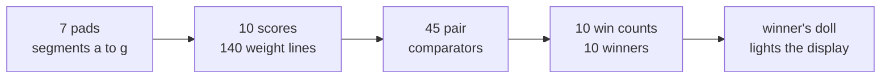

# The museum map

This is one DOOM map that you download and play without Python: you light a seven-segment digit on the floor, press
READ, and voodoo dolls classify it.

<p align="center"></p>

MUTATE reverses one connection while the level runs, so the same 7 reads as a 1 until RESTORE changes it back. The
network is written by hand and small enough to inspect every weight, and it reads seven-segment patterns rather than
handwriting.

> [!TIP]
> Download [museum.wad](https://github.com/mottopanikeiku/doomformer/releases/download/v0.7.1/museum.wad) and the free
> [Freedoom](https://freedoom.github.io/download.html) IWAD, then play:
> ```sh
> gzdoom -iwad freedoom2.wad -file museum.wad
> ```
> You can also build it yourself with `doomformer museum build museum`.

## The network

The seven inputs correspond to segments a through g, with `x_s` set to 1 for a lit pad and 0 for a dark one, and each
digit d has one score neuron:

```
s_d = b_d + sum_s w_ds * x_s,   w_ds = +1 if digit d lights segment s, else -1,   b_d = 7 - (segments of d)
```

`s_d` counts the segments that match digit d, so a score of 7 is an exact match. A 7 lights pads a, b and c and gives
these scores:

| digit | 0 | 1 | 2 | 3 | 4 | 5 | 6 | 7 | 8 | 9 |
|---|---|---|---|---|---|---|---|---|---|---|
| score | 4 | 6 | 3 | 5 | 4 | 3 | 2 | 7 | 3 | 4 |

Then come the same winner layers as in DrawPad (`drawpad.with_argmax`).



The lowest digit wins a tie, as in `np.argmax`, and the winner's doll crosses the line that lights its digit.

`doomformer.museum.reader()` builds the network, and `models/museum/museum_net.json` contains its weights, biases and
thresholds. Each score appears as a light level (`s_d`) and a floor height (`-s_d`), so a segment's doll crosses two
lines per digit, one adding `w_ds` to the light and the other adding `-w_ds` to the floor, and the 70 weights need 140
lines.

Each READ exposes 140 values: scores, comparisons, win counts, winners and the one-hot answer, with negated twins
for hidden values.

## What MUTATE changes

MUTATE flips the connection from segment a to digit 7, from +1 to -1.

<p align="center"></p>

It calls ACS `SetLineSpecial` on the two weight lines of that connection, which the build gives line ids 1 and 2.

| line | before | after MUTATE |
|---|---|---|
| light (id 1) | `Light_RaiseByValue(s_7, 1)` | `Light_LowerByValue(s_7, 1)` |
| floor (id 2) | `Floor_LowerByValue(-s_7, 1)` | `Floor_RaiseByValue(-s_7, 1)` |

These are the only line specials the level ever changes, and RESTORE sets them back. With a, b and c lit, `s_7` drops
from 7 to 5 while `s_1` stays 6, so DOOM reads 1. Of the 128 pad patterns, the flip changes the answer for 8:

| before | after | lit pads |
|---|---|---|
| 7 | 1 | a, a+b, a+c, a+b+c |
| 7 | 0 | four other patterns |

`models/museum/reference.json` lists every pattern's scores and digit, with and without the flip.

### Static extraction

`doomformer extract` recovers the network from the WAD, and replacing the two specials that MUTATE changes produces the
expected `w_7a = -1` network, which differs only at layer 0, row 7, column 0 and its negated twin
(`tests/test_museum.py`).

## The hall

You start facing north, toward the seven-segment floor pads, the scoreboard and the stepped display, with the switches
on the south wall behind you, from west to east:

| camera A | camera B | camera C | CLEAR | READ | MUTATE | RESTORE |
|---|---|---|---|---|---|---|

Standing in front of a switch shows what it does, and the MUTATE podium is brighter while the connection is rewired.

- Pads: stepping onto a pad toggles it, and pads lock during a READ.
- READ: runs scripts 3 (rewind), 1 once per segment (write the port) and 7 (start).
- Timing: after about 744 game tics, or 21 s at real-time speed, the winner's doll lights the display.
- Scores: the HUD lists all ten scores and the scoreboard raises each bar 16 units per point, both copying the dolls'
  score lights after the display lights.

### The cameras

A camera station puts your view inside the circuit until you move, which brings your own view back.

| camera | stands at | shows |
|---|---|---|
| A | segment a's input lane, near the two lines MUTATE rewires | the narrow input corridor |
| B | the start of digit 7's sixth score doll, looking east along its lane | that doll's gate |
| C | the start of digit 1's sixth score doll, looking east along its lane | that doll's gate |

The sixth doll passes its gate only when its digit's score is at least 6, which the frames from
`doomformer museum shots` show:

| after | digit 7's lane (B) | digit 1's lane (C) |
|---|---|---|
| READ of the 7 | empty: the doll passed (`s_7` = 7) | empty: the doll passed (`s_1` = 6) |
| MUTATE, then READ | the doll waits at its gate (`s_7` = 5) | still empty |

The map has 136 voodoo dolls and 3,975 sectors spanning 31,898 x 4,360 map units, and it uses the original `opt 0`
schedule with no ACS between layers.

## Commands

```sh
doomformer museum build museum            # museum.wad, museum.json, museum_net.json, reference.json, SHA256SUMS
gzdoom -iwad freedoom2.wad -file museum/museum.wad
doomformer play museum/museum.wad         # the same in a ViZDoom window
doomformer museum verify                  # headless: Python plays the 7 -> MUTATE -> RESTORE tour, every READ checked
doomformer museum export DIR --check      # the self-test map and its expected lines, run in ViZDoom
doomformer museum shots DIR               # PNG frames of the hall and the three cameras, before and after MUTATE
```

Builds are deterministic for the same source and pinned ACC compiler revision, which `tests/test_museum.py` checks by
rebuilding the four files against `models/museum/SHA256SUMS`.

### Play without Python

The release [museum.wad](https://github.com/mottopanikeiku/doomformer/releases/download/v0.7.1/museum.wad) and its
[hashes](https://github.com/mottopanikeiku/doomformer/releases/download/v0.7.1/museum_SHA256SUMS.txt) match
`models/museum/SHA256SUMS`, and the WAD opens in GZDoom with `freedoom2.wad`.

The [tests workflow](https://github.com/mottopanikeiku/doomformer/actions/workflows/tests.yml) also builds the map
in its Linux / Python 3.12 job, so you can download the `museum` artifact from a recent run and find its hashes in the
job summary, as long as the run is younger than the repository's artifact retention period, 90 days by default.

## How it is checked

`doomformer museum verify` walks onto pads and presses USE through the marine's controls, and during READ Python only
advances tics and runs readout scripts through `readout.ReadoutOnly`.

Script 9 first writes 100,003 into the USER variables, and Python waits for that sentinel, runs the readout and then
waits for the sentinel to disappear, so a missing readout raises an error instead of returning stale values.

Python then compares three things with the NumPy reference of the network, as wired at that moment.

- All 140 values.
- The seven ports, against the lit pads.
- The display: one firing, for the right digit.

The level's flag tells Python which wiring to compare. `models/museum/verify.log` covers digits 0 through 9 and the
7 → MUTATE → 1 → RESTORE → 7 tour, where every READ matches all 148 checked values and only readout commands were sent
during computation.

### The self-test map

`doomformer museum export` adds a script that needs neither a player nor Python. It lights digits 0 through 9, then
rewires and reads a 7, restores the connection and reads it again, and after the display lights and the dolls stop it
logs the digit and all 140 values. `expected.txt` contains the 12 reference lines, and ViZDoom produces identical lines
(`models/museum/selftest.log`).

## Ports

The whole museum runs headless in ViZDoom 1.3.2, which has ZDoom 2.8.1 inside, and other ports run the self-test map.

The ports workflow (`.github/workflows/ports.yml`) exports `museum_selftest.wad` on a GitHub x86_64 runner, compares
`expected.txt` with `models/museum/selftest_expected.txt`, runs the map in real time under Xvfb and compares its
`FACT museum` lines with the reference. Zandronum also gets the `--low-tags` build, with every sector tag below 32,768,
and the results are in `models/ports/<port>/museum_selftest/` and in the museum rows of `models/ports/matrix.md`.

| port | default tags | every tag below 32,768 |
|---|---|---|
| GZDoom 4.14.2, OpenGL | PASS | not run |
| GZDoom 4.14.2, Vulkan | PASS | not run |
| LZDoom 3.88b | PASS | not run |
| UZDoom 5.0.3 | PASS | not run |
| ZDoom 2.8.1 | PASS | not run |
| Zandronum 3.2.1 | no line in 900 s | PASS |

PASS means all 12 output lines match `expected.txt` exactly. Each line holds the case number, wiring state, lit pads,
digit, display firing count and all 140 values, and the cases include 7 → 1 after MUTATE and 1 → 7 after RESTORE.

### Zandronum and high sector tags

The default-tag Zandronum run loaded the map but logged no `FACT` line before the 900 s timeout. Layer-start barriers
use tags from 60,000 and freeze barriers use tags from 64,000 (`pure.STAGE_TAG0`, `pure.FREEZE_TAG0`), while Zandronum
3.2.1 cannot find sector tags from 32,768 up ([engine_limits.md](engine_limits.md#other-ports)). With `--low-tags`
those ranges start at 25,000 and 30,000 and all 12 lines match, although the default run's stopping point was not
traced.
