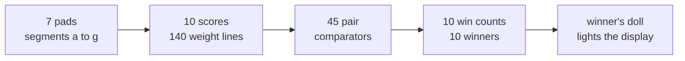

# The museum map

The museum is one map you download and play without Python. You light a digit on the floor, press READ, and voodoo
dolls work out which digit it is.

<p align="center"></p>

A second switch rewires one connection of the network inside the running level. Then the same 7 reads as a 1. A third
switch puts the connection back.

The network is small and written by hand, with no training. So you can check every weight by eye.

> [!TIP]
> Build it and play it in GZDoom:
> ```sh
> doomformer museum build museum
> gzdoom -iwad freedoom2.wad -file museum/museum.wad
> ```

## The network

There are seven inputs, one per segment a to g. `x_s` is 1 for a lit pad and 0 for a dark one.

Each digit d has one score neuron.

```
s_d = b_d + sum_s w_ds * x_s,   w_ds = +1 if digit d lights segment s, else -1,   b_d = 7 - (segments of d)
```

So `s_d` counts the segments where the pads agree with digit d. A score of 7 means the pads show exactly that digit.

A 7 lights pads a, b and c. It gives these scores:

| digit | 0 | 1 | 2 | 3 | 4 | 5 | 6 | 7 | 8 | 9 |
|---|---|---|---|---|---|---|---|---|---|---|
| score | 4 | 6 | 3 | 5 | 4 | 3 | 2 | 7 | 3 | 4 |

Then come the same winner layers as in DrawPad (`drawpad.with_argmax`).



The lowest digit wins a tie, as in `np.argmax`. The winner's doll crosses the line that lights its digit.

`doomformer.museum.reader()` builds this network. `models/museum/museum_net.json` holds its weights, biases and
thresholds, as the compiler read them.

In the map, each score is a light level (`s_d`) and a floor height (`-s_d`). The doll of segment s walks one lane.

For each digit it crosses two lines. One adds `w_ds` to the light, the other adds `-w_ds` to the floor. That makes 140
weight lines for the 70 weights.

Each READ exposes 140 values. These are the scores, comparisons, win counts, winners and the one-hot answer. Hidden
values come with their negated twins.

## What MUTATE changes

MUTATE flips the connection from segment a to digit 7, from +1 to -1.

<p align="center"></p>

It calls ACS `SetLineSpecial` on the two weight lines of that connection. The build gives them line ids 1 and 2.

| line | before | after MUTATE |
|---|---|---|
| light (id 1) | `Light_RaiseByValue(s_7, 1)` | `Light_LowerByValue(s_7, 1)` |
| floor (id 2) | `Floor_LowerByValue(-s_7, 1)` | `Floor_RaiseByValue(-s_7, 1)` |

These are the only line specials the level ever changes. RESTORE sets them back.

With a, b and c lit, `s_7` drops from 7 to 5. `s_1` stays 6, so DOOM reads 1.

Of the 128 pad patterns, the flip changes the answer for 8.

| before | after | lit pads |
|---|---|---|
| 7 | 1 | a, a+b, a+c, a+b+c |
| 7 | 0 | four other patterns |

`models/museum/reference.json` lists every pattern's scores and digit, with and without the flip.

### The rewired map, checked without DOOM

The static extractor (`doomformer extract`) recovers the netlist from the built WAD. It equals the network's netlist.

Then the two specials in the WAD are replaced, the way `SetLineSpecial` does it. The recovered netlist now equals the
network with `w_7a = -1`.

Against the original network, it differs only in layer 0, row 7, column 0: the weight and its twin
(`tests/test_museum.py`).

## The hall

You start facing north. Ahead are the pads, laid out as a big seven-segment digit on the floor. Behind them stand a
scoreboard and the display, a staircase of cells rising to the north wall.

The switches are on the south wall, behind you. From west to east:

| camera A | camera B | camera C | CLEAR | READ | MUTATE | RESTORE |
|---|---|---|---|---|---|---|

Standing in front of a switch shows what it does. The MUTATE podium is brighter while the connection is rewired.

- **Pads**: stepping onto a pad switches it on or off. The pads lock while DOOM is reading.
- **READ**: runs the network's own scripts: 3 (rewind the dolls), 1 once per segment (write the port), then 7 (start).
  After that, only the dolls work.
- **Timing**: about 744 game tics later, 21 s of real-time DOOM, the winner's doll lights the display.
- **Scores**: after a READ, the HUD lists the ten scores. The scoreboard raises one bar per digit, 16 units per point.
- **Copies**: the HUD and scoreboard copy the score lights after the display has lit. They compute nothing.

### The cameras

A camera station puts your view inside the circuit. Moving brings your own view back.

| camera | stands at | shows |
|---|---|---|
| A | segment a's input lane, near the two lines MUTATE rewires | a close view of a narrow corridor, not much else |
| B | the start of digit 7's sixth score doll, looking east along its lane | that doll's gate |
| C | the start of digit 1's sixth score doll, looking east along its lane | that doll's gate |

The sixth doll passes its gate only when its digit's score is at least 6. The frames come from
`doomformer museum shots`.

| after | digit 7's lane (B) | digit 1's lane (C) |
|---|---|---|
| READ of the 7 | empty: the doll passed (`s_7` = 7) | empty: the doll passed (`s_1` = 6) |
| MUTATE, then READ | the doll waits at its gate (`s_7` = 5) | still empty |

The map has 136 voodoo dolls and 3,975 sectors. It spans 31,898 x 4,360 map units.

It is built with the original schedule (`opt 0`). So no ACS runs between the layers.

## Commands

```sh
doomformer museum build museum            # museum.wad, museum.json, museum_net.json, reference.json, SHA256SUMS
gzdoom -iwad freedoom2.wad -file museum/museum.wad
doomformer play museum/museum.wad         # the same in a ViZDoom window
doomformer museum verify                  # headless: Python plays the 7 -> MUTATE -> RESTORE tour, every READ checked
doomformer museum export DIR --check      # the self-test map and its expected lines, run in ViZDoom
doomformer museum shots DIR               # PNG frames of the hall and the three cameras, before and after MUTATE
```

A build from the same source gives the same four files, byte for byte. `models/museum/SHA256SUMS` holds their hashes.
`tests/test_museum.py` rebuilds the files and compares them.

The hashes depend on the pinned ACC revision, which compiles the level's scripts.

### Play without Python

1. Open a recent run of the [tests workflow](https://github.com/mottopanikeiku/doomformer/actions/workflows/tests.yml).
2. Download its `museum` artifact. The Linux / Python 3.12 job builds the map and checks the hashes.
3. Open `museum.wad` in GZDoom with freedoom2.wad.

The job summary lists the hashes. Artifacts expire after the repository's retention period, 90 days by default.

## How it is checked

`doomformer museum verify` has Python stand in for a player. It presses only the marine's movement keys to walk onto
pads, and USE on switches.

During each READ, Python only advances tics and runs readout scripts, through `readout.ReadoutOnly`.

Every readout is guarded:

1. The map's script 9 writes the poison value 100,003 into the USER variables.
2. Python waits until it sees the poison.
3. Python runs the readout and waits until the poison is gone.

So a readout that never runs raises an error. It cannot return old values.

Python then compares three things with the NumPy reference of the network, as wired at that moment.

- All 140 values.
- The seven ports, against the lit pads.
- The display: one firing, for the right digit.

Python learns the current wiring from the level's own flag.

`models/museum/verify.log` is the run behind these numbers. It lights and reads each digit 0 to 9. Then it does the
tour: 7, MUTATE, 7 (DOOM reads 1), RESTORE, 7 (DOOM reads 7 again).

Every READ is exact, with 148 values checked. No command other than readouts runs during a READ.

### The self-test map

`doomformer museum export` adds one script to the map, for other ports. It needs no player and no Python.

The script lights the pads for each digit 0 to 9. Then it rewires and reads a 7, and restores and reads a 7.

It waits for the display and for the dolls to stand still. Then it logs one line per READ, with the digit and all 140
values.

`expected.txt` holds those 12 lines as the NumPy reference computes them. In ViZDoom the 12 logged lines are identical
to `expected.txt` (`models/museum/selftest.log`).

## Ports

The whole museum runs headless in ViZDoom 1.3.2, which has ZDoom 2.8.1 inside. Other ports run the self-test map.

The ports workflow (`.github/workflows/ports.yml`) does this on a GitHub x86_64 runner:

1. It exports `museum_selftest.wad` from the checkout.
2. It checks that its `expected.txt` equals `models/museum/selftest_expected.txt`, byte for byte.
3. It runs the map in real time under xvfb.
4. It compares the port's `FACT museum` lines with `expected.txt`.

Zandronum also gets the `--low-tags` build, with every sector tag below 32,768.

The results come from run 40907926589. They are in `models/ports/<port>/museum_selftest/` and in the museum rows of
`models/ports/matrix.md`.

| port | default tags | every tag below 32,768 |
|---|---|---|
| GZDoom 4.14.2, OpenGL | PASS | not run |
| GZDoom 4.14.2, Vulkan | PASS | not run |
| LZDoom 3.88b | PASS | not run |
| UZDoom 5.0.3 | PASS | not run |
| ZDoom 2.8.1 | PASS | not run |
| Zandronum 3.2.1 | no line in 900 s | PASS |

PASS means the port logged all 12 lines, and each equals `expected.txt` byte for byte.

A line holds the case number, the flip, the lit pads, the digit DOOM read, the number of display firings and all 140
values.

The 12 lines include the 7 that reads as 1 after the rewire, and as 7 again after the restore.

> [!NOTE]
> In each PASS port, the dolls compute all 140 values of these 12 READs exactly. The two `SetLineSpecial` calls rewire
> the network as they do in ViZDoom.

### Zandronum and high sector tags

With the default tags, Zandronum logged nothing before the runner stopped it after 900 s. Its log, in the run's
`zandronum-3.2.1` artifact, shows the map loading and then no `FACT` line.

In the default build, the start barriers of layers 1 and up have tags from 60,000. The freeze barriers have tags from
64,000 (`pure.STAGE_TAG0`, `pure.FREEZE_TAG0`).

Zandronum 3.2.1 does not find sector tags from 32,768 up ([engine_limits.md](engine_limits.md#other-ports)). The
`--low-tags` build moves the tags to 25,000 and 30,000. With it, Zandronum logs all 12 lines exactly.

The tags as the cause is an inference from these two runs. Where the default-tag run stops is not checked.

Attempt 1 of the UZDoom job never ran the map. Apt found no `uzdoom` package in the DRD Team repository
(`E: Unable to locate package uzdoom`). Attempt 2 of the same run installed it and passed.

## Limits

> [!WARNING]
> - The network is hand-written for clean seven-segment patterns. For a messy pattern it just picks the digit with
>   the most agreeing segments.
> - A READ checks DOOM against the integer network. It does not check that the network's answer is "right".
> - Outside ViZDoom only the self-test map runs, once per port. Nobody has walked the hall there.

- The scoreboard, the HUD scores and the display's segments are drawn by level scripts. They use values the dolls
  computed. The arithmetic itself is only in the dolls and their lines.
- The WAD is a build output, not a file in the repository. `doomformer museum build` reproduces it.
  `models/museum/SHA256SUMS` says what it should hash to.
- The tests workflow's Linux / Python 3.12 job builds the WAD and checks the hashes. It uploads the four files as the
  `museum` artifact, with the hashes in the job summary.
- The self-test map has no player. It sets the pads and starts READ, MUTATE and RESTORE through the same scripts the
  pads and switches use.
- So in the other ports, these parts are not checked: the pads' sector actions (SecActEnter), the switches, the camera
  stations (`ChangeCamera` and SecurityCamera things), the HUD and the scoreboard.
- `doomformer museum build` has no low-tag option. The playable museum.wad keeps the tags from 60,000 up.
- So museum.wad is expected to fail in Zandronum 3.2.1, as the default-tag self-test did. It has not been run there.
