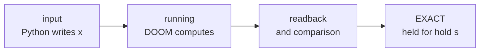

# Recording a run: `brain.record(...)`

`brain.record` films DOOM while it computes your network. You get a small `.gif` or `.mp4`.

<p align="center"></p>

`brain.record(inputs, "run.gif")` runs inputs through the brain like `brain(x)`. The film shows the map from above,
the player's first-person view, or both. In the map view each voodoo doll is a dot.

> [!TIP]
> [`examples/09_record_a_gif.py`](../examples/09_record_a_gif.py) films XOR. Run it to see a first recording.

```python
import numpy as np, doomformer as df

with df.compile(net) as brain:                                    # net: any df.MLP / df.SpikingNet / df.Transformer
    rec = brain.record([[0, 0], [0, 1], [1, 0], [1, 1]], "xor.gif")     # view='topdown', every=8, fps=30
    print(rec)          # <Recording xor.gif: 104 frames, 0.19 MB, 4 pass(es), 768 tics, 20 values checked, verified=True>
    rec.results         # what brain(x) returned for each input, as it always does
```

`rec.verified` is `True` only if every pass matched the integer reference exactly.

On a mismatch, `record` still writes the file. The failing pass ends on a red MISMATCH banner, and `record` raises
`df.MismatchError`. A `df.RangeError` is raised before anything runs, and then nothing is written.

## What each part does

DOOM computes and Python only watches and compares.

| step | who |
|---|---|
| arithmetic, doll movement, every compared value | **DOOM** (ACS only copies values out) |
| exact comparison, `MismatchError` | Python, via `brain(x)` unchanged |
| sampling doll positions and the screen buffer every `every` tics | Python, read only |
| first-person image | ViZDoom's renderer |
| top-down image, legend, text, file | Python (Pillow, imageio) |

Sampling wraps the runner's settle loop, `TileRunner.settle`. That loop already inspects the dolls every 8 tics. So
a recorded pass has the same tics and outputs as an unrecorded one. `tests/test_record.py` checks this on four XOR
passes.

Each pass in the film goes through these captions:



| phase | caption |
|---|---|
| input | "Python writes x = [1, 0] into the 2 input ports" |
| running | "DOOM is computing: tic N", `result: pending` |
| after a passing check | the values read back and `EXACT: n values [...] (tolerance 0)` for `hold` seconds |
| last pass of `brain.generate` | the generated text. DOOM computes the logits, Python picks the letter |

## Arguments

`record` takes the inputs and output path, plus options for view, sampling and size.

```python
brain.record(inputs, path, view="topdown", every=8, fps=30, *, width=640, colors=None, hold=1.5,
             camera_script=None, title=None, **generate_kwargs)
```

| argument | meaning |
|---|---|
| `inputs`, MLP | one vector, or a list for one pass each |
| `inputs`, spiking net | a `(steps, n_in)` array |
| `inputs`, transformer | a prompt string or a list of token ids |
| `path` | `.gif` (imageio) or `.mp4` (H.264, needs `imageio-ffmpeg`, a package dependency) |
| `view` | `"topdown"`, `"firstperson"` or `"both"` (map 60% / screen 40%) |
| `every` | DOOM tics between frames, a positive multiple of 8. Default 8 |
| `fps` | playback speed. At the defaults a frame shows 0.23 s of game time for 1/30 s |
| `width`, `colors` | frame width in pixels, GIF palette size (default 64 top-down, 128 with first-person) |
| `hold` | seconds a finished pass stays on screen |
| `camera_script` | see [Camera](#camera-first-person) |

A spiking net carries its state over between recorded steps, like `brain.step`. A prompt string runs `brain.generate`,
and a list of token ids runs one `brain.logits` pass.

Only a one-map brain can be recorded. For a tile-mode brain `record` raises `TypeError`.

## The top-down view

The top-down view draws the map from above with one dot per doll.

* **Lines**: the brain's linedefs at `y >= 0`, grey-blue, or orange if they carry a special. Your world is not drawn.
* **Layout**: to scale. A wide map is cut into stacked bands. Above ~40,000 linedefs it draws a density image.
* **Dots**: every voodoo doll, coloured by layer. Dim waits at home, bright has moved, white with a tail is moving.
* **Sampling**: a doll crosses its corridor in a few tics, so frames catch only part of its walk.

## Camera (first-person)

By default `firstperson` is what the player sees. For another viewpoint, place a camera in your world. Add a script
that switches the view to it.

```python
def world(m):
    ...                                                           # your rooms
    m.thing(-700, -2688, 1)                                        # the player
    m.thing(-300, -2688, 9025, angle=180, id=77)                   # SecurityCamera with TID 77
    return "script 202 (int cam) { if (cam) { ChangeCamera(77, 0, 0); } else { ChangeCamera(0, 0, 0); } }"

with df.compile(net, world=world) as brain:
    brain.record(x, "cam.gif", view="both", camera_script=202)
```

`record` runs script 202 with 1 before the first pass and with 0 after the last.

The default screen is 160x120. For a sharper picture, pass `resolution=vzd.ScreenResolution.RES_320X240` to
`df.compile`.

## Size and speed

Film sizes and recording overhead, measured on one shared aarch64 core at `nice -n 10`:

| film | frames | file |
|---|---|---|
| XOR, 4 passes, top-down, `width=800`, `every=8` (example 09) | 104 | GIF 0.24 MB, MP4 0.12 MB |
| 8-neuron spiking ring in example 04's hall (20 dolls), first-person from a 320x240 screen, `width=480`, `every=16`, 10 steps | 140 | GIF 0.44 MB |
| tiny one-map transformer (593 dolls, 12,620 sectors), one forward pass, `width=640`, `every=64` | 31 | GIF 0.10 MB |
| the same pass, `every=8` (225 samples) | 225 | MP4 0.39 MB |

| tiny-transformer forward pass | wall time |
|---|---|
| unrecorded | 4.8 s |
| recorded, `every=64` | 5.7 s |
| recorded, `every=8` | 9.1 s |

Positions stay in memory, about 8 bytes per doll per sample. For a long `generate` or a smaller GIF, you can:

- raise `every`.
- lower `width`.
- use `.mp4`.

## Limits

> [!IMPORTANT]
> The film shows sampled doll positions drawn by Python. Only the EXACT line shows the numbers are right.

Other limits:

* The real player is taken to be the last `DoomPlayer` in the object list. The compiler guarantees this.
* Layer colours need the layout's doll counts to match the map. Otherwise all dots share one colour.
* GIF frame times are stored in 10 ms units, so `fps=30` gives 30 ms frames. The MP4 is exactly 30 fps.
* A brain whose runs bypass `TileRunner.settle` cannot be recorded.
