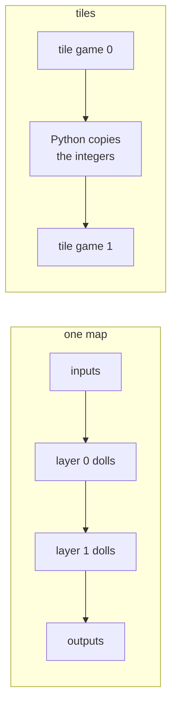
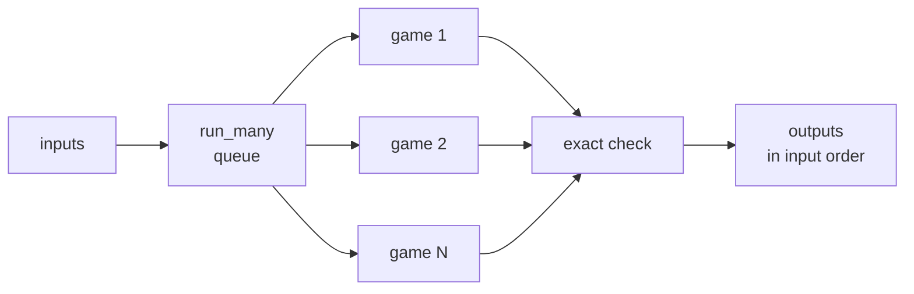

# Scaling from one map to operation tiles

A small net runs as one DOOM map. A big net is split into tiles, one small map per operation. This page covers both
modes, what a pass costs, and how to run many games at once.

<p align="center"></p>

```python
import doomformer as df

if __name__ == "__main__":       # tile workers are separate processes: keep the guard when you run this as a script
    net = df.Transformer.load("doomnames")
    print(df.plan(net, mode="auto", workers=2))
    with df.compile(net, mode="tiles", workers=2) as brain:
        name = brain.generate("F", max_new=4)  # FEAR, including the EOS decision
        print(name, brain.info)
```

`compile` and `plan` take `mode="auto" | "map" | "tiles"` and a positive `workers` (default 1).
Tile mode supports integer Transformers and MLPs. Spiking networks are map-only. Their potentials must stay in one game.

## What runs where



**Map:** the whole network is one map. Dolls cross weight lines and move the next layer's gates. They also release
the layer clocks. Python writes inputs, waits, reads results and checks them. No Python runs between layers.

**Tiles:** `model_tiles` builds one WAD per operation kind. `orchestrator.TilePool` runs them in up to `workers`
processes. Dolls compute the integer sums, staircase activations and attention products. ACS moves the input gates,
resets the tile and exposes the sector lights.

> [!NOTE]
> In tile mode, Python copies the read-back integers between games. It also schedules attention slots and samples the
> next token from the DOOM-computed logits, as `intref.choose` does.

- Each worker holds one live DOOM game (`max_live=1`). Switching tiles closes and reloads games.
- Each `brain.logits(tokens)` checks every exposed value against `intref.forward`, at tolerance 0. This covers
  preactivations, causal scores, weighted sums, logits and negation twins.
- A check covers the inputs of that call and the integer model only.
- In generation, a matching token prefix reuses the values already read. A changed context resets the cache.
- MLPs get one tile per layer. Python copies raw hidden values and their negations.
- The next tile's gates compute the staircase. `brain(x)` returns checked outputs.
- `brain.run(x, check=True)` checks every readback.

## Automatic selection and planning

`mode="auto"` builds one map whenever it fits. Then only inputs and outputs cross into Python.
It picks tiles only when the map is too wide and the tiles fit. Too wide means over 32,000 units on an axis
([engine_limits.md](engine_limits.md)). You can always ask for `mode="tiles"`.

`estimated_settle_tics` counts game tics per pass. It adds this term per stage, then sums the stages.

```
ceil((waves * wave_spacing + corridor_width + 400 + 512) / 16) + 16
```

400 and 512 are the sync and clock distances. 16 units per tic is the conveyor speed. The last 16 tics are a margin.

On 35 passes of 25 random MLPs, the estimate was 1.2 % below to 3.9 % above the measured tics.
A pass raises if it needs more than twice the estimate, or 20,000 tics if that is larger.

`plan` builds no WAD and starts no game. It reports these keys.

<details><summary><b>What <code>plan</code> reports</b></summary>


| key | meaning |
|---|---|
| `map` | dolls, sectors, `fits`, `span`, `bounds`, `world_area`, `estimated_settle_tics`, and for a map that fits `predicted_tics`, `sector_tics`, `predicted_seconds` |
| `tiles` | summed dolls and sectors over distinct WADs, the largest tile, `fits`, `per_tile`, and for an MLP `predicted_tics`, `sector_tics`, `predicted_seconds` |
| `mode`, `workers` | the selected mode and worker count |
| `recommended`, `recommended_ratio` | the mode with fewer predicted seconds when both fit, and slower over faster |
| `reason` | why the selected mode does not fit. `df.compile` then raises `ValueError` |

- Top-level `dolls`, `sectors`, `fits` and `span` describe the map. Use `report[report["mode"]]` for the selected mode.
- Tiles fit when every tile spans at most 32,000 units per axis and holds fewer than 20,000 dolls.
- `recommended` is advice. Auto still builds one map when it fits. `mnist --tiles` and `run_many(mode="tiles")` act on it.
- Transformers get no tile prediction: their tile executions depend on the sequence.
- World, actions, resolution and configure hooks need one map. Auto keeps map mode with them. Explicit tiles raise.
- Map mode uses one worker regardless of `workers`.

</details>

## Cost model

Every pass costs the same simple law. The engine visits every sector on every tic.

```
engine seconds per pass = tics x (sectors x about 90 ns + dolls x about 1 us)        (one map)
```

> [!NOTE]
> An idle map costs what a running one does. Sectors, not busy dolls, set the price.

`plan` uses this law ([`doomformer/cost.py`](../doomformer/cost.py)). `predicted_seconds` is the engine time of one pass
with the games loaded, on an otherwise idle core. `sector_tics` does not depend on the machine.

`python -m demos.costcheck` measures engine CPU over 6 to 12 passes per net. `--refit` refits the constants.
The fit uses random MLPs on a quiet 16-core machine.

| layout | fit nets | per sector-tic | per doll-tic |
|---|---|---:|---:|
| one map | 14, 2.2k to 275k sectors | 89.9 ns | 0.97 us |
| tiles | 14, up to 475k sectors | 67.1 ns | 2.25 us |

A tile runs `tile_tics(zone)`: 30 tics plus its longest zone at 16 units per tic. That is rounded up to the 8-tic
settle window.

On held-out nets the root-mean-square error is 13 % for one map and 22 % for tiles.
Log: [`models/bench/costcheck-refit.log`](../models/bench/costcheck-refit.log).

<details><summary><b>Held-out nets: predicted against measured</b></summary>

| net | one map: sectors, tics | predicted s | measured CPU s | error | tiles: tics pred/meas | predicted s | measured CPU s | error |
|---|---|---:|---:|---:|---|---:|---:|---:|
| 8-12-4 K3 | 2,239, 527 | 0.15 | 0.12 | +25 % | 88/88 | 0.012 | 0.012 | +2 % |
| 24-24-8 K3 | 9,593, 1,062 | 1.14 | 1.18 | -3 % | 96/96 | 0.040 | 0.035 | +14 % |
| 48-32-10 K3 | 22,619, 1,739 | 4.18 | 4.60 | -9 % | 96/96 | 0.079 | 0.072 | +10 % |
| 100-32-10 K3 | 44,727, 2,987 | 14.02 | 15.82 | -11 % | 96/96 | 0.151 | 0.153 | -1 % |
| 20-20-20-10 K3 | 10,201, 1,259 | 1.45 | 1.58 | -8 % | 120/136 | 0.040 | 0.032 | +24 % |
| 128-64-10 K3 | 103,818, 4,059 | 41.66 | 39.00 | +7 % | 112/112 | 0.319 | 0.315 | +1 % |
| 32-64-64-10 K3 | 54,047, 2,647 | 14.34 | 14.25 | +1 % | 120/184 | 0.173 | 0.103 | +68 % |
| 200-50-10 K3 | 128,178, 5,612 | 72.00 | 74.94 | -4 % | 112/104 | 0.388 | 0.402 | -3 % |
| 8-12-4 K8 | 5,924, 1,087 | 0.82 | 1.02 | -20 % | 88/88 | 0.029 | 0.028 | +4 % |
| 24-24-8 K8 | 25,514, 2,502 | 7.14 | 8.80 | -19 % | 96/96 | 0.090 | 0.088 | +2 % |
| 48-32-10 K8 | 60,232, 4,299 | 27.54 | 31.42 | -12 % | 96/96 | 0.170 | 0.163 | +4 % |

`NET K` is the layer sizes and the number of staircase thresholds. The tile tic formula is an upper estimate.
Later layers of a random net settle sooner. The log's own prediction columns use older constants.

</details>


The shipped MNIST net runs `doomformer bench pass --net mnist`. NumPy takes 47.6 us. Log:
[`models/bench/pass-mnist.log`](../models/bench/pass-mnist.log).

| shipped MNIST, one map | game tics | measured engine CPU | predicted |
|---|---:|---:|---:|
| `--opt 0` | 5,696 | 73.2 s | 88.3 s (+21 %) |
| `--opt 2` | 3,560 | 48.7 s | 55.4 s (+14 %) |
| `--opt 3` | 272 | 2.84 s | 2.81 s (-1 %) |

Random nets keep more dolls busy per tic than the trained net. The trained net costs 81 ns per sector-tic.
For tiles, `doomformer bench tiles` measures 0.72 to 0.77 s per digit. The prediction is 0.75 s.

`doomformer bench predict` runs six random nets of K 2 to 8 at opt 0 to 3. The prediction was low in 23 of 24 rows.
The rms error was 21 %, on a machine shared with other games.

> [!WARNING]
> For nets outside K3 and K8, treat the prediction as a lower bound. The measurement may exceed it by 40 %.

The model leaves out these costs.

- Wall time on a loaded machine: 1.3 to 2.5 times the CPU time.
- Game start: 0.3 s for 4k sectors, 7 to 13 s for 54k to 103k.
- Compile time and other CPUs. The constants are fitted on arm64.
- Memory: about 5.2 KB per sector plus 20 MB per engine.

### The idle conveyor tax

Most sectors are conveyors, and conveyors cost even when idle. 87 to 96 % of a map's sectors carry the conveyor tag.
Each holds 4 stacked Boom carry scrollers (`tile.CONVEYOR`). The engine updates them every tic, doll or no doll.

`doomformer bench idle` rebuilds one map per net at stacks 4, 2, 1 and 0. It times 300 idle tics five times.
Stack 0 is wall time, since engine CPU is read in 10 ms ticks. Nets are random K3 MLPs.
Log: [`models/bench/idle.log`](../models/bench/idle.log).

| net (sectors) | stack 4 | stack 2 | stack 1 | stack 0 (wall) |
|---|---:|---:|---:|---:|
| 12-16-6 K3 (3,925) | 413 us/tic (105 ns/sector-tic) | 373 us | 320 us (1.3x) | 22 us (19x) |
| 32-32-10 K3 (15,830) | 1,733 us (110 ns) | 1,360 us | 1,153 us (1.5x) | 35 us (50x) |
| 64-64-10 K3 (54,086) | 4,660 us (86 ns) | 3,060 us | 2,447 us (1.9x) | 59 us (79x) |
| shipped MNIST, `--opt 3` (88,146) | 10,767 us (122 ns) | 8,733 us | 8,220 us (1.3x) | 164 us (66x) |

The first scroller costs about 45 to 90 ns per sector-tic. Each further one costs 8 to 14 ns.
An idle MNIST map at `--opt 3` costs 10.77 ms per tic. A running pass costs 10.44 ms.
The dolls and the ACS copy do not show against the idle cost.

### The stack test

Fewer scrollers do not make a working map cheaper. `doomformer bench stack` runs a checked pass at stacks 4, 2 and 1.
Each runs 3 passes. Log: [`models/bench/stack.log`](../models/bench/stack.log).

| net (sectors) | stack | game tics | engine CPU per pass | result |
|---|---:|---:|---:|---|
| 12-16-6 K3 (3,925) | 4 | 672 | 0.290 s (432 us/tic) | exact |
| | 2 | 1,296 | 0.533 s (412 us/tic), 1.84x | exact |
| | 1 | | | MismatchError: values wrong |
| 32-32-10 K3 (15,830) | 4 | 1,360 | 2.473 s (1,819 us/tic) | exact |
| | 2 | 2,680 | 4.570 s (1,705 us/tic), 1.85x | exact |
| | 1 | | | MismatchError: values wrong |

The conveyors carry the dolls. Half the scrollers double the tics, and each tic is only 5 % cheaper.
So a pass costs 1.8x more. At one scroller the dolls arrive late and the pass is wrong.

A cheaper MNIST pass needs one of two things. Either the engine skips empty conveyor sectors, or the map has about a
sixth of the sectors.

## One map versus tiles: the price

A one-map layer releases its dolls in serial waves. A wave is 64 map units, about 4 tics.
MNIST layer 0 has 784 waves, layer 1 512. A tile has the sectors of one layer and runs all its dolls side by side.

| shipped MNIST | one map | 4 tiles |
|---|---:|---:|
| sectors | 158,550 | 111,112 (100,828 + 9,510 + 652 + 122) |
| game tics per digit | 5,696 | 216 (72 + 64 + 40 + 40) |
| sector-tics | 903 million | 7.9 million |
| engine CPU per digit | 73.2 s (predicted 88 s) | 0.72 to 0.77 s (predicted 0.75 s) |
| wall per digit | 104 s (one game, load 25) | 0.83 s mean (6 workers) |
| Python between layers | none | copies 64 hidden values and their twins into layer 1, and so on |

Tiles are about 100 times faster in engine CPU on this net.
The price: Python carries the layer values from game to game.

> [!TIP]
> Use one map to show that no Python runs between layers. Use tiles to push many inputs through.

The gap grows with width. Measured CPU, one map over tiles:

| net | K3 | K8 |
|---|---:|---:|
| 12-16-6 | 16x | 57x |
| 32-32-10 | 56x | 184x |
| 64-64-10 | 83x | 280x |

## The 65,000 times, as a range

The README's "about 65,000 times slower than NumPy" is for the 12-16-6 toy. That is 726 ms in DOOM against 11.1 us.
The ratio depends on the net. `MLP.reference(x)` takes 14.0 us for 12-16-6, 15.6 us for 32-32-10, 19.2 us for
64-64-10 and 47.6 us for MNIST. Engine CPU of one pass:

| net | one map | tiles |
|---|---:|---:|
| 12-16-6, K3 (3,925 sectors) | 0.32 s, about 23,000x | 0.020 s, about 1,400x |
| 32-32-10, K3 | 3.19 s, about 200,000x | 0.057 s, about 3,600x |
| 64-64-10, K3 | 14.2 s, about 740,000x | 0.172 s, about 8,900x |
| MNIST, `--opt 0` | 73.2 s, about 1.54 million x | 0.72 s, about 15,000x |
| MNIST, `--opt 3` | 2.84 s, about 60,000x | |

A ratio against a 14 us call mostly says how little the reference does.

The 12-16-6 nets here, in [HOW_IT_WORKS.md](HOW_IT_WORKS.md#speed) and in the conveyor table are different builds.
Do not mix their figures. The one-map MNIST pass is 73.2 s of CPU on a quiet machine. At load 25 it took 104 s of wall time.

## Measured results

Setup: Linux arm64, ViZDoom 1.3.2, `OMP_NUM_THREADS=1`, `nice -n 10`, headless, tolerance zero.
Wall times include game and worker start but not compilation. Geometry comes from `df.plan`.

| Model | Mode | Dolls | Sectors | Distinct WADs | Fits | Estimated map tics |
|---|---|---:|---:|---:|---|---:|
| `onemap.tiny_model()` | map | 593 | 12,620 | 1 | yes | 1,937 |
| same | tiles | 214 | 2,766 | 12 | yes | |
| `models/doomnames_onemap` (d=8) | map | 3,548 | 95,448 | 1 | yes | 3,592 |
| same | tiles | 728 | 11,498 | 18 | yes | |
| `models/doomnames` (L=1, d=16, T=16) | map | 116,968 | 15,190,214 | 1 | **no** | 100,244 |
| same | tiles | 10,462 | 135,912 | 38 | yes | |

The d=16 model's largest tile has 448 dolls and 5,252 sectors. Its map does not fit.

`tiny_model()` on tokens `[0, 1]`: `df.compile(m, mode=mode, workers=2)`, then `brain.logits([0, 1])`.

| Mode | Compile/build wall | Forward wall | Tile executions | Game tics | Checked integers | Exact logits |
|---|---:|---:|---:|---:|---:|---|
| map | 0.413 s | 5.214 s | 1 map pass | 1,800 | 148 | yes |
| tiles, 2 workers | 0.080 s | 2.447 s | 23 | 968 summed | 148 | yes |

The trained-model example:

```sh
OMP_NUM_THREADS=1 nice -n 10 .venv/bin/python examples/10_big_model_tiles.py
```

Output: `text="FEAR"`, `reference="FEAR"`, `exact=true`, `workers=2`, `compile_seconds=0.192`,
`generate_seconds=19.994`, `total_seconds=20.187`, `runs=4`, `tile_runs=140`, `checked=1650`.

It generates from `F` and checks the EOS decision. `checked` and `tics` describe the last request only.

```sh
OMP_NUM_THREADS=1 nice -n 10 .venv/bin/python -m pytest -q tests/test_tiled.py
```

Result: **4 passed in 29.69 s**.

## Brain metadata and limitations

Both modes are `Brain` instances. Use them as context managers to close the games.

- `info["runs"]` counts forward requests, `checked` the comparisons and `tics` the game tics of the last request.
- Tile brains add `mode`, `workers`, `backend` (`"local"` or `"ray"`), `tiles` and cumulative `tile_runs`.
- `brain.wad` is the tile directory. A supplied `name.wad` becomes `name.tiles`. Tiles cache under `DOOMFORMER_CACHE`.
- A tile brain has no single `runner`, `run_script` world or playable WAD. Hooks and recording need `mode="map"`.
- Transformers expose `brain.engine`. Both tile brain kinds expose `brain.pool.log`.
- Workers use multiprocessing spawn, so scripts need an `if __name__ == "__main__":` guard.

The integer ranges still apply. Gate-fed values stay within ±12,000, partial sums within ±30,000, weights within ±255.
Tiles lift whole-map packing limits, not per-tile or integer-range limits.

## Scaling out: many games, many machines

`df.run_many` spreads independent passes of one map over many games. The games run on this machine or on a Ray
cluster. Nothing is hosted: you run the games.



```python
import numpy as np

import doomformer as df

if __name__ == "__main__":       # local workers are spawned processes: keep the guard in scripts
    net = df.MLP([[[2, -1], [-1, 2]], [[1, -2]]], [[1, -1], [3]], [[1, 3], [1, 2]])
    xs = np.random.default_rng(0).integers(-4, 5, size=(12, 2))
    ys = df.run_many(net, xs, workers=3)                          # 3 DOOM games, every pass checked
    print(np.array_equal(np.stack(ys), net.reference(xs)["y"]))   # True
```

<details><summary><b>Signature and behaviour of <code>run_many</code></b></summary>

```python
run_many(net, inputs, *, workers=None, backend="local", address=None, world=None, actions=None, progress=None, mode="map", opt=0)
```

It does the following.

- Compiles the map once, in the calling process.
- Starts `workers` games and gives every input to the next idle game.
- Checks every pass as `brain(x)` or `brain.logits(tokens)` does: 248 values per MNIST digit.
- Returns the outputs in input order.
- Range-checks every input before any game starts.
- Raises `df.MismatchError` with `.index` on the first difference, and `RuntimeError` naming a failed input.
- Calls `progress(info)` after every pass with `index`, `done`, `total`, `game`, `output`, `checked`, `tics`,
  `seconds` and `retried`.

</details>

Spiking nets are refused. `workers` defaults to `min(CPU count, len(inputs))` locally and to the cluster's CPUs on Ray.

Games do not outlive their caller. Local workers exit within about a second when the caller dies.
`doomformer` treats SIGTERM like Ctrl+C.

A plain `df.compile(net)` game has a `sh` guard (`doomformer._mp.guard_engine`). It kills the engine within a second of
the parent dying (`tests/test_tiles_many.py`). The guard needs `sh` and `ps` and does nothing on Windows.

### Tile games in `run_many`: `mode="tiles"`

`df.run_many(net, xs, mode="tiles", workers=W)` runs an MLP on the local backend. `mode="auto"` takes
`plan(net)["recommended"]`.

Each worker holds one resident game per layer and takes inputs one after another. Python copies each layer's values
and negation twins into the next layer's ports. The check is the same as in `mode="map"`.

The code is `doomformer/tilefleet.py`. The command line is `doomformer mnist --tiles [--workers N]`.

`doomformer bench tiles --workers 1,2,4,8,16 --digits 200` runs on 16 idle cores and checks every pass.
"Steady" leaves out the start of the games. Log: [`models/bench/tiles-sweep.log`](../models/bench/tiles-sweep.log).

| workers | engine processes | wall (with start) | digits per minute | steady digits per minute | speed-up | mean pass | engine CPU per digit |
|---:|---:|---:|---:|---:|---:|---:|---:|
| 1 | 4 | 151 s | 79 | 81 | 1.0x | 0.74 s | 0.72 s |
| 2 | 8 | 84 s | 143 | 151 | 1.9x | 0.79 s | 0.77 s |
| 4 | 16 | 45 s | 265 | 299 | 3.7x | 0.80 s | 0.77 s |
| 8 | 32 | 28 s | 433 | 563 | 6.9x | 0.86 s | 0.82 s |
| 16 | 64 | 22 s | 552 | 880 | 10.9x | 1.07 s | 0.92 s |

At 16 workers, the engines and Python workers share 16 cores. Each added worker buys less.

### All 10,000 MNIST test digits in DOOM

<p align="center"></p>

```sh
doomformer mnist --tiles --all --workers 6 --record models/mnist/doom_tiles_10000.json
```

| digits exact | read correctly | tics per digit | wall | digits per minute | mean pass |
|---|---|---:|---:|---:|---:|
| 10,000/10,000 (248 values each) | 9,716 (97.16 %) | 216 | 1,390 s | 431.7 | 0.83 s (0.77 to 1.73 s) |

DOOM's output equals the NumPy integer reference on all 10,000 digits. The 97.16 % is the integer net's accuracy
(`models/mnist/EVAL.md`).

You can check the record without DOOM. Rebuild the digits with `doomformer.cli.mnist_test_set()`. Then compare each
row's `y` with `net.reference(net.encode(x))["y"]`.

The one-map run of 1,000 digits is [`models/mnist/doom_1000.json`](../models/mnist/doom_1000.json).

`doomformer mnist --digits N --workers W [--tiles] [--ray [ADDRESS]] [--all] [--record PATH]`:

- Up to 100 digits come from the shipped test digits. More are drawn from the 10,000 MNIST test digits.
- The test set downloads once from `https://ossci-datasets.s3.amazonaws.com/mnist/`. It lands in
  `~/.cache/doomformer/mnist` and is checked by sha256.
- `--record PATH` writes one JSON line per digit. `PATH.partial` keeps finished digits if the run is killed.

### The Ray backend

```sh
pip install "doomformer[ray]"
```

`backend="ray"` runs one Ray actor per game, each reserving one CPU. `address` goes to `ray.init`.
Without it, `run_many` joins a running cluster or starts a local Ray for the call.

- The map is sent once as bytes through Ray's object store, so nodes need no shared filesystem.
- Every node needs the same Python minor version, doomformer and Ray versions, and `vizdoom==1.3.2`.
- A dead actor costs only its input, which runs once more with `retried=True`. A second death raises `RuntimeError`.
- Extra `workers` beyond free CPUs wait for CPUs.

Tile mode runs on Ray too: `df.compile(net, mode="tiles", backend="ray", workers=N, address=...)`.
The tile WADs ship as bytes. A dead tile actor stops the pool.

Keep `workers` at or below the free CPUs. A task queued on an actor that never starts waits for the pool's 900 s deadline.

### A Ray cluster across machines

On the head machine:

```sh
pip install "doomformer[ray]"
ray start --head --port=6379 --num-cpus=8      # 8 games on this machine
```

On every other machine:

```sh
pip install "doomformer[ray]"
ray start --address=HEAD_IP:6379 --num-cpus=8
```

Ray 2.59 enables token authentication by default. The other machines need the head's `~/.ray/auth_token`.
Or every machine sets `RAY_AUTH_MODE=disabled` before `ray start`. Then, on any machine of the cluster:

```sh
doomformer mnist --all --workers 32 --ray --record mnist-10000.json
```

`ray stop` on every machine ends the cluster. Set `--num-cpus` to one game per core.
Give each game about 1.3 GB of RAM for MNIST.

On one machine, run `ray start --head` before several concurrent `run_many(backend="ray")` calls.
Otherwise the first call's Ray shuts down under the others.

### What one game costs

These costs come from the previous 784-48-10 MNIST map (122,955 sectors). The shipped map has 158,550 sectors.
It peaks at 1.23 GB per game.

<details><summary><b>Start-up, shipping and memory per game</b></summary>

| Item | Measured |
|---|---|
| compile the map (once per call) | 4.8 s and 5.6 s |
| WAD + metadata shipped to Ray actors | 118.2 MB |
| `ray.put` of those bytes (once) | 0.37 s |
| an actor writing them to its disk | 0.04 to 0.05 s |
| local game start (load the map) | 2.32 s |
| Ray: 1 actor from creation to a loaded game | 3.2 s |
| Ray: 8 actors from creation to 8 loaded games | 6.48 s |
| starting a local Ray (`ray.init`) | 3.82 s |
| engine process memory | 319 MB resident, 656 MB peak while loading |
| Ray actor process memory | 317 MB resident, 429 MB peak |

</details>

### Measured throughput

A game runs at the same speed on either backend. Side by side on 6 digits with 3 games each, the mean pass is 78.0 s
on Ray and 78.3 s locally. Ray adds its start and lets the games run on more machines.

The one-map MNIST ran `doomformer mnist --digits 1000 --seed 0 --workers 14` on a shared machine. Record:
[`models/mnist/doom_1000.json`](../models/mnist/doom_1000.json).

| digits exact | read correctly | wall | digits per minute | mean pass | largest process |
|---|---|---:|---:|---:|---:|
| 1,000/1,000 | 966/1,000 | 7,420.9 s | 8.09 | 103.1 s (83 to 153 s) | 1.24 GB |

Tile mode below has `models/doomnames` write `FEAR` from `F`. Times include actor start and shipping.

| Backend | Workers | Generate wall | Text, exact |
|---|---:|---:|---|
| local | 2 | 26.9 s | FEAR, yes |
| Ray | 2 | 23.7 s | FEAR, yes |
| local | 8 | 12.8 s | FEAR, yes |
| Ray | 8 | 13.55 s | FEAR, yes |

Test: `python -m pytest -q tests/test_fleet.py`. The three Ray tests skip without Ray.
