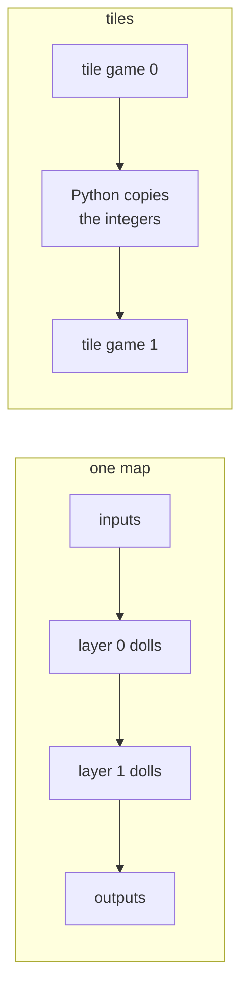
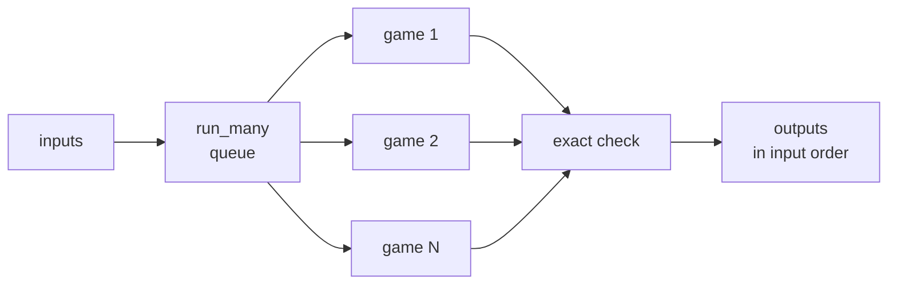

# Scaling from one map to operation tiles

Small networks run in one DOOM map, while larger networks use operation tiles, smaller maps between which Python passes
integer values, and several games can process independent inputs locally or on a Ray cluster.

<p align="center"></p>

```python
import doomformer as df

if __name__ == "__main__":       # tile workers are separate processes: keep the guard when you run this as a script
    net = df.Transformer.load("doomnames")
    print(df.plan(net, mode="auto", workers=2))
    with df.compile(net, mode="tiles", workers=2) as brain:
        name = brain.generate("F", max_new=4)  # FEAR, including the EOS decision
        print(name, brain.info)
```

`compile` and `plan` take `mode="auto" | "map" | "tiles"` and a positive `workers` (default 1). Tile mode supports
integer Transformers and MLPs, while spiking networks are map-only because their potentials must stay in one game.

## What runs where



In map mode, dolls cross weight lines, update the next layer's gates and release its clock, while Python writes inputs
and reads and checks outputs with no host work between layers.

In tile mode, `model_tiles` builds one WAD per operation kind and `orchestrator.TilePool` runs up to `workers`
processes. Dolls compute integer sums, staircases and attention products, ACS sets inputs, resets tiles and exposes
lights, and Python copies values between games, schedules attention slots and samples tokens using `intref.choose`.

- Each worker holds one live DOOM game (`max_live=1`), so switching tiles closes and reloads games.
- Each `brain.logits(tokens)` checks every exposed value against `intref.forward` at tolerance 0, covering
  preactivations, causal scores, weighted sums, logits and negation twins.
- In generation, a matching token prefix reuses the values already read, and a changed context resets the cache.
- MLPs get one tile per layer, and Python copies raw hidden values and their negations.
- The next tile's gates compute the staircase, and `brain(x)` returns checked outputs.
- `brain.run(x, check=True)` checks every readback.

## Automatic selection and planning

`mode="auto"` builds one map whenever it fits, so that only inputs and outputs cross into Python, and it picks tiles
only when the map is too wide, meaning over 32,000 units on an axis ([engine_limits.md](engine_limits.md)), and the tiles
fit. You can always ask for `mode="tiles"`.

`estimated_settle_tics` counts game tics per pass by summing this term over the stages:

```
ceil((waves * wave_spacing + corridor_width + 400 + 512) / 16) + 16
```

Here 400 and 512 are the sync and clock distances, 16 units per tic is the conveyor speed, and the last 16 tics are a
margin.

On 35 passes of 25 random MLPs the estimate was 1.2 % below to 3.9 % above the measured tics, and a pass raises if it
needs more than twice the estimate, or 20,000 tics if that is larger.

`plan` builds no WAD and starts no game, and it reports these keys:

<details><summary><b>What <code>plan</code> reports</b></summary>


| key | meaning |
|---|---|
| `map` | dolls, sectors, `fits`, `span`, `bounds`, `world_area`, `estimated_settle_tics`, and for a map that fits `predicted_tics`, `sector_tics`, `predicted_seconds` |
| `tiles` | summed dolls and sectors over distinct WADs, the largest tile, `fits`, `per_tile`, and for an MLP `predicted_tics`, `sector_tics`, `predicted_seconds` |
| `mode`, `workers` | the selected mode and worker count |
| `recommended`, `recommended_ratio` | the mode with fewer predicted seconds when both fit, and slower over faster |
| `reason` | why the selected mode does not fit. `df.compile` then raises `ValueError` |

- Top-level `dolls`, `sectors`, `fits` and `span` describe the map, and `report[report["mode"]]` gives the selected
  mode.
- Tiles fit when every tile spans at most 32,000 units per axis and holds fewer than 20,000 dolls.
- `recommended` is advice, since auto still builds one map when it fits, while `mnist --tiles` and
  `run_many(mode="tiles")` act on it.
- Transformers get no tile prediction because their tile executions depend on the sequence.
- World, actions, resolution and configure hooks need one map, so auto keeps map mode with them and explicit tiles
  raise.
- Map mode uses one worker regardless of `workers`.

</details>

## Cost model

The engine visits every sector on every tic, and the measured pass time follows:

```
engine seconds per pass = tics x (sectors x about 90 ns + dolls x about 1 us)        (one map)
```

Idle maps cost about as much as running maps, because the sector count dominates doll activity.

`plan` uses this law ([`doomformer/cost.py`](../doomformer/cost.py)), where `predicted_seconds` is the engine time of one
pass with the games loaded on an otherwise idle core and `sector_tics` does not depend on the machine.

`python -m demos.costcheck` measures engine CPU over 6 to 12 passes per net, and `--refit` refits the constants on
random MLPs on a quiet 16-core machine.

| layout | fit nets | per sector-tic | per doll-tic |
|---|---|---:|---:|
| one map | 14, 2.2k to 275k sectors | 89.9 ns | 0.97 us |
| tiles | 14, up to 475k sectors | 67.1 ns | 2.25 us |

A tile runs `tile_tics(zone)`, which is 30 tics plus its longest zone at 16 units per tic, rounded up to the 8-tic
settle window.

On held-out nets the root-mean-square error is 13 % for one map and 22 % for tiles
([`models/bench/costcheck-refit.log`](../models/bench/costcheck-refit.log)).

<details><summary><b>Held-out nets: predicted against measured</b></summary>

| net | one map: sectors, tics | predicted s | measured CPU s | error | tiles: tics pred/meas | predicted s | measured CPU s | error |
|---|---|---:|---:|---:|---|---:|---:|---:|
| 8-12-4 K3 | 2,239, 527 | 0.15 | 0.12 | +25 % | 88/88 | 0.012 | 0.012 | +2 % |
| 24-24-8 K3 | 9,593, 1,062 | 1.14 | 1.18 | -3 % | 96/96 | 0.040 | 0.035 | +14 % |
| 48-32-10 K3 | 22,619, 1,739 | 4.18 | 4.60 | -9 % | 96/96 | 0.079 | 0.072 | +10 % |
| 100-32-10 K3 | 44,727, 2,987 | 14.02 | 15.82 | -11 % | 96/96 | 0.151 | 0.153 | -1 % |
| 20-20-20-10 K3 | 10,201, 1,259 | 1.45 | 1.58 | -8 % | 120/136 | 0.040 | 0.032 | +24 % |
| 128-64-10 K3 | 103,818, 4,059 | 41.66 | 39.00 | +7 % | 112/112 | 0.319 | 0.315 | +1 % |
| 32-64-64-10 K3 | 54,047, 2,647 | 14.34 | 14.25 | +1 % | 120/184 | 0.173 | 0.103 | +68 % |
| 200-50-10 K3 | 128,178, 5,612 | 72.00 | 74.94 | -4 % | 112/104 | 0.388 | 0.402 | -3 % |
| 8-12-4 K8 | 5,924, 1,087 | 0.82 | 1.02 | -20 % | 88/88 | 0.029 | 0.028 | +4 % |
| 24-24-8 K8 | 25,514, 2,502 | 7.14 | 8.80 | -19 % | 96/96 | 0.090 | 0.088 | +2 % |
| 48-32-10 K8 | 60,232, 4,299 | 27.54 | 31.42 | -12 % | 96/96 | 0.170 | 0.163 | +4 % |

`NET K` is the layer sizes and the number of staircase thresholds. The tile tic formula is an upper estimate because
later layers of a random net settle sooner, and the log's own prediction columns use older constants.

</details>


`doomformer bench pass --net mnist` runs the shipped MNIST net, which NumPy computes in 47.6 us
([`models/bench/pass-mnist.log`](../models/bench/pass-mnist.log)).

| shipped MNIST, one map | game tics | measured engine CPU | predicted |
|---|---:|---:|---:|
| `--opt 0` | 5,696 | 73.2 s | 88.3 s (+21 %) |
| `--opt 2` | 3,560 | 48.7 s | 55.4 s (+14 %) |
| `--opt 3` | 272 | 2.84 s | 2.81 s (-1 %) |

Random nets keep more dolls busy per tic than the trained net, which costs 81 ns per sector-tic. For tiles,
`doomformer bench tiles` measures 0.72 to 0.77 s per digit against a prediction of 0.75 s.

`doomformer bench predict` runs six random nets of K 2 to 8 at opt 0 to 3, and the prediction was low in 23 of 24 rows,
with an rms error of 21 % on a machine shared with other games.

Outside K3 and K8, measurements can exceed predictions by 40%, and the model also leaves out these costs:

- Contention: wall time on a loaded machine is 1.3 to 2.5 times engine CPU time.
- Game startup: 0.3 s for 4k sectors, 7 to 13 s for 54k to 103k.
- Compilation and differences between CPUs; constants were fitted on arm64.
- Memory: about 5.2 KB per sector plus 20 MB per engine.

### Idle conveyor cost

Conveyor sectors account for 87–96% of a map. Each has 4 stacked Boom carry scrollers (`tile.CONVEYOR`) updated
every tic, whether a doll is moving or not.

`doomformer bench idle` rebuilds one map per net, all random K3 MLPs, at stacks 4, 2, 1 and 0 and times 300 idle tics
five times, where stack 0 is wall time because engine CPU is read in 10 ms ticks
([`models/bench/idle.log`](../models/bench/idle.log)).

| net (sectors) | stack 4 | stack 2 | stack 1 | stack 0 (wall) |
|---|---:|---:|---:|---:|
| 12-16-6 K3 (3,925) | 413 us/tic (105 ns/sector-tic) | 373 us | 320 us (1.3x) | 22 us (19x) |
| 32-32-10 K3 (15,830) | 1,733 us (110 ns) | 1,360 us | 1,153 us (1.5x) | 35 us (50x) |
| 64-64-10 K3 (54,086) | 4,660 us (86 ns) | 3,060 us | 2,447 us (1.9x) | 59 us (79x) |
| shipped MNIST, `--opt 3` (88,146) | 10,767 us (122 ns) | 8,733 us | 8,220 us (1.3x) | 164 us (66x) |

The first scroller costs about 45–90 ns per sector-tic and each additional scroller 8–14 ns, and at opt 3 idle MNIST
costs 10.77 ms per tic against 10.44 ms during a pass.

### Fewer scrollers

`doomformer bench stack` runs 3 checked passes each at stacks 4, 2 and 1
([`models/bench/stack.log`](../models/bench/stack.log)).

| net (sectors) | stack | game tics | engine CPU per pass | result |
|---|---:|---:|---:|---|
| 12-16-6 K3 (3,925) | 4 | 672 | 0.290 s (432 us/tic) | exact |
| | 2 | 1,296 | 0.533 s (412 us/tic), 1.84x | exact |
| | 1 | | | MismatchError: values wrong |
| 32-32-10 K3 (15,830) | 4 | 1,360 | 2.473 s (1,819 us/tic) | exact |
| | 2 | 2,680 | 4.570 s (1,705 us/tic), 1.85x | exact |
| | 1 | | | MismatchError: values wrong |

Halving the scrollers doubles the tics while reducing each tic's cost by only 5%, making a pass 1.8x slower, and with
one scroller the dolls arrive too late and the outputs are wrong.

## One map versus tiles: the price

At opt 0 each wave is 64 map units, about 4 tics, and MNIST layers 0 and 1 need 784 and 512 waves, while a tile holds
one layer and runs its dolls side by side.

| shipped MNIST, one-map opt 0 | one map | 4 tiles |
|---|---:|---:|
| sectors | 158,550 | 111,112 (100,828 + 9,510 + 652 + 122) |
| game tics per digit | 5,696 | 216 (72 + 64 + 40 + 40) |
| sector-tics | 903 million | 7.9 million |
| engine CPU per digit | 73.2 s (predicted 88 s) | 0.72 to 0.77 s (predicted 0.75 s) |
| wall per digit | 104 s (one game, load 25) | 0.83 s mean (6 workers) |
| Python between layers | none | copies 64 hidden values and their twins into layer 1, and so on |

Tiles use about 100x less engine CPU than the opt 0 map, with Python copying values between layers, so map mode is for
when the whole computation must stay inside one game and tiles are for throughput.

The gap grows with width, as the measured CPU ratio of one map over tiles shows:

| net | K3 | K8 |
|---|---:|---:|
| 12-16-6 | 16x | 57x |
| 32-32-10 | 56x | 184x |
| 64-64-10 | 83x | 280x |

## Compared with NumPy

A 12-16-6 toy takes 726 ms in DOOM against 11.1 us in NumPy, about 65,000x slower. For the builds in the table,
`MLP.reference(x)` takes 14.0 us for 12-16-6, 15.6 us for 32-32-10, 19.2 us for 64-64-10 and 47.6 us for MNIST, against
this engine CPU per pass:

| net | one map | tiles |
|---|---:|---:|
| 12-16-6, K3 (3,925 sectors) | 0.32 s, about 23,000x | 0.020 s, about 1,400x |
| 32-32-10, K3 | 3.19 s, about 200,000x | 0.057 s, about 3,600x |
| 64-64-10, K3 | 14.2 s, about 740,000x | 0.172 s, about 8,900x |
| MNIST, `--opt 0` | 73.2 s, about 1.54 million x | 0.72 s, about 15,000x |
| MNIST, `--opt 3` | 2.84 s, about 60,000x | |

The 12-16-6 examples here, in [HOW_IT_WORKS.md](HOW_IT_WORKS.md#speed) and in the conveyor table use different builds,
and MNIST takes 73.2 s of CPU on a quiet machine, or 104 s wall time at load 25.

## Measured results

These ran headless on Linux arm64 with ViZDoom 1.3.2, `OMP_NUM_THREADS=1` and `nice -n 10` at tolerance zero. Wall
times include game and worker start but not compilation, and the geometry comes from `df.plan`.

| Model | Mode | Dolls | Sectors | Distinct WADs | Fits | Estimated map tics |
|---|---|---:|---:|---:|---|---:|
| `onemap.tiny_model()` | map | 593 | 12,620 | 1 | yes | 1,937 |
| same | tiles | 214 | 2,766 | 12 | yes | |
| `models/doomnames_onemap` (d=8) | map | 3,548 | 95,448 | 1 | yes | 3,592 |
| same | tiles | 728 | 11,498 | 18 | yes | |
| `models/doomnames` (L=1, d=16, T=16) | map | 116,968 | 15,190,214 | 1 | **no** | 100,244 |
| same | tiles | 10,462 | 135,912 | 38 | yes | |

The d=16 model's largest tile has 448 dolls and 5,252 sectors, although its map does not fit.

This runs `tiny_model()` on tokens `[0, 1]` with `df.compile(m, mode=mode, workers=2)` and then `brain.logits([0, 1])`:

| Mode | Compile/build wall | Forward wall | Tile executions | Game tics | Checked integers | Exact logits |
|---|---:|---:|---:|---:|---:|---|
| map | 0.413 s | 5.214 s | 1 map pass | 1,800 | 148 | yes |
| tiles, 2 workers | 0.080 s | 2.447 s | 23 | 968 summed | 148 | yes |

The trained-model example runs with:

```sh
OMP_NUM_THREADS=1 nice -n 10 .venv/bin/python examples/10_big_model_tiles.py
```

Its output is `text="FEAR"`, `reference="FEAR"`, `exact=true`, `workers=2`, `compile_seconds=0.192`,
`generate_seconds=19.994`, `total_seconds=20.187`, `runs=4`, `tile_runs=140`, `checked=1650`.

It generates from `F` and checks the EOS decision, and `checked` and `tics` describe the last request only.

```sh
OMP_NUM_THREADS=1 nice -n 10 .venv/bin/python -m pytest -q tests/test_tiled.py
```

The result is 4 passed in 29.69 s.

## Brain attributes

Both modes are `Brain` instances, and using them as context managers closes the games.

- `info["runs"]` counts forward requests, `checked` the comparisons and `tics` the game tics of the last request.
- Tile brains add `mode`, `workers`, `backend` (`"local"` or `"ray"`), `tiles` and cumulative `tile_runs`.
- `brain.wad` is the tile directory, where a supplied `name.wad` becomes `name.tiles`, and tiles cache under
  `DOOMFORMER_CACHE`.
- A tile brain has no single `runner`, `run_script` world or playable WAD, so hooks and recording need `mode="map"`.
- Transformers expose `brain.engine`, and both tile brain kinds expose `brain.pool.log`.
- Workers use multiprocessing spawn, so scripts need an `if __name__ == "__main__":` guard.

The integer ranges still apply, so gate-fed values stay within ±12,000, partial sums within ±30,000 and weights within
±255, because tiles lift whole-map packing limits but not per-tile or integer-range limits.

## Scaling out: many games, many machines

`df.run_many` distributes independent passes across local games or a Ray cluster you run.



```python
import numpy as np

import doomformer as df

if __name__ == "__main__":       # local workers are spawned processes: keep the guard in scripts
    net = df.MLP([[[2, -1], [-1, 2]], [[1, -2]]], [[1, -1], [3]], [[1, 3], [1, 2]])
    xs = np.random.default_rng(0).integers(-4, 5, size=(12, 2))
    ys = df.run_many(net, xs, workers=3)                          # 3 DOOM games, every pass checked
    print(np.array_equal(np.stack(ys), net.reference(xs)["y"]))   # True
```

<details><summary><b>Signature and behaviour of <code>run_many</code></b></summary>

```python
run_many(net, inputs, *, workers=None, backend="local", address=None, world=None, actions=None, progress=None, mode="map", opt=0)
```

- Compiles the map once, in the calling process.
- Starts `workers` games and gives every input to the next idle game.
- Checks every pass as `brain(x)` or `brain.logits(tokens)` does: 248 values per MNIST digit.
- Returns the outputs in input order.
- Range-checks every input before any game starts.
- Raises `df.MismatchError` with `.index` on the first difference, and `RuntimeError` naming a failed input.
- Calls `progress(info)` after every pass with `index`, `done`, `total`, `game`, `output`, `checked`, `tics`,
  `seconds` and `retried`.

</details>

Spiking nets are refused, and `workers` defaults to `min(CPU count, len(inputs))` locally and to the cluster's CPUs on
Ray.

Games close when their caller exits, local workers stop within about a second, and SIGTERM is handled like Ctrl+C. For
`df.compile(net)`, `doomformer._mp.guard_engine` stops the engine within a second of the parent dying
(`tests/test_tiles_many.py`), although this helper needs `sh` and `ps` and is inactive on Windows.

### Tile games in `run_many`: `mode="tiles"`

`df.run_many(net, xs, mode="tiles", workers=W)` runs an MLP on the local backend, and `mode="auto"` takes
`plan(net)["recommended"]`. Each worker holds one resident game per layer and takes inputs one after another, while
Python copies each layer's values and negation twins into the next layer's ports, and the check is the same as in
`mode="map"`. The code is `doomformer/tilefleet.py`, and the command line is `doomformer mnist --tiles [--workers N]`.

`doomformer bench tiles --workers 1,2,4,8,16 --digits 200` runs on 16 idle cores and checks every pass, where "steady"
leaves out the start of the games ([`models/bench/tiles-sweep.log`](../models/bench/tiles-sweep.log)).

| workers | engine processes | wall (with start) | digits per minute | steady digits per minute | speed-up | mean pass | engine CPU per digit |
|---:|---:|---:|---:|---:|---:|---:|---:|
| 1 | 4 | 151 s | 79 | 81 | 1.0x | 0.74 s | 0.72 s |
| 2 | 8 | 84 s | 143 | 151 | 1.9x | 0.79 s | 0.77 s |
| 4 | 16 | 45 s | 265 | 299 | 3.7x | 0.80 s | 0.77 s |
| 8 | 32 | 28 s | 433 | 563 | 6.9x | 0.86 s | 0.82 s |
| 16 | 64 | 22 s | 552 | 880 | 10.9x | 1.07 s | 0.92 s |

At 16 workers, engines and Python processes share 16 cores, reducing the benefit of each additional worker.

### All 10,000 MNIST test digits in DOOM

<p align="center"></p>

```sh
doomformer mnist --tiles --all --workers 6 --record models/mnist/doom_tiles_10000.json
```

| digits exact | read correctly | tics per digit | wall | digits per minute | mean pass |
|---|---|---:|---:|---:|---:|
| 10,000/10,000 (248 values each) | 9,716 (97.16 %) | 216 | 1,390 s | 431.7 | 0.83 s (0.77 to 1.73 s) |

DOOM matches all 248 integer-reference values for every digit and classifies 9,716 correctly
([`models/mnist/EVAL.md`](../models/mnist/EVAL.md)).

To compare the saved outputs without DOOM, load digits with `doomformer.cli.mnist_test_set()` and compare each row's
`y` with `net.reference(net.encode(x))["y"]`.

The one-map run of 1,000 digits is [`models/mnist/doom_1000.json`](../models/mnist/doom_1000.json).

`doomformer mnist --digits N --workers W [--tiles] [--ray [ADDRESS]] [--all] [--record PATH]`:

- Up to 100 digits come from the shipped test digits, and more are drawn from the 10,000 MNIST test digits.
- The test set downloads once from `https://ossci-datasets.s3.amazonaws.com/mnist/` into `~/.cache/doomformer/mnist`
  and is checked by sha256.
- `--record PATH` writes one JSON line per digit, and `PATH.partial` keeps finished digits if the run is killed.

### The Ray backend

```sh
pip install "doomformer[ray]"
```

`backend="ray"` runs one Ray actor per game, each reserving one CPU, and `address` goes to `ray.init`, without which
`run_many` joins a running cluster or starts a local Ray for the call.

- The map is sent once as bytes through Ray's object store, so nodes need no shared filesystem.
- Every node needs the same Python minor version, doomformer and Ray versions, and `vizdoom==1.3.2`.
- A dead actor costs only its input, which runs once more with `retried=True`, while a second death raises
  `RuntimeError`.
- Extra `workers` beyond free CPUs wait for CPUs.

Tile mode runs on Ray too, with `df.compile(net, mode="tiles", backend="ray", workers=N, address=...)`, where the tile
WADs ship as bytes and a dead tile actor stops the pool. Keep `workers` at or below the free CPUs, because a task queued
on an actor that never starts waits for the pool's 900 s deadline.

### A Ray cluster across machines

On the head machine:

```sh
pip install "doomformer[ray]"
ray start --head --port=6379 --num-cpus=8      # 8 games on this machine
```

On every other machine:

```sh
pip install "doomformer[ray]"
ray start --address=HEAD_IP:6379 --num-cpus=8
```

Ray 2.59 enables token authentication by default, so the other machines need the head's `~/.ray/auth_token`, or every
machine sets `RAY_AUTH_MODE=disabled` before `ray start`. Then any machine of the cluster can run:

```sh
doomformer mnist --all --workers 32 --ray --record mnist-10000.json
```

`ray stop` on every machine ends the cluster. `--num-cpus` should allow one game per core, and each game needs about
1.3 GB of RAM for MNIST.

On one machine, run `ray start --head` before several concurrent `run_many(backend="ray")` calls, because otherwise the
first call's Ray shuts down under the others.

### What one game costs

These costs come from the previous 784-48-10 MNIST map (122,955 sectors), while the shipped map has 158,550 sectors and
peaks at 1.23 GB per game.

<details><summary><b>Start-up, shipping and memory per game</b></summary>

| Item | Measured |
|---|---|
| compile the map (once per call) | 4.8 s and 5.6 s |
| WAD + metadata shipped to Ray actors | 118.2 MB |
| `ray.put` of those bytes (once) | 0.37 s |
| an actor writing them to its disk | 0.04 to 0.05 s |
| local game start (load the map) | 2.32 s |
| Ray: 1 actor from creation to a loaded game | 3.2 s |
| Ray: 8 actors from creation to 8 loaded games | 6.48 s |
| starting a local Ray (`ray.init`) | 3.82 s |
| engine process memory | 319 MB resident, 656 MB peak while loading |
| Ray actor process memory | 317 MB resident, 429 MB peak |

</details>

### Measured throughput

On 6 digits with 3 games per backend, the mean pass time is 78.0 s on Ray and 78.3 s locally, so Ray adds startup
overhead in exchange for games on several machines.

The one-map MNIST run uses `doomformer mnist --digits 1000 --seed 0 --workers 14` on a shared machine, with results in
[`models/mnist/doom_1000.json`](../models/mnist/doom_1000.json).

| digits exact | read correctly | wall | digits per minute | mean pass | largest process |
|---|---|---:|---:|---:|---:|
| 1,000/1,000 | 966/1,000 | 7,420.9 s | 8.09 | 103.1 s (83 to 153 s) | 1.24 GB |

In tile mode, `models/doomnames` writes `FEAR` from `F`, with times that include actor start and shipping:

| Backend | Workers | Generate wall | Text, exact |
|---|---:|---:|---|
| local | 2 | 26.9 s | FEAR, yes |
| Ray | 2 | 23.7 s | FEAR, yes |
| local | 8 | 12.8 s | FEAR, yes |
| Ray | 8 | 13.55 s | FEAR, yes |

`python -m pytest -q tests/test_fleet.py` runs the tests for this section, and its three Ray tests skip without Ray.
