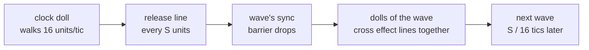
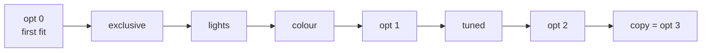
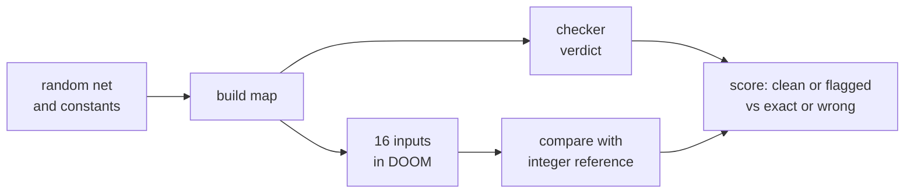

# Scheduling: waves, opt levels, the checker and the tuner

In a one-map net, a clock releases each layer's dolls in groups called waves. This page explains the waves, the four
`opt` levels that shorten them, and the checker that proves a schedule safe.

> [!IMPORTANT]
> `opt=3` puts an ACS copy bus between the layers. A script copies each layer's light levels into the next layer's
> gate heights. So "no ACS between layers" holds at `opt` 0 to 2 only. The script adds, compares and chooses nothing.

The default is `opt=0`. Every value is read back and checked at every level. Every validation pass and its command is
in [`models/schedule/`](../models/schedule): `summary.md`, `runs.csv`, `commands.txt`.

## What the schedule has to prevent

A dense layer is a crossbar. Each doll that passes its lane gate crosses one line per target. Each line adds its weight
to a sector. That sector is a light level, or a gate plane that a later layer reads.

<p align="center"></p>

Two engine facts apply ([HOW_IT_WORKS.md](HOW_IT_WORKS.md#engine-facts)):

* Two plane movers hit one sector in the same tic: the second is lost. One tic apart, both land.
* A light level takes every same-tic hit.

So dolls that write the same plane must cross their lines in different tics.



At `opt=0` each doll gets the first wave where none of its targets is taken. This is first fit. It uses `S = 64`,
`SYNC_WAIT = 400` and `CLOCK_MARGIN = 512`.

This is correct but slow. Every MNIST pixel doll hits all 64 hidden sectors. So layers 0 and 1 need 1,296 waves. They
take 91 percent of the 5,696 tics.

## Levels

| `opt` | passes | what it assumes |
|---|---|---|
| 0 | none: the original schedule | nothing; the hashes below pin its bytes |
| 1 | `exclusive`, `lights`, `colour` | only facts that hold for every input |
| 2 | opt 1 + `tuned` | timing constants from `doomformer/tuning.json`, a per-layer sync wait from the arrival model |
| 3 | opt 2 + `copy` | light accumulators and an ACS copy at each layer end |

Pick a level with `df.compile(net, opt=N)`, `df.plan(net, opt=N)` or `df.run_many(..., opt=N)`. On the command line,
`mnist`, `draw`, `demo`, `hello` and `plan` take `--opt N`.

A set of pass names selects single passes, for example `opt={"exclusive", "lights"}`. Spiking nets, learners and agents
stay at `opt=0`. Tile maps have no waves.

### Opt 0 hashes

The table pins the opt 0 bytes of six models. Default builds guard their readback. That adds ACS script 9 and a
`guard_script` entry, so both hashes changed. Geometry and arithmetic did not.

The older unguarded hashes are in `models/schedule/opt0_identity.json`. `guard=False` still builds them.

> [!TIP]
> `doomformer tune --hashes` builds the six maps without a game in about 30 s. It exits 1 on a difference.

A change to an opt 0 byte must update [`doomformer/opt0_hashes.json`](../doomformer/opt0_hashes.json) in the same
commit. `doomformer tune --update-hashes` rewrites it. Give the reason in the commit.

<details><summary><b>sha256 of the opt 0 builds</b></summary>

| model | sectors | `.wad` sha256 | `.json` sha256 |
|---|---|---|---|
| `tiny_model` | 12,620 | `9876b57a3c0c3d03c570af2e20a58c526102c69310cd629da8aeb2342cd0ff88` | `838ef05b198065dc30fec45701759d9e01c50bbee258ba22821399bccf92380d` |
| `doomnames_onemap` | 95,448 | `aa167adc8c2994294a74f76edd1c63d068b845fde8376f830217b3518494d352` | `aa7c6595a16ba703745a127796ec96e95a248f4af86affd4613a5661dfea5aef` |
| `doomnames_onemap_softmax` | 123,066 | `8e191461885f3b898197299df17ba2c23a4b2d942e980f8974cde434d07dddf4` | `b8cbdb709ebef8686411643e10e0cb7b6d9ba0189d09afd19a6eafa057b71685` |
| `doomplayer_onemap` | 37,109 | `ea1bfc483bf74ab517211062dfea2618bae90713f970bf6a735ceb2820686375` | `2eeb1bb319248f40bebfd38813184df557412b5218d0a9538a25e2271b03482c` |
| `induction_onemap` | 244,890 | `b1242572f640fee9e1de03059c67cb590aef21a44ef69ebf8a901f501e65fa0b` | `5e2b85f0d7917292fe09097419bb285c02f4310f4a0c86b7027b0153220b4093` |
| MNIST MLP (`models/mnist/mlp.npz`) | 158,550 | `503f352a44b528ae59e4ed66aa408035993e8fb32b99c4549d35f717512cc857` | `1120a86b12d33d72f65fc2c5a0580abb340799e5895560390b4b91dd297abe9f` |

</details>

Before the guard, random nets could differ from v0.4.1 at opt 0. Of 300 random MLPs (`hash_rand.py`, seeds 1000 to
1299), nets 10 and 98 built different bytes. The cause was the barrier-height fix below.

### The barrier-height fix

The barrier closes at height 13,000. It opens by lowering to the lane's walkway. On some walkway heights, the first
mover tic stops 1 to 24 units above the walkway.

The doll beside the barrier then steps onto it and rides it down. It arrives about 7 tics late. Its plane move lands in
the next wave's tic and is lost.

`doomformer fuzz` found such a net: net 591, seed 0. It has signed input and thresholds `[5748, 8058]`. It was wrong at
every `opt`.

`pure._barrier_height` now picks a safe closed height per layer. At that height no walkway sees such a stop
(`tests/test_waves.py::test_late_barrier_float_regression`). No shipped model has a walkway in that window. Nets 10 and
98 above do. They get closed heights of 12,995 and 12,993.

## The passes

Each pass adds to the previous level. The code is in `doomformer/pure.py` (`compile_pure`, `Timing`, `opt_passes`),
`doomformer/waves.py` (conflict graph, colouring) and `doomformer/explain.py` (`plan --explain`).



### Conflict graph

The vertices are one layer's dolls. Two dolls are adjacent when both can reach an effect line on a shared plane
target. A plane target is a gate floor, a gate ceiling or an action special.

A wave is a colour class. Each component of the graph is coloured separately and reuses wave numbers.

### `exclusive`

Each gate on a doll's path bounds one value from one side. So a doll's gates give an interval per value. Two dolls
with disjoint intervals can never both pass, whatever the input. They share a wave.

Examples:

* one-hot lookups (`ops.equals`, token embeddings)
* the plus and minus dolls of a signed read
* equality dolls

Only values that stay constant while the layer runs count. The pass assumes a value's two ports carry `v` and `-v`.
Every writer in the toolkit guarantees that.

### `lights`

Light targets never conflict. Two same-tic hits on one light both land
(`tests/test_waves.py::test_light_hits_in_one_tic_are_not_lost_but_plane_moves_are`). Action targets keep their
conflicts, because a user's special may move a plane.

### `colour`

DSATUR (Brelaz 1979) colours each component. It picks the vertex with the most distinct neighbour colours next. It
gives it the lowest free colour. It is exact on cliques, bipartite graphs and odd cycles.

A comparison layer (`onemap.argmax_layers`, `drawpad.with_argmax`) is the line graph of K_k. The circle method colours
it with `k - 1` colours for even `k` and `k` for odd `k`. That is the minimum.

For `k = 10` first fit gives 15 waves and the circle method 9. The result is minimal for every `k` from 2 to 20
(`tests/test_waves.py::test_comparison_layer_is_coloured_optimally`).

Each layer reports a clique lower bound in `stage_stats[i]["lower_bound"]`. At opt 1 every layer of the shipped
transformers meets it.

### `tuned`

The `Timing` constants come from `doomformer/tuning.json`. `doomformer tune` writes it ([tuning.md](tuning.md)). Each
layer's first release waits for its slowest lane doll:

```
sync_wait = lane_arrival_units(stairs, drop) + sync_margin
```

`lane_arrival_units` comes from the checker's doll model. It is 125 units on a flat lane. It is `16 sqrt(2 d) + 32` when
the first corridor floor lies `d` units below.

### `copy` (opt 3)

Each consumed value adds up in one light level. A value and its negation from `ops.output_pair` share one light. So all
of a layer's dolls hit only lights, in one wave.

At the layer's end the clock crosses a line that runs ACS script `30 + layer`. The script reads each light. It writes
the value into the gate planes with `Floor_MoveToValue` / `Ceiling_MoveToValue`. After `Timing.copy_settle` units, the
freeze lines and the next layer's start barrier follow.

Some values keep plane accumulators: values with `actions`, values in `state`, and values whose twin is not an exact
negation. Every plane the next layer reads is read back and compared. A wrong copy shows as a mismatch.

## The checker: `doomformer lint WAD`, `df.check_schedule(build)`

`doomformer/schedule.py` checks the schedule of a compiled map. It reads only the map: the `.wad` TEXTMAP and the port
keys of its `.json`.

It rebuilds every lane, gate, barrier, effect cell and clock chain. Then it replays each doll tic by tic in the engine's
16.16 fixed point. The replay covers carry push, friction, step-up and fall, move splitting and teleports.

Its predicted crossing tics match the engine's on every line compared.

| map | clock lines | lane cells | sync arrivals |
|---|---|---|---|
| hello | 66 | 74 | 7 |
| `tiny_model` | 163 | 687 | 198 |

It reports two kinds of failure.

* **Hazard.** Two dolls can both pass and move one sector's plane less than 1 tic apart. It prints a witness input.
* **Margin.** A timing margin is below its minimum: sync wait (at least 4 tics), serial, clock margin, teleport
  clearance, and at opt 3 the copy line and its settle.

```
doomformer lint WAD [--net NET] [--json]    # exit 1 on any hazard or margin
```

Seconds per model, on a loaded machine:

| model | opt 0 | opt 1 | opt 2 | opt 3 |
|---|---|---|---|---|
| MNIST | 27 | 27 | 23 | 13 |
| `doomnames_onemap` | 17 | 36 | 17 | 13 |
| softmax | 27 | 41 | 20 | 16 |
| `doomplayer_onemap` | 10 | 17 | 8 | 5 |
| `tiny_model` | 3 | 5 | 3 | 2 |

All five are clean at opt 0 and 1. So is `induction_onemap`. At opt 2 and 3 it is flagged for one margin: layer 9,
sync wait 2 tics against the minimum of 4. DOOM is exact on its prompts
(`models/schedule/revalidate/tune-check-induction-opt*.log`). So this flag is conservative.

### Plane bound

`lint --net MODEL` and `check_schedule(..., net=net)` also check an MLP's plane-move contract over all inputs. The
contract is in `doomformer/planes.py`.

A plane that starts a move beyond +-14,018 breaks it. The map alone cannot show this, because it depends on the
weights. A net whose plane reaches 15,003 fails with exit 1:

```
PLANE BOUND: -h1: a plane partial sum reaches 15003 ...
```

Without `--net`, `lint` says it cannot check this. Transformers and spiking nets are not checked for it.

### Tests

Tests in `tests/test_schedule.py`:

* A tightened `serial={0: 8}` is flagged, and its witness mismatches in DOOM.
* With the old barrier height, net 591 is flagged with witness `x0 = -8058`. DOOM fails there.
* At opt 3, `clock_margin=0` puts the copy line before the last light hit. It is flagged, and DOOM mismatches.

The tuner's `mlp24` is a 24-32-16-8 net with K = 3 (`tune.make_net("mlp24")`). At opt 1 with `Timing(serial=S)`, on 30
inputs:

| S | hazards | DOOM exact |
|---|---|---|
| 16 | 186 | 17/30 |
| 24 | 92 | 25/30 |
| 32 | 0 | 30/30 |

The checker set two shipped values:

* MNIST at opt 3 with `clock_margin = 144` is flagged. It loses 114 values in DOOM.
* `doomplayer_onemap` at opt 2 with 144 is flagged for its freeze line.

### Soundness campaign: `doomformer lint --fuzz`

Can a map the checker calls clean still be wrong in DOOM? The campaign tests that.



Code: [`doomformer/lintfuzz.py`](../doomformer/lintfuzz.py). Results:
[`models/schedule/lintfuzz-seed0/`](../models/schedule/lintfuzz-seed0) (`summary.md`, `lintfuzz.jsonl`, `commands.txt`).

Nets come from `fuzz.gen_case`. They have 1 to 4 layers, with values on thresholds and at the range edge. About one map
in seven is a mid-size MLP of up to 16-24-24-8.

Inputs seek boundaries: thresholds, thresholds +-1, extremes, zero and random values. There are two campaigns:

* **random:** per net and opt 1, 2, 3, each timing constant is redrawn with probability 1/2. The draw comes from a
  range around its failure edge.
* **edge:** per net, opt and constant (serial, clock_margin), bisect the smallest value the checker calls clean. Run
  it and one unit below it in DOOM.

| campaign | nets | maps scored | false negatives | flagged, DOOM wrong | flagged, DOOM exact | clean, exact |
|---|---|---|---|---|---|---|
| random, opt 1, 2, 3 | 983 | 2,947 | **0** | 278 | 935 | 1,734 |
| edge, opt 1, 2, 3 | 280 | 2,450 | **0** | 542 | 232 | 1,676 |

> [!NOTE]
> In all, 5,397 maps and 97,549 DOOM passes gave 0 false negatives.

Most conservative flags come from one margin. Of the 935 in the random campaign, 920 are the `sync_wait` margin alone.
Without that flag, 15 of 210 flagged maps (7 percent) run exactly.

At the edge, one unit below the clean value fails in DOOM on 66 percent of the clock_margin maps. For serial it is 73
percent. So on about two thirds of the nets, the checker's boundary is within one unit of the true one.

The checker models the barrier stop with `LOWERING_ABSORBED = 8` in `schedule.py`. A doll steps onto a lowering barrier
only when it stops more than 8 units above the walkway.

With v0.4.1's barrier height, 100 random nets ran at opt 0 and 1. The checker flags 66 of the 66 maps DOOM gets wrong.
It adds 1 conservative flag (`tests/test_schedule.py::test_small_barrier_stop_family_is_flagged`).

The rule is measured for a doll resting against the barrier. A doll arriving late at a still-lowering barrier is not
measured.

<details><summary><b>Campaign commands</b></summary>

```
doomformer lint --fuzz --nets 1000 --seed 0 --workers 6 --fuzz-out models/schedule/lintfuzz-seed0   # 11 minutes at 6 games
doomformer lint --fuzz --edge --nets 500 --seed 0 --workers 6 --fuzz-out models/schedule/lintfuzz-seed0
doomformer lint --fuzz --only 1:1 --seed 9                   # one row again (net 1, opt 1)
```

</details>

The campaign does not cover these cases.

* nets larger than 24 inputs and 4 layers, or more than 16 inputs per map.
* boundary probes of constants other than serial and clock_margin.
* nets with gated corridor layers, such as transformers.
* engine rules outside the checker's model.

## Timing constants: `doomformer tune`

`doomformer tune` finds where each timing constant starts to fail on reference nets. It writes the result to
`doomformer/tuning.json`. `doomformer tune --check` reruns the shipped values. Method and scans: [tuning.md](tuning.md).

| constant | meaning | opt 0 | edge | shipped |
|---|---|---|---|---|
| `serial` | clock distance between wave releases | 64 | 29 | 40 (2.5 tics) |
| `sync_margin` | release past the slowest predicted lane arrival | (sync_wait 400) | <= -32 | 64 (4 tics) |
| `clock_margin` (opt 2) | next layer's line past the last effect cell | 512 | 80 | 192 (12 tics) |
| `clock_margin` (opt 3) | copy line past the last effect cell | 512 | 160 | 256 |
| `corr_gap`, `tele_gap`, `chunk_lead`, `copy_settle` | | 64, 64, 16, 64 | not measured | defaults |

## `plan`'s settle estimate

`doomformer plan MODEL --opt N` prints the game tics of one pass. The format is
`about N game tics per pass, +-X %`.

The geometry counter's `estimated_settle_tics` is an upper bound. The runner's timeout uses it. It is in
`df.plan(...)["map"]`. Its error is almost the same at every opt level for one net.

The printed value follows the clock's timeline instead (`doomformer/cost.py`, `settle_estimate`). Per layer it sums these terms.

* the sync wait and `(waves - 1) * S`.
* the extra clock chunks and the corridor.
* the clock margin, and the copy settle at opt 3.

It converts at 16 map units per tic. Then it adds 4.78 tics per layer and 29.8 tics for the start. These two numbers
are least-squares fits on 44 measured settles.

The held-out rows are four random MLPs, `induction_onemap` and `doomplayer_onemap`, each at opt 0 to 3:

| | fit rows (44) | held-out rows (24) |
|---|---|---|
| calibrated: median \|error\| | 0.7 % | 0.7 % |
| calibrated: largest \|error\| | 10.1 % | 4.6 % |
| geometry bound: median \|error\| | 6.6 % | 5.4 % |
| geometry bound: range | -10.5 % to +27.6 % | -0.4 % to +27.2 % |

The band is `+-max(20 tics, 1.5 %)`. No row of either set falls outside it. Nets with many gated corridor layers or
hundreds of clock chunks are not in the held-out set.

`plan`'s predicted seconds stay on the geometry bound. The cost model was fitted on it
([scaling.md](scaling.md#cost-model)). Every row is in
[`models/schedule/plan_calibration.json`](../models/schedule/plan_calibration.json).

```
python -m doomformer.cost --refit                      # re-fits and prints the errors
python -m demos.settlecheck NETS --opts 0,1,2,3        # measures new nets in DOOM
```

## Results

The table gives measured settle tics per pass. The settle does not depend on the input. Every pass is exact against the
NumPy integer reference at tolerance 0.

Opt 2 and 3 use the shipped `tuning.json`. Counts in parentheses are exact passes. Commands are in
`models/schedule/commands.txt`, rows in `runs.csv`.

| model | opt 0 | opt 1 | opt 2 | opt 3 |
|---|---|---|---|---|
| `hello` 4-6-5-3 | 488 | 384 | 240 (5/5) | 184 (5/5) |
| 24-32-16-8 MLP, K=3 | 1,440 | 960 (30/30) | 608 (30/30) | 200 (30/30) |
| `tiny_model` | 1,800 | 1,048 (20/20) | 736 (20/20) | 512 (20/20) |
| `doomnames_onemap` | 3,488 (2/2) | 1,512 (24/24) | 1,128 (24/24) | 544 (24/24) |
| `doomnames_onemap_softmax` | 4,144 (1/1) | 2,344 (10/10) | 1,928 (10/10) | 592 (10/10) |
| MNIST map | 5,696 | 5,672 (20/20) | 3,560 (76/76) | 272 (100/100, [log](../models/schedule/revalidate/mnist-opt3-100.log)) |
| DrawPad READ pass | 5,705 | 5,681 (10/10) | 3,569 (10/10) | 273 (30/30 walked, [log](../models/schedule/revalidate/draw-opt3-30walked.log)) |
| `selfgen --loop`, `doomnames_onemap` | 4,000 | 2,080 (5/5) | 1,568 (5/5) | 768 (5/5) |

* MNIST at opt 1 gains only the comparison layer: 15 to 9 waves. Layers 0 and 1 are full cliques of 784 and 512
  dolls. Only shorter spacing helps them.
* `selfgen --loop` writes the same text as `intref.generate` at every level.
* More MNIST digits at opt 2 are in `models/schedule/revalidate/mnist-opt2-100.log`.

## Limits

* The checker's minimums for the freeze line and the copy line's own tic come from one net.
* `corr_gap`, `tele_gap`, `chunk_lead` and `copy_settle` ship their defaults, unmeasured.
* Opt 3 is not scanned for `sync_margin`.
* `doomplayer_onemap` at opt 2 is not run in DOOM. At opt 3, `demos/brainlevel.py` runs it 50 of 50 exact
  (`models/brainlevel_opt/`).
* Corridor layers keep `S = span + corr_gap`. Dolls are slower than 16 units per tic in corridors. A tighter spacing
  gave 688 certain hazards on the softmax model.
* Nothing is tested on macOS.
* There is no `--no-twins`. At opt 3 the copy pass already drops the negated twins. MNIST has 88,146 sectors at opt 3
  and 158,538 at opt 2.
