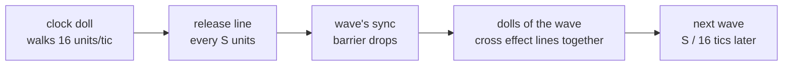
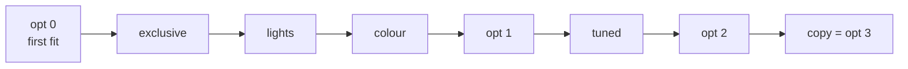
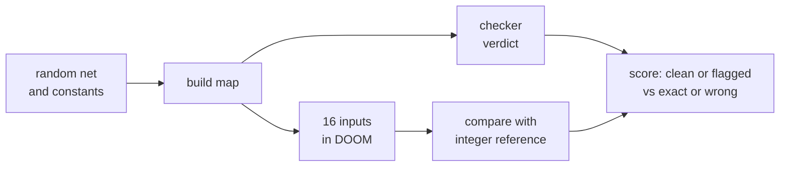

# Scheduling one-map networks

A clock releases each layer's dolls in groups called waves, four `opt` levels reduce the wave count and spacing, and a
static checker detects conflicting writes and short timing margins.

The Python API defaults to `opt=0`. Opt 0–2 need no ACS between layers, while opt 3 uses ACS to copy each layer's light
levels into the next layer's gate heights without adding, comparing or choosing values, and every level checks exposed
values against the integer reference. The measurements and commands are in [`models/schedule/`](../models/schedule/).

## Conflicting writes

A dense layer is a crossbar, where each doll that passes its lane gate crosses one line per target and each line adds
its weight to a sector, which is either a light level or a gate plane that a later layer reads.

<p align="center"></p>

Two engine facts apply ([HOW_IT_WORKS.md](HOW_IT_WORKS.md#engine-facts)):

* When two plane movers hit one sector in the same tic the second is lost, while one tic apart both land.
* A light level takes every same-tic hit.

So dolls that write the same plane must cross their lines in different tics.



At `opt=0` each doll gets the first wave where none of its targets is taken, a first-fit schedule with `S = 64`,
`SYNC_WAIT = 400` and `CLOCK_MARGIN = 512`. Every MNIST pixel doll hits all 64 hidden sectors, so at opt 0 layers 0 and
1 need 1,296 waves, which account for 91% of the 5,696-tic pass.

## Levels

| `opt` | passes | what it assumes |
|---|---|---|
| 0 | none: the original schedule | nothing; the hashes below pin its bytes |
| 1 | `exclusive`, `lights`, `colour` | only facts that hold for every input |
| 2 | opt 1 + `tuned` | timing constants from `doomformer/tuning.json`, a per-layer sync wait from the arrival model |
| 3 | opt 2 + `copy` | light accumulators and an ACS copy at each layer end |

A level is picked with `df.compile(net, opt=N)`, `df.plan(net, opt=N)` or `df.run_many(..., opt=N)`, and on the command
line `mnist`, `draw`, `demo`, `hello` and `plan` take `--opt N`. A set of pass names selects single passes, for example
`opt={"exclusive", "lights"}`, while spiking nets, learners and agents stay at `opt=0` and tile maps have no waves.

### Opt 0 hashes

These SHA256 hashes identify opt 0 builds of six models. Default builds include readout script 9 and the `guard_script`
metadata entry for detecting stale values, which changed the hashes without changing geometry or arithmetic, and
`guard=False` reproduces the older builds in `models/schedule/opt0_identity.json`.

> [!TIP]
> `doomformer tune --hashes` builds the six maps without a game in about 30 s and exits 1 on a difference.

When an opt 0 build changes, update [`doomformer/opt0_hashes.json`](../doomformer/opt0_hashes.json) with
`doomformer tune --update-hashes` and explain the change in the commit.

<details><summary><b>sha256 of the opt 0 builds</b></summary>

| model | sectors | `.wad` sha256 | `.json` sha256 |
|---|---|---|---|
| `tiny_model` | 12,620 | `9876b57a3c0c3d03c570af2e20a58c526102c69310cd629da8aeb2342cd0ff88` | `838ef05b198065dc30fec45701759d9e01c50bbee258ba22821399bccf92380d` |
| `doomnames_onemap` | 95,448 | `aa167adc8c2994294a74f76edd1c63d068b845fde8376f830217b3518494d352` | `aa7c6595a16ba703745a127796ec96e95a248f4af86affd4613a5661dfea5aef` |
| `doomnames_onemap_softmax` | 123,066 | `8e191461885f3b898197299df17ba2c23a4b2d942e980f8974cde434d07dddf4` | `b8cbdb709ebef8686411643e10e0cb7b6d9ba0189d09afd19a6eafa057b71685` |
| `doomplayer_onemap` | 37,109 | `ea1bfc483bf74ab517211062dfea2618bae90713f970bf6a735ceb2820686375` | `2eeb1bb319248f40bebfd38813184df557412b5218d0a9538a25e2271b03482c` |
| `induction_onemap` | 244,890 | `b1242572f640fee9e1de03059c67cb590aef21a44ef69ebf8a901f501e65fa0b` | `5e2b85f0d7917292fe09097419bb285c02f4310f4a0c86b7027b0153220b4093` |
| MNIST MLP (`models/mnist/mlp.npz`) | 158,550 | `503f352a44b528ae59e4ed66aa408035993e8fb32b99c4549d35f717512cc857` | `1120a86b12d33d72f65fc2c5a0580abb340799e5895560390b4b91dd297abe9f` |

</details>

Of 300 random MLPs (`hash_rand.py`, seeds 1000–1299), nets 10 and 98 differed from v0.4.1 before the readout change,
because of the barrier-height fix.

### The barrier-height fix

The barrier closes at height 13,000 and opens by lowering to the lane's walkway, but on some walkway heights the first
mover tic stops 1 to 24 units above the walkway. The doll beside the barrier then steps onto it and rides it down,
arriving about 7 tics late, so its plane move lands in the next wave's tic and is lost.

`doomformer fuzz` found such a net (net 591, seed 0, signed input and thresholds `[5748, 8058]`), which was wrong at
every `opt`.

`pure._barrier_height` now picks a safe closed height per layer at which no walkway sees such a stop
(`tests/test_waves.py::test_late_barrier_float_regression`). No shipped model has a walkway in that window, but nets 10
and 98 above do, and they get closed heights of 12,995 and 12,993.

## The passes

Each pass adds to the previous level. The code is in `doomformer/pure.py` (`compile_pure`, `Timing`, `opt_passes`),
`doomformer/waves.py` (conflict graph, colouring) and `doomformer/explain.py` (`plan --explain`).



### Conflict graph

The vertices are one layer's dolls, and two dolls are adjacent when both can reach an effect line on a shared plane
target, which is a gate floor, a gate ceiling or an action special. A wave is a colour class, and each component of the
graph is coloured separately and reuses wave numbers.

### `exclusive`

Each gate on a doll's path bounds one value from one side, so a doll's gates give an interval per value. Two dolls with
disjoint intervals can never both pass, whatever the input, which lets them share a wave, as in these cases:

* one-hot lookups (`ops.equals`, token embeddings)
* the plus and minus dolls of a signed read
* equality dolls

Only values that stay constant while the layer runs count, and the pass assumes that a value's two ports carry `v` and
`-v`, which every writer in the toolkit guarantees.

### `lights`

Light targets never conflict, because two same-tic hits on one light both land
(`tests/test_waves.py::test_light_hits_in_one_tic_are_not_lost_but_plane_moves_are`), while action targets keep their
conflicts because a user's special may move a plane.

### `colour`

DSATUR (Brelaz 1979) colours each component by picking next the vertex with the most distinct neighbour colours and
giving it the lowest free colour, which is exact on cliques, bipartite graphs and odd cycles.

A comparison layer (`onemap.argmax_layers`, `drawpad.with_argmax`) is the line graph of K_k, which the circle method
colours with the minimum of `k - 1` colours for even `k` and `k` for odd `k`.

For `k = 10` first fit gives 15 waves and the circle method 9, and the result is minimal for every `k` from 2 to 20
(`tests/test_waves.py::test_comparison_layer_is_coloured_optimally`). Each layer reports a clique lower bound in
`stage_stats[i]["lower_bound"]`, which every layer of the shipped transformers meets at opt 1.

### `tuned`

The `Timing` constants come from `doomformer/tuning.json`, which `doomformer tune` writes ([tuning.md](tuning.md)), and
each layer's first release waits for its slowest lane doll:

```
sync_wait = lane_arrival_units(stairs, drop) + sync_margin
```

`lane_arrival_units` comes from the checker's doll model and is 125 units on a flat lane, or `16 sqrt(2 d) + 32` when
the first corridor floor lies `d` units below.

### `copy` (opt 3)

Each consumed value adds up in one light level, and a value and its negation from `ops.output_pair` share one light,
so all of a layer's dolls hit only lights, in one wave.

At the layer's end the clock crosses a line that runs ACS script `30 + layer`, which reads each light and writes the
value into the gate planes with `Floor_MoveToValue` / `Ceiling_MoveToValue`, and after `Timing.copy_settle` units the
freeze lines and the next layer's start barrier follow.

Values with `actions`, values in `state` and values whose twin is not an exact negation keep plane accumulators. Every
plane the next layer reads is read back and compared, so a wrong copy shows as a mismatch.

## The checker: `doomformer lint WAD`, `df.check_schedule(build)`

`doomformer/schedule.py` checks the schedule of a compiled map from the map alone, meaning the `.wad` TEXTMAP and the
port keys of its `.json`. It reconstructs lanes, gates, barriers, effect cells and clock chains and then replays each
doll tic by tic in 16.16 fixed point, with a model that includes carry push, friction, steps, falls, move splitting and
teleports, and its predicted crossing tics match every compared engine crossing:

| map | clock lines | lane cells | sync arrivals |
|---|---|---|---|
| hello | 66 | 74 | 7 |
| `tiny_model` | 163 | 687 | 198 |

The checker reports two kinds of failure:

* Hazard: two dolls can both pass and move one sector's plane less than 1 tic apart, and it prints a witness input.
* Margin: a timing margin is below its minimum, for the sync wait (at least 4 tics), serial, clock margin, teleport
  clearance, and at opt 3 the copy line and its settle.

```
doomformer lint WAD [--net NET] [--json]    # exit 1 on any hazard or margin
```

These are the checker's seconds per model on a loaded machine:

| model | opt 0 | opt 1 | opt 2 | opt 3 |
|---|---|---|---|---|
| MNIST | 27 | 27 | 23 | 13 |
| `doomnames_onemap` | 17 | 36 | 17 | 13 |
| softmax | 27 | 41 | 20 | 16 |
| `doomplayer_onemap` | 10 | 17 | 8 | 5 |
| `tiny_model` | 3 | 5 | 3 | 2 |

The five models and `induction_onemap` pass at opt 0 and 1. At opt 2 and 3, `induction_onemap`'s layer 9 has a 2-tic
sync wait against the checker's 4-tic minimum, although its tested prompts still compute exactly
(`models/schedule/revalidate/tune-check-induction-opt*.log`).

### Plane bound

`lint --net MODEL` and `check_schedule(..., net=net)` check an MLP's plane-move bounds over all inputs
(`doomformer/planes.py`), because a plane must start each move within ±14,018, and this check needs the model weights as
well as the map. A network reaching 15,003 fails with exit 1:

```
PLANE BOUND: -h1: a plane partial sum reaches 15003 ...
```

Without `--net`, `lint` says it cannot check this, and transformers and spiking nets are not checked for it.

### Tests

`tests/test_schedule.py` covers three cases:

* A tightened `serial={0: 8}` is flagged, and its witness mismatches in DOOM.
* With the old barrier height, net 591 is flagged with witness `x0 = -8058`, where DOOM fails.
* At opt 3, `clock_margin=0` puts the copy line before the last light hit, which is flagged and mismatches in DOOM.

The tuner's `mlp24` is a 24-32-16-8 net with K = 3 (`tune.make_net("mlp24")`), and at opt 1 with `Timing(serial=S)` on
30 inputs it gives:

| S | hazards | DOOM exact |
|---|---|---|
| 16 | 186 | 17/30 |
| 24 | 92 | 25/30 |
| 32 | 0 | 30/30 |

The checker set two shipped values:

* MNIST at opt 3 with `clock_margin = 144` is flagged and loses 114 values in DOOM.
* `doomplayer_onemap` at opt 2 with 144 is flagged for its freeze line.

### Randomized checker tests: `doomformer lint --fuzz`

`doomformer lint --fuzz` compares static predictions with DOOM execution on randomly generated maps.



The code is in [`doomformer/lintfuzz.py`](../doomformer/lintfuzz.py), and the results are in
[`models/schedule/lintfuzz-seed0/`](../models/schedule/lintfuzz-seed0) (`summary.md`, `lintfuzz.jsonl`, `commands.txt`).

Nets come from `fuzz.gen_case` with 1 to 4 layers and values on thresholds and at the range edge, and about one map in
seven is a mid-size MLP of up to 16-24-24-8. Inputs cover thresholds, thresholds ±1, extremes, zero and random values,
and two search modes vary the timing:

- random: for each network and opt 1, 2, 3, redraw each constant with probability 1/2 from a range around its
  failure edge.
- edge: for each network, opt and constant (`serial`, `clock_margin`), bisect the smallest value the checker accepts
  and run it and one unit below in DOOM.

| mode | nets | maps scored | false negatives | flagged, DOOM wrong | flagged, DOOM exact | clean, exact |
|---|---|---|---|---|---|---|
| random, opt 1, 2, 3 | 983 | 2,947 | **0** | 278 | 935 | 1,734 |
| edge, opt 1, 2, 3 | 280 | 2,450 | **0** | 542 | 232 | 1,676 |

Across 5,397 maps and 97,549 DOOM passes, the checker missed no failures. Of 935 conservative flags in random mode, 920
concern only `sync_wait`, and without that margin 15 of 210 flagged maps (7%) run exactly.

One unit below the accepted boundary fails in DOOM on 66% of `clock_margin` maps and 73% of `serial` maps.

The checker models the barrier stop with `LOWERING_ABSORBED = 8` in `schedule.py`, since a doll steps onto a lowering
barrier only when it stops more than 8 units above the walkway. With v0.4.1's barrier height, 100 random nets ran at
opt 0 and 1, and the checker flags 66 of the 66 maps DOOM gets wrong while adding 1 conservative flag
(`tests/test_schedule.py::test_small_barrier_stop_family_is_flagged`). The rule is measured for a doll resting against
the barrier, not for a doll arriving late at a still-lowering barrier.

<details><summary><b>Commands</b></summary>

```
doomformer lint --fuzz --nets 1000 --seed 0 --workers 6 --fuzz-out models/schedule/lintfuzz-seed0   # 11 minutes at 6 games
doomformer lint --fuzz --edge --nets 500 --seed 0 --workers 6 --fuzz-out models/schedule/lintfuzz-seed0
doomformer lint --fuzz --only 1:1 --seed 9                   # one row again (net 1, opt 1)
```

</details>

The runs cover networks up to 24 inputs and 4 layers with 16 test inputs per map, and the boundary searches cover
`serial` and `clock_margin`, while gated corridor layers, including transformers, and engine behavior outside the
checker's model are left out.

## Timing constants: `doomformer tune`

`doomformer tune` finds where each timing constant starts to fail on reference nets and writes the result to
`doomformer/tuning.json`, while `doomformer tune --check` reruns the shipped values ([tuning.md](tuning.md) has the
method and scans).

| constant | meaning | opt 0 | edge | shipped |
|---|---|---|---|---|
| `serial` | clock distance between wave releases | 64 | 29 | 40 (2.5 tics) |
| `sync_margin` | release past the slowest predicted lane arrival | (sync_wait 400) | <= -32 | 64 (4 tics) |
| `clock_margin` (opt 2) | next layer's line past the last effect cell | 512 | 80 | 192 (12 tics) |
| `clock_margin` (opt 3) | copy line past the last effect cell | 512 | 160 | 256 |
| `corr_gap`, `tele_gap`, `chunk_lead`, `copy_settle` | | 64, 64, 16, 64 | not measured | defaults |

## `plan`'s settle estimate

`doomformer plan MODEL --opt N` prints the game tics of one pass as `about N game tics per pass, +-X %`.

`df.plan(...)["map"]["estimated_settle_tics"]` estimates from geometry and sets the runner's timeout, and its error is
similar across opt levels for a given network.

The printed value follows the clock's timeline instead (`doomformer/cost.py`, `settle_estimate`), summing these terms
per layer:

* the sync wait and `(waves - 1) * S`.
* the extra clock chunks and the corridor.
* the clock margin, and the copy settle at opt 3.

It converts at 16 map units per tic and then adds 4.78 tics per layer and 29.8 tics for the start, two numbers that are
least-squares fits on 44 measured settles.

The held-out rows are four random MLPs, `induction_onemap` and `doomplayer_onemap`, each at opt 0 to 3:

| | fit rows (44) | held-out rows (24) |
|---|---|---|
| calibrated: median \|error\| | 0.7 % | 0.7 % |
| calibrated: largest \|error\| | 10.1 % | 4.6 % |
| geometry bound: median \|error\| | 6.6 % | 5.4 % |
| geometry bound: range | -10.5 % to +27.6 % | -0.4 % to +27.2 % |

The band is `+-max(20 tics, 1.5 %)`, and no row of either set falls outside it, although nets with many gated corridor
layers or hundreds of clock chunks are not in the held-out set.

`plan`'s predicted seconds stay on the geometry bound because the cost model was fitted on it
([scaling.md](scaling.md#cost-model)), and every row is in
[`models/schedule/plan_calibration.json`](../models/schedule/plan_calibration.json).

```
python -m doomformer.cost --refit                      # re-fits and prints the errors
python -m demos.settlecheck NETS --opts 0,1,2,3        # measures new nets in DOOM
```

## Results

These are measured settle tics per pass, and every pass matches the NumPy integer reference at zero tolerance. Opt 2
and 3 use `tuning.json`, parentheses give exact-pass counts, and the commands are in `models/schedule/commands.txt`
with the measurements in `runs.csv`.

| model | opt 0 | opt 1 | opt 2 | opt 3 |
|---|---|---|---|---|
| `hello` 4-6-5-3 | 488 | 384 | 240 (5/5) | 184 (5/5) |
| 24-32-16-8 MLP, K=3 | 1,440 | 960 (30/30) | 608 (30/30) | 200 (30/30) |
| `tiny_model` | 1,800 | 1,048 (20/20) | 736 (20/20) | 512 (20/20) |
| `doomnames_onemap` | 3,488 (2/2) | 1,512 (24/24) | 1,128 (24/24) | 544 (24/24) |
| `doomnames_onemap_softmax` | 4,144 (1/1) | 2,344 (10/10) | 1,928 (10/10) | 592 (10/10) |
| MNIST map | 5,696 | 5,672 (20/20) | 3,560 (76/76) | 272 (100/100, [log](../models/schedule/revalidate/mnist-opt3-100.log)) |
| DrawPad READ pass | 5,705 | 5,681 (10/10) | 3,569 (10/10) | 273 (30/30 walked, [log](../models/schedule/revalidate/draw-opt3-30walked.log)) |
| `selfgen --loop`, `doomnames_onemap` | 4,000 | 2,080 (5/5) | 1,568 (5/5) | 768 (5/5) |

* MNIST at opt 1 gains only in the comparison layer, from 15 to 9 waves, because layers 0 and 1 are full cliques of 784
  and 512 dolls that only shorter spacing helps.
* `selfgen --loop` writes the same text as `intref.generate` at every level.
* More MNIST digits at opt 2 are in `models/schedule/revalidate/mnist-opt2-100.log`.

There is no `--no-twins` option, because opt 3's copy pass already removes negated twins, which leaves MNIST with 88,146
sectors at opt 3 against 158,538 at opt 2.
