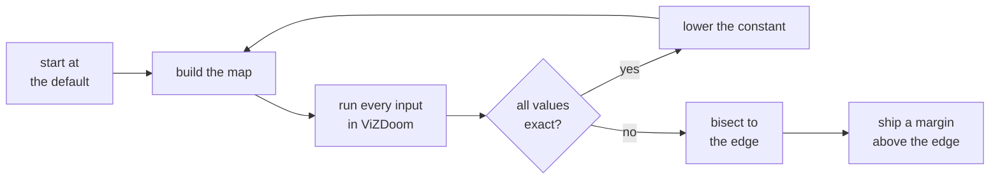

# Tuning the one-map schedule

`doomformer tune` finds how far timing constants can be reduced while keeping map outputs exact, and it writes
[`tuning.json`](../doomformer/tuning.json), whose `shipped` values opt 2 uses and whose `shipped_copy` values opt 3 adds
on top. The implementation is in [`doomformer/tune.py`](../doomformer/tune.py).

Constants live in `pure.Timing`, measured in clock-doll map units, about 16 per game tic.

## Method



The tuner changes one constant at a time, holding the rest at their defaults or, with `--shipped-others`, at their
shipped values. It runs every input in ViZDoom and compares exposed values with the integer reference at zero
tolerance. The scan descends until an input fails and then bisects the passing/failing interval, and the edge is the
smallest tested value at and above which every reference network passes.

MLPs get four extremes, seeded random vectors and boundary vectors at `±(t + d)` for threshold `t` and
`d` in 0, 1, 10, 23, 24. Transformers get three extremes and random token lists, within 23 of an embedding threshold.

Identical maps and inputs reuse results, new maps also get the static checker's `predicted_slack`, and the shipped
values add a margin:

| constant | shipped value | rounded up to |
|---|---|---|
| serial | 1.25 x edge | 8 |
| sync_margin | max(64, 1.25 x edge) | 8 |
| clock_margin (opt 2) | 2 x edge | 8 |
| clock_margin (opt 3) | max(256, 1.25 x edge) | 16 |

A constant without a measured edge ships its default value.

## Results

Reference networks are hello, mlp24 (24-32-16-8 K3), tiny_model and the softmax fixture, with 49, 49, 33 and 33 inputs.
These scans use shipped values for the other constants, as opt 2 and opt 3 do, and the logs are in
[`models/schedule/revalidate/`](../models/schedule/revalidate).

| constant | what it spaces | default | largest failing | edge | shipped |
|---|---|---|---|---|---|
| serial | consecutive releases | 64 | 20 (mlp24 31 of 49) | 24 (1.5 tics) | 40 (2.5 tics) |
| sync_margin | release past the slowest lane arrival | none (sync_wait 400) | none down to -64 | at most -64 | 64 (4 tics) |
| clock_margin (opt 2) | next layer's line past the last effect | 512 | 72 (tiny_model 6 of 33) | 80 (5 tics) | 192 (12 tics) |
| clock_margin (opt 3) | copy line past the last effect | 512 | 144 (mlp24 48 of 49) | 160 (10 tics) | 256 |
| corr_gap, tele_gap, chunk_lead | | 64, 64, 16 | not measured | | defaults |
| copy_settle (opt 3) | | 64 | not measured | | 64 |

Every shipped value is at least 1.5 times its measured edge.

- With other constants at their defaults, `clock_margin` has an edge of 72 and `serial` an edge of 29, but with shipped
  constants 72 fails on tiny_model, which is the interaction `--shipped-others` measures.
- `clock_margin` ships at 192 rather than the rule's 160, because the static checker needs up to 176 units on MNIST and
  flags doomplayer_onemap at 144. A doll starting from rest lags about 154 units plus a tic, and 192 rounds that bound
  up to 16 and adds 16.
- At opt 3, a short `clock_margin` copies light levels before the last crossbar hits, so at 128 MNIST and mlp24 lose
  values.
- `serial=40` keeps releases half a tic beyond a plane mover's 2-tic lifetime, since releases less than 2 tics apart can
  share a tic.
- Opt 2 and above wait for the slowest lane doll (`pure.lane_arrival_units`) and then add `sync_margin`, because a fixed
  `sync_wait=64` lost a score on every doomnames_onemap prompt, as the checker predicted.
- `corr_gap` stays at its default because it bounds same-target hits across geometries, and values down to -59 pass on
  tiny_model only.

`tuning.json` keeps the serial rows of an older scan with the others at their defaults (edge 29), while the rows with
the others shipped are in the logs above.

## Joint runs

Joint runs use all shipped constants with input seed 200 + network index.

| schedule | hello | mlp24 | tiny_model | softmax fixture | doomnames_onemap |
|---|---|---|---|---|---|
| opt 2 | 29/29, 240 tics | 29/29, 608 | 13/13, 736 | 13/13, 1,120 | 3/3, 1,128 |
| opt 3 | 29/29, 184 | 29/29, 200 | 13/13, 512 | 13/13, 568 | not run |

At opt 1 with the default constants, the first four nets take 384, 960, 1,048 and 1,488 tics.

## `tune --check`

`tune --check` builds opt 2 maps from `tuning.json`, runs reference networks on a separate input stream and trained
models on their prompts, and exits 1 on a mismatch.

> [!TIP]
> `doomformer tune --check --trained --inputs 30 --workers 2 --no-predict`

| run | passes exact | time | log |
|---|---|---|---|
| opt 2, 9 nets | 331 of 331 | 5.6 min | `tune-check-opt2.log` |
| opt 3 (`--copy`), 6 nets | 169 of 169 | 4.1 min | `tune-check-opt3.log` |
| `induction_onemap`, opt 2 | 3 of 3, 2,160 tics | | `tune-check-induction-opt2.log` |
| `induction_onemap`, opt 3 | 3 of 3, 944 tics | | `tune-check-induction-opt3.log` |

The static checker flags `induction_onemap`'s 2-tic sync wait against its 4-tic minimum, although all six tested passes
are exact.

## Commands

<details><summary><b>Commands behind each result</b></summary>

```
doomformer tune --const serial --shipped-others --scan-top 48 --resolution 4
doomformer tune --const clock_margin --nets hello,mlp24,tiny,softmax --inputs 30 --shipped-others --scan-top 128 --resolution 8 --workers 3
doomformer tune --copy --const clock_margin --shipped-others --scan-top 256 --resolution 16
doomformer tune --coarse --const sync_margin --nets hello,signed,tiny --inputs 10 --workers 1
doomformer tune --joint --no-predict --nets hello,mlp24,tiny,softmax,doomnames_onemap --inputs 10 --workers 1
doomformer tune --joint --copy --no-predict --nets hello,mlp24,tiny,softmax --inputs 10 --workers 1
doomformer tune --hashes           # opt 0 sha256 of six models against doomformer/opt0_hashes.json (no game)
doomformer tune --check            # the committed constants at opt 2 on fresh inputs
```

</details>

A `copy_settle` below 1 at opt 3 raises a `ValueError` naming `Timing.copy_settle`.
