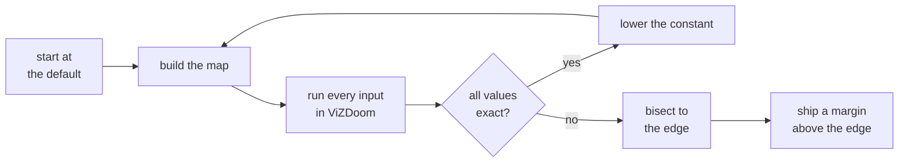

# Tuning the one-map schedule

A one-map pass runs on a schedule of timing constants. This page shows how small each constant can get before values
go wrong, and what ships.

`doomformer tune` ([`doomformer/tune.py`](../doomformer/tune.py)) finds those edges. It writes
[`doomformer/tuning.json`](../doomformer/tuning.json). `--opt 2` builds with its `shipped` constants.
`--opt 3` adds `shipped_copy` (`pure.Timing.tuned`).

The constants live in `pure.Timing`. Their unit is the map unit of the clock doll, about 16 units per game tic.

## Method



- Change one constant. Keep the others at their defaults, or at their shipped values with `--shipped-others`.
- Run every input through the map in ViZDoom. Compare every exposed value with the NumPy integer reference.
- The tolerance is 0. A value fails on a net if any input mismatches.
- MLP inputs: 4 extremes, boundary vectors and seeded random inputs.
- A boundary vector puts every unit at `+-(t + d)`. Here `t` is an input threshold and `d` is 0, 1, 10, 23 or 24.
- Transformer inputs: 3 extremes and random token lists. Every token lies within 23 of an embedding threshold.
- The scan descends from the default until an input fails. It then bisects between failing and passing values.
- edge: the smallest tested value at and above which every net passes every input.
- Game tics are simulated. The same map bytes and inputs give the same readback, so repeated maps reuse results.
- Each new map also gets the static checker's prediction (`doomformer.schedule.check_schedule`, `predicted_slack`).

The shipped rule:

| constant | shipped value | rounded up to |
|---|---|---|
| serial | 1.25 x edge | 8 |
| sync_margin | max(64, 1.25 x edge) | 8 |
| clock_margin (opt 2) | 2 x edge | 8 |
| clock_margin (opt 3) | max(256, 1.25 x edge) | 16 |

A constant without an edge ships its default.

## Results

Nets: hello, mlp24 (24-32-16-8 K3), tiny_model and the softmax fixture. They get 49, 49, 33 and 33 inputs.
Edges are measured with the other constants shipped, as opt 2 and opt 3 build them.
Logs: [`models/schedule/revalidate/`](../models/schedule/revalidate).

| constant | what it spaces | default | largest failing | edge | shipped |
|---|---|---|---|---|---|
| serial | consecutive releases | 64 | 20 (mlp24 31 of 49) | 24 (1.5 tics) | 40 (2.5 tics) |
| sync_margin | release past the slowest lane arrival | none (sync_wait 400) | none down to -64 | at most -64 | 64 (4 tics) |
| clock_margin (opt 2) | next layer's line past the last effect | 512 | 72 (tiny_model 6 of 33) | 80 (5 tics) | 192 (12 tics) |
| clock_margin (opt 3) | copy line past the last effect | 512 | 144 (mlp24 48 of 49) | 160 (10 tics) | 256 |
| corr_gap, tele_gap, chunk_lead | | 64, 64, 16 | not measured | | defaults |
| copy_settle (opt 3) | | 64 | not measured | | 64 |

> [!NOTE]
> Every shipped value is at least 1.5 times its edge.

- **One at a time is not enough.** With the others at their defaults, the clock_margin edge is 72. The serial edge
  is 29. With the others shipped, 72 fails on tiny_model. `--shipped-others` scans the combined schedule.
- **clock_margin ships 192, over the rule's 160.** The static checker needs up to 176 units on MNIST. It flags
  doomplayer_onemap at 144.
- A doll starting from rest lags about 154 units plus a tic. 192 is that bound rounded up to 16, plus 16.
- **opt 3 clock_margin.** Too small a value fires the copy line before a long crossbar's last light hits.
  At 128, MNIST and mlp24 lose values.
- **serial.** Two releases can share a tic below 2 tics. 40 stays half a tic above a plane mover's 2-tic lifetime.
- **sync_margin.** At opt 2 and above, each layer waits for its slowest lane doll (`pure.lane_arrival_units`).
  It then adds sync_margin. A constant sync_wait of 64 lost one score value on every doomnames_onemap prompt.
  The checker predicted that.
- **corr_gap is not tuned.** Only corr_gap bounds the gap between same-target hits for any geometry.
  Negative values pass on tiny_model down to -59, but only for that geometry.

`tuning.json` keeps the serial rows of an older scan, with the others at their defaults (edge 29).
The rows with the others shipped are in the logs above.

## Joint runs

All shipped constants run together on fresh inputs. The seed is 200 + net index.

| schedule | hello | mlp24 | tiny_model | softmax fixture | doomnames_onemap |
|---|---|---|---|---|---|
| opt 2 | 29/29, 240 tics | 29/29, 608 | 13/13, 736 | 13/13, 1,120 | 3/3, 1,128 |
| opt 3 | 29/29, 184 | 29/29, 200 | 13/13, 512 | 13/13, 568 | not run |

At opt 1 with the default constants, the first four nets take 384, 960, 1,048 and 1,488 tics.

## `tune --check`

`tune --check` builds opt 2 maps from the committed `tuning.json`. It runs every reference net on fresh inputs.
The trained models run their prompts. It exits 1 on any mismatch.

> [!TIP]
> `doomformer tune --check --trained --inputs 30 --workers 2 --no-predict`

| run | passes exact | time | log |
|---|---|---|---|
| opt 2, 9 nets | 331 of 331 | 5.6 min | `tune-check-opt2.log` |
| opt 3 (`--copy`), 6 nets | 169 of 169 | 4.1 min | `tune-check-opt3.log` |
| `induction_onemap`, opt 2 | 3 of 3, 2,160 tics | | `tune-check-induction-opt2.log` |
| `induction_onemap`, opt 3 | 3 of 3, 944 tics | | `tune-check-induction-opt3.log` |

The static checker flags `induction_onemap` for a sync wait of 2 tics against a minimum of 4.
DOOM does not bear that out.

## Commands

<details><summary><b>Commands behind each result</b></summary>

```
doomformer tune --const serial --shipped-others --scan-top 48 --resolution 4
doomformer tune --const clock_margin --nets hello,mlp24,tiny,softmax --inputs 30 --shipped-others --scan-top 128 --resolution 8 --workers 3
doomformer tune --copy --const clock_margin --shipped-others --scan-top 256 --resolution 16
doomformer tune --coarse --const sync_margin --nets hello,signed,tiny --inputs 10 --workers 1
doomformer tune --joint --no-predict --nets hello,mlp24,tiny,softmax,doomnames_onemap --inputs 10 --workers 1
doomformer tune --joint --copy --no-predict --nets hello,mlp24,tiny,softmax --inputs 10 --workers 1
doomformer tune --hashes           # opt 0 sha256 of six models against doomformer/opt0_hashes.json (no game)
doomformer tune --check            # the committed constants at opt 2 on fresh inputs
```

</details>

## Limits

- Not tested on macOS or other ViZDoom versions.
- The trained models in `--check` run 2 or 3 prompts, not 30 inputs.
- A `copy_settle` below 1 at opt 3 raises a `ValueError` naming `Timing.copy_settle`.
