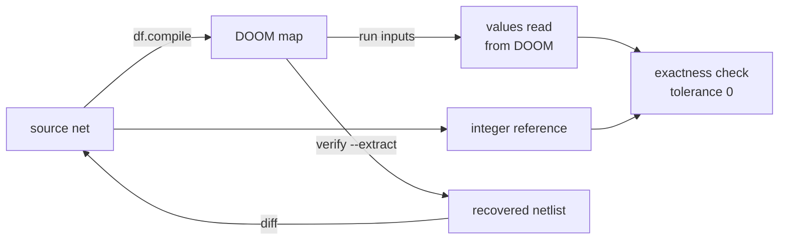
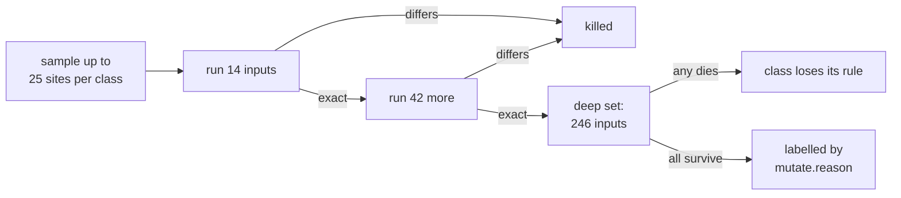

# Verification

Doomformer checks every value DOOM computes against an integer reference. This page explains what that check covers,
and how `fuzz`, `fuzz --mutate`, `verify` and static extraction test the check itself.

> [!NOTE]
> An exact run proves equality for the inputs that ran. It proves nothing about inputs that did not run.

Records are in [models/verify/](../models/verify/) and [models/extract/](../models/extract/).



| tool | what it varies | what it shows |
|---|---|---|
| exactness check | nothing: runs on every pass | DOOM equals the reference on this input |
| [`fuzz`](#doomformer-fuzz) | random nets and inputs | the compiler is exact on many nets |
| [`fuzz --mutate`](#doomformer-fuzz---mutate) | one site of a compiled map | which map changes the check notices |
| [`verify`](#doomformer-verify) | every input class of a small MLP | the whole input domain, under one assumption |
| [static extraction](#static-extraction) | no inputs: reads the `.wad` | the map holds the source's weights and contract |

## What is compared

Every pass compares each value the map exposes with `intref`. The tolerance is 0.

This holds for `brain(x)`, `brain.logits(tokens)`, `brain.step(spikes)` and `df.run_many`.

| net | exposed values |
|---|---|
| MLP | output lights, every hidden light `h{l}_{j}`, every hidden gate floor `-h{l}_{j}` |
| transformer | every pre-activation, score, softmax and RMSNorm intermediate, and logit |

<p align="center"></p>

Three guards keep the check from getting weaker:

* **Name set.** A pass must read back exactly the names the lowering exposes. Otherwise it raises `df.ReadoutError`.
  The lists come from `MLP.exposed_names()` and `onemap.exposed_names()`.
* **Readout guard.** Before each readout page, an ACS script writes a poison value into every USER slot. Python checks
  the poison is there, then that the page replaced it.
* **Range check.** `df.compile(transformer)` runs `intref.check_limits` before building. A failure raises `RangeError`.

The poison is `GUARD_NONCE = 100_003` in `tile.py`. A dropped guard or page raises `RuntimeError`, even when an input
repeats. The guard is on by default for one-map, spiking and tile maps.

The guard costs one tic per page. It changes no game state. Maps that hold results for a fixed window size it from the
guarded readout. So the machines and the brain-level demos keep their tics per step.

`guard=False` opts out and builds the older unguarded maps. The fly loop stays unguarded on purpose. Its 9 pages would
take 18 tics, and its hold window is 16 tics of world time. There a dropped page is caught only when stale values differ.

The range check covers the parameters and `kit.limit_sequences(net)`. That is every single token after BOS, plus 48
seeded random sequences. A one-map `brain.logits(tokens)` also checks each sequence before it runs.

`limits=False` skips both range checks. Tile brains do not check sequences.

The check compares DOOM with what the lowering says it computes. It does not compare against the float model. That is
the job of `quantization_report`. A value the map does not expose is not compared.

## The plane-move bound

In one map, a value that feeds a gate is a plane height. Dolls move it with `Floor_`/`Ceiling_RaiseByValue` and
`LowerByValue` lines. The mover speed is 150,000, which is 18,750 units per tic.

A move that starts above 14,018 units still ends at the right height. That bound is 32,768 - 18,750. But the mover then
stays busy for 3 tics, and a move requested in tics 1 and 2 is dropped.

Waves keep moves on one plane at least 4 tics apart. So only moves outside the bound are lost.

| plane | move | starts fine at | busy from |
|---|---|---|---|
| floor | raise | 14,018 | 14,019 |
| floor | lower | -14,017 | -14,018 |
| ceiling | raise | 14,017 | 14,018 |
| ceiling | lower | -14,018 | -14,019 |

Source: `doomformer facts --only mover_busy` ([log](../models/verify/mover_busy_probe.txt),
[longer sweep](../models/verify/mover_busy_edges.txt)). The miscompile it caused is in
[What the fuzzer found](#what-the-fuzzer-found).

**The contract.** Take a plane with bias `b`, raised by `P` in total and lowered by `N` in total. It needs
`b + P <= 14,018` when `P > 0`, and `b - N >= -14,018` when `N > 0`.

`P` is the whole sum of raises. So the rule is stricter than the engine by at most one weight. Nets from `from_numpy`
and `from_torch` stay inside: they keep `|b| + sum|W| K` at most 12,000.

Three places enforce it:

| where | what it checks |
|---|---|
| `net.check(x)` | every pass of a one-map brain, and `run_many` in map mode |
| `df.compile(net)`, map mode | an MLP over all inputs, a transformer over `kit.limit_sequences`; raises `RangeError` |
| `SpikingBrain.step` | each step before it runs, since the potentials are state |

Tile maps have no doll-moved planes, so tile brains call `check(x, planes=False)`. `limits=False` skips the compile
check. `net.check(x)` still refuses the inputs.

### Bias sweep

`doomformer verify --plane-sweep` runs the replay net with the check bypassed. "peak" is the rule's `b + P`
([record](../models/verify/plane_bias_sweep.json)).

| bias | peak | `check` | DOOM `-h1_0` | reference | |
|---|---|---|---|---|---|
| -12,000 | 12,012 | accepts | 9,717 | 9,717 | exact |
| -12,001 | 12,013 | accepts | 9,718 | 9,718 | exact |
| -14,006 | 14,018 | accepts | 11,723 | 11,723 | exact |
| -14,007 | 14,019 | refuses | 11,724 | 11,724 | exact (the rule is one move conservative) |
| -14,009 | 14,021 | refuses | 11,726 | 11,726 | exact (fourth raise starts at 14,018) |
| -14,010 | 14,022 | refuses | 11,982 | 11,727 | differs by 255 (fourth raise starts at 14,019) |
| -14,282 | 14,294 | refuses | 12,254 | 11,999 | differs by 255 (the replay) |

Schedule levels 0, 1 and 2 give the same rows. The one exception: the replay reads 12,251 at opt 2.

Level 3 is exact on every row ([record](../models/verify/plane_bias_sweep_opt3.json)). It copies each hidden light into
its plane with one `Floor_MoveToValue`, so no doll moves the plane. The check does not know `opt` and refuses at every
level.

Shipped transformers stay inside. Over `kit.limit_sequences`, the largest plane partial sum is 13,224 in
`doomnames_modern`. The others stay under 10,000.

`doomnames_modern` runs only in tiles. Over its whole corpus the largest partial sum is 14,848. A one-map build would
break the rule on some names.

### Where a plane may start

A floor port's sector has its ceiling at 16,000 (`CEIL`, `tile.py`). A ceiling port's sector has its floor at -15,000
(`FLOOR_PIT`, `pure.py`).

The map is built with each plane at its bias, so the first pass is exact. The reset script's
`Floor_MoveToValue`/`Ceiling_MoveToValue` stops at those clamps. A plane that starts beyond them is wrong on every
later pass:

| floor start | opt 0, 1, 2 | opt 3 |
|---|---|---|
| 16,000 | exact | exact |
| 16,001 | off by 1: DOOM 11,920, reference 11,921 | exact |
| 16,010 | off by 10 | exact |
| 17,000 | off by 1,000 | exact |

Repro: `MLP([[[255,255,255,255]],[[-255]]], [[-16001],[0]], [[10,20,30,40],[100]], signed_input=False)` at
`x = [45]*4` ([log](../models/verify/plane_start_probe.txt)). Opt 3 sets each plane with one move from the light.

Floors have no clamp below. A reset that lowers a floor more than 37,500 units reads a wrapped height. That is three
mover steps. With a previous final value of 12,000, it is any start below -25,500.

| net | start bound |
|---|---|
| every plane | `START_MIN = -15,000`, `START_MAX = 16,000`, safe for floors and ceilings |
| MLP | the twin `-h` starts at `-bias`, so a hidden bias lies in `[-16,000, 15,000]` |
| transformer | every bias is at most 255 in magnitude (`W_MAX`) |
| spiking | a state starts within +-12,000 (`V_MAX`) |

`check`, the compile check and `check_limits(planes=True)` enforce it through `planes.start_errors`.

## Coverage: how many of the reference's values does a pass compare

`df.coverage(brain_or_net)` lists every value the integer reference defines for one pass. For each, it reports whether
the map reads it back and the check compares it.

The CLI is `doomformer verify --coverage NET [--tiles]`. The module is `doomformer/exposure.py`.

The reference side comes from `net.reference(x)`, `IntNet.step` or `intref.forward`. It never uses the lowering. So a
lowering that stops exposing a value shows up.

For one-map brains and MLP tiles, the comparison is measured. The readback is replayed once per name, with that value
changed by 1. The name counts as `detected` only if the check raises `MismatchError` naming it.

| MNIST, input zeros | one map | tiles |
|---|---|---|
| reference values (119 hidden pre-activations, 10 outputs) | 129 | 129 |
| negated twins | 119 | 119 |
| compared | 248 of 248 | 248 of 248 |
| change by 1 detected | 248 of 248 | 248 of 248 |
| not exposed: staircase counts, gate comparisons | 903, 1,351 | 903, 1,351 |

Records: [one map](../models/verify/coverage_mnist_map.json), [tiles](../models/verify/coverage_mnist_tiles.json).

`tests/test_exposure.py` fails if the compared count drops below the reference total. It covers an MLP, a spiking net
and a transformer, in one map and in tiles. A negative control drops one readout name and requires the report to name it.

Spiking maps read back spikes and potentials. Their twin planes `-s` feed only the synapse gates. They are listed as not
exposed.

## Method: translation validation

Each compile is followed by a validation of that one compiler run. Pnueli, Siegel and Singerman call this translation
validation:

> "each individual translation (i.e. a run of the compiler) is followed by a validation phase which verifies that the
> target code produced on this run correctly implements the submitted source program"

Source: A. Pnueli, M. Siegel, E. Singerman, *Translation validation*, TACAS 1998, LNCS 1384, pp. 151-166,
<https://link.springer.com/chapter/10.1007/BFb0054170>.

Their validator builds a refinement proof. Doomformer's validator is a test. It runs the map on chosen inputs and
compares with the source semantics.

A test can find a wrong translation. It proves nothing about inputs it did not run. `verify` closes that gap for small
nets, under one assumption. `fuzz` samples many nets. Related work: [related_work.md](related_work.md).

## `doomformer fuzz`

`doomformer fuzz` compiles random nets and runs them in DOOM. It compares every exposed value with the reference.

> [!TIP]
> `doomformer fuzz --nets 40` takes seconds. `doomformer fuzz --nets 12 --plant gate-gt` must fail: it plants a bug.

```text
doomformer fuzz --nets 40 --seed 0 --workers 3          # MLPs
doomformer fuzz --kind transformer --nets 100 --workers 3 --inputs 3
doomformer fuzz --kind spiking --nets 100
doomformer fuzz --edge --nets 500                       # weights +-255, hidden values at +-12,000, thresholds at 12,000,
                                                        # hidden planes at the plane-move bound
doomformer fuzz --edge --nets 5000 --seed random --workers 6   # a fresh seed, printed ("fuzz: random seed N")
doomformer fuzz --edge --nets 5000 --tiles              # MLPs in tile mode (one game per layer)
doomformer fuzz --replay fuzz-failures.json             # re-run the cases saved by a failing run
doomformer fuzz --nets 12 --plant gate-gt               # self-test: must exit 1
doomformer fuzz --nets 300 --opt 1                      # the compiler's schedule level (when df.compile has `opt`)
```

Each worker compiles a net into a temporary WAD and starts a game. It runs the net's inputs, then closes the game.

A mismatch, an unexpected exception or a dead worker is a failure. The run exits with status 1. Failing cases go to a
replay file (`--save-failures`, default `fuzz-failures.json`).

The summary goes to `--json`. It records `opt`, `tiles` and `source_sha256`, a hash of every `doomformer/*.py` used.

Net `i` of seed `S` comes from `SeedSequence([S, i, kind])`. So a case does not depend on the worker count. To rerun one
net, use `--seed S --start i --nets 1`.

MLPs compile with `limits=False`. The fuzzed contract is that DOOM agrees on every input `net.check` accepts. A net whose
inputs are all refused is reported as `refused`, not as a pass.

<details><summary><b>What the generators draw</b></summary>

| generator | draws |
|---|---|
| MLP shape | depth 1 to 4, 1 to 5 inputs, widths 1 to 8, signed or unsigned input |
| MLP parameters | 1 to 4 thresholds per staircase with duplicates, weights up to +-255 |
| MLP range edge: a quarter of the nets, every `--edge` net | many weights at +-255, biases up to +-12,000, thresholds at 12,000 or 11,999 |
| MLP bias shifts | biases up to about +-14,300 |
| MLP inputs | zero, +-1, +-12,000, random, `t-1, t, t+1` around each first-layer threshold |
| MLP targeted inputs | a hidden unit on a later threshold or on +-12,000; a plane sum 0 to 3 inside the bound |
| `--edge` plane starts | twin planes that start 0 to 9 units inside `[-15,000, 16,000]` |
| `--edge` high starts, about 5 % of nets | a unit-0 plane that starts in [15,000, 16,000] and only lowers |
| transformer variants | all 8 combinations of `attn` relu/softmax, `norm` none/rms, `mlp` relu/reglu |
| transformer shape | 1 to 2 layers, `d` 1 to 4, `H` 1 to 2, `T` 2 to 3 |
| transformer vocabulary and weights | 3 to 5 tokens, weights +-3 |
| spiking | 2 to 6 neurons, 1 to 3 inputs, theta 2 to 8, leak 0 to 2, 8 steps |
| spiking `--edge` | thresholds of 2,000 to 12,000, weights up to 255 |
| all-zero layers, 3 % of MLPs | `df.compile` must raise `ValueError`; reported as `unsupported` |

`--edge` does not change transformers. Refused inputs are counted, not run.

`--edge --tiles` draws inputs with the tile-mode range check, which has no plane rule. Only `tests/test_planes.py` tests
the per-pass transformer plane check at the edge.

</details>

**Planted bugs.** `--plant NAME` patches one lowering function. It tests the harness itself.

| bug | change |
|---|---|
| `gate-gt` | `x > t` instead of `x >= t` at an input gate |
| `w255` | weight lines clamp at 254 |
| `bias-twin` | the negated twin of a negative hidden bias is off by one |
| `dup-thr` | duplicate thresholds collapse |

`tests/test_verification.py` runs 12 nets per bug and requires a mismatch for each. CI runs `fuzz --nets 40`, then
requires `fuzz --nets 12 --plant gate-gt` to fail.

On v0.7.1, `fuzz --nets 40 --seed 0 --workers 2` gives these results:

| nets | passes | values | mismatches | refused inputs | `gate-gt` planted |
|---|---|---|---|---|---|
| 40 | 306 | 5,958 | 0 | 60 | 10 of 12 nets mismatch |

### Results

Every campaign below has 0 mismatches. No run had an error.

`values` counts the exposed values compared at tolerance 0. Nets with an all-zero layer count as `unsupported`, not as
passes.

| kind | campaigns | largest | log |
|---|---|---|---|
| MLP | 23 runs, plain and edge, opt 0, 1, 3 and tiles | v2 edge total: 15,000 nets, 1,987,632 values, 0 mismatches | tables below |
| transformer | 3 runs, all 8 variants | 100 nets, 60,890 values, 0 mismatches | tables below |
| spiking | 4 runs, plain and edge | 200 edge nets, 105,936 values, 0 mismatches | tables below |

v2 ran on a snapshot after the plane-move fix (`source_sha256` 28a519c0c52354a0), not on the tagged v0.6.0. Its
1,000-net chunk files `v2/edge_MODE_seedS_cC.json` do not record `start`.

<details><summary><b>MLP campaigns, per seed</b></summary>

| campaign | tree | seed | nets | passes | values | mismatches | log |
|---|---|---|---|---|---|---|---|
| plain | v0.5.0 | 0 | 2,000 | 15,374 | 276,594 | 0 | [fuzz_mlp.json](../models/verify/fuzz_mlp.json) |
| edge | v0.5.0 | 1 | 500 | 3,799 | 68,750 | 0 | [fuzz_mlp_edge.json](../models/verify/fuzz_mlp_edge.json) |
| plain, opt 1 | v0.5.0 | 2 | 300 | 2,317 | 40,620 | 0 | [fuzz_mlp_opt1.json](../models/verify/fuzz_mlp_opt1.json) |
| plain, opt 3 | v0.5.0 | 3 | 300 | 2,280 | 38,892 | 0 | [fuzz_mlp_opt3.json](../models/verify/fuzz_mlp_opt3.json) |
| v2 edge, opt 0 | v0.6.0 | 1546066799 | 2,000 | 15,162 | 269,363 | 0 | [v2/](../models/verify/v2/) |
| v2 edge, opt 3 | v0.6.0 | 78056607 | 2,000 | 15,091 | 262,458 | 0 | [v2/](../models/verify/v2/) |
| v2 edge, tiles | v0.6.0 | 1712291335 | 2,000 | 15,211 | 258,873 | 0 | [v2/](../models/verify/v2/) |
| v2 edge, opt 0 | v0.6.0 | 1659255519 | 2,000 | 15,167 | 267,664 | 0 | [v2/](../models/verify/v2/) |
| v2 edge, opt 3 | v0.6.0 | 1705628535 | 2,000 | 15,073 | 261,365 | 0 | [v2/](../models/verify/v2/) |
| v2 edge, tiles | v0.6.0 | 570427258 | 1,000 | 7,603 | 134,524 | 0 | [v2/](../models/verify/v2/) |
| v2 edge, opt 0 | v0.6.0 | 1447945148 | 1,000 | 7,526 | 129,867 | 0 | [v2/](../models/verify/v2/) |
| v2 edge, opt 3 | v0.6.0 | 1090071893 | 1,000 | 7,563 | 130,583 | 0 | [v2/](../models/verify/v2/) |
| v2 edge, tiles | v0.6.0 | 327667345 | 1,000 | 7,650 | 140,626 | 0 | [v2/](../models/verify/v2/) |
| v2 edge, opt 0 | v0.6.0 | 1382960168 | 1,000 | 7,559 | 132,309 | 0 | [v2/](../models/verify/v2/) |
| **v2 total** | | 10 seeds | **15,000** | **113,605** | **1,987,632** | **0** | |
| v3 edge, opt 0 | v0.6.1 | 2109258237 | 1,000 | 7,598 | 136,241 | 0 | `v2/edge_opt0_seed2109258237_c0_r3.json` |
| v3 edge, opt 3 | v0.6.1 | 19503025 | 1,000 | 7,508 | 133,202 | 0 | `v2/edge_opt3_seed19503025_c0_r3.json` |
| v3 edge, tiles | v0.6.1 | 1794520407 | 1,000 | 7,576 | 133,036 | 0 | `v2/edge_tiles_seed1794520407_c0_r3.json` |
| v4 edge, opt 0 | v0.7.1 | 326047183 | 1,000 | 7,380 | 132,757 | 0 | `v2/edge_opt0_seed326047183_c0_r5.json` |
| v4 edge, opt 3 | v0.7.1 | 1732841896 | 500 | 3,643 | 63,945 | 0 | `v2/edge_opt3_seed1732841896_c0_r5.json` |
| v4 edge, tiles | v0.7.1 | 959462705 | 500 | 3,759 | 63,461 | 0 | `v2/edge_tiles_seed959462705_c0_r5.json` |
| CI edge, opt 0 | v0.7.0 | 2084419975 | 1,000 | 7,611 | 132,715 | 0 | [run 40747096084](https://github.com/mottopanikeiku/doomformer/actions/runs/40747096084) |
| CI edge, opt 3 | v0.7.0 | 1544036178 | 1,000 | 7,555 | 132,904 | 0 | same run |
| CI edge, tiles | v0.7.0 | 1245050383 | 300 | 2,281 | 40,699 | 0 | same run |

</details>

<details><summary><b>Transformer and spiking campaigns</b></summary>

Transformer, all 8 variants:

| campaign | tree | seed | nets | passes | values | mismatches | log |
|---|---|---|---|---|---|---|---|
| `--inputs 3` | v0.5.0 | 0 | 100 | 297 | 54,675 | 0 | [fuzz_transformer.json](../models/verify/fuzz_transformer.json) |
| `--inputs 3` | v0.6.0 | 31338 | 100 | 297 | 60,890 | 0 | `v2/transformer_100_seed31338.json` |
| CI | v0.7.0 | 1366333554 | 20 | 60 | 11,269 | 0 | [run 40747096084](https://github.com/mottopanikeiku/doomformer/actions/runs/40747096084) |

Spiking:

| campaign | tree | seed | nets | passes | values | mismatches | log |
|---|---|---|---|---|---|---|---|
| plain | v0.5.0 | 0 | 100 | 800 | 6,432 | 0 | [fuzz_spiking.json](../models/verify/fuzz_spiking.json) |
| plain | v0.6.0 | 31337 | 300 | 2,400 | 19,016 | 0 | `v2/spiking_300_seed31337.json` |
| edge | v0.7.1 | 317167311 | 200 | 12,794 | 105,936 | 0 | `v2/spiking_edge_200_seed317167311.json` |
| CI | v0.7.0 | 485719738 | 100 | 800 | 6,304 | 0 | [run 40747096084](https://github.com/mottopanikeiku/doomformer/actions/runs/40747096084) |

In the spiking edge run, 67 of the 200 nets reach |v| >= 10,000. The largest is 11,999. The plane start bound is
approached but not crossed, since the check forbids it.

</details>

CI runs `fuzz --edge --nets 60 --seed random --workers 2` on every push. `.github/workflows/fuzz.yml` runs a longer
campaign every Monday with random seeds.

The weekly campaign covers opt 0, opt 3, tiles, spiking and transformers. Each step prints `fuzz: random seed N`. A
failing step uploads its replay file. Reproduce a failing seed with `--seed N`.

### What the fuzzer found

Each row is a failure a fuzz run reported. All are fixed.

| found by | failure | cause | fix |
|---|---|---|---|
| `fuzz --nets 2000 --seed 0`, net 591 | `-h1_0: DOOM -1461 != reference -1305` | a barrier that needs two mover tics left a doll one tic late, and a plane move was lost | per-layer barrier height in `pure.py` |
| `fuzz --edge --nets 500 --seed 1`, net 246 | `-h1_0: DOOM -255 != reference -510` | the same | the same |
| `fuzz --edge --nets 400 --seed 902`, net 5, v0.5.0 | DOOM 12,254, reference 11,999 | the plane-move bound: a raise started above 14,018 and one lower was lost | [new contract](#the-plane-move-bound); regression `tests/test_planes.py` |
| `fuzz --kind transformer --nets 6 --seed 0`, net 4 | `L0.zu:0:1: DOOM 0 != reference -4` | a gated unit with an all-zero `Wdn` column kept its gate port, read from a missing sector | `ops.gated` |
| the transformer generator | `check_limits` raised | empty level sets: softmax with `R * len(thr_v) == 1`, `d == 1` | `intref.check_limits` |

The failing nets:

```text
net 591: MLP([[[156]],[[3]]], [[1617],[0]], [[5748,8058],[11999]]) at x = -12000
net 246: thresholds [5740, 11999], W = 255, x = 12000
net 5:   MLP([[[3,255,255,0,255]],[[-255]]], [[-14282],[185]], [[713,1423,3182,11867],[8540]])
         at x = [-12000, 5933, 6252, -353, 11483]
```

Replays: [net 591](../models/verify/replay_mlp_seed0_net591.json), [net 246](../models/verify/replay_mlp_edge_seed1_net246.json),
[net 5](../models/verify/replay_mlp_edge_seed902_net5.json).

The barrier replays are exact at `--opt 0`, `1` and `3`. The failing runs are kept as `fuzz_mlp_2000_before_fix.json`
and `fuzz_mlp_edge_before_fix.json`.

In net 5 the plane starts at 14,282. Four dolls raise it by 3, and nine lower it by 255. Every partial sum was inside
the old contract.

Net 5's replay now reports one pass and 18 refused inputs. The transformer fix is pinned by
`test_gated_unit_with_a_zero_wdn_column_has_no_stray_port`.

## `doomformer fuzz --mutate`

Mutation analysis changes one site of a compiled map. Then it checks whether the exactness check notices.

<p align="center"></p>

```text
doomformer fuzz --mutate --per-class 25 --workers 3 --seed 0 --controls --json models/verify/mutation_v2.json
doomformer fuzz --mutate --tile K        # operation tile K of the tile-mode lowering
doomformer fuzz --mutate --learning      # the online perceptron map of doomformer.learn
```

The default target is the map of a 3-4-3 two-layer MLP. It is `mutate.demo_net()`, with 1,222 sectors.

| site | mutation |
|---|---|
| linedef special argument | +-1 |
| linedef special number | raise <-> lower |
| effect line | retargeted |
| sector floor, ceiling, light | +-1 |
| ACS integer literal | +-1, recompiled with acc |
| `>> 16` of a plane readout | `>> 15` |

Each mutant goes through these steps:



The 14 inputs are zero, +-1, +-12,000, threshold neighbours and random ones. A mutant is also killed when the game fails
to start, crashes or does not settle.

The deep set runs up to 6 survivors per class. Its 246 inputs are 150 random ones at four scales, and 96 threshold
neighbours.

A class with a deep-set kill loses its rule by family (`ctx["demoted"]`). The rules in `mutate.reason` are expectations
from the design, not proofs.

| target | sites | run | killed | kill rate | survivors without a rule | record |
|---|---|---|---|---|---|---|
| 3-4-3 net, one map | 5,578 | 1,004 | 297 | 29.6 % | 0, plus 117 input gaps | [mutation_v2.json](../models/verify/mutation_v2.json) |
| tile 0 (layer 0) | 1,926 | 893 | 245 | 27.4 % | 8 (`acs-other` 4, `acs-reset` 4) | [mutation_tile0.json](../models/verify/mutation_tile0.json) |
| tile 1 (layer 1) | 1,034 | 779 | 189 | 24.3 % | 9 (`acs-other` 4, `acs-reset` 5) | [mutation_tile1.json](../models/verify/mutation_tile1.json) |
| perceptron, learning map | 5,911 | 923 | 190 | 20.6 % | 74 | [mutation_learning.json](../models/verify/mutation_learning.json) |

The kill rate is not a quality score. Of the 707 survivors on the 3-4-3 map, 590 are labelled equivalent.

On that map, 40 classes went through the deep set. It killed 3 more mutants.

The tile and learning rows have not been through the deep set. The 8 and 9 unexplained tile survivors are unclassified
ACS literals.

Survivors by class on the 3-4-3 map ([test pins](../tests/test_mutation_rules.py)):

| class | result | label | evidence |
|---|---|---|---|
| weights: light and plane weight lines and tags, effect sign, effect target, script number, doll TID, start-barrier tag | every sampled site killed | none needed | |
| walking floors (`sector-floor-walk:*`) | 117 survive 14 inputs; 4 die on the deep set, all in `FLOOR4_8/192` | **input gap** | lowering a walkway by 1 moves that lane's threshold by one ([record](../models/verify/mutation_input_gaps.json)) |
| scroller args | survive | equivalent: the belt is 4 stacked scrollers | removing 1 or 2 is exact, removing 3 or 4 fails |
| freeze line tag and arg3, `special 37` | survive | equivalent on forward nets: no late doll | removing all 3 is exact; 6 of 8 die on the learning map |
| wave barrier reset, tag or sign flag | survive | equivalent by control only, no known mechanism | removing the first reset is exact, every other fails |
| freeze reset flag 1 -> 2 | survive | identical mutant: any nonzero flag negates the height | |
| `sector-ceiling-gate`, `sector-floor-gate` | survive | equivalent only while planes stay within +-10,000 (`mutate.PLANES_LOW`) | plane-edge table below |
| barrier, mover-speed, move-to and output heights, unread lights, high ceilings, motion script, unused ACS arguments | survive | equivalent by rule | |

The gate labels are conditioned. A gate ceiling of 16,000 clamps a plane that starts there.

On [plane_edge_net.npz](../models/verify/plane_edge_net.npz), every site of each class ran on 151 inputs
([log](../models/verify/mutation_plane_edge_labels.txt)):

| class | sites | killed on the plane-edge net |
|---|---|---|
| `sector-ceiling-gate` | 56 | 1 (`heightceiling 16000 -> 15999`) |
| `sector-floor-gate` | 56 | 6 (the three planes' start heights +-1) |
| `sector-floor-barrier`, `sector-ceiling-barrier` | 80 + 80 | 0 |
| `plane-mover-speed`, `barrier-speed`, `move-to-speed` | 80 + 58 + 8 | 0 |
| `move-to-height`, `sector-floor-output`, `sector-ceiling-output` | 8 + 10 + 10 | 0 |

On the learning map, many weight and target lines survive 40 examples. A perceptron updates only on a mistake. A line
is crossed only when its feature is on. So these survivors are a gap in the examples.

Planted compiler bugs (`fuzz --plant`) are the complementary test. They change the compiler, not the map.

## `doomformer verify`

`verify` runs every input class of a small MLP. Under one assumption, that covers its whole input domain.

```text
doomformer verify net.npz                               # --mode classes over |x| <= 12,000 for every input
doomformer verify net.npz --mode all --domain -40 40    # every input of the box
doomformer verify net.npz --wad tampered.wad            # check a given compiled map: a changed weight line fails
doomformer verify --validate 20                         # classes == all on 20 small nets; tampered maps fail both
```

`net.npz` is an `MLP.save` file. There are two modes:

* `all` runs every integer input of the box `[lo, hi]^n_in` that `net.check` accepts.
* `classes` runs one pass per input class and per threshold neighbourhood.

The default box is the legal range `[-12000, 12000]`. Only a one-input net can enumerate it: 24,001 runs.

**Why classes cover the domain.** The map sees an input `x_i` only through its staircase count
`a_i = adc(x_i, thresholds[0])`.

Every later layer, weight line and readout depends only on the count vector `a`. So do the reference and `net.check`,
apart from `|x_i| <= 12,000`.

`a_i` is constant between the breakpoints of the first layer's thresholds. These are `t`, and `1 - t` for signed input.
So the box splits into the product of the per-input classes.

`verify` runs both end points of every class. For each input and breakpoint, it also runs `t-1, t, t+1`. The other inputs
stay at 0. It reports how many domain inputs the runs stand for.

**The assumption (A).** DOOM's result on `x` equals its result on the class representative. This holds if the engine
sees `x` only through the counts.

That needs two facts. Each gate comparison is a correct integer comparison for every `|x| <= 12,000`. 16.16 fixed
point is exact there. And port moves finish within 2 tics at any distance. `all` needs no assumption.

**What `VERIFIED` means.** Every listed input reproduced the reference in every exposed value, at tolerance 0. This
holds for this compiled map in this engine build.

With `all`, that is every input of the box. With `classes`, it covers the box under A.

It says nothing about the float model the net was quantised from. It says nothing about unexposed values, other engine
versions or the ACS of other maps. Inputs outside the box, or refused by the range check, never run.

The run is deterministic only as far as ZDoom is.

### `--validate`: classes against all

`doomformer verify --validate 20 --seed 0` builds 20 small random MLPs. They have 1 to 3 layers, 1 or 2 inputs, and
weights +-9 ([record](../models/verify/verify_validate.json)).

A tampered map has its first `Light_RaiseByValue` / `Light_LowerByValue` line raised by 1.

| | result |
|---|---|
| `classes` verdict equals `all` verdict | 20 of 20 nets |
| clean maps `VERIFIED` by both | 20 of 20 |
| tampered maps `FAILED` by both | 20 of 20 |
| runs: `classes` / `all` | 808 / 105,724 |

Nets 0 and 1 have one input and span the whole domain `[-12000, 12000]`. There `all` ran 24,001 inputs, against 14 and
8 `classes` runs.

The other 18 nets use small boxes that contain every breakpoint. This validates A on these 20 nets only.

## Static extraction

Static extraction reads the net back out of a compiled map, without running DOOM. Then it compares it with the source.

```text
doomformer verify --extract net.wad --net net.npz      # no game: read the net out of the map, compare, exit 1 on a difference
doomformer extract --dump net.wad                      # the recovered netlist per layer, the checks, FINDING and NOT CHECKED lines
```

`extract` reads only the TEXTMAP and the BEHAVIOR lump of the `.wad`. `Netlist.diff(net)` compares the recovered MLP
with the source. It needs no input, so it covers weight lines that no run reaches.

**What EQUAL means.** The arithmetic netlist matches the source. So do the plane contract and the items marked "read"
below.

The plane contract is `planes.plane_errors()` on the recovered net. EQUAL says nothing about timing, unlisted triggers
or readout slot names. Both commands print the `NOT CHECKED:` list.

The extractor imports nothing from the lowering code (`doomformer/extract.py`, module docstring). It does not read the
`.json` that `compile` writes. So port names like `x{i}` are not checked against the map.

**Method.** Lanes are found from the start barriers. The tag is 2 for layer 0, and 60000 + s for layer s.

Each lane is walked along x, through its two-sided linedefs. A lane gives its port, its gate limit and the ordered effect
lines behind the gate. The gate limit is the walkway floor plus 24. The threshold is its negation.

Per layer, the lines sum into rows. A hidden unit writes the light of `h` and the plane of `-h`. An output writes its
light.

A bias is the start height of the plane, or the start level of the light. A small ACS interpreter decodes the opt 3
copy scripts, scripts 1, 2, 3, 4, 7 and the readout pages.

<details><summary><b>What extraction reads, item by item</b></summary>

| item | status |
|---|---|
| layer count and widths, weights per lane, biases, thresholds of every layer including the input staircase | read; compared lane by lane |
| signed or relu input | read as the port structure: pairs `-x`, `x` with equal gates and negated lines |
| twin accumulators: light of `h`, plane of `-h` | read; start values and lane amounts must agree with each other and the net |
| opt 3 accumulators | one light; the copy script is decoded |
| units no later weight reads | read when their row has a nonzero weight |
| plane contract | read: `plane_errors()` on the recovered net; an unread unit has no plane |
| line specials of weight, release, freeze, script-start and teleport lines and conveyor scrollers | read: class, tag, all five arguments, mover speed |
| trigger flags of those lines | read: exactly `playercross` and `repeatspecial`, two-sided |
| mover speeds | read: 150,000 to 262,144 accepted |
| two-sided lines without flags | read |
| weight lines outside every lane; blocking two-sided lines; other line specials | read: findings |
| teleport destinations | read: one thing with that id, inside a lane or clock sector, spawning in single player |
| reset script (3) | read: restores every light, internal plane, barrier and freeze walkway to its TEXTMAP value exactly once |
| reset script (3), dolls | read: sends each doll to a destination of the right id in its home sector, at an allowed speed |
| scripts 1, 2, 4, 7 | read: port writers, TID script and layer-0 release produce the specials the runtime relies on |
| readout pages (100 and up) | read: together they read every light and internal plane exactly once |
| copy scripts (opt 3) and their start lines | read |
| lane geometry | read: sector specials, conveyor tag, steps up of at most 24, headroom of 56, closed sector boundaries |
| barriers and things | read: barriers block closed and open to a walkable step; one doll per home plus the player; thing flags |
| wave, start and freeze barriers | read: released |
| vertex coordinates, sidedefs, textures; lane lengths, wave spacing, clock chain positions | not read (timing and geometry) |
| other sectors' light and ceiling; thing angles, coop and dm flags, positions inside a home | not read |
| motion script 8, guard script 9, world scripts | not read |
| all-zero inputs, unread hidden units with a zero row, leading all-zero output rows | not in the map; `expected_netlist` drops them too |
| tile maps, transformer maps, other maps | `ExtractError` |

A relu net whose input columns come in negated pairs looks like a signed net. So `equals` compares in the port form of
the net, under its own `signed_input`.

An unread unit with a zero row leaves two lights. They are compared as a multiset of start values.

The teleport destination's place in the clock chain is not read. Neither are the names behind the readout slots.

</details>

### Extraction mutation score

`python models/extract/mutation_score.py --opt N` changes one field of a compiled map, then reads the map back. The map
is a 3-4-3 signed MLP (`small_net()`, 24 doll lanes).

| field | edit |
|---|---|
| TEXTMAP integer | +1, and sign flip when not 0 |
| float coordinate | +1 |
| true linedef or thing flag | set false |
| BEHAVIOR byte | +1 |

DIFF means a difference, a finding or `ExtractError`. Two undetected edits per field kind then ran in DOOM, on 12 inputs
at tolerance 0. `SAME` means every pass was exact.

| | opt 0 | opt 3 |
|---|---|---|
| edits | 23,622 | 19,754 |
| detected (difference, finding or `ExtractError`) | 17,906 | 14,890 |
| undetected (EQUAL) | 5,716 | 4,864 |
| undetected edits run in DOOM (12 inputs, tolerance 0) | 50 | 48 |
| ... DOOM caught it (mismatch) | 0 | 0 |
| ... DOOM error (no settle, exception) | 0 | 0 |
| ... DOOM crash or hang | 0 | 0 |
| ... SAME: exact on all 12 inputs | 50 | 48 |

Every edit of the other 66 field kinds is detected. They include every weight, bias and threshold field. They also
include every sector tag, every thing type and id, and the special number, tag, arguments and flags of every line class.

<details><summary><b>Undetected edits by field kind</b></summary>

Each cell is undetected / edits of that kind. Every sampled one was SAME in DOOM.

| field kind | opt 0 | opt 3 | why it stays EQUAL |
|---|---|---|---|
| BEHAVIOR: bytes of scripts 1, 2, 3, 7, copy scripts, readout pages | 114 / 1,241 | 72 / 1,012 | a mover speed edited inside 150,000 to 262,144; at opt 3, 8 of 72 change no script output |
| BEHAVIOR: legacy ACS0 script directory | 92 / 92 | 104 / 104 | not used behind the ACSe header; the extractor reads the chunk table |
| BEHAVIOR: motion script 8 | 236 / 279 | 243 / 292 | not read (runtime settle only for maps with 4,096 or more objects) |
| linedef blocking flag off | 952 / 952 | 814 / 814 | one-sided lines block anyway |
| linedef sidedef index | 511 / 3,527 | 442 / 2,975 | another sidedef of the same sector (boundaries still close) |
| mover speed +1 (lines 20, 21, 23, 37) | 75 / 336 | 5 / 197 | inside the accepted range 150,000 to 262,144 |
| sector floor and ceiling | 697 / 1,721 | 559 / 1,466 | ground ceilings with more headroom, floors within the step rule, lights, closets, input gates (written by Python) |
| sector light level | 868 / 880 | 730 / 742 | sectors that are not accumulators |
| sector special | 2 / 441 | 2 / 372 | world room and closets (not part of the machine) |
| thing angle, coop and dm flags | 159 / 635 | 159 / 635 | not read |
| thing position +1 | 106 / 106 | 106 / 106 | still inside the home sector; not read |
| vertex coordinates | 1,904 / 1,904 | 1,628 / 1,628 | geometry and timing, not read |

</details>

### Extraction results

`python models/extract/campaign.py --nets N --seed S --opt K [--edge]` compiles random MLPs. It extracts each map and
compares it with its net. Records are in [models/extract/](../models/extract/).

A violation is an equal netlist that breaks the plane contract. It compiles only with `limits=False`.

| campaign | nets | compiled | failures | equal, contract ok | violations | record |
|---|---|---|---|---|---|---|
| seed 0, opt 0 | 500 | 490 | 0 | 484 | 6 | [json](../models/extract/fuzz_seed0_opt0.json) |
| seed 0, opt 1, 2, 3 each | 200 | 199 | 0 | 196 | 3 | |
| seed 1 `--edge`, opt 0 and 3 each | 200 | 200 | 0 | 191 | 9 | |

The 10 nets that did not compile have an all-zero layer.

| check | command | result |
|---|---|---|
| plane start -16,001, outside [-15,000, 16,000] | `doomformer verify --extract bad.wad --net bad.npz` | netlist equal, `plane contract: 1 violation(s)`, `NOT EQUAL`, exit 1 |
| shipped MNIST net (784-64-45-10-10) | `doomformer verify --extract mnist_opt0.wad --net models/mnist/mlp.npz` | opt 0, 1, 2, 3: EQUAL, plane contract ok ([log](../models/extract/mnist.txt)) |
| negative controls, fuzz net 10 of seed 0 (2-5-5-7-3, signed) | `python models/extract/controls.py --fuzz-seed 0 --index 10 --opt 0` (3) | 19 controls at opt 0, 18 at opt 3, all detected ([opt 0](../models/extract/controls_fuzz_idx10_opt0.txt), [opt 3](../models/extract/controls_fuzz_idx10_opt3.txt)) |
| negative controls, MNIST | `python models/extract/controls.py --net models/mnist/mlp.npz` | the same 19 controls, all detected ([log](../models/extract/controls_mnist.txt)) |
| the fuzz-net controls in DOOM | `doomformer verify net10.npz --wad CONTROL.wad` (61 runs each) | 15 of 19 FAILED ([log](../models/extract/controls_fuzz_idx10_opt0_dynamic.txt)) |
| static EQUAL against DOOM, opt 0 | `python models/extract/doom_pair.py --seed 0 --indices 1 5 6 10 14 17 24 33 --opt 0` | 8 nets: 64 passes and 2,160 values exact ([json](../models/extract/doom_pair_opt0.json)) |
| the same, nets 10, 14, 17 at opt 1, 2, 3 | `... --opt N` | 24 passes and 824 values exact per level |
| mutation score | `python models/extract/mutation_score.py --opt 0` (3) | the table above ([opt 0](../models/extract/mutation_score_opt0.json), [opt 3](../models/extract/mutation_score_opt3.json)) |

`test_plane_contract_is_part_of_equal` pins the plane-start case.

The MNIST map is built with `df.compile(MLP.load("models/mnist/mlp.npz"), wad, mode="map", opt=N)`. Extraction
recovers its 73,766 lane weights, 129 biases and 1,351 lane thresholds.

The controls edit a weight, sign, target, gate height, pad, start value, plane line, twin line or plane start. Others
drop a trigger or repeat flag. The rest change a mover speed, the freeze height, a teleport id or the reset light tag.

Four controls pass in DOOM as `VERIFIED`:

* Two edit last-layer thresholds 3 and 4 of one unit. That unit takes only the values -2, 4, 7 and 10. This holds on
  the 61 runs and on 40,000 random inputs.
* Two edit freeze lines these inputs do not need. `test_freeze_barriers_are_necessary` has a case that needs them.

### Extraction limits

* EQUAL compares the map with the net as the lowering reads it. Only the exactness checks test that the engine runs it
  that way.
* Each special's meaning is the extractor's own reading of the engine facts. If that reading is wrong, extractor and
  compiler can agree and both be wrong. A DOOM run exposes that.
* Timing is outside the netlist: wave spacing, clock positions, crossing order and the settle estimate.
* The mutation score is single edits on one small net. `SAME` means equal on 12 inputs, not equivalent.
* Of the 490 compiled fuzz nets, 36 have an all-zero input column. 9 have a leading all-zero output row.
* Some have an unread unit with a nonzero row (75) or a zero row (15). The item table says how each is compared.
* Tile maps and every map that is not a one-map MLP are not read.

## Not covered

> [!WARNING]
> Each check covers only what it ran. The gaps:

* **The ACS.** Every run exercises the page and reset scripts. `--mutate` mutates their literals. Extraction reads
  scripts 1, 2, 3, 4, 7, the opt 3 copy scripts and the readout pages. Nothing proves the ACS for all inputs.
* **The motion script, the guard script, other maps' scripts.** No static argument covers them.
* **Inputs that were not run.** `fuzz` samples nets and inputs. `--mutate` samples mutants. `verify --mode classes`
  rests on assumption A.
* **Transformer domains.** `verify` is for MLPs. V^T token sequences are not enumerable here.
* **Transformer sequences outside `kit.limit_sequences`.** No static bound covers all of V^T. Each one-map pass checks
  its own sequence before it runs.
* **Large maps.** Maps with at least 4,096 objects use the motion script of `runtime.settle`. Fuzzed nets are far
  smaller, so `fuzz` does not exercise it.
* **Learning maps.** Not fuzzed. One mutation run covers them. Only it and `test_freeze_barriers_are_necessary`
  exercise the freeze barriers.
* **Tiles.** Transformers in tiles are covered by `df.coverage` and `tests/test_tiled.py`, not by `fuzz`. Ray, worlds,
  actions and `guard` on tiles are not fuzzed.
* **Spiking readout guard.** The spiking fuzz campaigns ran before spiking maps had the guard.
* **Ceiling planes.** Their edges and starts are measured only in the ACS probe, not in a real map.
* **Other engines.** Fuzzing, `verify` and mutation ran in ViZDoom 1.3.2 only. Probe maps and `hello` ran in five
  other engines ([engine_limits.md](engine_limits.md#other-ports)). The original DOOM engine is not tested.
* **Unexposed values.** Staircase counts are checked only through the sums they feed. Spiking twin planes `-s` are not
  read back.
* **Mutation labels.** Rule-based labels are expected equivalents, not proven ones. The wave-barrier rule has no
  known mechanism behind it.
